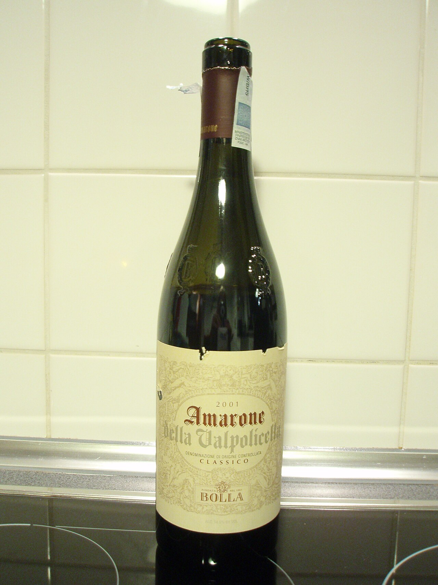

# 阿玛罗尼

阿玛罗尼是意大利威尼托瓦坡里切拉产区的红葡萄酒，以科维纳、科维诺内与罗迪内拉等品种风干后酿造，酒体饱满、酒精高、带果干与樱桃气息。常见 750 mL、酒精度约 15%–16% vol，产区规则要求先风干葡萄，再进行发酵与较长陈年。

图：阿玛罗尼。摄影：A bottle of Amarone della Valpolicella。署名：Jerzy Kociatkiewicz，CC BY-SA 2.0，来自 Wikimedia Commons（[来源](https://commons.wikimedia.org/w/index.php?curid=8844471)）。

## 定义与定位

先分层：[红葡萄酒](ref:red-wine)是大类，科维纳等是品种，瓦坡里切拉是产地，阿玛罗尼是法定产区（DOCG），具体酒庄与酒款是生产者层面。四层分开看，才不会把“阿玛罗尼”当成一个品牌或一种葡萄。

阿玛罗尼是地理名称与法定产区标识，不是商标。它属于风干型红酒，与同产区的瓦坡里切拉（Valpolicella）、瓦坡里切拉超级（Superiore）和甜型雷乔托（Recioto）是不同产品；只有按阿玛罗尼生产规范酿造并满足陈年要求的酒，才能使用这一名称。

## 生产者与品牌

瓦坡里切拉产区内有家族酒庄、合作社与酒商，规模从数公顷的小庄到较大的合作社都有。酒标上的装瓶者信息是判断身份的依据；同一酒庄往往同时生产瓦坡里切拉、里帕索（Ripasso）与阿玛罗尼，产品线需要分层看待。

酒庄、品牌与产品是三个层级：酒庄回答园地、设备与工艺，品牌回答定位与产品线，产品回答年份、容量与酒精度。产区历史与企业叙事不能替代瓶标上的法定产区、年份与陈年信息。

## 「阿玛罗尼」的产地与原料
产区位于[意大利](ref:italy)威尼托大区维罗纳省，包括瓦坡里切拉经典产区与扩展产区，丘陵与谷地交错，气候受加尔达湖与阿尔卑斯山影响，秋季相对干燥，有利于葡萄风干。

原料是[葡萄](ref:grape)，以科维纳（Corvina）与科维诺内（Corvinone）为主，罗迪内拉（Rondinella）等为辅。采收时需选择健康、成熟且果皮完整的果串，因为风干过程会浓缩糖分与风味，也会放大霉变与破损带来的缺陷。

## 「阿玛罗尼」怎么做出来
采收后的葡萄不立即压榨，而是放在通风良好的果棚中风干，通常持续约 100 至 120 天，果粒失水、糖分与风味浓缩。风干结束后进行去梗压榨，再由酵母进行缓慢的[发酵](ref:fermentation)，低温与高糖度会拉长发酵时间。

发酵完成后进入[橡木桶陈年](ref:oak-ageing)，再在瓶中继续陈化。生产规范对风干时间、最低酒精度与陈年时长都有要求，酒款须满足条件后才能上市；具体桶型、桶龄与陈年时长由酒庄决定。里帕索是把瓦坡里切拉酒液与阿玛罗尼酒渣接触再发酵的产品，属于另一类酒款。

## 「阿玛罗尼」的瓶型与标签
常见容量为 750 mL，[酒精度](ref:abv)约 15%–16% vol，具体数值随年份与酒庄而异。标签应核对法定产区名 Amarone della Valpolicella、DOCG 标识、年份、装瓶者、净含量与进口商信息，并注意与里帕索、雷乔托区分。

核对阿玛罗尼时，中文背标、进口商与防伪信息是身份依据；不同市场标签语言可能不同，以瓶身为准。见到“Amarone”字样时，还要确认它是否为完整的法定产区名称。

## 「阿玛罗尼」的闻与喝
典型香气是果干、黑樱桃、李子干、无花果、肉桂与可可，陈年后出现皮革、烟草与坚果。入口酒体饱满、酒精高、酸度中等偏高，单宁厚实，余味长；风干带来的甜美感与高酒精需要酸度支撑，否则会显得沉重。

品鉴时温度建议在 16–18 摄氏度，使用大肚酒杯，避免温度过高放大酒精感。年份较新的酒可适当醒酒，老年份则宜缩短醒酒时间；杯中香气会随温度与空气变化，适合慢慢饮用。

## 「阿玛罗尼」的饮用与搭配
适合搭配炖肉、烤肉、野味、硬质干酪与浓郁酱汁菜肴；高酒精与饱满酒体适合油脂与蛋白质丰富的食物，也能与陈年奶酪的咸鲜呼应。不宜搭配清蒸海鲜、清淡蔬菜或过甜的食物，容易显得酒精突出。

开瓶后应冷藏保存并尽量在数日内饮用完毕，接触空气过久会加速氧化。阿玛罗尼通常酒精度高、结构强，适合在年轻时少量饮用或中长期存放；具体适饮窗口因年份与酒庄而异。本页关于阿玛罗尼的内容涉及酒精饮料；过量饮酒有害健康，未成年人不应饮酒。

## 「阿玛罗尼」的购买与保存
购买时优先选择正规渠道，核对法定产区名、年份、装瓶者与进口商信息。价格随年份、产区与渠道波动，本页不给出具体数字；瓦坡里切拉、里帕索与阿玛罗尼属于不同产品，不能用一款概括整个产区。

未开瓶应避光、平放存放于阴凉处，理想温度为 12–15 摄氏度，避免高温与剧烈温差。软木塞封瓶需保持湿度，长期存放可平放；开瓶后冷藏并尽快饮用，高酒精酒款开瓶后香气变化较快。

## 「阿玛罗尼」容易被读错的地方
第一，把阿玛罗尼当成葡萄品种。它是法定产区名，品种以科维纳为主。
第二，把阿玛罗尼与里帕索混为一谈。里帕索是另一类酒款，工艺与定位不同。
第三，认为阿玛罗尼是甜酒。甜型对应的是雷乔托，阿玛罗尼通常为干型或近干型。
第四，把高酒精当成质量保证。平衡、酸度与香气集中度同样重要。
第五，用价格或包装判断真伪。渠道、标签与防伪信息更可靠。

对照阅读：[红葡萄酒](ref:red-wine)、[葡萄](ref:grape)。

**关键事实。**

| 项目 | 内容 |
| --- | --- |
| 一句话定位 | 意大利威尼托瓦坡里切拉产区的红葡萄酒，以科维纳、科维诺内与罗迪内拉等品种风干后酿造，酒体饱满、酒精高、带果干与樱桃气息；DOCG 规则要求风干与较长陈年，常见 750 mL、酒精度约 15%–16% vol |
| 酒种/风格 | 红葡萄酒 |
| 产区 | 意大利 |
| 酒精度 | 15–16% vol |

**来源与边界。** 本页关于「阿玛罗尼」的关键事实，主要由以下来源交叉核对：Consorzio Tutela Vini della Valpolicella（阿玛罗尼的产地范围、品种与风干工艺）、Ministero dell'Agricoltura, della Sovranità Alimentare e delle Foreste（阿玛罗尼法定产区的生产规范与标签要求）、Oxford University Press（提供关于阿玛罗尼、瓦坡里切拉与风干工艺的条目；由原条目末尾参考资料迁移，未逐条复核访问日期）等 6 条来源。价格、批次与状态会变，涉及这些字段时以页面所列来源的最新版本为准。正文为项目自写，来源只作核验，不复制原文。

## 参考资料
- [红葡萄酒](ref:red-wine)：阿玛罗尼的分类、单宁与基本工艺。
- [意大利](ref:italy)：威尼托在意大利葡萄酒版图中的位置。
- [葡萄](ref:grape)：阿玛罗尼所用葡萄的成熟度、酸度与单宁判断。
- [发酵](ref:fermentation)：高糖度酒液的缓慢发酵。
- [橡木桶陈年](ref:oak-ageing)：桶型与桶龄对风干型红酒的影响。
- [酒精度](ref:abv)：15%–16% vol 在标签上的含义。
