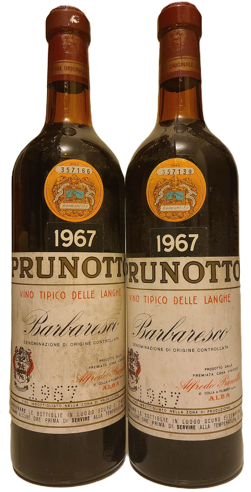

# 巴巴莱斯科

巴巴莱斯科是意大利皮埃蒙特巴巴莱斯科法定产区的红葡萄酒，只用内比奥罗酿造。它与巴罗洛同属内比奥罗体系，但产区范围更小、气候略暖、风格更柔和，通常更早进入适饮期。常见 750 mL、酒精度约 13.5%–14.5% vol；法定产区规则要求总陈年不少于 26 个月，其中木桶陈年不少于 9 个月。

图：巴巴莱斯科。图片：Geographer，CC BY-SA 4.0，via Wikimedia Commons（[原图页面](https://commons.wikimedia.org/wiki/File:Prunotto_Barbaresco_1967.jpg)）。

## 定义与定位

先分层：[红葡萄酒](ref:red-wine)是大类，内比奥罗是品种，皮埃蒙特是产区，巴巴莱斯科是法定产区（DOCG），酒庄与具体酒款是生产者层面。巴巴莱斯科不是品牌，也不是葡萄名。

与[巴罗洛](ref:barolo)相比，巴巴莱斯科的法定范围小得多，只覆盖库内奥省的三座村镇及阿尔巴市的一小部分。两者都用 100% 内比奥罗，规则与风格取向不同；巴罗洛的知名度与价格长期更高，但不能因此把巴巴莱斯科当成“次一级的巴罗洛”。

## 生产者与品牌

产区内的生产主体以家族酒庄为主，也有合作社与酒商。历史上有一些酒庄同时拥有巴罗洛与巴巴莱斯科的园地，产品线并行；酒标上的装瓶者、园地名与村镇名是判断身份的依据。

法定范围包括巴巴莱斯科、内伊韦与特雷伊索三座村镇，以及阿尔巴市的圣罗科-塞诺-德尔维奥（San Rocco Seno d'Elvio）一带。酒标常以小字标注村镇或园地名，同一村镇内不同坡地的风格也有差异。

## 「巴巴莱斯科」的产地与原料
产区位于[意大利](ref:italy)西北部皮埃蒙特大区，塔纳罗河右岸的丘陵地带，海拔整体低于巴罗洛，坡向与坡度的组合让成熟期略早。气候为大陆性，秋季常起雾，昼夜温差有利于香气与酸度的形成。

土壤以泥灰岩为主，夹有砂质与黏土，保水性与养分状况比巴罗洛部分地块更均衡，因此酒体通常更柔顺、单宁不那么紧。原料是[葡萄](ref:grape)，品种为[内比奥罗](ref:nebbiolo)，晚熟、皮厚、色素浅而单宁与酸度高。

## 「巴巴莱斯科」怎么做出来
采收多在十月上旬至中旬，去梗压榨后浸皮数周，萃取颜色、单宁与香气；发酵完成后进行苹果酸乳酸发酵以柔化酸度。内比奥罗色素少，萃取过重容易带来苦涩，分寸比单纯延长浸皮更重要。

之后进入[橡木桶陈年](ref:oak-ageing)。大桶强调缓慢氧化与整合，小桶带来更多甜香料气息，两种路径在产区内都有使用。产区规范要求总陈年不少于 26 个月，其中木桶不少于 9 个月；标注 Riserva 的酒款总陈年不少于 50 个月。

## 「巴巴莱斯科」的瓶型与标签
常见容量为 750 mL，[酒精度](ref:abv)约 13.5%–14.5% vol，具体数值随年份与酒庄而异。标签应核对产区名 Barbaresco、DOCG 标识、年份、Riserva 字样、村镇或园地名、装瓶者、净含量与进口商信息。

中文背标与进口商信息是核对身份的入口；巴巴莱斯科在不同市场的标签语言不同，以瓶身实际标注为准。以“巴巴莱斯科风格”描述的非产区酒，不属于法定产区产品。

## 「巴巴莱斯科」的闻与喝
典型香气是玫瑰、紫罗兰、红樱桃、覆盆子、甘草与香料，陈年后发展出干花、皮革与泥土气息。入口酸度高、单宁明显但比巴罗洛更细腻，酒体中等到饱满，余味长。

品鉴温度建议在 16–18 摄氏度，使用大肚郁金香形酒杯；年份较新的酒可醒酒一至两小时，老年份则宜缩短时间。观察颜色从石榴红向砖红变化，颜色浅不代表结构弱。

## 「巴巴莱斯科」的饮用与搭配
适合搭配炖肉、禽类、蘑菇菜、中等强度的干酪与面食；高酸度能切开油脂，单宁与肉类蛋白质结合后显得柔和。不宜搭配清蒸海鲜、重辣菜肴或过甜的点心。

开瓶后应冷藏保存并尽量在数日内饮用完毕，接触空气过久会加速氧化。与巴罗洛相比，多数巴巴莱斯科进入适饮期更早，但具体窗口仍取决于年份、村镇与酒庄工艺。本页关于巴巴莱斯科的内容涉及酒精饮料；过量饮酒有害健康，未成年人不应饮酒。

## 「巴巴莱斯科」的购买与保存
购买时优先选择正规渠道，核对年份、DOCG 标识、村镇或园地名、装瓶者与进口商信息。价格随年份、园地与渠道波动，本页不给出具体数字；同一产区内的名园与普通地块属于不同层级。

未开瓶应避光、平放存放于阴凉处，理想温度为 12–15 摄氏度，避免高温与剧烈温差。软木塞封瓶需保持湿度；开瓶后冷藏并尽快饮用。

## 「巴巴莱斯科」容易被读错的地方
第一，把巴巴莱斯科当成巴罗洛的廉价替代。两者的法定范围、陈年规则与风格取向都不同。
第二，把产区名当成品种名。品种是内比奥罗。
第三，认为颜色浅等于酒体单薄。内比奥罗天然色素较少，单宁与酸度可以很强。
第四，认为巴巴莱斯科必须长期陈年才适饮。多数酒款比巴罗洛更早进入适饮期。
第五，只看酒庄名气，不看村镇、园地与年份。

对照阅读：[红葡萄酒](ref:red-wine)、[意大利](ref:italy)。

**关键事实。**

| 项目 | 内容 |
| --- | --- |
| 一句话定位 | 意大利皮埃蒙特巴巴莱斯科法定产区的红葡萄酒，只用内比奥罗酿造，风格比巴罗洛更柔和、更早适饮，以玫瑰、红樱桃与香料香气著称；DOCG 规则要求总陈年不少于 26 个月，其中木桶不少于 9 个月 |
| 酒种/风格 | 红葡萄酒 |
| 产区 | 意大利 |
| 酒精度 | 13.5–14.5% vol |

**来源与边界。** 本页关于「巴巴莱斯科」的关键事实，主要由以下来源交叉核对：Consorzio di Tutela Barolo Barbaresco Alba Langhe e Dogliani（巴巴莱斯科 DOCG 的产地范围、品种与陈年规则）、Ministero dell'Agricoltura, della Sovranità Alimentare e delle Foreste（巴巴莱斯科法定产区的生产规范与标签要求）、Oxford University Press（提供关于巴巴莱斯科与内比奥罗的条目；由原条目末尾参考资料迁移，未逐条复核访问日期）等 6 条来源。价格、批次与状态会变，涉及这些字段时以页面所列来源的最新版本为准。正文为项目自写，来源只作核验，不复制原文。

## 参考资料
- [红葡萄酒](ref:red-wine)：巴巴莱斯科的分类、单宁与基本工艺。
- [巴罗洛](ref:barolo)：同一品种的另一处法定产区，对比陈年规则与风格。
- [意大利](ref:italy)：巴巴莱斯科所在的产区版图与法定体系。
- [内比奥罗](ref:nebbiolo)：核心品种的植物学特征与香气。
- [葡萄](ref:grape)：巴巴莱斯科所用葡萄的成熟度、酸度与单宁判断。
- [发酵](ref:fermentation)：巴巴莱斯科的浸皮、温控与苹果酸乳酸发酵。
- [橡木桶陈年](ref:oak-ageing)：大桶与小桶对风格的影响。
- [酒精度](ref:abv)：13.5%–14.5% vol 在标签上的含义。
