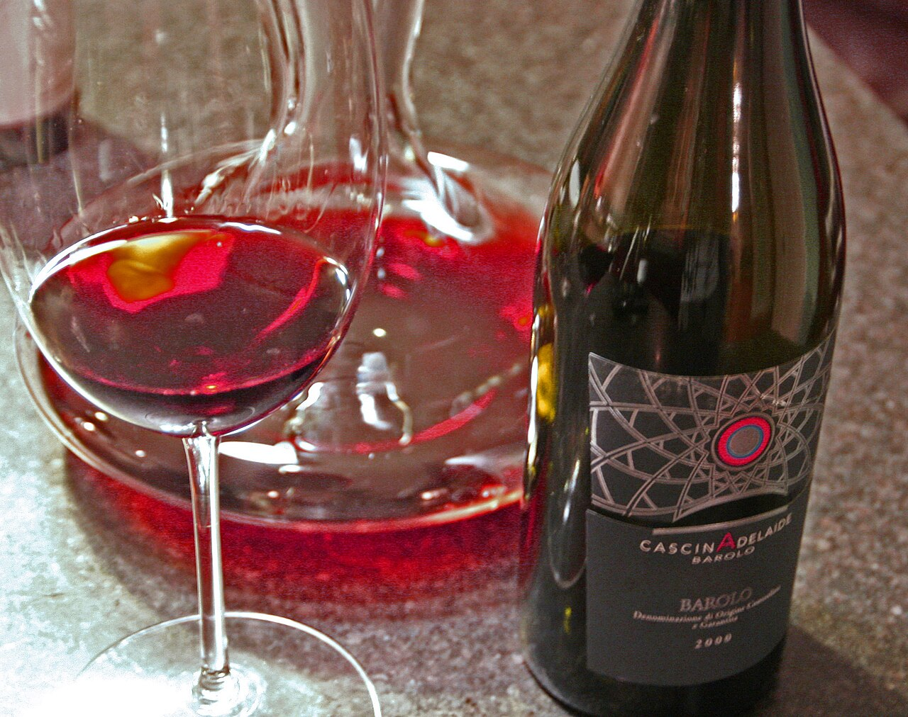

# 巴罗洛

巴罗洛是意大利皮埃蒙特朗格丘陵的法定产区红葡萄酒，只用内比奥罗酿造，以高酸度、强单宁与玫瑰、焦油香气著称。常见 750 mL、酒精度约 14%–15% vol；法定产区规则要求总陈年不少于 38 个月，其中木桶陈年不少于 18 个月。

图：巴罗洛。图片：Biskuit，CC BY-SA 2.0，via Wikimedia Commons（[原图页面](https://commons.wikimedia.org/wiki/File:Cascin_Adelaide_Barolo_%26_decanter.jpg)）。

## 定义与定位

先分层：[红葡萄酒](ref:red-wine)是大类，内比奥罗是品种，皮埃蒙特朗格是产区，巴罗洛是法定产区（DOCG），具体酒庄与酒款是生产者层面。四层分开看，才不会把“巴罗洛”当成一个品牌或一种葡萄。

巴罗洛是地理名称与法定产区标识，不是商标。只有在划定范围内、按生产规范种植与酿造、并以 100% 内比奥罗酿成的红酒，才能标注 Barolo；市面上以“巴罗洛风格”描述的其他产品，不等于法定产区酒。

## 生产者与品牌

巴罗洛产区内有大量家族酒庄、合作社与酒商，规模从几公顷的小庄到较大的酒商都有。酒标上的装瓶者信息是判断身份的依据：自有园地的酒庄与收购葡萄或酒液的酒商，角色不同。

产区覆盖十一座产酒村镇，包括 Barolo、La Morra、Castiglione Falletto、Serralunga d'Alba、Monforte d'Alba、Novello、Verduno、Grinzane Cavour、Diano d'Alba、Cherasco 与 Roddi。村镇与具体园地常以小字标注在酒标上。

## 「巴罗洛」的产地与原料
产区位于[意大利](ref:italy)西北部皮埃蒙特大区的朗格丘陵，北面有阿尔卑斯山屏障，秋季常起雾，“内比奥罗”之名被认为与意大利语 Nebbia（雾）相关。丘陵坡向与海拔带来昼夜温差，有利于香气与酸度的形成。

土壤差异明显：La Morra 与 Barolo 一带偏石灰岩与泥灰土，酒通常更香、质地更柔；Serralunga d'Alba 与 Monforte d'Alba 偏砂质与紧实土壤，结构更强、更需要陈年。原料是[葡萄](ref:grape)，品种为[内比奥罗](ref:nebbiolo)，晚熟、皮厚、单宁与酸度都高。

## 「巴罗洛」怎么做出来
采收通常在十月，去梗后压榨，浸皮时间较长，常达数周，以便从皮中提取颜色、单宁与香气；发酵温度较高，随后进行苹果酸乳酸发酵以柔化酸度。内比奥罗颜色偏浅、单宁强，萃取分寸是工艺难点。

发酵完成后进入[橡木桶陈年](ref:oak-ageing)。传统做法使用大型斯拉沃尼亚橡木桶，强调缓慢氧化与整合；现代做法使用小型法国橡木桶，带来更多甜香料与可可气息。生产规范要求总陈年不少于 38 个月，其中木桶陈年不少于 18 个月；标注 Riserva 的酒款总陈年不少于 62 个月。

巴罗洛法定陈年至少 38 个月，Riserva 为 62 个月，内比奥罗是唯一允许的红葡萄品种；陈年时间从采收后的次年 1 月 1 日起算。

## 「巴罗洛」的瓶型与标签
常见容量为 750 mL，[酒精度](ref:abv)约 14%–15% vol，具体数值随年份与酒庄而异。标签应核对产区名 Barolo、DOCG 标识、年份、Riserva 字样、村镇或园地名、装瓶者、净含量与进口商信息。

村镇名与园地名属于地理标注，需要符合产区规范中的边界与使用规则。核对巴罗洛时，中文背标、进口商与防伪信息是身份依据；不同市场标签语言可能不同，以瓶身为准。

## 「巴罗洛」的闻与喝
典型香气是玫瑰、紫罗兰、红樱桃、李子、焦油、甘草与松露；入口酸度高、单宁强、酒体饱满，余味长。年轻时常显得紧致封闭，随时间展开出干花、皮革与泥土气息。

品鉴时温度建议在 16–18 摄氏度，使用大肚郁金香形酒杯，让香气有空间展开。年份较新的酒可提前醒酒一至数小时，老年份则宜缩短醒酒时间，避免香气过快散失。倒杯后观察颜色从石榴红向砖红变化。

## 「巴罗洛」的饮用与搭配
适合搭配炖牛肉、野味、松露菜、硬质干酪与油脂丰富的肉类；高酸度与强单宁能切开脂肪与蛋白质，也能与 earthy 风味呼应。不宜搭配清蒸海鲜、清淡蔬菜或重辣菜肴，容易显得苦涩或压制食材本味。

开瓶后应冷藏保存并尽量在数日内饮用完毕，接触空气过久会加速氧化。多数巴罗洛需要瓶中陈年才进入适饮期，具体窗口因年份、村镇与酒庄工艺而异。本页关于巴罗洛的内容涉及酒精饮料；过量饮酒有害健康，未成年人不应饮酒。

## 「巴罗洛」的购买与保存
购买时优先选择正规渠道，核对年份、DOCG 标识、村镇或园地名、装瓶者与进口商信息。价格随年份、园地与渠道波动，本页不给出具体数字；普通年份与名园年份属于不同层级，不能用一款概括整个产区。

未开瓶应避光、平放存放于阴凉处，理想温度为 12–15 摄氏度，避免高温与剧烈温差。软木塞封瓶需保持湿度，长期存放可平放；开瓶后冷藏并尽快饮用，不宜反复取出回温。

## 「巴罗洛」容易被读错的地方
第一，把巴罗洛当成品种名。它是产区名，品种是内比奥罗。
第二，认为巴罗洛一定要陈年几十年才能喝。年份、村镇与酿造风格差异很大。
第三，把颜色浅当成酒体单薄。内比奥罗天然色素较少，但单宁与结构可以很强。
第四，把整个产区当成一种风格。La Morra 与 Serralunga d'Alba 的差异相当明显。
第五，用价格或包装判断真伪。渠道、标签与防伪信息更可靠。

对照阅读：[红葡萄酒](ref:red-wine)、[内比奥罗](ref:nebbiolo)。

**关键事实。**

| 项目 | 内容 |
| --- | --- |
| 一句话定位 | 意大利皮埃蒙特朗格丘陵的巴罗洛法定产区红葡萄酒，只用内比奥罗酿造，以高酸度、强单宁与玫瑰、焦油香气著称；DOCG 规则要求总陈年不少于 38 个月，其中木桶不少于 18 个月 |
| 酒种/风格 | 红葡萄酒 |
| 产区 | 意大利 |
| 酒精度 | 14–15% vol |

**来源与边界。** 本页关于「巴罗洛」的关键事实，主要由以下来源交叉核对：Consorzio di Tutela Barolo Barbaresco Alba Langhe e Dogliani（巴罗洛 DOCG 的产地范围、品种与陈年规则）、Ministero dell'Agricoltura, della Sovranità Alimentare e delle Foreste（巴罗洛法定产区的生产规范与标签要求）、Oxford University Press（提供关于巴罗洛、内比奥罗与朗格丘陵的条目；由原条目末尾参考资料迁移，未逐条复核访问日期）等 6 条来源。价格、批次与状态会变，涉及这些字段时以页面所列来源的最新版本为准。正文为项目自写，来源只作核验，不复制原文。

## 参考资料
- [红葡萄酒](ref:red-wine)：巴罗洛的分类、单宁与基本工艺。
- [意大利](ref:italy)：巴罗洛所在的产区版图与法定体系。
- [内比奥罗](ref:nebbiolo)：巴罗洛核心品种的植物学特征与香气。
- [葡萄](ref:grape)：巴罗洛所用葡萄的成熟度、酸度与单宁判断。
- [发酵](ref:fermentation)：巴罗洛的浸皮、温控与苹果酸乳酸发酵。
- [橡木桶陈年](ref:oak-ageing)：大桶与小桶对风格的影响。
- [酒精度](ref:abv)：14%–15% vol 在标签上的含义。
