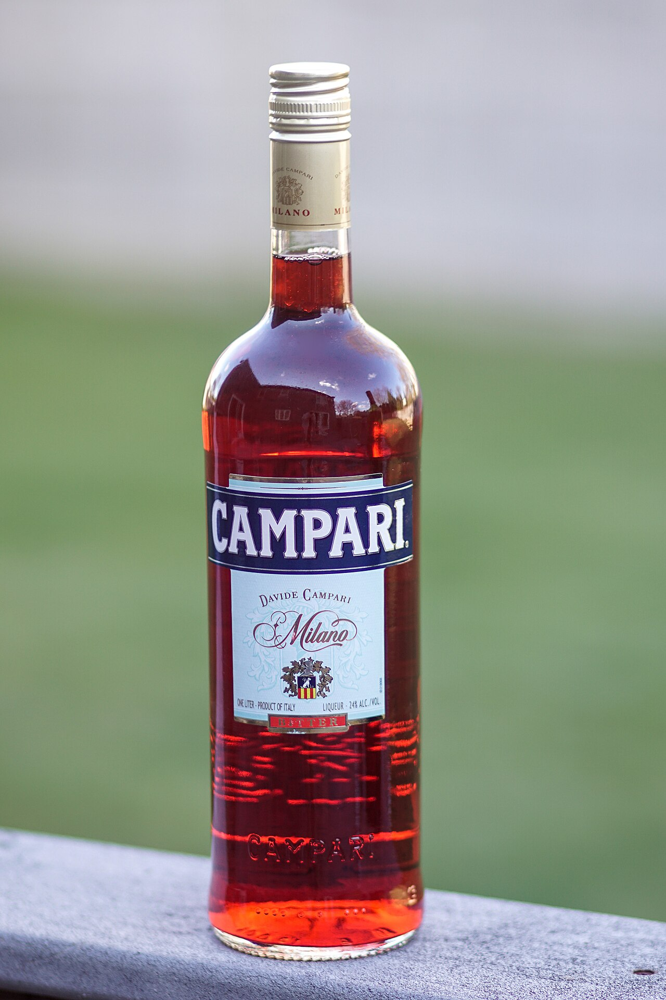

# 金巴利

金巴利（Campari）是意大利苦味开胃酒，1860 年由 Gaspare Campari 在米兰创立。它以草本、根茎与柑橘皮浸提，酒精度通常为 20.5%–25% vol，苦味与甜味并重。它属于[开胃酒](ref:aperitif)与[利口酒](ref:liqueur)两个类别，也是[内格罗尼](ref:negroni)的核心材料。

图：金巴利。图片：Kenneth C. Zirkel，CC BY-SA 4.0，via Wikimedia Commons（[原图页面](https://commons.wikimedia.org/wiki/File:Bottle_of_Campari_(United_States).jpg)）。

## 定义与身份

金巴利是“苦味酒”（bitter）的一种：以酒精为基酒，把苦味植物与柑橘皮通过浸渍或蒸馏取得风味，再加入糖浆与水调和。它不是金酒，也不是葡萄酒；苦味是设计目标，不是质量缺陷。作为开胃酒，它通常在餐前饮用，目的是用苦味与气泡刺激食欲，而不是佐餐。

“金巴利”既是品牌名，也是一个风格代称。其他酒厂也生产苦味酒，但只有 Campari 品牌的产品能以这个商标销售。不同国家、不同版本的酒精度与配方会有差异，购买时应以瓶身标签与官方信息为准，不能把某一市场的规格当成全球统一标准。

## 「金巴利」的时间线
1860 年，Gaspare Campari 在米兰开设酒吧并推出自己的苦味酒。关于配方的细节从未完整公开，品牌公开资料只说明它由草本、芳香植物、根茎与柑橘皮等成分构成。19 世纪末至 20 世纪，Campari 家族把产品从米兰推向意大利其他地区与海外市场，逐渐建立起今天的国际品牌。

20 世纪后期，金巴利通过广告、艺术赞助与调酒文化扩大影响，红色酒液与简洁酒标成为识别符号。品牌所有权与生产组织经历多次变化，但“苦味、红色、米兰起源”这三项叙事一直保留。需要区分品牌历史叙事与可核查的产品规格：年份与人物属于历史，酒精度、容量与配料属于标签信息。

## 「金巴利」的产地与原料
金巴利的生产与品牌总部位于意大利，米兰是它的历史起点；原料包括草本、根、树皮、柑橘皮、水、糖与酒精。具体植物清单与比例属于商业机密，外界无法逐项复核。公开信息能够确认的是“多种植物成分 + 柑橘”这一结构，而不是“某一种神秘草药决定全部风味”。

苦味来自生物碱、萜类、多酚与苦味肽等多种物质；糖分则负责平衡与圆润。高糖与苦味并存，是苦味开胃酒的典型结构：入口先甜，随后苦味上升，最后留下柑橘与草本的余味。酒精度较低时，苦味更容易被感知；酒精度较高时，香气更强但刺激感也更明显。

## 配方与工艺

公开工艺框架是：把植物原料在酒精或水酒精混合液中浸渍，使香气与苦味物质溶出；必要时进行[蒸馏](ref:distillation)或过滤，得到澄清的浸提液；再与糖浆、水、色素混合，调整到目标酒精度与甜度。红色是产品识别的一部分，但颜色本身不携带风味信息，不能通过颜色判断苦味强度。

工业化生产会通过批次控制保证颜色、甜度与苦味的稳定性。不同市场的配方可能因法规、税率与消费者偏好而调整，因此“意大利版”和“出口版”在酒精度或甜度上可能不同。比较产品时，应先确认版本与规格，再讨论风味。

## 「金巴利」的闻与喝
金巴利的典型香气是橙皮、苦橙、草本、根茎与淡淡的花香，入口甜，随后苦味在中段上升，收尾干净，带柑橘皮与香料。它的苦不是“药味”，而是一种结构性的苦，负责把甜味与香气拉回平衡。温度过低会让香气闭塞，温度过高则酒精刺激增强。

品鉴时可以先用小杯纯饮，少量即可；再滴入几滴水，观察香气是否打开；最后加苏打水，比较气泡对苦味与甜味的影响。不要用大口吞咽的方式评价苦味酒，因为苦味在口腔后段才完整展开，快速吞咽会错过层次。

## 「金巴利」的饮用与搭配
最常见的开胃酒喝法是金巴利加苏打水与冰块，或做成金巴利苏打；也可以加少量橙片增加香气。调酒方面，内格罗尼按国际调酒师协会的官方配方使用等量的金巴利、金酒与甜味美思，最后以橙皮装饰；美国佬（Americano）则用金巴利、甜味美思与苏打水。金巴利也可以用于highball 或与葡萄柚搭配，但酸甜平衡会明显改变。

餐前饮用时，适合搭配橄榄、坚果、咸味小食与硬质奶酪；不建议与重甜点心同饮，因为甜度叠加会让苦味显得突兀。作为餐后酒，它的苦味可以解腻，但高糖版本不适合大量饮用。

## 「金巴利」容易被读错的地方
第一，把金巴利当成金酒。它不含杜松子主导的香气结构，属于苦味利口酒。
第二，认为“越苦越正宗”。苦味是配方与甜度平衡的结果，不同版本会有差异。
第三，把红色当成风味线索。颜色主要来自配方与色素管理，不说明苦味或甜度。
第四，把某一国家的酒精度当成全球标准。20.5%–25% vol 是常见区间，具体以标签为准。
第五，把内格罗尼的等量配方当成唯一版本。IBA 给出官方比例，但酒吧常有调整。

对照阅读：[开胃酒](ref:aperitif)、[内格罗尼](ref:negroni)。

**关键事实。**

| 项目 | 内容 |
| --- | --- |
| 一句话定位 | 意大利苦味开胃酒，1860 年由 Gaspare Campari 在米兰创立；酒精度通常 20.5%–25% vol，苦甜平衡，是内格罗尼的核心材料 |
| 酒种/风格 | 开胃酒、利口酒 |
| 酒精度 | 20.5–25% vol |

**来源与边界。** 本页关于「金巴利」的关键事实，主要由以下来源交叉核对：Campari（品牌历史、产品与酒精度信息）、IBA（金巴利在内格罗尼中的角色与官方配方比例）、Oxford University Press（提供关于苦味利口酒、开胃酒与金巴利的条目）等 4 条来源。价格、批次与状态会变，涉及这些字段时以页面所列来源的最新版本为准。正文为项目自写，来源只作核验，不复制原文。

**并读。** 把「金巴利」与「开胃酒」、「利口酒」、「内格罗尼」放在一起读时，先确认它们是同一层级还是上下游关系：先确认酒种与产区，再比较年份、酒精度、价格与饮用场景。本页负责给出酒款的基本坐标，对照条目补上具体案例与差异；读完再回到本页，才能分清哪些差别属于酒款本身，哪些只是产地、批次或品牌选择。

**适用边界。** 对「金巴利」而言，年份、批次、酒精度与包装会变；酒种定义与产区法规较稳定。购买时先看背标，再看品牌页面。

## 参考资料
- [开胃酒](ref:aperitif)：餐前饮用与苦味刺激的品类框架。
- [利口酒](ref:liqueur)：金巴利所属的配制酒大类。
- [内格罗尼](ref:negroni)：金巴利最知名的调酒应用之一。
