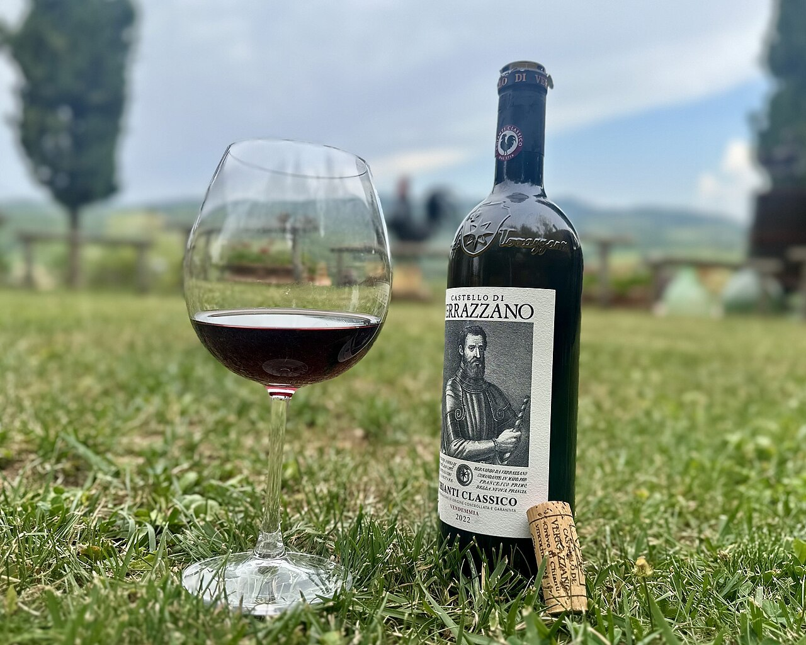

# 基安蒂经典

基安蒂经典是意大利托斯卡纳基安蒂山区的法定产区红葡萄酒，以桑娇维塞为主体，酸度高、单宁清晰，以酸樱桃、紫罗兰与皮革香气著称。常见 750 mL、酒精度约 13%–14.5% vol；产区要求至少 80% 桑娇维塞，普通款陈年不少于 12 个月，Riserva 不少于 24 个月。

图：基安蒂经典。摄影：Chianti Classico example bottle - Annata type。署名：FranzKafka2000，CC BY-SA 4.0，来自 Wikimedia Commons（[来源](https://commons.wikimedia.org/w/index.php?curid=168690826)）。

## 定义与定位

先分层：[红葡萄酒](ref:red-wine)是大类，桑娇维塞是品种，托斯卡纳是产区，基安蒂经典是法定产区（DOCG），酒庄与具体酒款是生产者层面。基安蒂经典不是品牌，也不是“基安蒂”大产区的同义词。

“经典”（Classico）指佛罗伦萨与锡耶纳之间最古老的核心区域。它曾与范围更大的基安蒂产区同属一个体系，1984 年前后逐步分立并各自取得独立规则；今天两者的产区边界、标志与陈年要求都不同，不能互相替代。

## 生产者与品牌

产区内的生产主体包括家族酒庄、合作社与酒商，规模差异很大。1924 年，一批酒庄联合成立了保护历史标志的联合体，以黑公鸡（Gallo Nero）作为产区标志；该标志属于联合体，不是任意酒庄都可使用的通用图案。

法定核心区覆盖格雷韦、卡斯特利纳、拉达与加约莱四座村镇，以及周边少数市镇的部分地带。酒标常见村镇名、园地名与“黑公鸡”标志，装瓶者与进口商信息是核对身份的入口。

## 「基安蒂经典」的产地与原料
产区位于[意大利](ref:italy)中部托斯卡纳的基安蒂山区，介于佛罗伦萨与锡耶纳之间，丘陵起伏、海拔多在 200–600 米。气候为地中海型，夏季温暖干燥，昼夜温差与坡向决定成熟节奏，秋季降雨会影响采收安排。

土壤以 galestro 片岩与 alberese 石灰岩为主，排水良好、养分偏少，有利于控制产量与形成酸度。原料是[葡萄](ref:grape)，主体品种为[桑娇维塞](ref:sangiovese)；规范允许最多 20% 的其他允许红葡萄品种，也可全部使用桑娇维塞酿造。

## 「基安蒂经典」怎么做出来
采收通常在九月下旬至十月，去梗后浸皮，时间从十余天到数周不等，以萃取颜色、单宁与香气。桑娇维塞酸度高、色素不算浓，萃取与温度控制决定酒体走向；发酵后进行苹果酸乳酸发酵以柔化酸度。

之后进入[橡木桶陈年](ref:oak-ageing)。传统使用大桶，强调缓慢氧化与清爽结构；现代做法使用小桶，增加甜香料与香草气息。普通款陈年不少于 12 个月；Riserva 不少于 24 个月，其中瓶陈不少于 3 个月；Gran Selezione 要求不少于 30 个月，并对原料来源有额外规定。

## 「基安蒂经典」的瓶型与标签
常见容量为 750 mL，[酒精度](ref:abv)约 13%–14.5% vol，随年份、村镇与酒庄而异。标签应核对产区名 Chianti Classico、DOCG 标识、年份、Riserva 或 Gran Selezione 字样、黑公鸡标志、装瓶者、净含量与进口商信息。

黑公鸡标志属于产区联合体的历史标志，用于识别产区成员的产品；没有标志不等于酒一定有问题，有标志也不等于自动符合某一等级。等级与年份仍需以标签和产区规范核对。

## 「基安蒂经典」的闻与喝
典型香气是酸樱桃、红李、紫罗兰、番茄叶、干草与皮革，陈年后发展出烟草、香料与泥土气息。入口酸度高、单宁清晰，酒体中等，余味偏干；与[布鲁奈罗](ref:brunello)相比，基安蒂经典通常更轻盈、更早适饮。

品鉴温度建议在 16–18 摄氏度，用中等大小的酒杯即可；年轻酒款可短时间醒酒，Riserva 与 Gran Selezione 可适当延长。酸度高是品种特征，不是缺陷；搭配食物后酸度会显得更平衡。

## 「基安蒂经典」的饮用与搭配
适合搭配番茄基底的意面、烤肉、禽类、蘑菇与中等强度的干酪；高酸度与番茄、橄榄油的组合尤其合拍。不宜搭配过甜的点心、清蒸海鲜或重辣菜肴，容易显得酸涩。

开瓶后冷藏保存并尽量在数日内饮用完毕。普通款适合日常饮用，Riserva 与 Gran Selezione 可短期存放后再喝，但并非所有酒款都需要长期陈年。本页关于基安蒂经典的内容涉及酒精饮料；过量饮酒有害健康，未成年人不应饮酒。

## 「基安蒂经典」的购买与保存
购买时优先选择正规渠道，核对年份、DOCG 标识、等级字样、黑公鸡标志、装瓶者与进口商信息。价格随年份、村镇、等级与渠道波动，本页不给出具体数字；普通款与 Gran Selezione 属于不同层级。

就「基安蒂经典」而言，未开瓶应避光平放，存放于 12–15 摄氏度的阴凉处，避免高温与剧烈温差。软木塞封瓶需保持湿度；开瓶后冷藏并尽快饮用，不宜反复取出回温。

## 「基安蒂经典」容易被读错的地方
第一，把基安蒂经典与整个基安蒂产区混为一谈。两者的边界与规则不同。
第二，把黑公鸡标志当成等级证明。它标识产区成员身份，不替代年份与等级信息。
第三，认为桑娇维塞必须混酿。规范允许全部使用桑娇维塞。
第四，把高酸度当成酒质缺陷。这是品种与产区风格的一部分。
第五，认为 Riserva 一定更好。它代表更长的陈年要求，不等于个人口味偏好。

**关键事实。**

| 项目 | 内容 |
| --- | --- |
| 一句话定位 | 意大利托斯卡纳基安蒂山区的基安蒂经典法定产区红葡萄酒，以桑娇维塞为主体，酸度高、单宁清晰，以酸樱桃、紫罗兰与皮革香气著称；产区要求至少 80% 桑娇维塞，普通款陈年不少于 12 个月，Riserva 不少于 24 个月 |
| 酒种/风格 | 红葡萄酒 |
| 产区 | 意大利 |
| 酒精度 | 13–14.5% vol |

**来源与边界。** 本页关于「基安蒂经典」的关键事实，主要由以下来源交叉核对：Consorzio del Marchio Storico Chianti Classico（基安蒂经典的产区范围、黑公鸡标志与分级规则）、Ministero dell'Agricoltura, della Sovranità Alimentare e delle Foreste（桑娇维塞比例、陈年要求与标签规定）、Oxford University Press（提供关于基安蒂经典与桑娇维塞的条目；由原条目末尾参考资料迁移，未逐条复核访问日期）等 6 条来源。价格、批次与状态会变，涉及这些字段时以页面所列来源的最新版本为准。正文为项目自写，来源只作核验，不复制原文。

## 参考资料
- [红葡萄酒](ref:red-wine)：基安蒂经典的分类、单宁与基本工艺。
- [意大利](ref:italy)：基安蒂经典所在的产区版图与法定体系。
- [桑娇维塞](ref:sangiovese)：托斯卡纳核心品种的植物学特征与香气。
- [布鲁奈罗](ref:brunello)：同为桑娇维塞体系的另一处法定产区。
- [葡萄](ref:grape)：基安蒂经典所用葡萄的成熟度、酸度与单宁判断。
- [发酵](ref:fermentation)：基安蒂经典的浸皮、温控与苹果酸乳酸发酵。
- [橡木桶陈年](ref:oak-ageing)：大桶与小桶对风格的影响。
- [酒精度](ref:abv)：13%–14.5% vol 在标签上的含义。
