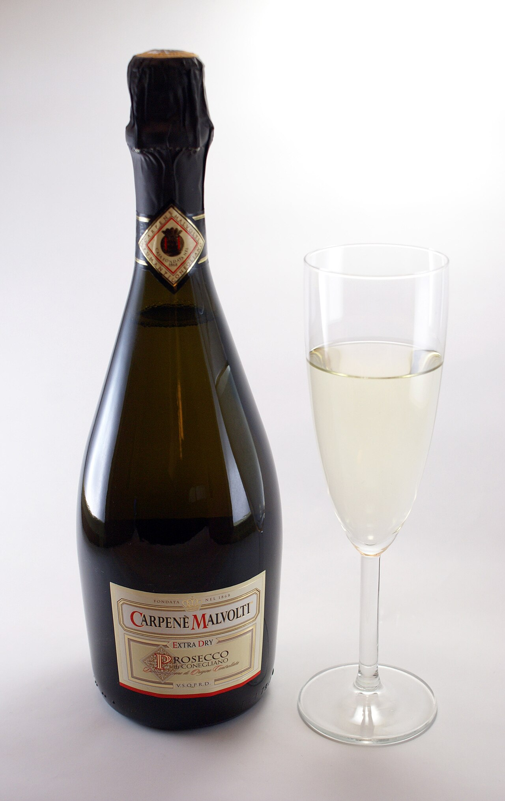

# 普罗塞克

普罗塞克是意大利威尼托与弗留利的起泡酒，以格莱拉葡萄酿造，多用罐式二次发酵，以青苹果、梨与白花香气和轻盈酒体著称。常见 750 mL、酒精度约 11%–12% vol；产区分为范围较大的 Prosecco DOC，以及科内利亚诺-瓦尔多比亚德内与阿索洛两处 DOCG。

图：普罗塞克。图片：Sandstein，CC BY 3.0，via Wikimedia Commons（[原图页面](https://commons.wikimedia.org/wiki/File:Prosecco_di_Conegliano_bottle_and_glass.jpg)）。

## 定义与定位

先分层：[起泡酒](ref:sparkling)是大类，格莱拉是品种，威尼托与弗留利是产区，普罗塞克是法定产区名称，具体酒庄与酒款是生产者层面。四层分开看，才不会把“普罗塞克”当成一个品牌或一种葡萄。

普罗塞克是地理名称与法定产区标识，不是商标。只有按产区规则种植格莱拉、在划定范围内酿造并满足气泡与酒精度要求的酒，才能标注 Prosecco；市面上以“普罗塞克风格”描述的其他起泡酒，不等于法定产区酒。

## 生产者与品牌

普罗塞克产区内有大量酒庄、合作社与酒商，规模从家族小庄到大型合作社都有。酒标上的装瓶者信息是判断身份的依据；合作社与小农酒庄的产品线、价格与风格差异很大，不能只凭“Prosecco”字样推断生产规模。

酒庄、品牌与产品是三个层级：酒庄回答园地、设备与工艺，品牌回答定位与产品线，产品回答等级、甜度与容量。产区内的 DOC 与 DOCG 属于不同层级，酒标上的完整名称需要逐字核对。

## 「普罗塞克」的产地与原料
产区位于[意大利](ref:italy)东北部的威尼托与弗留利-威尼斯朱利亚大区，核心地带在科内利亚诺与瓦尔多比亚德内之间的丘陵，以及阿索洛一带；Prosecco DOC 的范围更大，覆盖两个大区的多个省份。

原料是[葡萄](ref:grape)，品种为格莱拉（Glera），产区规则要求以格莱拉为主体。丘陵地带的坡向、海拔与昼夜温差影响酸度与香气；土壤与微气候带来差异，但同一产区内不同地块的表现仍需具体看待。

## 「普罗塞克」怎么做出来
采收后的葡萄压榨取汁，先进行第一次[发酵](ref:fermentation)得到基酒；随后在密闭罐中进行第二次发酵，产生气泡并保留果香，这一方式常被称为罐式法或马丁诺蒂法。罐式法发酵温度较低、时间较短，适合保留青苹果与白花的清新香气。

部分生产者使用传统瓶内二次发酵，风格更复杂、成本更高，但普罗塞克的主流是罐式法。发酵结束后按甜度添加调味液，形成从 Brut 到 Dry 等不同甜度；甜度标识与酒精度是阅读酒标的关键。

## 「普罗塞克」的瓶型与标签
常见容量为 750 mL，[酒精度](ref:abv)约 11%–12% vol，具体数值随等级与甜度而异。标签应核对法定产区完整名称（Prosecco DOC 或 Conegliano Valdobbiadene Prosecco Superiore DOCG 等）、甜度标识（Brut、Extra Dry、Dry）、年份或非年份、装瓶者、净含量与进口商信息。

甜度标识与日常语感并不完全一致：Brut 通常最干，Extra Dry 反而更甜一些，Dry 的甜度更高。核对普罗塞克时，中文背标、进口商与防伪信息是身份依据；不同市场标签语言可能不同，以瓶身为准。

## 「普罗塞克」的闻与喝
典型香气是青苹果、梨、白桃、白花与柑橘，部分酒款带面包与奶油气息；入口气泡细腻、酸度清晰、酒体轻盈，余味干净。与香槟相比，普罗塞克通常更强调果香与易饮性，酵母与陈年带来的复杂度较少。

品鉴时充分冰镇至约 6–8 摄氏度，用郁金香形或笛形杯；温度过高会让气泡快速散失并放大甜感。闻香时注意是否有明显的氧化或湿纸板味，后者可能与软木塞或存放条件有关。

## 「普罗塞克」的饮用与搭配
适合作为餐前酒，也适合搭配海鲜、沙拉、油炸食物、白肉与清淡奶酪；气泡与酸度能清洁口腔、切开油脂。不宜搭配重酱汁红肉或过甜的甜点，容易显得酒体不足或甜度叠加。

开瓶后应冷藏并使用瓶塞保存，气泡会随时间减弱，最好在一两天内饮用完毕。多数普罗塞克适合年轻时饮用，DOCG 中的部分酒款可短期存放；具体适饮窗口因等级与年份而异。本页关于普罗塞克的内容涉及酒精饮料；过量饮酒有害健康，未成年人不应饮酒。

## 「普罗塞克」的购买与保存
购买时优先选择正规渠道，核对法定产区完整名称、甜度标识、装瓶者与进口商信息。价格随等级、甜度与渠道波动，本页不给出具体数字；Prosecco DOC 与两处 DOCG 属于不同层级，不能用一款概括整个产区。

未开瓶应避光、直立存放于阴凉处，避免高温与剧烈温差；起泡酒不宜长期平放，以免软木塞受潮。开瓶后冷藏并尽快饮用，避免反复取出回温导致气泡流失。

## 「普罗塞克」容易被读错的地方
第一，把普罗塞克当成葡萄品种。品种是格莱拉，普罗塞克是法定产区名称。
第二，把普罗塞克等同于香槟。两者产区、品种与主流工艺不同。
第三，认为 Extra Dry 比 Brut 更干。甜度标识的语感与字面并不一致。
第四，认为所有普罗塞克都是低端酒。DOCG 与特定地块的酒款可以更复杂。
第五，用价格或包装判断真伪。渠道、标签与防伪信息更可靠。

对照阅读：[起泡酒](ref:sparkling)、[葡萄](ref:grape)。

**关键事实。**

| 项目 | 内容 |
| --- | --- |
| 一句话定位 | 意大利威尼托与弗留利的起泡酒，以格莱拉葡萄酿造，多用罐式二次发酵，以青苹果、梨与白花香气和轻盈酒体著称；常见 750 mL、酒精度约 11%–12% vol，分 Prosecco DOC 与两处 DOCG |
| 酒种/风格 | 起泡酒 |
| 产区 | 意大利 |
| 酒精度 | 11–12% vol |

**来源与边界。** 本页关于「普罗塞克」的关键事实，主要由以下来源交叉核对：Consorzio Tutela Prosecco DOC（普罗塞克的产地范围、品种与风格分类）、Ministero dell'Agricoltura, della Sovranità Alimentare e delle Foreste（普罗塞克法定产区的生产规范与标签要求）、Oxford University Press（提供关于普罗塞克、格莱拉与罐式发酵的条目；由原条目末尾参考资料迁移，未逐条复核访问日期）等 6 条来源。价格、批次与状态会变，涉及这些字段时以页面所列来源的最新版本为准。正文为项目自写，来源只作核验，不复制原文。

## 参考资料
- [起泡酒](ref:sparkling)：起泡酒的分类与主要工艺。
- [意大利](ref:italy)：威尼托与弗留利在意大利葡萄酒版图中的位置。
- [葡萄](ref:grape)：普罗塞克所用葡萄的成熟度、酸度与单宁判断。
- [发酵](ref:fermentation)：罐式二次发酵如何保留果香。
- [酒精度](ref:abv)：11%–12% vol 在标签上的含义。
