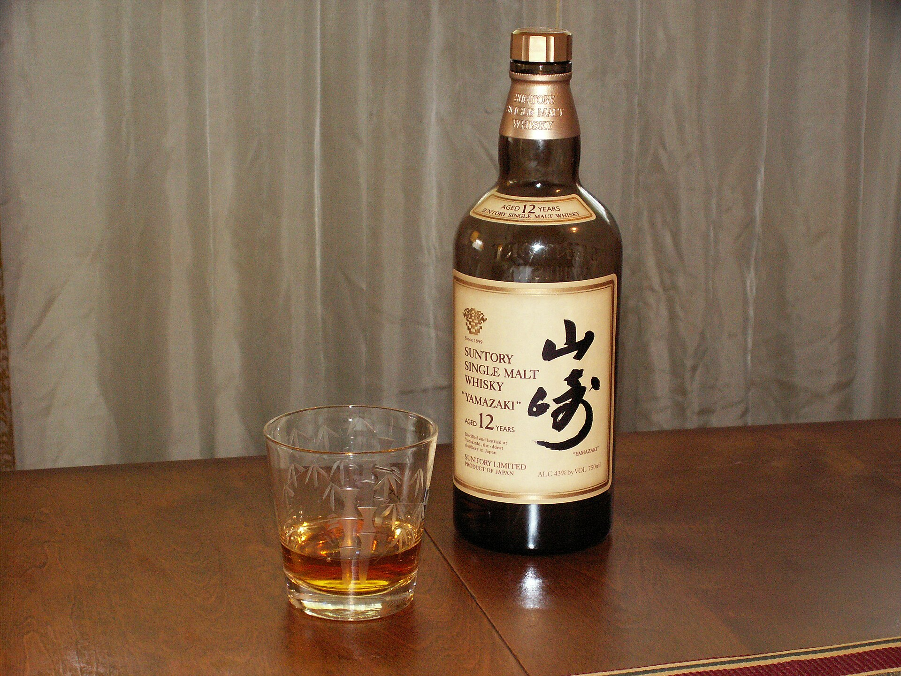

# 山崎单一麦芽威士忌

山崎是日本三得利在大阪府三岛郡岛本町设立的麦芽威士忌蒸馏厂，1923 年投产，是日本威士忌产业的起点之一。山崎单一麦芽常使用水楢桶与雪莉桶，常见酒精度为 43% vol。

图：山崎单一麦芽威士忌相关实景照片。图片：Gentgeen，CC BY-SA 3.0，via Wikimedia Commons（[原图页面](https://commons.wikimedia.org/wiki/File:Yamazake_single_malt.jpg)）。

## 定义与定位

山崎既是蒸馏厂名称，也是品牌与产品线名称。它属于[威士忌](ref:whisky)中的单一麦芽：同一蒸馏厂、以发芽大麦为原料、在壶式蒸馏器中蒸馏，并在规定条件下陈年。单一麦芽不等于单一桶，多数产品仍是多桶调配。

“日本威士忌”有具体的标示要求，涉及原料、蒸馏、陈年地点与装瓶。并非所有在日本销售的威士忌都符合这些条件；购买时应查看标签与协会标准，而不是只凭品牌或产地印象。山崎产品线中也有无年份标示的酒款，不能以年份有无判断品质。

## 产地与环境

山崎位于大阪府与京都府交界的丘陵地带，靠近桂川、宇治川与木津川的交汇处，气候湿润、四季分明。湿度与温差影响橡木桶中的熟成速度与风味走向，这也是选址的重要考虑。

蒸馏厂周边的水质与空气微生物环境，属于日本威士忌叙事的一部分，但不应被夸大为唯一决定因素。原料、蒸馏器形状、桶型与陈年仓库条件，同样决定最终风味。产区故事需要与工艺事实一起理解。

日本威士忌的产业化始于 20 世纪 20 年代，山崎蒸馏厂由鳥井信治郎推动建立，竹鶴政孝参与早期技术工作。此后日本威士忌逐步形成自己的风格，并在国际市场上获得关注。理解这段历史，有助于区分品牌叙事与产品事实。

## 原料

主要原料是发芽大麦。山崎使用不同品种与不同烘烤程度的大麦，部分泥煤烘烤原料带来轻微的烟熏感。酵母与发酵时间影响香气前体，蒸馏厂会保留多种发酵条件以增加原酒多样性。

水在糖化、稀释与降度中使用，水质影响口感。原料与水的具体配比属于企业信息；标签上的原料表与酒精度，是消费者可直接核对的信息。

## 「山崎单一麦芽威士忌」怎么做出来
典型流程是：发芽、烘烤、糖化、发酵、[蒸馏](ref:distillation)、陈年、调配、降度与装瓶。山崎使用不同形状的壶式蒸馏器，以产生不同风格的原酒；蒸馏后的酒心切割点影响香气与酒体。

[橡木桶陈酿](ref:oak-ageing)是风格核心。水楢桶带来沉香、椰子与香料气息，雪莉桶带来干果、巧克力与香料，波本桶带来香草与甜感。不同桶型的组合与比例，由调酒师按产品目标决定。

## 「山崎单一麦芽威士忌」的闻与喝
山崎通常表现为细腻、平衡，带有花果香、蜂蜜与檀香般的木质气息。水楢桶的沉香与椰子感是其辨识度较高的特征；不同年份、桶型与产品线的差异很大，不能用单一描述概括。

调配型单一麦芽强调平衡，不同桶型的原酒互相补足：水楢桶提供香料与木质，雪莉桶提供干果与厚度，波本桶提供香草与甜感。评价时应看整体协调性，而不是追逐某一种桶味。

品鉴时用郁金香杯聚集香气，先闻静止香气，再加少量水观察变化。加水能降低酒精刺激并打开香气，但会改变结构；加冰会进一步压抑香气。高球是日本常见的日常喝法，但会稀释细节，不适合作为品鉴的主要方式。

## 产品体系与标签

山崎的产品线包括不同年份标示与无年份标示的单一麦芽，酒精度与桶型组合不同。酒标上的产品名称、酒精度、容量、产地与陈年标示，是核对身份的基本信息。

日本威士忌的标示规则近年收紧，年份标示与实际酒龄的关系需要谨慎理解。无年份产品可能是多桶调配，不等于品质较低；具体酒款的年龄结构与比例，应以官方信息为准。

## 「山崎单一麦芽威士忌」的饮用与搭配
纯饮或加少量水，适合用小郁金香杯。搭配日式烧物、寿司、照烧与清淡奶酪较合适；重辣与重酸菜肴会干扰细腻香气。高球适合轻松饮用，但应接受香气被稀释的结果。

开瓶后应避光、阴凉保存，尽量在合理时间内喝完。威士忌不会像葡萄酒那样快速氧化，但长期暴露在空气与光照中仍会损失香气。饮酒应适量。

## 「山崎单一麦芽威士忌」容易被读错的地方
第一，把单一麦芽等同于单一桶。多数单一麦芽是多桶调配。
第二，认为所有日本威士忌都符合日本标示标准。应以标签与协会标准为准。
第三，把水楢桶当作唯一风格来源。桶型、蒸馏与原料同样重要。
第四，认为年份越老越好。适饮期与桶型差异更关键。
第五，用高球体验替代品鉴。加苏打水会掩盖细节。

**关键事实。**

| 项目 | 内容 |
| --- | --- |
| 一句话定位 | 日本三得利在大阪府岛本町设立的麦芽威士忌蒸馏厂，1923 年投产，常见酒精度 43% vol，以水楢桶与雪莉桶风格著称 |
| 酒种/风格 | 威士忌 |
| 酒精度 | 43–43% vol |

**来源与边界。** 本页关于「山崎单一麦芽威士忌」的关键事实，主要由以下来源交叉核对：Suntory（蒸馏厂历史、产地与产品信息）、日本洋酒酒造组合（日本威士忌的原料、蒸馏与陈年地点要求）、Oxford University Press（提供关于日本威士忌与山崎的条目；由原条目末尾参考资料迁移，未逐条复核访问日期）。价格、批次与状态会变，涉及这些字段时以页面所列来源的最新版本为准。正文为项目自写，来源只作核验，不复制原文。

**并读。** 把「山崎单一麦芽威士忌」与「威士忌」、「蒸馏」、「橡木桶陈酿」放在一起读时，先确认它们是同一层级还是上下游关系：先确认酒种与产区，再比较年份、酒精度、价格与饮用场景。本页负责给出酒款的基本坐标，对照条目补上具体案例与差异；读完再回到本页，才能分清哪些差别属于酒款本身，哪些只是产地、批次或品牌选择。

## 参考资料
- [威士忌](ref:whisky)：威士忌的大类、原料与主要类型。
- [蒸馏](ref:distillation)：壶式蒸馏与酒心切割如何影响风味。
- [橡木桶陈酿](ref:oak-ageing)：水楢桶、雪莉桶与波本桶的差异。
- [酒精度](ref:abv)：理解 43% vol 与降度工艺。

把山崎放回日本威士忌的桶陈与蒸馏语境，可对照[威士忌](ref:whisky)与[橡木桶陈酿](ref:oak-ageing)。
