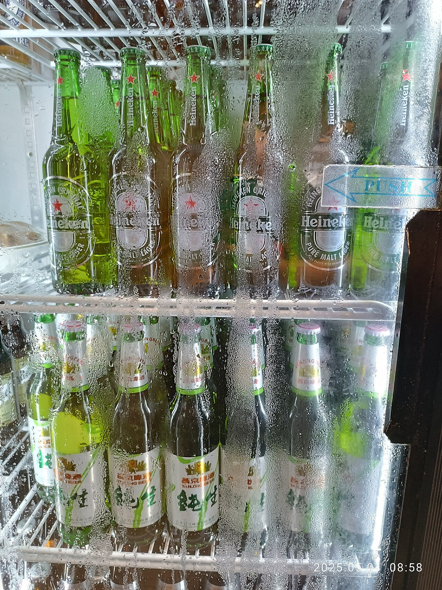

# 喜力

如果只看货架，喜力最显眼的是一身绿：绿色玻璃瓶、绿色标签、绿色灯箱。这个视觉符号如此成功，以至于很多人忘了它同时是一个技术选择——而绿色玻璃对啤酒并不总是友好。理解喜力，最好从这个矛盾开始：一款以“稳定、干净”为核心竞争力的工业拉格，偏偏采用了最容易受光影响的包装。

图：喜力。摄影：HK KTD 觀塘 Kwun Tong 鱷魚恤中心 Crocodile Center shop 稻香茶居 Tao Heung Tea House Restaurant cold bottled beer Heineken bottles brand May 2025 R12S。署名：Lee Zhun Waesm Stephen AussieA，CC0，来自 Wikimedia Commons（[来源](https://commons.wikimedia.org/w/index.php?curid=164691047)）。

## 绿瓶与苦味：一个符号的两面

喜力（Heineken）是荷兰阿姆斯特丹喜力公司自 1873 年起生产的淡色[拉格](ref:lager)，常见 5.0% vol、330 mL。它的风味坐标介于美式拉格与德国皮尔森之间：比百威更有骨架和苦味，比传统皮尔森更轻、碳酸感更强。它不是精酿，也不是小批量产品，而是一款为全球分销设计的标准拉格。

“国际拉格”（international lager）是商业分类，不是法定风格。它描述的是这样一类产品：风味中性、苦度适中、在任何气候与任何菜系旁边都不至于出错。喜力是这类产品的典型样本之一。

## 阿姆斯特丹 1864：从 De Hooiberg 出发

1864 年，二十二岁的赫拉德·阿德里安·喜力买下阿姆斯特丹的 De Hooiberg 啤酒厂。当时荷兰啤酒市场以顶部发酵的浑浊啤酒为主，他转向德国与捷克式的底部发酵技术，并把目光放在出口市场。1873 年，公司以 Heineken's Bierbrouwerij Maatschappij 的名义注册，品牌史通常把这一年视为现代喜力的起点。

19 世纪末的欧洲啤酒业正在经历一场技术分化：巴氏杀菌、人工冷藏与铁路运输让淡色拉格可以长途销售，也让“稳定”成为比“个性”更重要的商业能力。喜力的早期成功，建立在这套基础设施之上，而不是某个传奇配方。

## A 酵母：把风味变成可复制的资产

1886 年，喜力从当时在阿姆斯特丹工作的酵母学家哈托赫·埃利翁处获得一株酵母，后来被称为“A 酵母”。这株酵母成为品牌风味一致性的核心：不同工厂、不同水源、不同年份，只要发酵曲线与酵母状态可控，成品就能保持相近的香气轮廓。

公司至今维护自己的酵母库，并以“A 酵母”作为品牌叙事的一部分。从技术角度看，这并不神秘——大型啤酒集团普遍保存自家酵母菌株；但从品牌角度看，它把“风味”从抽象描述变成了可被保管、复制与验证的资产。这也是工业化拉格与小型酒厂最本质的差别之一：前者追求可重复，后者追求单批次表达。

## 原料与糖化：为什么它比美式拉格更有骨架

公开原料为[大麦](ref:barley)麦芽、[水](ref:water)与酒花，不添加大米或玉米等辅料。全麦芽配方让麦芽甜香与饼干感更完整，酒体也更“实”；酒花提供清淡的草本与辛香，苦度高于美式拉格，但远低于 IPA。

不同工厂使用当地水源，并针对水质做处理，使成品接近统一的风格目标。水中的矿物组成会影响糖化效率、酒花苦味的呈现与发酵表现，因此水处理是大型拉格工厂最重要的稳定性手段之一。原料比例与工艺参数属于企业信息，公开资料有限，不宜猜测具体数字。

## 低温发酵与后熟

酿造采用低温[发酵](ref:fermentation)：糖化、煮沸、添加酒花、冷却、接种酵母，在较低温度下完成主发酵，随后进入低温后熟与过滤。后熟让酵母与粗糙风味沉降，过滤则进一步保证澄清与货架期稳定。

这套流程的目标是“干净”：没有明显酯香，没有酵母味，苦味线性而短暂。代价是复杂度有限——它不会像未过滤拉格或小麦啤酒那样，随温度与时间展现层次。喝喜力，喝的是稳定性与清爽感，而不是变化。

## 光臭：绿瓶的化学代价

啤酒花中的异α-酸在光照下会分解，产生的反应性片段与酵母代谢产生的含硫化合物结合，生成 3-甲基-2-丁烯-1-硫醇（常称 3-MBT）。这种物质在极低浓度下就能被闻到，气味类似臭鼬或烧焦的橡胶，行业里称为“光臭”（lightstruck）。棕色玻璃能过滤大部分紫外线，绿色玻璃的阻隔能力弱得多，透明瓶最差。

因此，绿瓶是品牌识别与风味稳定性之间的取舍。喜力通过深色印刷、避光运输与较短货架期来降低风险，但消费者仍可能买到受光影响的瓶子。判断方法不复杂：如果香气出现明显的臭鼬味而非酒花味，多半不是“风格”，而是储运出了问题。

## 规格、产地与全球授权

荷兰原产版常见 5.0% vol、330 mL 瓶装；其他市场由当地授权工厂生产，酒精度常在 4.5%–5.0% 之间，容量有 330 mL 瓶、500 mL 罐等。授权生产意味着同一品牌下的产品并不完全一致，这在跨国啤酒品牌中是常态。

2017 年，喜力推出 0.0 无醇版本，用真空蒸馏去除酒精后再调配风味。它扩展了品牌的使用场景，但也提醒饮用者：无醇不等于无热量，也不等于可以无限饮用。选购时应看背标的生产商、产地、酒精度与净含量。

## 价格带与饮用场景

喜力在全球多数市场属于中档价位，高于本地主流拉格，低于精酿与进口特色啤酒。它的主要场景是餐饮渠道、酒吧与聚会：需要一款认知度高、口味不冒犯、冰镇后容易入口的啤酒。

在中国市场，它常被放在“进口拉格”的位置，与百威、嘉士伯及国产高端拉格竞争。价格差更多来自品牌定位、渠道与关税，而不是原料成本。用它搭配烧烤、海鲜、沙拉与轻食都不会出错；搭配重辣或重酱汁的菜，它的苦味会被放大，清爽感反而下降。

## 常见误区

第一，把喜力当成荷兰手工啤酒。它是跨国集团的工业化拉格，荷兰只是品牌起源地。
第二，认为绿瓶代表更好的保鲜。绿色玻璃对紫外线的阻隔弱于棕色，更容易产生光臭。
第三，以为所有产地的喜力完全一样。授权工厂、水质与法规都会带来差异。
第四，把“国际拉格”当成法定风格。它是商业分类，没有产区法规约束。
第五，用品牌知名度判断风味复杂度。知名度来自渠道与一致性，不来自层次。
第六，认为 A 酵母是营销虚构。它确实是品牌长期使用的菌株，只是其作用被品牌叙事放大了。

## 延伸阅读

- [拉格](ref:lager)：喜力所属的啤酒大类与底层发酵逻辑。
- [荷兰](ref:netherlands)：品牌起源地与主要生产国。
- [大麦](ref:barley)与[水](ref:water)：全麦芽配方的主要原料。
- [发酵](ref:fermentation)：低温发酵与后熟如何塑造干净收口。
