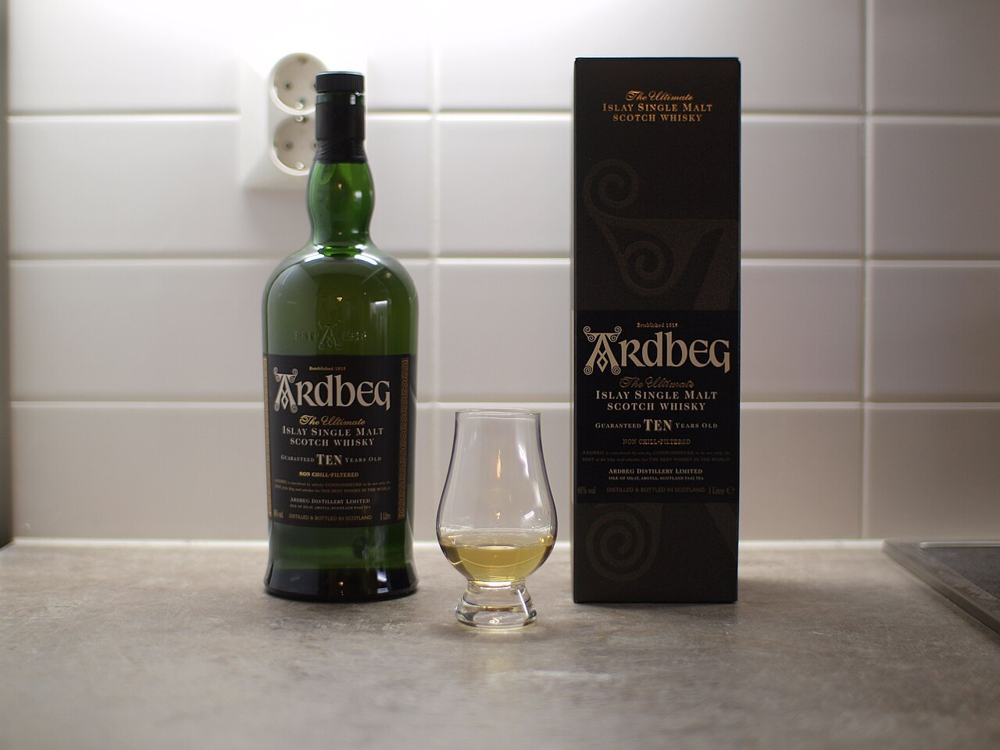

# 阿贝 10 年

阿贝 10 年是苏格兰艾雷岛的重泥煤单一麦芽威士忌，在波本桶中陈年至少 10 年，非冷凝过滤，常见 46% vol、700 mL。它以焦油、烟熏、咖啡与深色巧克力风味著称，是重泥煤风格的代表作之一。

图：阿贝 10 年。摄影：File:Ardbeg 10 years old whisky.jpg。署名：JIP，CC BY-SA 3.0，来自 Wikimedia Commons（[来源](https://commons.wikimedia.org/w/index.php?curid=40682836)）。

## 定义与定位

先分层：威士忌是大类，苏格兰单一麦芽是法定类型，艾雷岛是产区，阿贝是酒厂与品牌，10 年是具体产品的年份标注。四层分开看，才能区分海岛风格、酒厂工艺与瓶中酒龄。

“10 年”是瓶中所有酒液的最低陈年时间。它是酒厂的常规核心款，之上还有 Uigeadail、Corryvreckan 等无年份或特殊桶型版本；常规款不是低配，而是理解酒厂风格最直接的入口。

## 生产者与品牌

阿贝酒厂位于艾雷岛南岸，1815 年正式建立，20 世纪末经历停产与复产，现属[路威酩轩](ref:lvmh)集团旗下的格兰杰公司。酒厂以重泥煤、非冷凝过滤与较高酒精度作为公开的工艺主张。

酒厂、品牌与产品是三个层级：酒厂回答设备与工艺，品牌回答定位与产品线，产品回答年份、桶型与酒精度。集团所有权与酒厂历史属于背景信息，不能替代瓶标上的具体规格。

## 「阿贝 10 年」的产地与原料
艾雷岛位于苏格兰西岸，海洋性气候风大、湿度高、温差小，泥煤资源丰富。当地泥煤燃烧时释放酚类化合物，烘麦时附着在麦芽上，形成烟熏与药感的基础；阿贝的泥煤强度在行业内属于较高水平。

原料是[大麦](ref:barley)与[水](ref:water)。大麦浸泡、发芽后用泥煤火烘烤，再经糖化与[发酵](ref:fermentation)进入蒸馏。具体酚值、麦芽供应商与水源细节属于酒厂工艺信息，公开程度不一，本页不把单一数值当成风格的全部解释。

## 「阿贝 10 年」怎么做出来
麦汁发酵后进入壶式[蒸馏](ref:distillation)，取酒心后装入波本桶[陈酿](ref:oak-ageing)。阿贝 10 年采用非冷凝过滤，装瓶时保留更多脂类与风味物质，因此加水后可能出现轻微浑浊，这属于工艺结果，不是变质。

波本桶带来香草、椰子与木质甜感，与重泥煤烟熏形成层次。桶源、桶龄与仓库条件会影响最终风格，具体配比不公开；批次之间可能有细微差异，这是单一麦芽的常态。

## 「阿贝 10 年」的瓶型与标签
常见[酒精度](ref:abv)为 46% vol，容量常见 700 mL。标签应核对酒厂名、年份、单一麦芽类型、酒精度、净含量、装瓶商与批次信息；非冷凝过滤通常会在包装或背标上说明。

“10 年”必须与类型一起读：单一麦芽指同一酒厂以发芽大麦为原料、壶式蒸馏所得，年份指最低陈年时间。中文背标、进口商与防伪信息是核对身份的依据，不同市场的标签可能不同。

## 「阿贝 10 年」的闻与喝
典型香气是焦油、篝火烟、咖啡渣、黑巧克力与茴香，伴随海盐与柠檬皮；入口烟熏厚重，带苦甜交错的深色风味，酒体中等偏厚，余味长且带回甘与灰烬感。46% vol 让香气更集中，也让酒精感更明显。

品鉴时先常温纯饮，再滴入少量水；加水会打开果香与甜感，也让烟熏变得柔和，非冷凝过滤版本可能出现浑浊。初次接触重泥煤的人可以用小杯慢饮，避免一次性被烟熏压制。

## 「阿贝 10 年」的饮用与搭配
纯饮、加少量水或加冰都可。搭配黑巧克力、烟熏肉、蓝纹奶酪与烤肉较合适；苦甜与烟熏能和油脂、咸鲜形成对比。避免与清淡海鲜同饮，容易掩盖食物本身的鲜味。

它也可用于调制，但重泥煤会主导整杯酒，配方需要相应调整。开瓶后应避光、直立、阴凉保存；酒液会缓慢氧化，建议在数月内饮用完毕。本页关于阿贝 10 年的内容涉及酒精饮料；过量饮酒有害健康，未成年人不应饮酒。

## 「阿贝 10 年」的购买与保存
购买时优先选择正规渠道，核对防伪、中文背标、进口商与批次编号。价格随市场与批次波动，本页不给出具体数字；不同市场的容量与包装差异应回到瓶标核对。

未开瓶可长期存放于避光、阴凉处，直立放置以减少酒液与软木塞的接触。高温与强光会加速劣化，厨房等异味环境不适合长期存放；开瓶后尽量在数月内喝完。

## 「阿贝 10 年」容易被读错的地方
第一，把非冷凝过滤的浑浊当成变质。加水后浑浊是工艺结果。
第二，把 46% vol 当成“更烈所以更好”。酒精度影响香气与口感，不等于品质。
第三，认为重泥煤只有烟味。烟熏之下还有果甜、海盐与苦味层次。
第四，把 10 年当作平均年龄。它是瓶中所有酒液的最低陈年时间。
第五，用包装或礼盒判断真伪。渠道、防伪与标签信息更可靠。

对照阅读：[威士忌](ref:whisky)、[路威酩轩](ref:lvmh)。

**关键事实。**

| 项目 | 内容 |
| --- | --- |
| 一句话定位 | 苏格兰艾雷岛的重泥煤单一麦芽威士忌，在波本桶中陈年至少 10 年，非冷凝过滤，常见 46% vol、700 mL；以焦油、烟熏与咖啡风味著称 |
| 酒种/风格 | 威士忌 |
| 产区 | 苏格兰 |
| 酒精度 | 46–46% vol |
| 生产商/品牌 | 路威酩轩 |

**来源与边界。** 本页关于「阿贝 10 年」的关键事实，主要由以下来源交叉核对：Ardbeg Distillery（10 年陈年、非冷凝过滤与 46% vol；由原条目末尾参考资料迁移，未逐条复核访问日期）、LVMH（阿贝所属集团与品牌结构；由原条目末尾参考资料迁移，未逐条复核访问日期）、Scotch Whisky Association（苏格兰威士忌的法定定义与年份标注规则；由原条目末尾参考资料迁移，未逐条复核访问日期）等 8 条来源。价格、批次与状态会变，涉及这些字段时以页面所列来源的最新版本为准。正文为项目自写，来源只作核验，不复制原文。

## 参考资料
- [威士忌](ref:whisky)：威士忌的分类与基本工艺。
- [苏格兰](ref:scotland)：苏格兰威士忌的产区与法规背景。
- [路威酩轩](ref:lvmh)：阿贝所属集团与品牌结构。
- [大麦](ref:barley)：发芽大麦在单一麦芽中的作用。
- [水](ref:water)：糖化、发酵与降度的基础。
- [发酵](ref:fermentation)：麦汁发酵的基本逻辑。
- [蒸馏](ref:distillation)：壶式蒸馏与切酒的基本逻辑。
- [橡木桶陈酿](ref:oak-ageing)：波本桶如何影响香气与酒体。
- [泥煤](ref:peat)：酚类物质与烟熏风味的来源。
- [酒精度](ref:abv)：46% vol 在标签上的含义。
- [拉弗格 10 年](ref:laphroaig)：另一款艾雷岛重泥煤的对照阅读。
