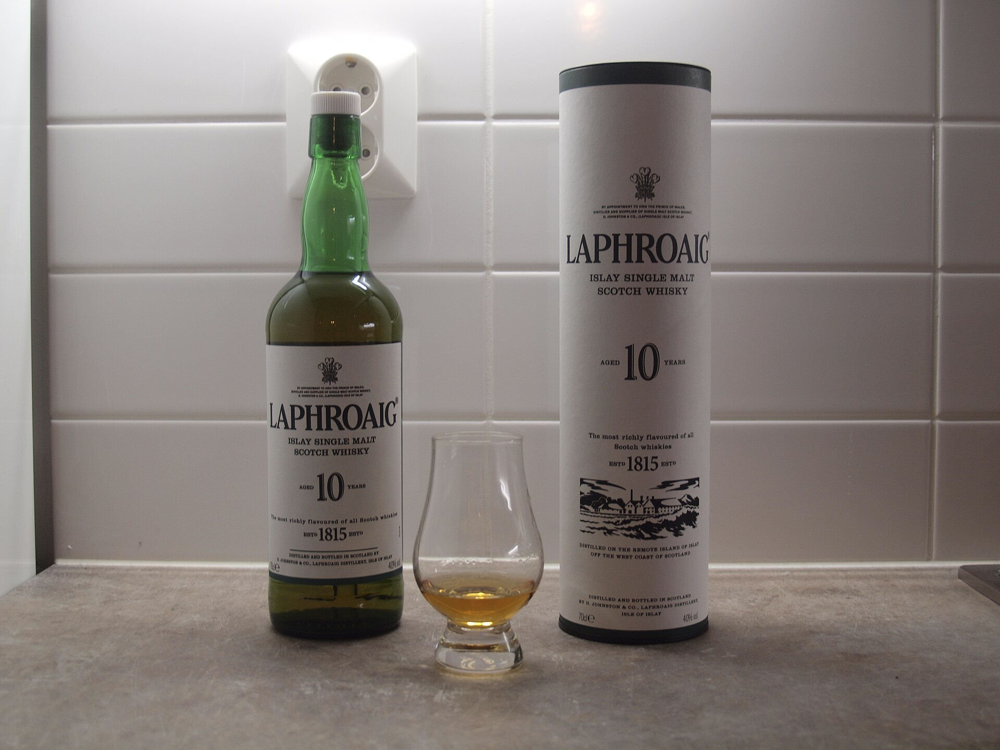

# 拉弗格 10 年

拉弗格 10 年是苏格兰艾雷岛南岸的单一麦芽威士忌，以泥煤烘麦带来的烟熏、碘酒与海洋气息著称，在波本桶中陈年至少 10 年，常见 40% vol、700 mL，部分市场标注 43% vol。

图：拉弗格 10 年相关实景照片。图片：JIP，CC BY-SA 3.0，via Wikimedia Commons（[原图页面](https://commons.wikimedia.org/wiki/File:Laphroaig_10_year_old_whisky.jpg)）。

## 定义与定位

先分层：威士忌是大类，苏格兰单一麦芽是法定类型，艾雷岛是产区，拉弗格是酒厂与品牌，10 年是具体产品的年份标注。四层分开看，才不会把海岛风格、酒厂工艺与瓶中酒龄混为一谈。

“10 年”是法定年份标注，指瓶中所有酒液的最低陈年时间。它属于酒厂的常规入门款，之上还有 18 年、25 年与桶强版本；入门款不代表低质，它更像酒厂风格的“基准线”。

## 生产者与品牌

拉弗格酒厂于 1815 年由唐纳德·约翰斯顿与亚历山大·约翰斯顿在艾雷岛南岸建立，长期由家族经营，现属三得利控股旗下的 Beam Suntory。酒厂是艾雷岛泥煤风格的代表性生产者之一。

酒厂、品牌与产品是三个层级：酒厂回答设备与工艺，品牌回答定位与产品线，产品回答年份、桶型与酒精度。企业所有权可能随集团调整，购买时仍以标签上的装瓶商与实际信息为准。

## 「拉弗格 10 年」的产地与原料
艾雷岛位于苏格兰西岸，属海洋性气候，风大、湿度高、温差小，酒厂多临海而建。当地泥煤由植物残体堆积而成，燃烧时释放酚类化合物，烘麦时附着在麦芽上，形成烟熏与药味的基础。

原料是[大麦](ref:barley)与[水](ref:water)。大麦经浸泡、发芽后，用泥煤火烘烤，使麦芽带[泥煤](ref:peat)风味；随后糖化、发酵、蒸馏。水源与麦芽供应商属于酒厂工艺信息，公开资料未必完整，本页不把单一原料当成风格的全部解释。

## 「拉弗格 10 年」怎么做出来
麦芽经糖化得到麦汁，加入酵母[发酵](ref:fermentation)后进入壶式[蒸馏](ref:distillation)，取酒心后装入橡木桶[陈酿](ref:oak-ageing)。拉弗格 10 年主要使用波本桶，桶带来香草、椰子与木质甜感，与泥煤烟熏形成对比。

蒸馏切酒的宽窄决定烟熏与果味的比例；酒厂通常保留较多带酚类物质的酒心，使烟熏更明显。桶型、仓库位置与陈年时间共同决定最终风格，具体桶源与比例不公开，批次间可能有细微差异。

## 「拉弗格 10 年」的瓶型与标签
常见[酒精度](ref:abv)为 40% vol，部分市场为 43% vol；容量常见 700 mL，美国市场常见 750 mL。标签应核对酒厂名、年份、单一麦芽类型、酒精度、净含量、装瓶商与批次信息。

“10 年”必须与类型一起读：单一麦芽指同一酒厂以发芽大麦为原料、壶式蒸馏所得；年份指最低陈年时间。中文背标、进口商与防伪信息是核对身份的依据，不同市场的标签语言与酒精度可能不同。

## 「拉弗格 10 年」的闻与喝
典型香气是浓重泥煤烟、碘酒、海藻与焦油，伴随柠檬皮、香草与少许果甜；入口烟熏强烈，带咸味与药感，酒体中等偏厚，余味长且带灰烬与海水气息。它不是“轻微烟熏”，而是明确的重泥煤风格。

品鉴时先常温纯饮，再滴入少量水；加水会打开果香与甜感，同时让烟熏变得柔和。初次接触泥煤风格的人可以从小杯开始，搭配甜味食物降低冲击。闻香时注意是否有过重的硫味或焦苦，这些可能与批次或存放有关。

## 「拉弗格 10 年」的饮用与搭配
纯饮、加少量水或加冰都可，按个人习惯选择。搭配黑巧克力、烟熏肉类、蓝纹奶酪与海盐坚果较合适；烟熏与咸味能和油脂、甜感形成对比。避免与清淡海鲜同饮，容易掩盖食物本身的鲜味。

它也可用于调制，但重泥煤风味会主导整杯酒，配方需要相应调整。开瓶后应避光、直立、阴凉保存；泥煤香气稳定，但酒液仍会缓慢氧化。本页关于拉弗格 10 年的内容涉及酒精饮料；过量饮酒有害健康，未成年人不应饮酒。

## 「拉弗格 10 年」的购买与保存
购买时优先选择正规渠道，核对防伪、中文背标、进口商与批次编号。价格随市场与批次波动，本页不给出具体数字；不同市场的酒精度与容量差异应回到瓶标核对，不能用一款规格概括全部市场。

未开瓶可长期存放于避光、阴凉处，直立放置以减少酒液与软木塞的接触。开瓶后香气会随时间变化，建议在数月内饮用完毕；高温与强光会加速劣化，厨房等异味环境也不适合长期存放。

## 「拉弗格 10 年」容易被读错的地方
第一，把泥煤味当成“瑕疵”。它是原料与烘麦工艺的结果，属于风格选择。
第二，认为艾雷岛所有酒款都一样重。酒厂的泥煤强度与切酒方式差异很大。
第三，把 10 年当作平均年龄。它是瓶中所有酒液的最低陈年时间。
第四，认为年份越高烟熏越强。陈年会让部分酚类物质转化，风格会变化。
第五，用包装或礼盒判断真伪。渠道、防伪与标签信息更可靠。

对照阅读：[威士忌](ref:whisky)、[大麦](ref:barley)。

10 年是最低年份标示，不是唯一版本；不同市场常见 40% 与 43% 两种酒精度，读标签时要分开看。

**关键事实。**

| 项目 | 内容 |
| --- | --- |
| 一句话定位 | 苏格兰艾雷岛的单一麦芽威士忌，以泥煤烘麦与海洋气息著称，在波本桶中陈年至少 10 年；常见 40% vol（部分市场为 43% vol），700 mL |
| 酒种/风格 | 威士忌 |
| 产区 | 苏格兰 |
| 酒精度 | 40–43% vol |

**来源与边界。** 本页关于「拉弗格 10 年」的关键事实，主要由以下来源交叉核对：Laphroaig Distillery（10 年陈年、泥煤烘麦与常见规格；由原条目末尾参考资料迁移，未逐条复核访问日期）、Scotch Whisky Association（苏格兰威士忌的法定定义与年份标注规则；由原条目末尾参考资料迁移，未逐条复核访问日期）、Oxford University Press（提供关于艾雷岛、泥煤烘麦与海洋风味的条目；由原条目末尾参考资料迁移，未逐条复核访问日期）。价格、批次与状态会变，涉及这些字段时以页面所列来源的最新版本为准。正文为项目自写，来源只作核验，不复制原文。

## 参考资料
- [威士忌](ref:whisky)：威士忌的分类与基本工艺。
- [苏格兰](ref:scotland)：苏格兰威士忌的产区与法规背景。
- [大麦](ref:barley)：发芽大麦在单一麦芽中的作用。
- [水](ref:water)：糖化、发酵与降度的基础。
- [蒸馏](ref:distillation)：壶式蒸馏与切酒的基本逻辑。
- [橡木桶陈酿](ref:oak-ageing)：波本桶如何影响香气与酒体。
- [泥煤](ref:peat)：酚类物质与烟熏风味的来源。
- [酒精度](ref:abv)：40% vol 与 43% vol 的标签差异。
- [麦卡伦 12 年](ref:macallan)：雪莉桶风格的对照阅读。
