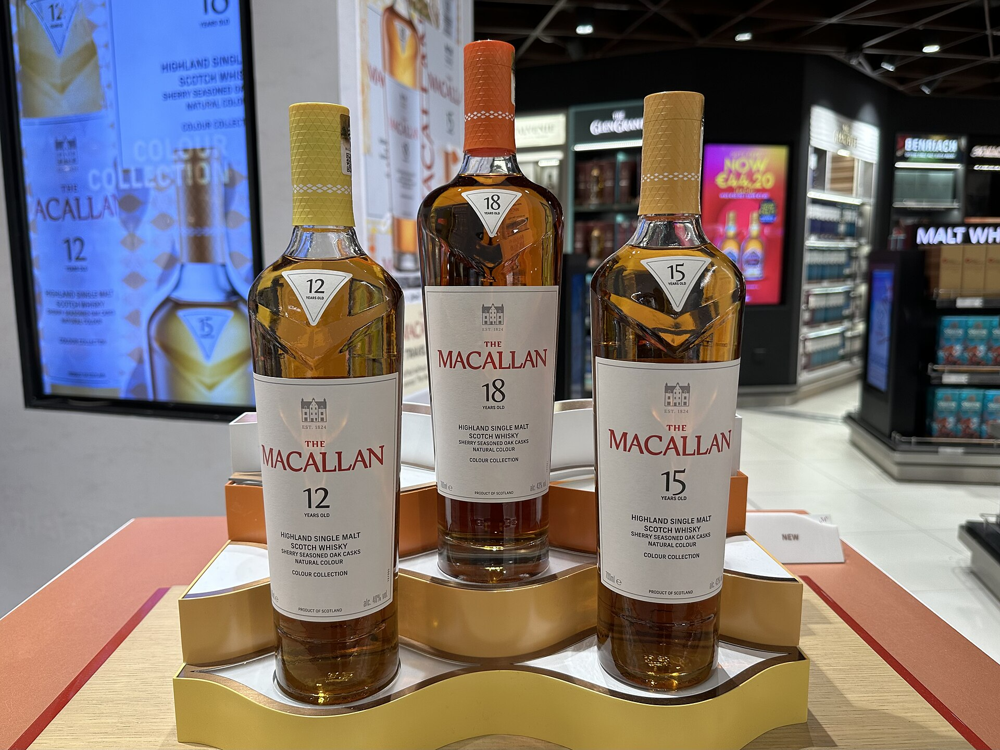

# 麦卡伦12年

麦卡伦12年（The Macallan 12）是苏格兰斯佩赛产区的单一麦芽[威士忌](ref:whisky)，以雪莉风味桶陈酿为特色，酒龄标注为 12 年。常见 700 mL 或 750 mL 瓶装、酒精度约 40% vol，具体版本、桶型与批次以瓶标为准。

图：麦卡伦12年相关实景照片。图片：Ssu，CC BY-SA 4.0，via Wikimedia Commons（[原图页面](https://commons.wikimedia.org/wiki/File:Macallan_whisky,_12-15-18_years.jpg)）。

## 定义与定位

麦卡伦12年是一个具体产品，不是麦卡伦品牌的统称。它属于单一麦芽威士忌：同一家蒸馏厂生产，原料为水与发芽大麦，不使用其他酒厂的调和基酒。品牌下还有不同酒龄与不同桶型的版本，定位与价格不同。

酒龄标注是瓶中最年轻原酒的年龄，不是平均年龄，也不是装瓶后的年份。12 年代表最低酒龄为 12 年，实际可能包含更老的酒液；判断具体风味仍要看桶型、版本与批次。

## 「麦卡伦12年」的产地与原料
斯佩赛位于苏格兰东北部，是苏格兰威士忌的重要产区，酒厂多沿河分布。当地水源与气候影响糖化、发酵与陈酿条件；斯佩赛风格常被描述为偏花果与柔和，但不同酒厂差异明显。

原料为[水](ref:water)、发芽[大麦](ref:barley)与酵母。大麦发芽后经烘干，部分工艺使用泥煤，泥煤用量影响烟熏风味。麦卡伦通常不以重泥煤为特色，风味更多来自桶型与陈酿。

## 糖化与发酵

就「麦卡伦12年」而言，糖化把麦芽中的淀粉转化为可发酵糖，温度与时间影响提取效率与糖分组成。发酵把糖转化为酒精与风味物质，发酵时间与酵母选择影响香气的前体。

蒸馏前的澄清与冷却也会影响最终风味。工艺描述只能说明风格路线，具体参数属于酒厂安排，瓶标不会完整披露；不同版本之间的差异，往往来自桶型与勾调而非单一工序。

## 蒸馏与陈酿

威士忌通常经过两次[蒸馏](ref:distillation)，取酒时按馏段分开收集。不同馏段的酒液在香气与口感上差异明显，酒厂会选择心仪的部分进入陈酿。

陈酿使用[橡木桶](ref:oak-ageing)，桶型与桶的既往用途决定风味走向。雪莉风味桶会带来干果、香料与巧克力的层次，波本桶则偏向香草与柑橘。桶型与陈酿时长属于酒厂工艺安排。

## 「麦卡伦12年」的瓶型与标签
常见规格为 700 mL 或 750 mL 瓶装，酒精度约 40% vol。瓶标通常包含品牌名、酒款名、酒龄、酒精度、净含量、产区与生产商信息；部分市场版本会在背标标注桶型与批次。

就「麦卡伦12年」而言，不同市场与不同版本的包装可能有差异，包装差异不等于酒体差异。购买时应核对酒龄、酒精度、版本与防伪信息，避免把礼盒装当作独立等级。

## 「麦卡伦12年」的闻与喝
香气常呈现干果、香草、柑橘与香料，雪莉桶版本还会有巧克力与烘焙气息；入口柔顺，酒体中等，回味带有干果与木质的层次。不同批次在甜感与香料强度上会有差异。

就「麦卡伦12年」而言，建议在 18-20°C 饮用，可使用郁金香杯或加少量水。加水可以降低酒精刺激、打开香气；加冰会压抑香气并稀释酒体，是否加冰取决于个人口味。

## 「麦卡伦12年」的饮用与搭配
麦卡伦12年适合纯饮，也可搭配坚果、黑巧克力、干酪与烘焙类食物。干果与巧克力的风味与雪莉桶的香气容易呼应；搭配烟熏类食物时，酒体的甜感可以平衡咸味。

就「麦卡伦12年」而言，开瓶后应塞紧瓶塞、避光直立存放，并尽量在数月内喝完。威士忌长时间接触空气会损失香气，反复开瓶也会加速变化；分装到小瓶可以减少空气接触。

## 「麦卡伦12年」的购买与保存
购买时应选择正规渠道，核对酒龄、酒精度、版本、桶型与防伪信息。不同版本的价格差异明显，促销价不能代表长期定位。

就「麦卡伦12年」而言，未开瓶的威士忌应避光、阴凉、直立存放，避免高温与异味环境。威士忌酒精度较高，不适合长期冷藏；家庭存放应注意密封，开瓶后避免阳光直射。

## 「麦卡伦12年」容易被读错的地方
第一，把酒龄当作年份。酒龄是瓶中最年轻原酒的年龄，不是葡萄或粮食的年份。

第二，把单一麦芽当作单一桶。单一麦芽指同一蒸馏厂，不指单桶。

第三，把雪莉桶当作添加物。风味来自桶的既往用途与陈酿，不是外加香精。

第四，只看酒龄判断质量。桶型、批次与工艺同样重要。

第五，把加冰当作唯一喝法。纯饮、加水与加冰各有适用场景。

麦卡伦12年的“12年”是法定酒龄标注，指瓶中威士忌最短陈年时间；雪莉风味桶是它的风格线索，不是每滴酒都来自单一雪莉桶。常见四十度、七百或七百五十毫升规格，不同市场与批次会有差异；不要把“雪莉桶”直接等同于深色、甜腻，颜色也可能来自其他桶型或调色。

对照阅读：[威士忌](ref:whisky)、[大麦](ref:barley)。

**关键事实。**

| 项目 | 内容 |
| --- | --- |
| 一句话定位 | 苏格兰斯佩赛产区的单一麦芽威士忌，以雪莉风味桶陈酿为特色，酒龄标注为 12 年；常见 700 mL 或 750 mL、酒精度约 40% vol，具体版本与批次以瓶标为准 |
| 酒种/风格 | 威士忌 |
| 产区 | 苏格兰 |

**来源与边界。** 本页关于「麦卡伦12年」的关键事实，主要由以下来源交叉核对：Scotch Whisky Association（苏格兰威士忌的法定定义、产区与标签规则）、The Macallan（麦卡伦的产品线、雪莉桶陈年与酒厂信息）、未注明（由原条目末尾参考资料迁移，未逐条复核访问日期）等 5 条来源。价格、批次与状态会变，涉及这些字段时以页面所列来源的最新版本为准。正文为项目自写，来源只作核验，不复制原文。

**并读。** 把「麦卡伦12年」与「威士忌」、「苏格兰」、「大麦」放在一起读时，先确认它们是同一层级还是上下游关系：先确认酒种与产区，再比较年份、酒精度、价格与饮用场景。本页负责给出酒款的基本坐标，对照条目补上具体案例与差异；读完再回到本页，才能分清哪些差别属于酒款本身，哪些只是产地、批次或品牌选择。

**适用边界。** 对「麦卡伦12年」而言，年份、批次、酒精度与包装会变；酒种定义与产区法规较稳定。购买时先看背标，再看品牌页面。

## 参考资料
- [威士忌](ref:whisky)：类别、产区与工艺。
- [苏格兰](ref:scotland)：苏格兰威士忌的产区格局。
- [大麦](ref:barley)：威士忌的主要原料。
- [水](ref:water)：糖化与稀释中的作用。
- [蒸馏](ref:distillation)：两次蒸馏与馏段取酒。
- [橡木桶陈酿](ref:oak-ageing)：桶型与风味走向。
- [麦卡伦18年](ref:macallan)：同品牌不同酒龄的版本。
