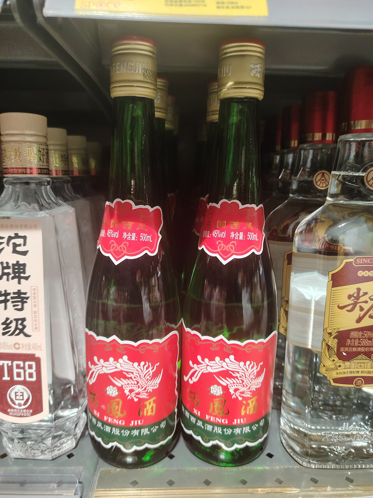

# 西凤酒

西凤酒产自陕西凤翔，是凤香型白酒的代表。它以高粱为原料，大麦、小麦、豌豆制曲，采用土暗窖发酵、酒海贮存，常见酒精度为 55% vol。

图：西凤酒。图片：Lhzss8，CC BY-SA 4.0，via Wikimedia Commons（[原图页面](https://commons.wikimedia.org/wiki/File:%E5%B0%8F%E7%93%B6%E8%A3%85%E8%A5%BF%E5%87%A4%E9%85%92.jpg)）。

## 定义与定位

西凤酒是[白酒](ref:baijiu)中的一个品牌，也是凤香型的主要代表。凤香型的定位介于清香与浓香之间：它既有清香型的爽净，也带有浓香型的窖香与醇厚。它不是“清香加浓香”的简单混合，而是一套独立的制曲、发酵与贮存传统。

产品属于蒸馏酒，酒精度以[体积分数](ref:abv)标示，常见为 55% vol。高度版本对饮用方式更敏感，比较时也不能只看度数。

## 产区与环境

凤翔位于陕西关中西部，属暖温带大陆性季风气候，四季分明、降水集中，空气相对干燥。干燥环境有利于制曲与贮存，也影响窖池微生物的季节变化。当地高粱与水源，是凤香风格的基础条件。

西凤酒使用土暗窖发酵，窖池与泥窖的微生物环境不同，带来的香气结构也不同。窖池需要长期维护，窖泥状态会随使用与季节变化。产区风格不是单靠地名形成的，它是气候、窖池、原料与工艺共同积累的结果。

凤翔古称雍，是关中西部的重要城邑，酿酒传统与当地农业、商贸长期相连。西凤酒在近代经历了从作坊到工厂的转变，酒海贮存等传统环节在部分产品中被保留下来。

## 原料与制曲

主料是高粱，要求颗粒饱满、淀粉含量高、杂质少。曲以大麦、小麦与豌豆为原料，不同曲种的配比与培菌温度会影响糖化力与香气前体。[制曲](ref:qu-making)是凤香型风格的基础环节，曲香过重会掩盖粮香，曲香不足则酒体单薄。

高粱的支链淀粉比例、蒸煮后的疏松度，以及曲与水的配合，都会影响发酵的均匀性。原料批次差异属于正常现象，生产者需要通过配比与工艺调整来稳定风格。

## 「西凤酒」怎么做出来
典型流程包括：原料粉碎、拌料、蒸煮、摊凉、加曲、入窖发酵、出窖、蒸馏取酒、分级贮存、勾调、装瓶。土暗窖发酵让酒醅在相对封闭的环境中完成糖化与发酵，蒸馏时按段摘酒，分离头段与尾段。

贮存使用酒海：以荆条编成桶形，内壁以传统材料裱糊，酒液在其中缓慢变化。酒海的透气性与内壁材料会影响氧化和香气融合，形成凤香型的一部分特征。贮存时间、容器状态与勾调目标共同决定成品风格。

## 「西凤酒」的闻与喝
凤香型介于清香与浓香之间，常带有己酸乙酯与乙酸乙酯的复合香气，入口挺拔，酸香清晰，回味较长。它不像清香型那样单纯爽净，也不像浓香型那样以窖香为主，评价时要看两者的比例是否协调。

品鉴时用小杯，先闻静止香气，判断香气是否干净、是否有明显的酸香与窖香冲突；再小口品尝，感受入口的挺拔感与收口。高度酒的酒精刺激较强，加水可以打开香气，但会改变结构，应逐滴加入并对比。

## 产品体系与标签

西凤酒有红西凤、西凤 1964 等系列，定位与酒体设计不同。核对西凤酒时，应把生产商、香型、酒精度、执行标准与净含量五项对齐，再查批次。西凤酒的仿冒风险多集中在近似商标、同名系列与礼盒改包，购买时应通过正规渠道并核对防伪。

“年份”“酒海贮存”等表述需要结合企业标准与标签说明理解。酒海是贮存容器，不等于瓶中酒液的准确年龄；具体酒龄、勾调比例与基酒构成，应以官方信息为准。

## 「西凤酒」的饮用与搭配
小杯纯饮，适合搭配西北风味的肉类和面食，如羊肉泡馍、腊牛肉、烧烤与手工面。高度酒不宜快饮；初次尝试可先少量，适应其挺拔的酸香和酒精感。搭配过辣的菜式会放大刺激，也会压住复合香气，品鉴前应避免先吃重辣食物。

西凤酒也可以用于调制，但 55% vol 的强度会显著改变成品平衡。加冰或大量兑水并非传统方式，会稀释香气并改变酒海贮存形成的质感。开瓶后应避光、阴凉存放，并尽量在合理时间内喝完。

## 「西凤酒」容易被读错的地方
第一，把凤香型当成清香与浓香的简单折中。它是独立工艺形成的香型。
第二，认为酒海只是包装容器。酒海参与贮存与风味形成。
第三，认为度数越高越正宗。度数服务于产品设计，不同版本都有各自目标。
第四，把“酒海贮存”等同于具体年份。贮存容器不等于酒龄。
第五，用包装或价格判断真伪。防伪、渠道与标签核对才可靠。

对照阅读：[白酒](ref:baijiu)、[制曲](ref:qu-making)。

**关键事实。**

| 项目 | 内容 |
| --- | --- |
| 一句话定位 | 产自陕西凤翔的凤香型白酒代表，以高粱为原料、土暗窖发酵、酒海贮存，常见酒精度 55% vol |
| 酒种/风格 | 白酒 |
| 酒精度 | 55–55% vol |

**来源与边界。** 本页关于「西凤酒」的关键事实，主要由以下来源交叉核对：陕西西凤酒股份有限公司（产地、原料与产品系列）、国家市场监督管理总局、国家标准化管理委员会（凤香型白酒与酒海贮存等术语；白酒在饮料酒分类中的位置）、Oxford University Press（提供关于中国白酒香型与贮存容器的条目；由原条目末尾参考资料迁移，未逐条复核访问日期）。价格、批次与状态会变，涉及这些字段时以页面所列来源的最新版本为准。正文为项目自写，来源只作核验，不复制原文。

**并读。** 把「西凤酒」与「白酒」、「浓香型白酒」、「制曲」放在一起读时，先确认它们是同一层级还是上下游关系：先确认酒种与产区，再比较年份、酒精度、价格与饮用场景。本页负责给出酒款的基本坐标，对照条目补上具体案例与差异；读完再回到本页，才能分清哪些差别属于酒款本身，哪些只是产地、批次或品牌选择。

**适用边界。** 对「西凤酒」而言，年份、批次、酒精度与包装会变；酒种定义与产区法规较稳定。购买时先看背标，再看品牌页面。

## 参考资料
- [白酒](ref:baijiu)：西凤酒所属的大类与香型体系。
- [浓香型白酒](ref:strong-aroma)：理解凤香型中窖香成分的参照。
- [制曲](ref:qu-making)：大麦豌豆曲如何影响凤香。
- [酒精度](ref:abv)：比较不同产品强度的指标。
