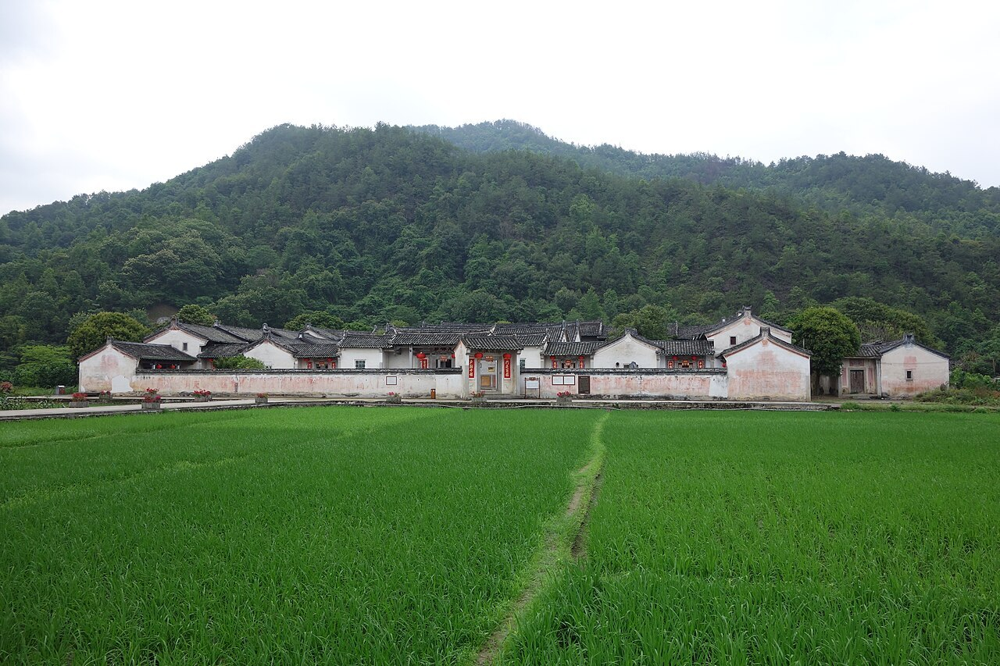

# 张裕葡萄酒

张裕葡萄酒产自山东烟台。张裕公司创建于 1892 年，创办人为张弼士，是中国最早的现代葡萄酒企业之一。产品覆盖干红、干白、白兰地等，常用品种包括蛇龙珠、赤霞珠和霞多丽。

图：张裕葡萄酒。摄影：Guang Lu Di in Dabu. Built in 1908, former residence of Cheong Fatt Tze who was the founder of Changyu Wine (19324457523)。署名：Yun Huang Yong from Harbord, Australia，CC BY 2.0，来自 Wikimedia Commons（[来源](https://commons.wikimedia.org/w/index.php?curid=140102273)）。

## 定义与定位

张裕既是企业名称，也是葡萄酒品牌。它不是一个产区，也不是某一个葡萄品种。把它当作[葡萄酒](ref:wine)品牌来理解，才能正确区分“张裕”与“烟台产区”“蛇龙珠品种”这些不同层级的概念。

张裕的业务并不限于葡萄酒，还包括白兰地等蒸馏酒产品。本页只讨论其葡萄酒部分。企业历史长、产品线宽，意味着同一品牌下不同系列的价格、工艺与风格差异可能很大，单看品牌名不足以判断一瓶酒的实际定位。

## 产区与环境

烟台位于山东半岛北部，北临渤海、东临黄海，属暖温带季风气候，受海洋调节明显：春季回暖较慢，夏季不算酷热，秋季相对漫长。葡萄生长季温和，成熟期的海风与昼夜温差影响糖酸平衡。

海洋性气候带来较高湿度，也带来病害压力，需要更细致的树体管理与采收判断。烟台是中国重要的葡萄酒产区之一，张裕的葡萄基地分布在烟台及周边地区。产区的价值在于长期积累的气候、土壤与栽培经验，但具体酒款仍要看地块、年份与酿造执行。

## 原料与品种

主要原料是[葡萄](ref:grape)。张裕使用的品种包括蛇龙珠、赤霞珠、霞多丽、贵人香等。蛇龙珠（Cabernet Gernischt）是中国葡萄酒中的代表性名称，研究认为它与佳美娜（Carmenère）存在亲缘关系；酒标上的品种标注应以企业检测与标签为准。

品种决定颜色、酸度、单宁与香气前体的上限。红葡萄需要充分成熟以获得颜色与单宁，白葡萄常需较早采收以保留酸度。同一品种在不同年份、不同地块的表现差异很大，因此“品种”只是理解一瓶酒的起点，不是结论。

## 「张裕葡萄酒」怎么做出来
红葡萄酒的典型流程是：除梗破碎、浸渍、酒精发酵、压榨、苹果酸-乳酸发酵、陈酿、澄清与装瓶。白葡萄酒则先压榨取汁，再低温发酵，以保留香气。[霞多丽](ref:chardonnay)的风格受发酵温度、是否使用橡木以及是否进行酒泥搅拌影响很大。

陈酿容器直接改变风味走向。橡木桶会带来香草、烘烤气息，并使单宁更柔和；不锈钢罐则更好地保留果香。张裕的产品跨度大，从日常餐酒到酒庄酒都有，[橡木桶陈酿](ref:oak-ageing)的使用比例与时间随产品定位而变，不能用一个工艺模板概括全部产品。

## 「张裕葡萄酒」的闻与喝
张裕的干红常见黑色水果、香料与橡木气息，干白偏柑橘、核果与花香，白兰地则属于另一套品鉴体系。评价葡萄酒应看平衡：酸度是否支撑酒体，单宁是否细密，香气是否干净，余味是否完整，而不是只看香气浓不浓。

品鉴时先观色，再闻香，最后入口。温度影响非常明显：干红过冷会显得闭塞，干白过热会显得松散。开瓶后与空气接触会改变香气，若出现明显氧化味，说明保存或饮用时机出了问题。

## 产品体系与标签

张裕的产品体系包括解百纳系列、酒庄酒系列以及白兰地等。酒标上的品种、年份、产地、酒精度、糖分与执行标准，是核对产品身份的基本信息。“解百纳”是产品与品牌名称，不应被当作一个葡萄品种来理解。

年份指葡萄采收年份，不等于陈年时间；同一系列不同年份的差异，可能比不同系列之间还大。单一品种与混酿各有目标：单一品种强调品种特征，混酿追求结构完整。购买时应以标签与官方信息为准，避免只凭包装或价格判断。

## 「张裕葡萄酒」的饮用与搭配
干红适合搭配红肉、酱汁菜与中式浓味菜肴，饮用温度约 16–18°C；干白适合海鲜、清蒸与清淡菜肴，温度约 8–12°C。搭配的核心是重量匹配：酒体重的酒配味道重的菜，酒体轻的酒配清淡的菜。

开瓶后应尽快喝完，剩余酒液可分装、避光、低温保存。加冰会稀释香气与结构，不适合传统葡萄酒；甜型或起泡产品另有饮用方式，应按标签说明处理。饮酒应适量，避免空腹快速饮用。

## 「张裕葡萄酒」容易被读错的地方
第一，把张裕当作一个产区或一个品种。它是企业与品牌。
第二，认为年份越老越好。多数葡萄酒有适饮期，过长存放可能衰退。
第三，把“解百纳”当成葡萄品种。它是产品名称。
第四，认为进口酒一定优于国产酒。产地与价格不能替代实际品鉴。
第五，只用价格判断质量。标签信息、年份与保存状态同样重要。

**关键事实。**

| 项目 | 内容 |
| --- | --- |
| 一句话定位 | 山东烟台葡萄酒品牌，张裕公司创建于 1892 年，产品覆盖干红、干白与白兰地，常用蛇龙珠、赤霞珠、霞多丽等品种 |
| 酒种/风格 | 葡萄酒 |

**来源与边界。** 本页关于「张裕葡萄酒」的关键事实，主要由以下来源交叉核对：烟台张裕葡萄酿酒股份有限公司（品牌历史、产地与产品系列）、OIV（葡萄酒的国际技术口径）、国家市场监督管理总局、国家标准化管理委员会（葡萄酒在饮料酒分类中的位置）等 5 条来源。价格、批次与状态会变，涉及这些字段时以页面所列来源的最新版本为准。正文为项目自写，来源只作核验，不复制原文。

**并读。** 把「张裕葡萄酒」与「葡萄酒」、「葡萄」、「霞多丽」放在一起读时，先确认它们是同一层级还是上下游关系：先确认酒种与产区，再比较年份、酒精度、价格与饮用场景。本页负责给出酒款的基本坐标，对照条目补上具体案例与差异；读完再回到本页，才能分清哪些差别属于酒款本身，哪些只是产地、批次或品牌选择。

**适用边界。** 对「张裕葡萄酒」而言，年份、批次、酒精度与包装会变；酒种定义与产区法规较稳定。购买时先看背标，再看品牌页面。

## 参考资料
- [葡萄酒](ref:wine)：葡萄酒的大类与基本分类。
- [葡萄](ref:grape)：酿酒原料与成熟度对风格的影响。
- [霞多丽](ref:chardonnay)：白葡萄酒品种与酿造选择。
- [橡木桶陈酿](ref:oak-ageing)：陈酿容器如何改变香气与单宁。
