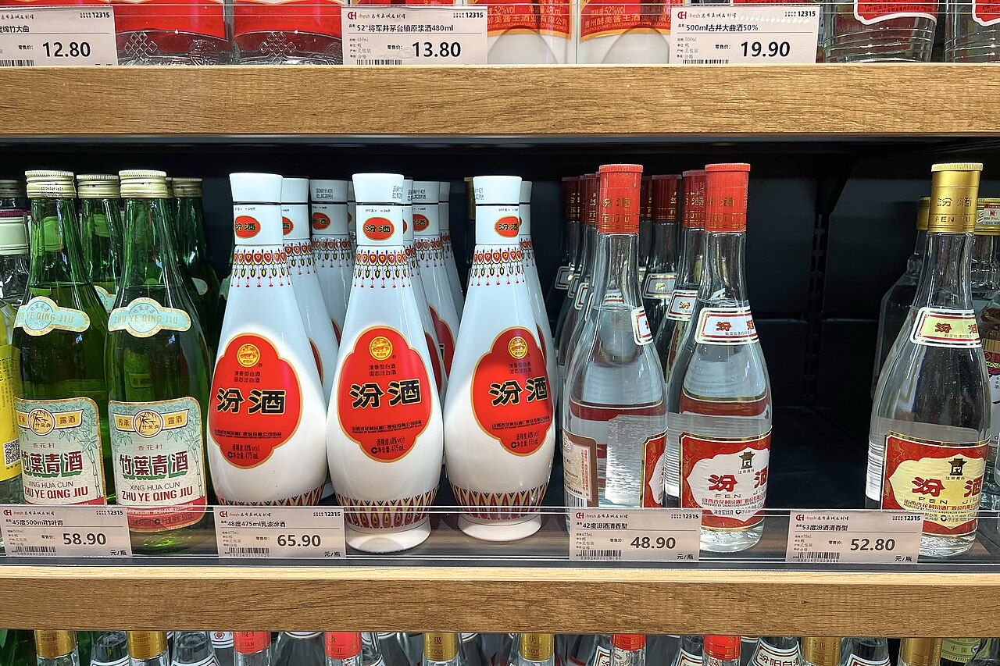

# 汾酒

汾酒产自山西汾阳杏花村，是清香型白酒的代表。它以高粱为原料，大麦和豌豆制曲，采用清蒸二次清工艺，常见酒精度为 53% vol。

图：汾酒。图片：N509FZ，CC BY-SA 4.0，via Wikimedia Commons（[原图页面](https://commons.wikimedia.org/wiki/File:Fen_Jiu_and_Chu_Yeh_Ching_Chiew_at_a_supermarket_in_Beijing_(20241109164541).jpg)）。

## 定义与定位

汾酒是[白酒](ref:baijiu)中的一个品牌，也是清香型白酒的典型代表。清香型的“清”指工艺上的清蒸清烧与地缸发酵，也指风味上的干净、爽净。它与浓香、酱香不是同一套评价体系，风格差异不应被简化为质量高低。

产品属于蒸馏酒，酒精度以[体积分数](ref:abv)标示，常见为 53% vol。不同系列与度数会改变入口刺激与香气释放，但都应以标签为准。

## 产区与环境

杏花村位于山西汾阳，属于温带大陆性季风气候，四季分明、降水较少，空气相对干燥。干燥气候有利于制曲与贮存，也减少了开放式发酵中杂菌的风险。当地水源与高粱品质，是清香风格的重要条件。

清香型白酒使用地缸发酵，而不是泥窖。缸体埋入地下，酒醅与土壤隔离，发酵环境更干净，窖泥带来的复合香气较少。这样的工艺选择，直接决定了清香型“净”的风格取向，也解释了它与浓香型在香气结构上的根本差异。

杏花村的酿酒传统在明清时期随晋商贸易向外扩散，清香工艺也影响了北方多地的白酒生产。讨论汾酒时，既要看历史传承，也要看具体产品的原料与工艺执行，不能只凭产地叙事下结论。

## 原料与制曲

主料是高粱，要求颗粒饱满、淀粉含量高。辅料为谷壳，用于调整酒醅的疏松度与含氧量。曲以大麦和豌豆为原料，通常包括清茬曲、后火曲与红心曲等类型，不同曲种的培菌温度与使用比例不同。

[制曲](ref:qu-making)决定糖化力与香气前体。清香型强调曲香干净，不能有霉味或过重的焙烤味。大麦提供酶与营养，豌豆增加曲的粘结性与香气，两者的比例会影响曲的质地与发酵表现。

## 「汾酒」怎么做出来
清香型白酒的典型工艺是“清蒸二次清”：原料清蒸，加曲入缸发酵，蒸馏取酒；酒糟再加曲进行第二次发酵与蒸馏。整个过程强调清蒸、清烧、清渣，避免酒醅与窖泥接触。地缸发酵让温度与湿度更易控制，也让杂菌风险更低。

[蒸馏](ref:distillation)时分段摘酒，头段与尾段分开，中段作为主要基酒。新酒按等级贮存，再经勾调形成成品。清香型白酒的贮存时间通常不需要像酱香型那样长，但贮存不足会带来明显的新酒感，贮存过度也可能损失清爽度。

## 「汾酒」的闻与喝
清香型白酒强调干净、爽净，香气以乙酸乙酯为主体，常带粮香和轻微果香，入口绵甜，落口爽净。它与浓香型的窖香、酱香型的焦香形成明显区别。优质清香酒的香气不应杂乱，饮后不应有明显不适感。

品鉴时用小杯，先闻静止香气，判断是否干净、是否有粮香与轻果香，再小口品尝，感受甜感、酒体与收口。清香型的层次不如酱香型复杂，评价重点在纯净度、协调性与回味，而不是香气强度。

## 产品体系与标签

汾酒有青花汾、玻汾等不同定位的产品线，价格与酒体设计差异明显。核对汾酒时，应把生产商、香型、酒精度、执行标准与净含量五项对齐，再查批次。汾酒的仿冒风险多集中在近似商标、同名系列与礼盒改包，购买时应通过正规渠道并核对防伪。

“年份”“陈酿”等字样要结合企业标准与标签说明理解。清香型白酒并非越陈越好，长期贮存可能损失清爽香气；家庭存放应避光、阴凉，避免高温与异味污染。

## 「汾酒」的饮用与搭配
小杯纯饮即可；也有人温饮，但温度不宜过高。不要用浓香型或酱香型的标准评判清香型，风格差异不是质量高低。佐餐时适合清淡、咸鲜的北方菜式，如面食、烧鸡、凉菜与涮肉；过重的辛辣与浓酱会压住清香。

汾酒也可以用于调制，但 53% vol 的强度会改变成品平衡。加冰会降低香气释放，适合追求清爽的个人偏好，但不是传统方式。开瓶后应尽快喝完，避免长时间暴露在空气与光照中。

## 「汾酒」容易被读错的地方
第一，认为清香型“没有味道”。清香的优势在干净与协调，不是香气强度。
第二，把汾酒与所有山西白酒混为一谈。品牌与产区不是同一概念。
第三，认为所有白酒都越陈越好。清香型对贮存时间更敏感。
第四，认为地缸发酵是简化工艺。它对温度、卫生与操作的要求更高。
第五，用价格或包装判断真伪。防伪、渠道与标签核对才可靠。

对照阅读：[白酒](ref:baijiu)、[蒸馏](ref:distillation)。

**关键事实。**

| 项目 | 内容 |
| --- | --- |
| 一句话定位 | 产自山西汾阳杏花村的清香型白酒代表，以高粱、大麦和豌豆制曲，常见酒精度 53% vol |
| 酒种/风格 | 白酒 |
| 酒精度 | 53–53% vol |

**来源与边界。** 本页关于「汾酒」的关键事实，主要由以下来源交叉核对：山西杏花村汾酒厂股份有限公司（产地、原料与产品信息）、国家市场监督管理总局、国家标准化管理委员会（清香型白酒、清蒸二次清与地缸发酵等术语；白酒在饮料酒分类中的位置）、Oxford University Press（提供关于中国白酒与清香风格的条目；由原条目末尾参考资料迁移，未逐条复核访问日期）。价格、批次与状态会变，涉及这些字段时以页面所列来源的最新版本为准。正文为项目自写，来源只作核验，不复制原文。

**并读。** 把「汾酒」与「白酒」、「制曲」、「蒸馏」放在一起读时，先确认它们是同一层级还是上下游关系：先确认酒种与产区，再比较年份、酒精度、价格与饮用场景。本页负责给出酒款的基本坐标，对照条目补上具体案例与差异；读完再回到本页，才能分清哪些差别属于酒款本身，哪些只是产地、批次或品牌选择。

**适用边界。** 对「汾酒」而言，年份、批次、酒精度与包装会变；酒种定义与产区法规较稳定。购买时先看背标，再看品牌页面。

## 参考资料
- [白酒](ref:baijiu)：汾酒所属的大类与工艺背景。
- [制曲](ref:qu-making)：大麦豌豆曲如何塑造清香。
- [蒸馏](ref:distillation)：清香型白酒取酒与分级的基础。
- [酒精度](ref:abv)：比较不同产品强度的指标。
