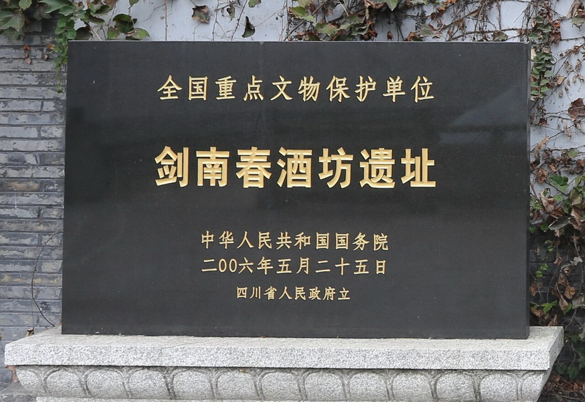

# 剑南春

剑南春产自四川绵竹，属浓香型白酒。它以高粱、大米、糯米、小麦、玉米为原料，采用泥窖固态发酵、续糟配料等传统工艺，常见酒精度为 52% vol。

图：剑南春。摄影：剑南春酒坊遗址国保碑。署名：Nekitarc，CC BY-SA 4.0，来自 Wikimedia Commons（[来源](https://commons.wikimedia.org/w/index.php?curid=44292018)）。

## 定义与定位

剑南春是[白酒](ref:baijiu)中的一个品牌，也是[浓香型白酒](ref:strong-aroma)的代表之一。它采用五粮配方，但风格与川南的浓香酒并不完全相同：绵竹位于四川盆地西北边缘，气候、水源与窖池条件形成了自己的路线。

产品属于蒸馏酒，酒精度以[体积分数](ref:abv)标示，常见为 52% vol。不同系列与年份的酒体设计不同，比较时应先确认产品线，而不是只看品牌名。

## 产区与环境

绵竹位于成都平原西北缘，靠近龙门山，气候比川南更温和，昼夜温差与湿度条件不同。当地水源与空气微生物影响制曲与发酵，也影响窖池中微生物群落的构成。产区风格不是单一因素决定，而是气候、粮食与工艺共同作用。

绵竹的酿酒传统与当地农业、商贸长期相连。地名能提示产区，但不能替代对具体产品的原料、窖池与勾调的核对。

剑南春的老窖池群是重要的生产资产。泥窖连续使用会让窖泥中的产香微生物逐渐稳定，形成更成熟的己酸菌生态。窖池需要维护，窖泥的酸碱度、水分与营养状态都会影响下一轮发酵，因此“老窖”背后是长期管理，而不是单纯的年份数字。

## 原料与制曲

五种粮食各有分工：高粱提供骨架，大米与糯米带来甜润与饱满，小麦提供曲香与发酵力，玉米增加甜味与厚度。原料粉碎后按比例混合，进入蒸煮与续糟配料流程。配比会随产品线调整，形成不同的香气重心。

曲以小麦为主，制成中高温大曲。曲块经过培菌、贮存后使用，[制曲](ref:qu-making)质量直接影响糖化力与香气前体。浓香型白酒的窖香来自窖泥微生物与续糟积累，曲则提供发酵起点，两者缺一不可。

## 「剑南春」怎么做出来
典型流程包括：原料处理、拌料、蒸煮、摊凉、加曲、入窖发酵、出窖、蒸馏取酒、分级贮存、勾调、装瓶。混蒸混烧让蒸粮与蒸酒在同一工序完成，新粮吸收酒醅中的香气，酒醅中的酒精与香味被同时提取。

发酵周期通常按月计。出窖后分层取酒、分段摘取，不同段位的酒风格不同。新酒按等级贮存，让辛辣感消退、香气融合，再通过勾调形成成品。贮存时间不是唯一变量，原酒结构与勾调目标同样重要。

## 「剑南春」的闻与喝
剑南春通常被描述为醇厚、甘冽，窖香与粮香并重，入口有甜感，尾味干净。它与川南浓香型在气候、窖池和勾调上存在差异，风格并不完全一致。香气中既有窖泥带来的复合香，也有五粮发酵带来的甜香与谷物感。

品鉴剑南春时用小杯，先闻静止香气，再轻摇闻香。入口让酒液铺满舌面，感受甜、酸、苦、鲜的次序与酒体厚度。加水可以降低刺激，但会改变香气平衡；若要尝试，应逐滴加入并与原样对比。

## 产品体系与标签

剑南春有多个系列与年份产品，定位与酒体设计不同。核对剑南春时，应把生产商、香型、酒精度、执行标准与净含量五项对齐，再查批次。剑南春的仿冒风险多集中在近似商标、同名系列与礼盒改包，购买时应通过正规渠道并核对防伪信息。

“年份”“陈酿”等字样需要结合企业标准与标签说明理解。瓶贮与坛贮的变化速度不同，家庭存放条件也难以复制酒厂环境，因此不宜把购买年份简单等同于品质。价格波动属于市场行为，本页不提供收藏或投资建议。

## 「剑南春」的饮用与搭配
传统喝法是常温小杯纯饮。佐餐时适合口味较重的菜肴，如红烧肉、卤味、酱牛肉与川菜；浓香酒的甜感与窖香能托住油脂，但过辣会放大酒精刺激。初次尝试可以少量倒酒，先闻香再入口，避免空腹快速饮用。

剑南春也可以用于调制，但 52% vol 的强度会改变成品平衡。加冰不是传统方式，会稀释香气并降低酒体厚度。开瓶后应避光、阴凉存放，并尽量在合理时间内喝完。

## 「剑南春」容易被读错的地方
第一，认为五粮配方一定比单粮更复杂。配方是风格路线，不等于质量等级。
第二，把绵竹浓香与川南浓香视为同一种风格。产区气候与窖池条件会带来差异。
第三，认为老窖池可以快速复制。窖泥微生物群落需要长期培养。
第四，认为低度版本是简单稀释。低度酒需要专门的酒体设计。
第五，用价格或包装判断真伪。防伪、渠道与标签核对才可靠。

对照阅读：[白酒](ref:baijiu)、[制曲](ref:qu-making)。

**关键事实。**

| 项目 | 内容 |
| --- | --- |
| 一句话定位 | 产自四川绵竹的浓香型白酒，以五粮为原料、泥窖固态发酵，常见酒精度 52% vol |
| 酒种/风格 | 白酒、浓香型白酒 |
| 酒精度 | 52–52% vol |

**来源与边界。** 本页关于「剑南春」的关键事实，主要由以下来源交叉核对：四川剑南春（集团）有限责任公司（产地、原料与产品信息）、国家市场监督管理总局、国家标准化管理委员会（浓香型白酒、泥窖固态发酵与续糟配料等术语；白酒在饮料酒分类中的位置）、Oxford University Press（提供关于中国白酒与浓香风格的条目；由原条目末尾参考资料迁移，未逐条复核访问日期）等 6 条来源。价格、批次与状态会变，涉及这些字段时以页面所列来源的最新版本为准。正文为项目自写，来源只作核验，不复制原文。

**并读。** 把「剑南春」与「白酒」、「浓香型白酒」、「制曲」放在一起读时，先确认它们是同一层级还是上下游关系：先确认酒种与产区，再比较年份、酒精度、价格与饮用场景。本页负责给出酒款的基本坐标，对照条目补上具体案例与差异；读完再回到本页，才能分清哪些差别属于酒款本身，哪些只是产地、批次或品牌选择。

## 参考资料
- [白酒](ref:baijiu)：剑南春所属的大类与工艺背景。
- [浓香型白酒](ref:strong-aroma)：理解窖香与续糟配料的关键。
- [制曲](ref:qu-making)：曲如何影响浓香酒香气。
- [酒精度](ref:abv)：比较不同产品强度的指标。
