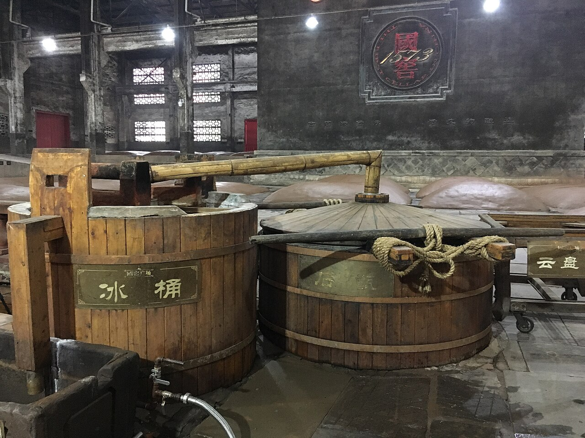

# 泸州老窖

泸州老窖产自四川泸州，是浓香型白酒的代表之一。其老窖池群连续使用时间长，“续糟配料、混蒸混烧”的泥窖固态发酵形成窖香浓郁的风格，常见产品酒精度为 52% vol。

图：泸州老窖。图片：Xiaomage de，CC BY-SA 4.0，via Wikimedia Commons（[原图页面](https://commons.wikimedia.org/wiki/File:Traditioneller_chinesischer_Destillationsapparat_in_der_Brennerei_Luzhou_Laojiao.jpg)）。

## 定义与定位

泸州老窖是[白酒](ref:baijiu)中的一个品牌，也是[浓香型白酒](ref:strong-aroma)的典型代表。品牌名中的“老窖”指向泥窖长期连续使用这一工艺事实：窖池不是一次性容器，而是持续参与发酵的微生物栖息地。理解这一点，才能理解浓香型白酒为何强调窖池年龄。

产品属于蒸馏酒，酒精度以[体积分数](ref:abv)标示，常见为 52% vol，也有低度版本。不同产品的酒体设计与勾调目标不同，不能只按度数比较。

## 产区与环境

泸州位于四川南部，长江与沱江在此交汇，气候温暖湿润，适合开放式制曲与长期窖池发酵。当地水源、粮食与空气微生物共同构成酿造环境。浓香型白酒的产区风格，往往与窖池群的历史、原料供应和气候条件绑定。

泸州老窖的老窖池群被视为重要的酿造遗产。窖池连续使用时间越长，窖泥中的微生物生态越稳定，产香能力越成熟。需要说明的是，“窖池越老酒越好”是经验判断，具体产品仍取决于原料、工艺控制与勾调。

## 原料与制曲

泸州老窖以高粱为主要原料，属于单粮浓香路线。高粱提供淀粉与适量单宁，单宁在发酵中转化，带来结构感与回味。原料粉碎后与曲、水配合，进入续糟配料流程。

曲以小麦为主，经培菌制成中高温大曲。[制曲](ref:qu-making)决定糖化力与香气前体，曲的质量直接影响出酒率与窖香厚度。泥窖中的窖泥富含己酸菌等微生物，与曲共同形成浓香型的主体香气。

## 「泸州老窖」怎么做出来
典型流程包括：原料处理、拌料、蒸煮、摊凉、加曲、入窖发酵、出窖、蒸馏取酒、分级贮存、勾调、装瓶。续糟配料指每轮保留部分旧糟与新粮、新曲混合，使香味物质逐轮积累；混蒸混烧指蒸粮与蒸酒在同一工序中完成。

发酵周期通常按月计。出窖后按层次取酒，分段摘取，不同段位的酒风格不同。新酒按等级贮存，再经勾调形成成品。贮存让辛辣感消退、香气融合，但贮存时间并非越长越好，原酒结构与目标风格才是判断依据。

## 「泸州老窖」的闻与喝
泸州老窖的香气以窖香、粮香与己酸乙酯的甜香为主，入口甜绵，酒体丰满，尾味干净。浓香型的“窖香”不是抽象的香气词，它来自泥窖微生物代谢与长期续糟积累。不同窖池、不同轮次会带来明显差异。

品鉴泸州老窖时用小杯，先闻静止香气，再轻摇闻香。入口让酒液铺满舌面，感受甜、酸、苦、鲜的次序，以及酒体是否托住酒精。加水能降低刺激，但会改变香气平衡；若要尝试，应逐滴加入并对比。

另一个常被忽略的变量是温度。浓香酒在冬季与夏季的香气表现不同，低温会让窖香显得内敛，高温则让甜香更突出。品鉴时记录环境温度，比单次判断更可靠。

## 产品体系与标签

泸州老窖有国窖 1573、特曲等产品线，定位与酒体设计不同。“1573”指向明代窖池的建造年份，是品牌叙事的一部分；具体产品的年份、批次与酒体，仍应以标签和企业说明为准。

核对泸州老窖时，应把生产商、香型、酒精度、执行标准与净含量五项对齐，再查批次。泸州老窖的仿冒风险多集中在近似商标、同名系列与礼盒改包，购买时应通过正规渠道并核对防伪。价格波动属于市场行为，本页不提供收藏或投资建议。

## 「泸州老窖」的饮用与搭配
传统喝法是常温小杯纯饮。佐餐时适合味道较浓的中式菜肴，如红烧肉、卤味、酱牛肉与火锅；浓香酒的甜感与窖香能托住油脂，但过辣会放大酒精刺激。餐前少量、慢饮更能体会层次。

泸州老窖也可以用于调制，但高酒精度会改变成品平衡。加冰不是传统方式，会稀释香气并降低窖香的展开；若追求清爽，可选择低度版本而非大量加冰。开瓶后应避光、阴凉存放，并尽快喝完。

## 「泸州老窖」容易被读错的地方
第一，把“老窖”当成绝对质量保证。窖池年龄是条件之一，不是唯一标准。
第二，认为浓香型只有一种风格。窖池、原料与勾调会带来明显差异。
第三，把“1573”理解为瓶中酒的年份。它指向窖池建造年份，不是酒液年份。
第四，认为低度版本是简单兑水。低度酒需要专门的酒体设计。
第五，用包装或价格判断真伪。防伪、渠道与标签核对才可靠。

对照阅读：[白酒](ref:baijiu)、[制曲](ref:qu-making)。

**关键事实。**

| 项目 | 内容 |
| --- | --- |
| 一句话定位 | 产自四川泸州的浓香型白酒代表，以老窖池续糟发酵为特色，常见产品酒精度 52% vol |
| 酒种/风格 | 白酒、浓香型白酒 |
| 酒精度 | 52–52% vol |

**来源与边界。** 本页关于「泸州老窖」的关键事实，主要由以下来源交叉核对：泸州老窖股份有限公司（产地、窖池与产品系列信息）、国家市场监督管理总局、国家标准化管理委员会（浓香型白酒、泥窖固态发酵与续糟配料等术语；白酒在饮料酒分类中的位置）、Oxford University Press（提供关于中国白酒与浓香风格的条目；由原条目末尾参考资料迁移，未逐条复核访问日期）。价格、批次与状态会变，涉及这些字段时以页面所列来源的最新版本为准。正文为项目自写，来源只作核验，不复制原文。

**并读。** 把「泸州老窖」与「白酒」、「浓香型白酒」、「制曲」放在一起读时，先确认它们是同一层级还是上下游关系：先确认酒种与产区，再比较年份、酒精度、价格与饮用场景。本页负责给出酒款的基本坐标，对照条目补上具体案例与差异；读完再回到本页，才能分清哪些差别属于酒款本身，哪些只是产地、批次或品牌选择。

## 参考资料
- [白酒](ref:baijiu)：泸州老窖所属的大类与工艺背景。
- [浓香型白酒](ref:strong-aroma)：理解窖香与续糟配料的关键。
- [制曲](ref:qu-making)：曲与窖泥如何共同塑造浓香。
- [酒精度](ref:abv)：比较不同度数版本的指标。
