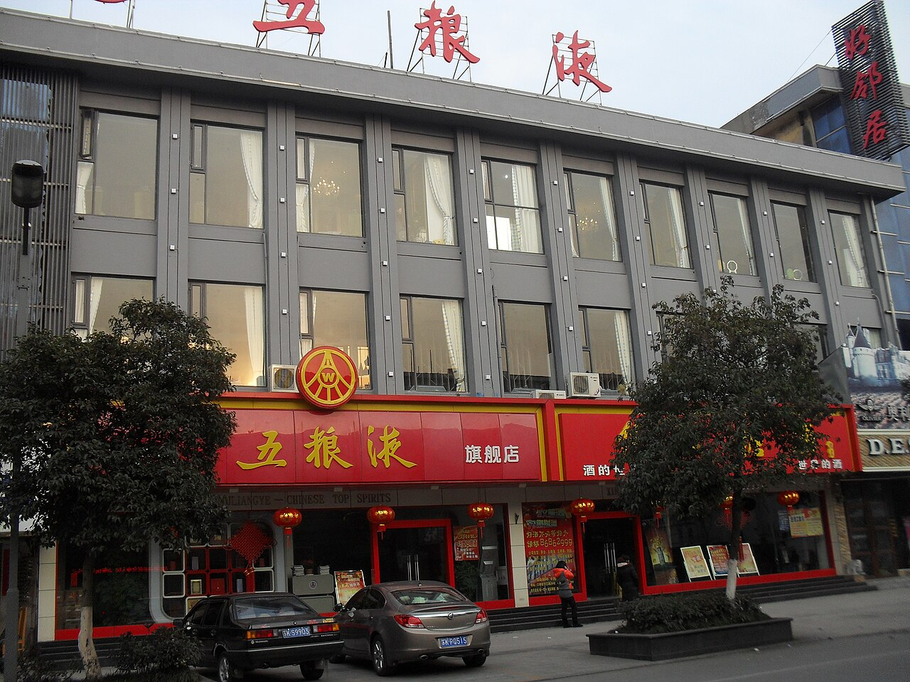

# 五粮液

五粮液产自四川宜宾，以高粱、大米、糯米、小麦、玉米五种粮食为原料，属浓香型白酒。老窖池持续发酵、续糟配料和混蒸混烧是其主要工艺特征，常见产品酒精度为 52% vol。

图：五粮液。图片：东京村子，CC BY-SA 3.0，via Wikimedia Commons（[原图页面](https://commons.wikimedia.org/wiki/File:%E4%BA%94%E7%B2%AE%E6%B6%B2%E6%97%97%E8%88%B0%E5%BA%97_-_panoramio.jpg)）。

## 定义与定位

五粮液是[白酒](ref:baijiu)中的一个品牌产品，也是[浓香型白酒](ref:strong-aroma)的代表之一。它的名称直接指向原料结构：五种粮食混合酿造。品牌、香型与产地是不同层次的概念，选购时需要分别核对，不能把“宜宾产的浓香酒”都当成五粮液。

产品属于蒸馏酒，酒精度以[体积分数](ref:abv)标示，常见为 52% vol，也有 39% vol 等低度版本。度数差异会影响入口刺激与香气释放，但不构成质量高下。

## 产区与环境

宜宾位于四川南部，岷江与金沙江在此汇合后进入长江，河谷气候湿润、温差相对温和，适合开放式制曲与长期窖池发酵。当地水源与空气微生物被视为浓香风格的环境条件之一。产区优势不是单一因素，而是气候、粮食、窖池与工艺共同积累的结果。

老窖池是宜宾浓香酒的重要资产。窖池连续使用时间越长，窖泥中的微生物群落越稳定，己酸菌等产香微生物的生态越成熟。窖池不是容器那么简单，它参与风味形成，因此“老窖”在浓香型白酒中具有实际意义，而不只是营销词。

## 原料与制曲

五种粮食各有角色：高粱提供骨架与单宁带来的结构感，大米与糯米增加甜润与醇厚，小麦带来曲香与发酵力，玉米带来甜味与酒体厚度。比例不是固定不变，不同产品线会调整配比以形成风格差异。

曲是糖化发酵剂。浓香型白酒通常使用中高温大曲，以小麦为主，曲块经过培菌与贮存后使用。续糟配料意味着每一轮发酵都会保留部分旧糟，与新粮、新曲混合，使风味逐轮积累。[制曲](ref:qu-making)与窖池管理共同决定香气的厚度与干净度。

## 「五粮液」怎么做出来
浓香型白酒的典型流程包括：原料粉碎、拌料、蒸煮、摊凉、加曲、入窖发酵、出窖、蒸馏取酒、分级贮存、勾调、装瓶。混蒸混烧指原料蒸煮与酒醅蒸馏在同一套工序中完成，既提取酒精与香气，也让新粮吸收酒醅中的风味。

发酵周期通常按月计，出窖后按层次取酒，分段摘酒。新酒按等级与轮次分别贮存，再通过勾调形成成品。勾调要解决的是香气、酒体与收口的平衡，而不是把不同酒简单相加。贮存容器与时间会影响辛辣感的消退速度。

## 「五粮液」的闻与喝
五粮液的香气以窖香、粮香与甜香为主，常伴有多粮发酵带来的复合香气。入口绵甜，酒体较饱满，中段香气展开，尾味干净。浓香型的主体香气通常与己酸乙酯有关，但不同窖池、年份与勾调会带来明显差异。

品鉴时用小杯，先闻静止香气，再轻轻摇杯闻香。入口后让酒液在口中停留，感受甜、酸、苦、鲜的次序与酒体的厚度。加少量水可以降低刺激，但会改变香气平衡；若要尝试，应逐滴加入并对比。

## 产品体系与标签

五粮液有核心产品与系列酒之分，价格与酒体设计不同。核对五粮液时，应把生产商、香型、酒精度、执行标准与净含量五项对齐，再查批次。市场上存在仿冒与“擦边”命名，购买时应通过正规渠道并核对防伪信息。

“年份”“陈酿”等字样需要结合企业标准与标签说明理解，不能只看包装。瓶贮与坛贮的变化速度不同，家庭存放条件也难以复制酒厂的温湿度环境，因此不宜把购买年份简单等同于品质。

## 「五粮液」的饮用与搭配
传统喝法是常温小杯纯饮。佐餐时适合川菜中的咸鲜、酱香与微辣菜式，如回锅肉、樟茶鸭、烧菜与卤味；过辣会放大酒精刺激，过甜会压住窖香。餐前少量、慢饮更能体会层次。

五粮液也可以用于调制，但 52% vol 的强度会显著改变成品平衡，配方中的糖与酸需要重新调整。加冰不是传统方式，会降低香气释放并稀释酒体；若追求清爽口感，可考虑低度版本而非大量加冰。

## 「五粮液」容易被读错的地方
第一，认为“五种粮食”一定优于单粮。多粮与单粮是风格路线，不是质量等级。
第二，把浓香等同于“越香越好”。香气需要干净与层次，过重的窖香可能掩盖粮香。
第三，认为低度版本是“兑水”。低度酒需要专门的酒体设计与勾调，不是简单稀释。
第四，认为老窖池可以短期复制。窖泥微生物群落需要长期培养，时间不可压缩。
第五，用包装或价格判断真伪。防伪信息、渠道与标签核对才是可靠方法。

对照阅读：[白酒](ref:baijiu)、[制曲](ref:qu-making)。

**关键事实。**

| 项目 | 内容 |
| --- | --- |
| 一句话定位 | 产自四川宜宾的浓香型白酒，以高粱、大米、糯米、小麦、玉米五种粮食为原料，常见酒精度 52% vol |
| 酒种/风格 | 白酒、浓香型白酒 |
| 酒精度 | 52–52% vol |

**来源与边界。** 本页关于「五粮液」的关键事实，主要由以下来源交叉核对：宜宾五粮液股份有限公司（产地、原料与产品系列）、国家市场监督管理总局、国家标准化管理委员会（浓香型白酒、续糟配料与混蒸混烧等术语；白酒在饮料酒分类中的位置）、Oxford University Press（提供关于中国白酒与浓香风格的条目；由原条目末尾参考资料迁移，未逐条复核访问日期）。价格、批次与状态会变，涉及这些字段时以页面所列来源的最新版本为准。正文为项目自写，来源只作核验，不复制原文。

**并读。** 把「五粮液」与「白酒」、「浓香型白酒」、「制曲」放在一起读时，先确认它们是同一层级还是上下游关系：先确认酒种与产区，再比较年份、酒精度、价格与饮用场景。本页负责给出酒款的基本坐标，对照条目补上具体案例与差异；读完再回到本页，才能分清哪些差别属于酒款本身，哪些只是产地、批次或品牌选择。

## 参考资料
- [白酒](ref:baijiu)：五粮液所属的大类与基础工艺。
- [浓香型白酒](ref:strong-aroma)：理解窖香与续糟配料的关键。
- [制曲](ref:qu-making)：曲如何影响浓香酒香气。
- [酒精度](ref:abv)：比较不同度数版本的指标。
