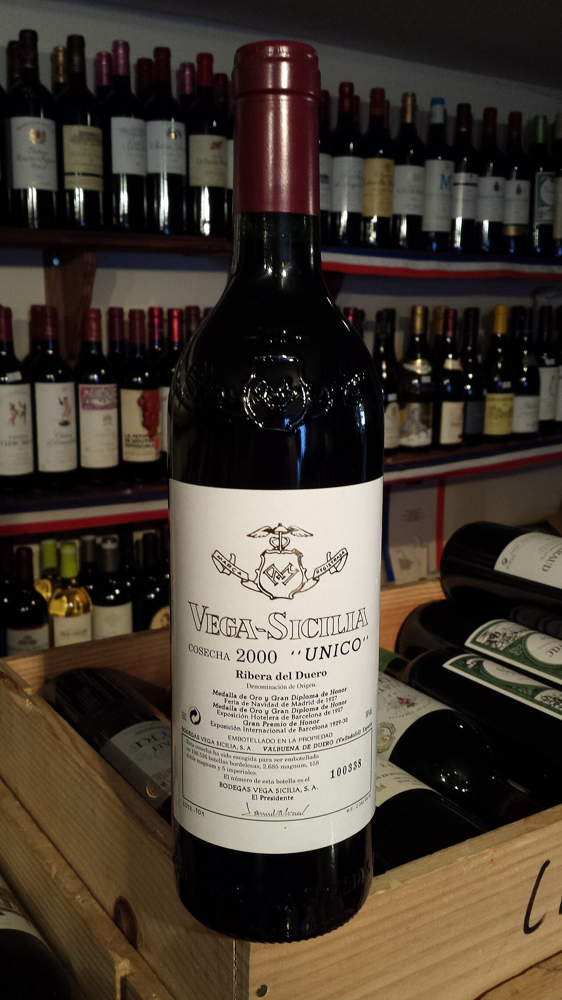

# 贝加西西里亚

贝加西西里亚（Vega Sicilia）是西班牙杜埃罗河岸产区的历史名庄，1864 年创立。酒款属于[红葡萄酒](ref:red-wine)，以[丹魄](ref:tempranillo)为主的混酿，旗舰酒款 Único 以长陈年与复杂度著称。常见 750 mL 瓶装、酒精度约 14% vol，具体年份、装瓶批次与酒标信息以瓶标为准。

图：贝加西西里亚。图片：Dominic Lockyer，CC BY 2.0，via Wikimedia Commons（[原图页面](https://commons.wikimedia.org/wiki/File:Vega_Sicilia_%C3%9Anico_2000.jpg)）。

## 定义与定位

贝加西西里亚既是酒庄名，也是酒庄产品的品牌名。酒庄位于西班牙北部杜埃罗河岸产区，在欧盟 AOC/AOP 体系中以原产地命名销售。旗舰酒款 Único 之外还有 Valbuena 等产品，不同酒款来自不同地块与筛选标准，不能混为一谈。

在[葡萄酒](ref:wine)的分类里，它属于静态红葡萄酒。历史名庄是长期积累的市场身份，不是法定等级；年份、地块与装瓶批次仍然是判断具体酒款的前提。

## 产区与气候

杜埃罗河岸位于西班牙北部高原，海拔较高，气候大陆性明显：夏季炎热干燥，冬季寒冷，昼夜温差大。这样的条件适合丹魄等品种在较长的成熟期内积累风味，同时保留酸度。

产区土壤由石灰岩、黏土与砾石混合而成，不同地块的排水与升温条件不同。海拔与朝向影响成熟节奏，酒庄需要按地块分批采收。高海拔与大陆性气候不是质量保证，年份差异仍然明显。

## 品种与混酿

酒款以丹魄为主体，常搭配[赤霞珠](ref:cabernet)与其他品种。丹魄提供果味、酸度与陈年潜力，赤霞珠补充结构与单宁，其他品种调整香气与酒体。不同酒款的品种比例不同，具体配方通常不会完整标注在瓶标上。

比例会随年份与地块调整。比例本身不是质量指标，最终要看酒款的平衡。调配是酒庄的工艺决定，具体比例属于企业工艺信息，瓶标未必完整披露。

## 「贝加西西里亚」怎么做出来
采收通常人工进行，经过分选、除梗与破碎后进入控温[发酵](ref:fermentation)。浸渍时间与发酵温度影响颜色、单宁与香气的提取强度；不同地块、不同品种往往分罐处理，再进入[调配](ref:blending)。

发酵完成后，酒液进入[橡木桶陈酿](ref:oak-ageing)。新桶比例、陈酿时长与换桶频率属于酒庄工艺安排。旗舰酒款以较长陈年著称，瓶中陈年也会影响最终风格；具体时长公开资料未必逐年披露。

## 「贝加西西里亚」的瓶型与标签
常见规格为 750 mL 瓶装，酒精度约 14% vol，属干型红葡萄酒。瓶标通常包含酒庄名、酒款名、年份、产区、酒精度与净含量；西班牙原产地命名酒款还会标注产区名称。

进口到中国市场时还会有中文背标，中文标签与原文信息应能互相对应。不同酒款、不同年份的包装可能有差异，包装差异不等于酒体差异。

## 「贝加西西里亚」的闻与喝
年轻时常呈现黑樱桃、李子、香料与烟草气息，单宁细密而有支撑，酸度较好。经过长时间陈年后逐渐发展出雪松、皮革、可可与干花的气息，酒体由紧致转向柔顺，余味较长。

建议在 16-18°C 饮用。温度过高会让酒精感突出，过低会压抑香气。老酒应缩短与空气接触的时间，避免香气过快散失；年轻酒款可以适度醒酒。

## 「贝加西西里亚」的饮用与搭配
贝加西西里亚适合搭配烤羊排、牛排、伊比利亚火腿与硬质奶酪。贝加西西里亚的单宁与蛋白质结合可以缓和涩感，酸度则能切割油脂。搭配蘑菇、松露等带有土壤气息的菜式，也容易与陈年香气形成呼应。

贝加西西里亚开瓶后应塞紧瓶塞冷藏，最好两天内喝完；Único 等长陈年酒款更怕氧化的反复。果香转向酸味与坚果味后不可逆；分装小瓶或真空塞可减缓，但老年份应尽快喝完。

## 「贝加西西里亚」的购买与保存
历史名庄的产品主要通过酒商、拍卖与酒庄渠道流通，价格受年份、产量与市场预期影响。购买时应核对酒庄名、酒款名、年份、产区、酒精度与防伪信息，并留意渠道是否可靠。

贝加西西里亚未开瓶应避光、卧放于 12–16°C 的稳定环境，避免温差与震动；软木塞需要湿度。家庭存放难以复制酒庄酒窖，长期陈年需要稳定条件，购买年份不等于适饮状态。

## 「贝加西西里亚」容易被读错的地方
第一，把历史名庄当作每年固定的质量保证。年份差异仍然明显。

第二，把旗舰酒款与入门酒款混为一谈。它们来自不同地块与筛选标准。

第三，把丹魄当作唯一品种。混酿中还有赤霞珠等其他品种。

第四，只看价格或 Único 名判断质量。贝加西西里亚不同年份、不同系列差异大，渠道、瓶况与保存历史同样重要；老酒还要看液面与酒标。

第五，把长陈年当作无限期存放。Único 的陈年潜力因年份而异，过了适饮期香气与结构都会衰退；家庭存放无法复制酒庄的酒窖条件。

对照阅读：[红葡萄酒](ref:red-wine)、[西班牙](ref:spain)。

**关键事实。**

| 项目 | 内容 |
| --- | --- |
| 一句话定位 | 西班牙杜埃罗河岸产区的历史名庄，1864 年创立；以丹魄为主的混酿，旗舰酒款 Único 以长陈年与复杂度著称，常见 750 mL、酒精度约 14% vol，具体年份与批次以瓶标为准 |
| 酒种/风格 | 红葡萄酒 |
| 产区 | 西班牙 |

**来源与边界。** 本页关于「贝加西西里亚」的关键事实，主要由以下来源交叉核对：International Organisation of Vine and Wine (OIV)（葡萄酒定义、类别与标签的基本表述）、European Union（欧盟葡萄酒类别、地理标志与标签规则）、国家质量监督检验检疫总局、国家标准化管理委员会（葡萄酒分类、标签与技术要求）等 7 条来源。价格、批次与状态会变，涉及这些字段时以页面所列来源的最新版本为准。正文为项目自写，来源只作核验，不复制原文。

**并读。** 把「贝加西西里亚」与「红葡萄酒」、「葡萄酒」、「西班牙」放在一起读时，先确认它们是同一层级还是上下游关系：先确认酒种与产区，再比较年份、酒精度、价格与饮用场景。本页负责给出酒款的基本坐标，对照条目补上具体案例与差异；读完再回到本页，才能分清哪些差别属于酒款本身，哪些只是产地、批次或品牌选择。

## 参考资料
- [红葡萄酒](ref:red-wine)：类别与基本工艺。
- [葡萄酒](ref:wine)：大类与分类体系。
- [西班牙](ref:spain)：西班牙葡萄酒产区格局。
- [丹魄](ref:tempranillo)：品种特征与风格。
- [赤霞珠](ref:cabernet)：混酿中的结构与单宁。
- [发酵](ref:fermentation)：带皮发酵与浸渍。
- [橡木桶陈酿](ref:oak-ageing)：香气与单宁的塑造。
- [调配](ref:blending)：平衡品种与地块差异。
