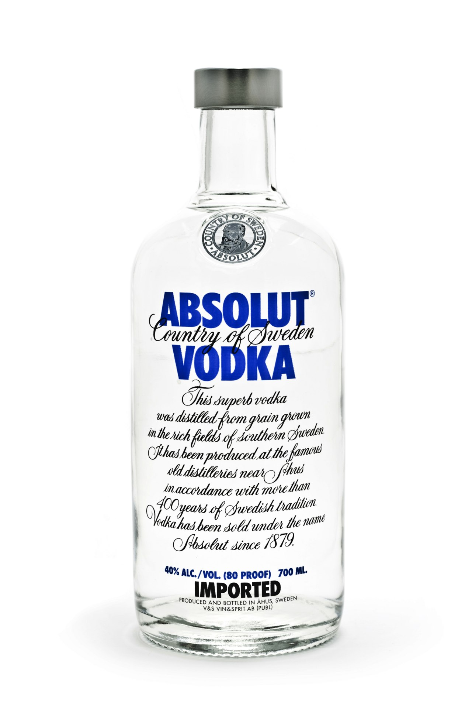

# 绝对伏特加

绝对伏特加（Absolut Vodka）是瑞典[伏特加](ref:vodka)品牌，以冬小麦为原料，在瑞典南部斯科讷省的 Åhus 生产，采用连续[蒸馏](ref:distillation)。品牌于 1979 年推出，常见酒精度为 40% vol，风味以干净、柔和的谷物甜感为主。

图：绝对伏特加。摄影：Absolut vodka bottle。署名：Justus Blümer，CC BY 3.0，来自 Wikimedia Commons（[来源](https://commons.wikimedia.org/w/index.php?curid=43012114)）。

## 定义与身份

伏特加是以农产品为原料、经蒸馏得到的高纯度酒精饮料，欧盟法规要求其装瓶酒精度不低于 37.5% vol。它可以是中性风味，也可以带有原料带来的轻微谷物或马铃薯特征。绝对伏特加属于“原味伏特加”，不是加味伏特加，也不是利口酒。

“绝对”既是品牌名，也是产品线的统称。品牌还有柠檬、柑橘、香草等加味版本，它们以原味伏特加为基酒再加入风味，不能与原味产品混为一谈。购买时应看标签上的版本名与酒精度，不能把某一款加味产品的甜度当成原味伏特加的特征。

## 「绝对伏特加」的时间线
Åhus 的蒸馏传统可以追溯到 1879 年，当地以小麦与水源为基础发展蒸馏业。1979 年，绝对伏特加作为面向国际市场的瑞典伏特加品牌推出，凭借简洁瓶身与广告设计迅速获得识别度。此后品牌扩展到多个国家，并推出不同风味与限量版本。

品牌所有权在 21 世纪发生变化，现由国际酒业集团持有。品牌在不同市场维持统一的原料与蒸馏标准，使产品风味相对稳定。历史年份与某一瓶酒的生产日期不是同一件事；品牌故事中的“1879”指蒸馏传统，而“1979”指现代产品上市。阅读品牌历史时，应区分传统、产品发布与市场宣传三个层面。

## 「绝对伏特加」的产地与原料
Åhus 位于瑞典南部，气候相对温和，适合冬小麦生长。冬小麦在秋季播种、越冬后成熟，生长期较长，蛋白质与淀粉结构会影响发酵与蒸馏。绝对伏特加强调“单一来源”的原料体系，即小麦来自特定区域，以减少批次差异。

伏特加的原料可以是谷物、马铃薯、糖蜜等；欧盟法规要求原料为农产品，并经过蒸馏提纯。谷物原料通常带来轻微甜感与柔和酒体，马铃薯原料可能更厚、更中性。原料差异不是“谁更高级”，而是风格差异；绝对伏特加选择冬小麦，是为了稳定、干净的酒体。

## 工艺与蒸馏

绝对伏特加采用连续蒸馏：酒液在蒸馏塔中连续进入、加热、蒸发与冷凝，效率高、产量大，适合稳定的大规模生产。连续蒸馏可以得到较高纯度的酒精，再通过过滤与加水调整到目标酒精度。与壶式间歇蒸馏相比，连续蒸馏更强调一致性与纯净度。

“蒸馏次数越多越好”是简化说法。次数影响纯度与风味保留：过度提纯会失去谷物特征，提纯不足则残留杂醇与刺激感。绝对伏特加的目标是干净、柔和、适合调酒，因此工艺选择服务于这一风格，而不是追求风味复杂度。加味版本会在基酒上增加风味，但仍以原味伏特加为骨架。

## 「绝对伏特加」的闻与喝
绝对伏特加的典型香气是清淡的谷物甜香、少量柑橘与酒精感，入口柔和，酒体较轻，余味干净。它不属于“完全无味”的伏特加：低温下谷物甜感更明显，温度升高则酒精刺激增强。不同批次之间差异通常较小，这正是连续蒸馏与原料管理的结果。

品鉴时建议充分冷藏后纯饮，用小杯少量品尝；也可以先在室温下闻香，再冷藏后对比，观察温度对甜感与刺激的影响。不要用大口吞咽的方式评价伏特加，因为高酒精度会迅速麻痹味觉。若用于调酒，应先了解配方中的糖、酸与稀释比例，再判断基酒是否合适。

## 「绝对伏特加」的饮用与搭配
纯饮时，伏特加通常冷藏至较低温度，搭配咸味小食、鱼子酱、腌黄瓜或烟熏鱼。调酒方面，莫斯科骡子（伏特加、姜汁啤酒、青柠）、血腥玛丽（伏特加、番茄汁、香料）、伏特加马天尼与大都会都常见。由于风味中性，它在调酒中更像结构骨架，但高酒精度会显著改变成品平衡。

作为基酒，绝对伏特加适合需要干净底味的配方；如果配方依赖基酒本身提供香气，它可能显得过于中性。与重甜饮料混合时，应注意总糖量与酒精度，避免成品过甜或过烈。餐食搭配上，它适合咸鲜、酸味与油脂较重的食物，不适合与精致甜点同饮。

## 「绝对伏特加」容易被读错的地方
第一，认为所有伏特加都完全没有味道。原料与蒸馏会留下轻微谷物、马铃薯或甜感差异。
第二，把蒸馏次数当成质量排名。次数影响纯度与风格，不等于更好喝。
第三，把绝对伏特加当成俄罗斯品牌。它起源于瑞典，在 Åhus 生产。
第四，把加味版本当成原味伏特加。加味产品有额外糖分与风味，标签会注明。
第五，忽视酒精度与容量。40% vol 是常见规格，不同市场与版本可能不同。

对照阅读：[伏特加](ref:vodka)、[小麦](ref:c-extra-1)。

相关条目：[蒸馏](ref:distillation)。

**关键事实。**

| 项目 | 内容 |
| --- | --- |
| 一句话定位 | 瑞典伏特加品牌，以冬小麦为原料，在 Åhus 连续蒸馏；1979 年推出，常见酒精度 40% vol |
| 酒种/风格 | 伏特加 |
| 酒精度 | 40–40% vol |

**来源与边界。** 本页关于「绝对伏特加」的关键事实，主要由以下来源交叉核对：Absolut（原料、产地、连续蒸馏与产品信息）、European Union（伏特加的定义、原料与最低装瓶酒精度）、Oxford University Press（提供关于伏特加、连续蒸馏与瑞典蒸馏传统的条目）等 4 条来源。价格、批次与状态会变，涉及这些字段时以页面所列来源的最新版本为准。正文为项目自写，来源只作核验，不复制原文。

**并读。** 把「绝对伏特加」与「伏特加」、「蒸馏」、「小麦」放在一起读时，先确认它们是同一层级还是上下游关系：先确认酒种与产区，再比较年份、酒精度、价格与饮用场景。本页负责给出酒款的基本坐标，对照条目补上具体案例与差异；读完再回到本页，才能分清哪些差别属于酒款本身，哪些只是产地、批次或品牌选择。

**适用边界。** 对「绝对伏特加」而言，年份、批次、酒精度与包装会变；酒种定义与产区法规较稳定。购买时先看背标，再看品牌页面。

## 参考资料
- [伏特加](ref:vodka)：绝对伏特加所属的品类与法规框架。
- [蒸馏](ref:distillation)：连续蒸馏与纯净酒体的关系。

补充阅读：[小麦](ref:c-extra-1)。
