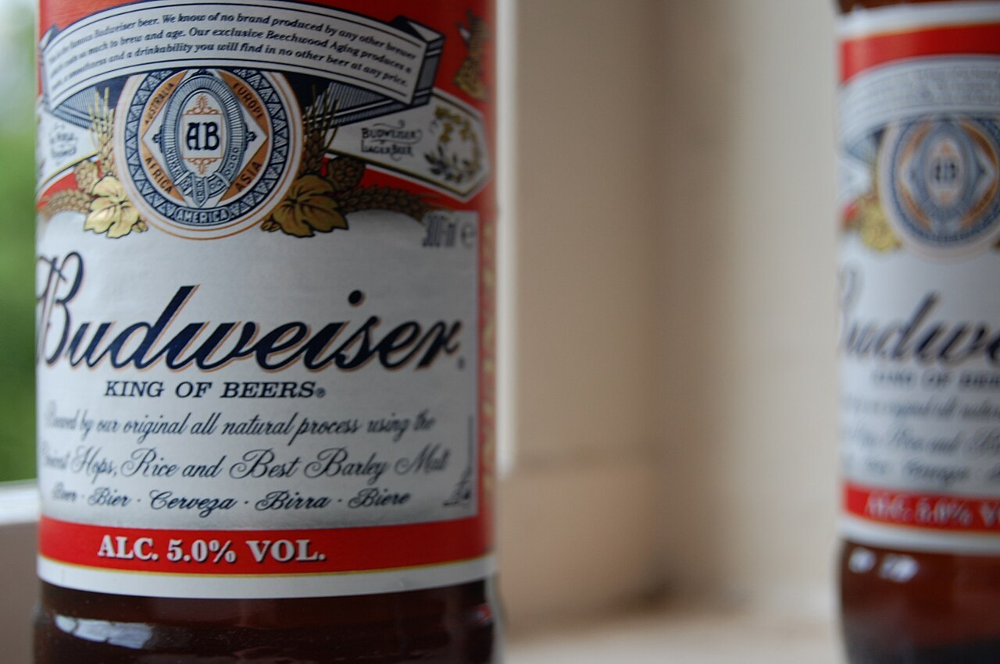

# 百威

1876 年，圣路易斯的德裔移民阿道夫·布希把一款淡色窖藏啤酒装进玻璃瓶，交给铁路运往全国。那时美国还没有真正意义上的“全国性啤酒品牌”：冷藏车厢与巴氏杀菌刚刚让啤酒可以跨州销售而不至于变质。百威（Budweiser）是在这个技术与市场的节点上诞生的产品，而不是先有风格定义、再有名牌。今天它的常见规格是 5.0% vol、355 mL，也是全球产量最大的啤酒品牌之一。

图：百威。摄影：Budweiser bottle close-up。署名：Sam，CC BY-SA 2.0，来自 Wikimedia Commons（[来源](https://commons.wikimedia.org/w/index.php?curid=20085117)）。

## 一款产品，而不是一种风格

讨论百威时最容易混淆的是三个层次：安海斯-布希是生产企业，百威是品牌，瓶中的酒才是具体产品。产品由酒精度、容量、产地与批次界定；同一品牌在不同国家授权生产时，水质、原料比例与标签法规都会变化。

“美式拉格”（American lager）是一类风格：浅色、低苦度、碳酸感强、收口干净，允许使用大米或玉米等辅料。百威是这类风格最有代表性的商业产品之一，但风格名不等于产品名。称它为“美式拉格”是分类，称它为“百威”才是识别。

## 从移民酒馆到铁路网络

安海斯-布希的前身是埃伯哈德·安海斯在圣路易斯经营的啤酒厂。阿道夫·布希加入后，把目光放在两件当时还不寻常的事上：一是用巴氏杀菌让啤酒在运输中保持稳定，二是借助冷藏铁路车厢把啤酒卖到更远的市场。这两项条件叠加，才使一个地方酒厂具备了全国品牌的可能。

1876 年，百威作为一款淡色拉格推出。它的名字借用了捷克城市布德瓦伊斯（Budweis，今捷克布杰约维采）在德语区的啤酒声誉——这也是后来长达一个多世纪的商标纠纷的源头。产品成功的原因并不神秘：口味清淡、价格可控、供应稳定，适合刚从欧洲移民过来的工人阶层，也适合禁酒令前后对“淡啤酒”仍有需求的美国市场。

## 大米为什么在配方里

百威的公开原料包括大麦麦芽、大米、水与酒花。大米在这里不是“填充物”，而是风格设计的一部分：它提供可发酵糖，几乎不带来蛋白质与多酚，使酒体更轻、色泽更浅、口感更干净。美国六棱大麦的蛋白质含量偏高，适量辅料还能避免酒体过于饱满或出现浑浊。

这套配方逻辑与欧洲《纯净法》传统不同。德国与捷克的许多拉格只允许大麦麦芽，因此麦芽骨架更明显、风味更“厚”；美式拉格用辅料把骨架削薄，换来的是易饮性与一致性。两者是两种设计目标，不是“正宗”与“不正宗”的关系。

## 糖化、发酵与山毛榉陈贮

酿造流程是标准的底层发酵：糖化、煮沸并添加酒花、冷却、接种酵母低温发酵，随后进入后熟与澄清。低温与长时后熟让酵母沉降、风味收敛，成品因此干净、少酯香。

需要纠正一个流传很广的说法：百威所谓“山毛榉陈贮”（beechwood ageing）并不是把酒放进山毛榉木桶。实际做法是在卧式后熟罐中铺放经过处理的山毛榉木条，为残余酵母提供附着表面，帮助沉降与澄清，木条本身并不像橡木桶那样赋予香草或烘烤味。它是工艺辅助，不是风味来源。

## 风味坐标：低苦、强碳酸、干收口

酒液浅金色，泡沫洁白但消散较快。香气以谷物甜香、淡淡酒花草本气息为主，没有明显的酯香或酵母香。入口碳酸感强，前段轻甜，中段几乎没有压迫感，收尾干净偏干，苦味短暂。

把它与捷克皮尔森并排，差别很清楚：皮尔森的苦度更高、酒花香气更外放、麦芽骨架更完整；百威则把苦度压到很低，让“解渴”优先于“品味”。这也是它适合冰镇、适合大口饮用的原因，但冰镇同时会进一步压低本就不多的香气。

## 规格、产地与全球授权

美国版常见 5.0% vol、355 mL 罐装与瓶装；欧洲与其他市场多由当地授权工厂生产，酒精度常在 4.5%–5.0% 之间，容量则按当地习惯调整为 330 mL、440 mL 或 500 mL。授权生产意味着配方要适配当地水源、原料供应与标签法规，成品不可能与圣路易斯原厂完全一致。

选购时最可靠的信息在背标：生产商、灌装地、酒精度、净含量与保质期。跨境版与本地版的价格差，往往来自关税、渠道与包装，而不是酒液本身的质量差异。

## 价格带与饮用场景

在本土市场，百威属于大众价位；进入中国市场后，它更多被放在中档进口拉格的位置，与国产主流拉格和精酿入门款同时竞争。它的优势场景是烧烤、火锅、球赛与聚会——需要的是低温、足量、不抢味的饮料，而不是需要慢慢分析的复杂风味。

这也解释了它的包装策略：大容量、易开盖、强调冰镇。用品鉴的方式对待它，容易失望；用佐餐与解渴的方式对待它，它很少出错。

## 与捷克布德瓦的商标之争

捷克布杰约维采的布德瓦（Budweiser Budvar）是另一家独立酒厂，使用相似的地名标识，双方围绕“Budweiser”名称在欧洲多国争讼数十年。欧盟法院 2011 年的判决允许两家商标在各自既有范围内共存，但不同成员国的具体结果并不一致。

对消费者而言，判断方法很简单：看生产商与产地。美国产品标 Anheuser-Busch；捷克产品标 Budějovický Budvar。两者风格也不同——捷克版更接近传统皮尔森，苦度与麦芽感更明显。

## 常见误区

第一，把百威当成捷克啤酒。它是美国产品，与捷克布德瓦只是共享地名渊源。
第二，认为大米辅料等于偷工减料。辅料是美式拉格的风格选择，影响酒体、色泽与成本。
第三，把山毛榉陈贮理解成木桶陈年。实际是后熟罐中的木条，主要作用是帮助酵母沉降。
第四，认为全球的百威完全一样。授权工厂、水质与法规都会带来差异。
第五，用销量判断风味高低。销量说明供应链与渠道能力，不说明复杂度。
第六，认为淡色拉格没有工艺。低温发酵、后熟与稳定性控制，恰恰是工业化拉格最难的部分。

## 延伸阅读

- [拉格](ref:lager)：百威所属的啤酒大类与底层发酵逻辑。
- [美国](ref:usa)：品牌起源地与主要市场。
- [大麦](ref:barley)、[大米](ref:rice)与[水](ref:water)：构成酒体的主要原料。
- [发酵](ref:fermentation)：低温发酵与后熟的核心环节。

相关条目：[拉格啤酒](ref:lager)、[美国](ref:usa)。
