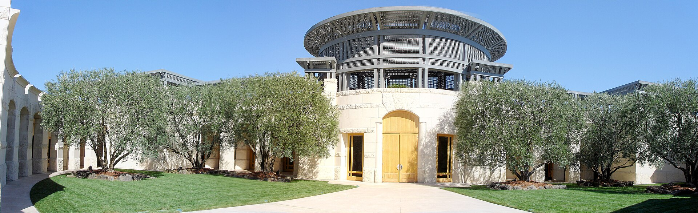

# 作品一号

作品一号（Opus One）是美国加州[纳帕谷](ref:napa-valley) Oakville 的波尔多风格[红葡萄酒](ref:red-wine)，1979 年由罗伯特·蒙大维与菲利普·德·罗斯柴尔德男爵合作创立，首个年份 1979，1979 与 1980 两个年份在 1984 年一起上市。它以[赤霞珠](ref:cabernet)为主，常见 750 mL、酒精度约 14% vol。

图：作品一号相关实景照片。图片：Jim G，CC BY 2.0，via Wikimedia Commons（[原图页面](https://commons.wikimedia.org/wiki/File:Panorama,_Opus_One,_Napa_Valley,_California,_USA.jpg)）。

## 1979：两个家族在奥克维尔的握手

1978 年，蒙大维与罗斯柴尔德在木桐酒庄见面，很快定下合作框架：不做多个产品，只做一款酒，用纳帕的葡萄、波尔多的[调配](ref:blending)思路，由两边酿酒师共同完成。1979 年首个年份在蒙大维酒庄酿造，1984 年与 1980 年份一起上市。1989 年动工、1991 年落成自己的酒庄，建筑以石灰岩、拱廊与塔楼呼应梅多克酒庄。

## 从 Napa Medoc 到 Opus One：1982 年的改名

项目最初叫 “Napa Medoc”（也有资料写作 Napamedoc），把纳帕与梅多克拼在一起。1982 年改名为 Opus One：“opus”在拉丁语里是“作品”，音乐里指作曲家的第一号作品，既表示“第一款”，也表示“只做这一款”。名字的改变不只是营销，它把产品定位从“纳帕的波尔多”改成“两个家族的第一件共同作品”。

## Oakville 的四个地块与 170 英亩

酒庄在 Oakville 西部拥有四个地块，合计约 170 英亩（约 69 公顷），其中两个在 To Kalon 葡萄园，另外两个是 Ballestra 与 River。最早的 35 英亩来自 To Kalon 的 Q Block，1981 年完成购买；此后又陆续购入 48 英亩与 100 英亩。不同资料对面积的统计口径在 55–70 公顷之间，以酒庄资料为准。Oakville 是纳帕谷中部的子产区（AVA），To Kalon 则是该地历史最久的葡萄园之一，冲积砾石与壤土排水良好。

## 2023 年的混酿：81% 赤霞珠

2023 年份的调配为赤霞珠 81%、[梅洛](ref:merlot) 7%、品丽珠 6%、小维多 5%、马尔贝克 1%。赤霞珠提供骨架、颜色与陈年潜力，梅洛补充圆润与果味，品丽珠带来花香与草本调，小维多增加颜色与单宁，马尔贝克补一点香料感。比例随年份变化，2022 年份赤霞珠为 80%、小维多 8%。

## 22 天浸渍与 19 个月新法国橡木桶

2023 年份浸渍 22 天，之后在全新法国橡木桶中[陈年](ref:oak-ageing) 19 个月；酒庄另处写“18 个月”，差异来自不同年份与统计节点，引用时应以该年份技术资料为准。新桶比例高，带来香草、烘烤、雪松与甜香料；装瓶后还要再陈约 15 个月才上市。葡萄人工采收，按地块分罐，重力输送，减少泵送对果实的冲击。

## Overture：副牌的角色

Overture 是作品一号的副牌，1993 年起生产，2021 年份成为第一个标注年份的 Overture。2023 年份调配为赤霞珠 91%、梅洛 4%、小维多 3.4%、品丽珠 1%、马尔贝克 0.5%，同样浸渍 22 天、在全新法国橡木桶中陈年 19 个月。它比正牌更早饮、果味更直接、单宁更柔，价格也更低；不是“次品”，而是把同一块园里风格更开放的酒液单独装瓶。

## 风格对比：为什么它比 Almaviva 更“石墨感”

与[活灵魂](ref:almaviva)相比，作品一号的赤霞珠比例更高（81% 对 70%），不使用佳美娜，葡萄园在更暖的 Oakville，新桶比例更高（约 100% 对 76%），陈年时间也更长（19 个月对 18 个月）。结果是它更偏黑加仑、石墨、雪松、香草与烟草，单宁更细密；活灵魂则有佳美娜带来的黑胡椒、月桂叶与黑巧克力。两者都是波尔多混酿，但风土与品种把风格分开。Oakville 的夜晚偏暖，赤霞珠成熟更充分，酒精度常在 14% 上下；Puente Alto 海拔约 650 米、昼夜温差更大，酒体更紧。

## 价格与拍卖：490 美元的发行价

酒庄官网 2026 年 11 月的在售价格是：Opus One 2023 单瓶 490 美元，Overture 2023 单瓶 210 美元；老年份如 2010 年份标价 710 美元。Overture 的价格约为正牌的四成，两者不应混为一谈。拍卖市场是另一套价格：1981 年首届纳帕谷葡萄酒拍卖会上，一箱 1979 年份尚未正式上市便以 24,000 美元成交。此后老年份在二级市场长期活跃，但成交价受年份、来源、保存状态与买家影响，不能把单次纪录当成普遍价格。

## 误解：Opus One 不是法国酒

最常见的误解是“Opus One 是法国酒”，理由是罗斯柴尔德参与、用法国橡木桶、名字是拉丁语。它的产地是加州纳帕谷 Oakville，受美国 TTB 标签法规管理，葡萄也全部来自美国；法国合作方与法国桶改变的是风格，不是原产地。另一个误解是把 Overture 当成“假 Opus One”；它是酒庄官方副牌，只是选果与风格不同。

## 适饮、醒酒与搭配

建议 16–18°C 饮用。年轻年份醒酒 1–2 小时，老年份减少与空气接触。正牌单宁更厚，Overture 单宁较柔，后者通常醒 30 分钟即可。搭配牛排、烤羊排、鸭胸、硬质奶酪与菌菇类；石墨与雪松气息适合带焦壳的红肉，香草与烘烤感适合烟熏与烧烤。开瓶后塞紧冷藏，数日内喝完。

## 怎样核对年份与批次

正标看品牌、年份、Oakville / Napa Valley 产区、酒精度、净含量与生产信息；美国标签由 TTB 管理，产区与品种标注要符合法规。背标看进口商、批次与中文对应信息。瓶身编码与防伪信息比价格更能判断来源；1984 年首发、1991 年自有酒庄等历史节点，也可以用来识别老年份的合理区间。

对照阅读：[红葡萄酒](ref:red-wine)、[美国](ref:usa)。

## 延伸阅读

- [红葡萄酒](ref:red-wine)：作品一号所属的大类。
- [葡萄酒](ref:wine)：基本定义与类别。
- [美国](ref:usa)：纳帕谷的国家背景。
- [纳帕谷](ref:napa-valley)：Oakville 与 To Kalon 的产区背景。
- [赤霞珠](ref:cabernet)：正牌的主导品种。
- [梅洛](ref:merlot)：提供圆润与果味。
- [发酵](ref:fermentation)：分罐发酵与浸渍。
- [橡木桶陈年](ref:oak-ageing)：19 个月全新法国橡木桶。
- [调配](ref:blending)：品种比例随年份调整。
- [木桐](ref:mouton)：罗斯柴尔德一方的波尔多参照。

**关键事实。**

| 项目 | 内容 |
| --- | --- |
| 一句话定位 | 作品一号是 1979 年由罗伯特·蒙大维与菲利普·德·罗斯柴尔德男爵在加州纳帕谷 Oakville 合作创立的波尔多风格干红，首个年份 1979、1984 年上市；本文从改名、四个地块、2023 年调配、Overture 与拍卖表现拆解其与 Almaviva 的差异 |
| 酒种/风格 | 红葡萄酒 |
| 产区 | 美国、纳帕谷 |

**来源与边界。** 本页关于「作品一号」的关键事实，主要由以下来源交叉核对：Opus One Winery（2023 年份赤霞珠 81%、梅洛 7%、品丽珠 6%、小维多 5%、马尔贝克 1%；浸渍 22 天；全新法国橡木桶 19 个月；Overture 自 1993 年起生产；2021 年份为第一个标注年份的 Overture；2023 年份调配与 19 个月全新法国橡木桶）、Langton's、The Buyer（项目最初名为 Napa Medoc，1982 年改为 Opus One；现由 Constellation Brands 与罗斯柴尔德方面共同持有）等 6 条来源。价格、批次与状态会变，涉及这些字段时以页面所列来源的最新版本为准。正文为项目自写，来源只作核验，不复制原文。
