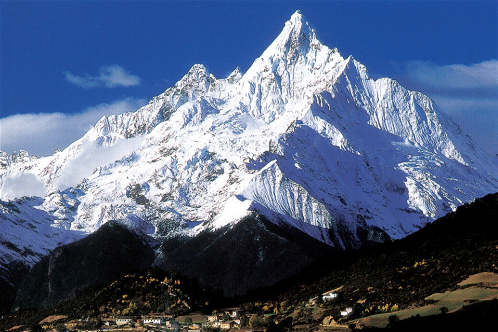

# 敖云

敖云（Ao Yun）是云南迪庆香格里拉高海拔产区出产的[赤霞珠](ref:cabernet)干红，由酩悦·轩尼诗-路易·威登集团投资建设，首个年份为 2013。酒款属于[红葡萄酒](ref:red-wine)，常见 750 mL 瓶装、酒精度约 13%-14% vol，具体年份、装瓶批次与酒标信息以瓶标为准。

图：敖云。图片：Charlie fong，Public domain，via Wikimedia Commons（[原图页面](https://commons.wikimedia.org/wiki/File:%E6%A2%85%E9%87%8C%E9%9B%AA%E5%B1%B1.jpg)）。

## 定义与定位

敖云是一个具体的葡萄酒产品，也是一个由中国高海拔产区生产的国际品牌。它在[葡萄酒](ref:wine)的分类里属于静态红葡萄酒，不是加强酒，也不是起泡酒。产品名与产区名不是同一件事：敖云回答“哪一款酒”，香格里拉回答“在哪种”。

这个项目的定位是高端干红：以赤霞珠为主体，在海拔较高的地块种植与酿造，再用橡木桶陈酿。高端定位来自产区条件与工艺投入，而不是来自名称本身；判断具体酒款仍要看年份、批次与瓶标。

## 产区与气候

产区位于云南西北部迪庆藏族自治州香格里拉一带，葡萄园分布在海拔约 2,200 米以上的河谷坡地。高海拔带来强烈的日照、较大的昼夜温差与较长的成熟期，葡萄在白天积累糖分与风味，夜间低温则有助于保留酸度。

这里的气候受季风影响，雨季与采收期可能重叠，霜冻、冰雹与降雨都是风险。不同海拔、坡向与土壤的地块成熟节奏不同，酒庄需要分批采收与筛选。高海拔不是质量保证，它只是改变了成熟与酸度的平衡条件。

## 品种与栽培

敖云以赤霞珠为主体，常搭配品丽珠、西拉与小维多等品种。赤霞珠提供骨架、颜色与陈年潜力，其他品种补充香气与结构层次。品种比例随年份与地块调整，具体配方通常不会完整标注在瓶标上。

高海拔地块的栽培管理需要更细致的修剪、挂果控制与病害管理。产量控制可以提升果实的浓度，但过低产量也可能让成熟过快、失去酸度。栽培决策与年份条件共同决定原料质量，不能用“高海拔”一个词概括。

## 「敖云」怎么做出来
采收通常人工进行，经过分选、除梗与破碎后进入控温[发酵](ref:fermentation)。不同地块、不同品种往往分罐处理，浸渍时间与温度影响颜色、单宁与香气的提取强度，之后进入[调配](ref:blending)。

发酵完成后，酒液进入[橡木桶陈酿](ref:oak-ageing)。新桶比例、陈酿时长与换桶频率属于酒庄工艺安排，公开资料未必逐年披露。橡木桶的作用是柔化单宁并增加香气层次，不能替代葡萄本身的成熟度。

## 「敖云」的瓶型与标签
常见规格为 750 mL 瓶装，酒精度约 13%-14% vol，属干型红葡萄酒。瓶标通常包含品牌名、年份、产地、酒精度、净含量与生产信息；进口酒款还会带有中文标签，中文标签与原文信息应能互相对应。

购买进口葡萄酒时，中文背标是核对身份的重要依据。标签上的生产商、灌装地、进口商与批次信息，比宣传语更可靠；若标签信息缺失或与实际不符，应谨慎购买。

## 「敖云」的闻与喝
年轻时常呈现黑加仑、黑樱桃、紫罗兰与香料气息，单宁细密而有支撑，酸度较高。陈年后逐渐发展出雪松、烟草与干花的气息，酒体由紧致转向柔顺。

就「敖云」而言，建议在 16-18°C 饮用。温度过高会让酒精感突出，过低会压抑香气。年轻酒款可以醒酒一段时间，老酒则应缩短与空气接触的时间，避免香气过快散失。

## 「敖云」的饮用与搭配
敖云适合搭配牛排、烤羊排、鸭胸与硬质奶酪。敖云的单宁与蛋白质结合可以缓和涩感，酸度则能切割油脂。搭配带有香料与菌菇气息的菜式，也容易与酒中的香料与陈年香气形成呼应。

敖云开瓶后应塞紧瓶塞冷藏，最好两天内喝完；高海拔酒的果香与结构在氧化后变化明显。分装小瓶或真空塞可减缓，但不宜反复回温；老年份更应减少与空气接触。

## 「敖云」的购买与保存
购买时应选择正规渠道，核对中文背标、年份、产地、酒精度与进口商信息。高海拔产区的产量有限，价格与供应会随年份波动；促销价不能代表长期定位，也不能用来推断酒质。

敖云未开瓶应避光、卧放于 12–16°C 的稳定环境，避免温差与震动；软木塞需要湿度。家庭存放难以复制酒庄条件，长期陈年需要稳定温湿度，购买年份不等于瓶中状态。

## 「敖云」容易被读错的地方
第一，把高海拔当作质量保证。海拔改变成熟条件，不等于每个年份都优秀。

第二，把品牌名当作产区名。敖云是产品，香格里拉是产区。

第三，把进口酒的中文标签当作装饰。它是核对身份与合规信息的依据。

第四，只看价格或“敖云”名判断质量。敖云年份少、产量小，渠道、瓶况与保存历史同样重要；购买时应核对中文背标与进口商。

第五，把高海拔或陈年潜力当作无限期存放。敖云的适饮窗口因年份而异，过了最佳期香气会衰退；家庭存放难以复制酒庄条件。

对照阅读：[红葡萄酒](ref:red-wine)、[中国](ref:china)。

**关键事实。**

| 项目 | 内容 |
| --- | --- |
| 一句话定位 | 云南迪庆香格里拉高海拔产区出产的赤霞珠干红，由酩悦·轩尼诗-路易·威登集团投资建设；首个年份为 2013，常见 750 mL、酒精度约 13%-14% vol，具体年份与批次以瓶标为准 |
| 酒种/风格 | 红葡萄酒 |
| 产区 | 中国 |

**来源与边界。** 本页关于「敖云」的关键事实，主要由以下来源交叉核对：International Organisation of Vine and Wine (OIV)（葡萄酒定义、类别与标签的基本表述）、国家质量监督检验检疫总局、国家标准化管理委员会（葡萄酒分类、标签与技术要求）、国家市场监督管理总局、国家标准化管理委员会（葡萄酒在饮料酒分类中的位置；GB/T 15037-2006的适用范围、术语与分类口径）等 7 条来源。价格、批次与状态会变，涉及这些字段时以页面所列来源的最新版本为准。正文为项目自写，来源只作核验，不复制原文。

## 参考资料
- [红葡萄酒](ref:red-wine)：类别与基本工艺。
- [葡萄酒](ref:wine)：大类与分类体系。
- [中国](ref:china)：中国葡萄酒产区格局。
- [赤霞珠](ref:cabernet)：品种特征与风格。
- [发酵](ref:fermentation)：带皮发酵与浸渍。
- [橡木桶陈酿](ref:oak-ageing)：香气与单宁的塑造。
- [调配](ref:blending)：平衡品种与地块差异。
- [饮料酒术语和分类](ref:gb-wine)：葡萄酒在分类体系中的位置。
