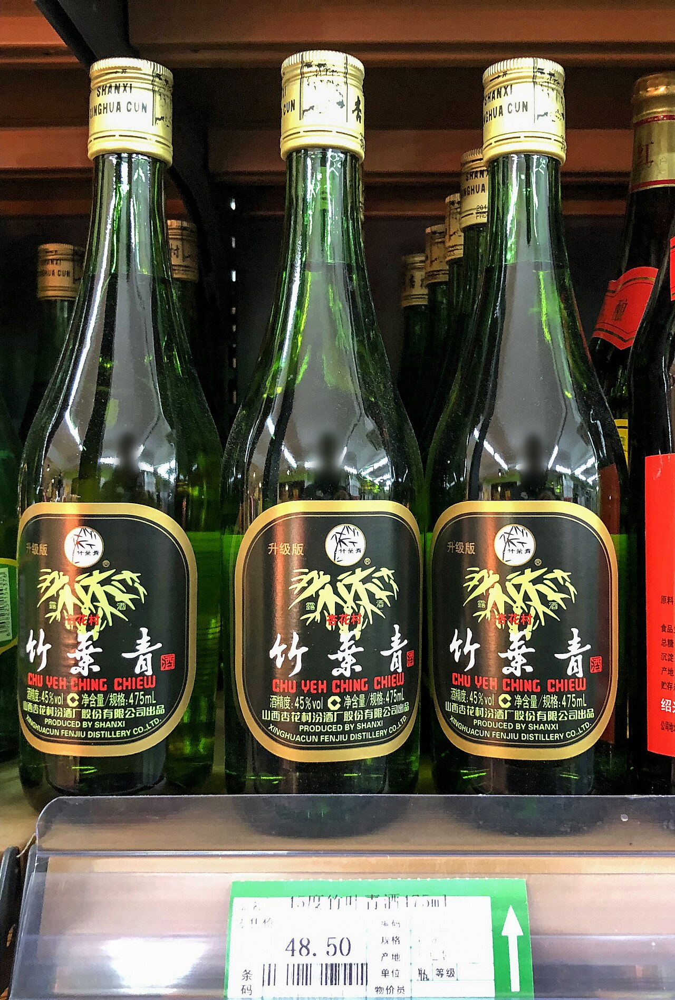

# 竹叶青酒

竹叶青酒是以[汾酒](ref:baijiu)为基酒，加入竹叶与多种植物配料、糖等配制而成的露酒，常见酒精度约 38% vol，产自山西汾阳杏花村。它风味清甜，带草本香气，是[配制酒](ref:medicinal)中认知度较高的一款。

图：竹叶青酒。图片：N509FZ，CC BY-SA 4.0，via Wikimedia Commons（[原图页面](https://commons.wikimedia.org/wiki/File:Chu_Yeh_Ching_Chiew_in_glass_bottle_(20191118165928).jpg)）。

## 定义与定位

这款酒属于配制酒（露酒），由[山西杏花村汾酒厂股份有限公司](ref:producer)生产，品牌由[汾酒](ref:brand)承载。它在产品结构中承担“低度、易饮、带草本风味”的位置，与清香型白酒的定位不同。

需要区分三个层级：白酒是基酒类别，配制酒是成品类别，竹叶青是具体产品。基酒用的是汾酒，但成品不是单纯的白酒，不能按清香型白酒的品评标准去要求它。

## 生产者与品牌

酒款由[山西杏花村汾酒厂股份有限公司](ref:producer)组织生产，品牌由[汾酒](ref:brand)承载。产区在山西汾阳杏花村，属于中国清香型白酒的核心产区之一。

公司、品牌与产品是三个层级：品牌回答“叫什么、面向谁”，公司回答“谁持有商标、谁承担法律责任”，产品则回答具体配料、酒精度与容量。把基酒的产区与工艺直接套到成品上，是常见的层级混淆。

## 「竹叶青酒」的产地与原料
杏花村位于山西汾阳，属温带大陆性季风气候，四季分明、昼夜温差较大。当地的水源与微生物环境是清香型白酒酿造的重要条件。

基酒以高粱等粮谷为原料，经固态发酵与蒸馏取得。成品的配料还包括竹叶与多种植物配料、糖等，具体名单与比例属于企业配方，标签通常只披露部分信息，购买时应以瓶标为准。

## 配制工艺

基本路线是：先按清香型白酒的工艺酿出基酒，再将植物配料以浸泡等方式提取风味，与基酒、糖液等按配方[调配](ref:blending)，经过滤、贮存与检验后装瓶。

基酒的[蒸馏](ref:distillation)质量决定成品的干净度与骨架；植物配料的种类、用量与提取方式决定香气方向；糖的用量影响甜度与酒体。任何一项变化都会改变成品，不能只看酒精度。

## 「竹叶青酒」的瓶型与标签
常见为 500 mL 瓶装，酒精度常见在 38% vol 上下，也有其他度数版本。标签上的生产商、品名、配料、酒精度、净含量、执行标准与产地，是核对身份的基本项。

配制酒允许使用的原料与标示方式受国家标准约束。配料表中的植物名称与糖类，是判断风味方向的重要线索；标签未列出的内容不应自行补全。

## 「竹叶青酒」的闻与喝
香气以草本清香、甜香与基酒的粮香为主，入口偏甜、酒体较轻，余味干净。温度过低会压住香气，温度过高会让甜感与酒精刺激更突出。

品鉴时先闻香，分辨草本香与基酒香的比例；再小口入口，看甜度是否盖住基酒、草本是否有苦涩；最后看余味是否干净。加冰或加苏打水会改变甜度与香气表现，属于饮用方式而非配方的一部分。

## 「竹叶青酒」的饮用与搭配
竹叶青酒适合常温或稍加冰饮用，也常被用作餐前酒。搭配上可选择坚果、卤味、凉菜与简单咸味小食；甜度较高的版本不适合搭配过甜的菜肴。

它也可以调制成加冰或加苏打的喝法，但稀释会降低甜度与草本浓度，比例应按杯型调整。驾车、服药或孕期不应饮酒。

## 「竹叶青酒」的购买与保存
购买时优先选择正规渠道，核对防伪、生产商与批次。不同度数、不同容量的版本应回到标签核对，避免把包装差异当作酒体差异。

未开瓶应避光、阴凉、直立存放，避免高温与异味环境。开瓶后应密封冷藏并尽快饮用，长期暴露在空气中会损失香气。

## 「竹叶青酒」容易被读错的地方
第一，把竹叶青当作单纯的白酒。它是配制酒，基酒只是原料之一。

第二，把草本香气当作药酒功效。香气与功效是两件事，本页不作功效说明。

第三，认为度数越低越不醉。甜味会掩盖酒精感，容易喝快。

第四，把标签外的配料自行补全。配方属于企业信息，应以标签为准。

第五，把加冰或加苏打当作配方变化。那是饮用方式，不是产品本身。

竹叶青酒不是竹叶泡酒，也不是药酒：它以汾酒为基酒，加入竹叶与多种植物配料、糖等配制而成，属于露酒。清甜、草本香气与较低的常见酒精度是它的入口特征；读标签时要区分“配制酒”与“白酒”，也不能把草本风味直接当成保健功效。

对照阅读：[保健酒](ref:medicinal)、[汾酒](ref:brand)。

**关键事实。**

| 项目 | 内容 |
| --- | --- |
| 一句话定位 | 以汾酒为基酒，加入竹叶与多种植物配料、糖等配制而成的露酒，常见酒精度约 38% vol，产自山西汾阳杏花村；风味清甜，带草本香气 |
| 酒种/风格 | 保健酒、白酒 |
| 产区 | 中国 |
| 生产商/品牌 | 山西杏花村汾酒集团有限责任公司、汾酒 |

**来源与边界。** 本页关于「竹叶青酒」的关键事实，主要由以下来源交叉核对：山西杏花村汾酒厂股份有限公司（竹叶青酒的基酒、配料方向、容量与酒精度区间；竹叶青酒的基酒、配料与企业背景）、国家市场监督管理总局、国家标准化管理委员会（配制酒（露酒）在饮料酒分类中的位置；由原条目末尾参考资料迁移，未逐条复核访问日期）。价格、批次与状态会变，涉及这些字段时以页面所列来源的最新版本为准。正文为项目自写，来源只作核验，不复制原文。

**并读。** 把「竹叶青酒」与「保健酒」、「白酒」、「汾酒」放在一起读时，先确认它们是同一层级还是上下游关系：先确认酒种与产区，再比较年份、酒精度、价格与饮用场景。本页负责给出酒款的基本坐标，对照条目补上具体案例与差异；读完再回到本页，才能分清哪些差别属于酒款本身，哪些只是产地、批次或品牌选择。

## 参考资料
- [汾酒](ref:brand)：品牌与清香型产品体系。
- [山西杏花村汾酒厂股份有限公司](ref:producer)：公司与产区信息。
- [青花汾 30](ref:qinghua-fen)：同品牌的清香型白酒，便于对比基酒风格。
- [配制酒](ref:medicinal)：露酒在饮料酒分类中的位置。
- [白酒](ref:baijiu)：基酒所属的大类。
- [蒸馏](ref:distillation)：基酒的生产核心。
- [调配](ref:blending)：配制酒的风味组合逻辑。
- [酒精度](ref:abv)：38% vol 上下不同版本的指标含义。
- [中国](ref:china)：中国酒类版图与产区组织。
