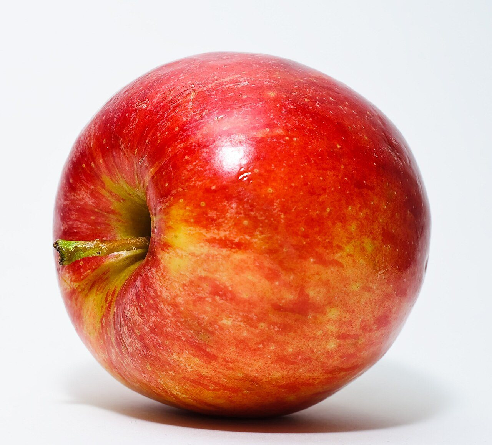

# 苹果

苹果（Malus domestica）是蔷薇科苹果属的落叶乔木果实。鲜食苹果追求甜、脆、汁多，酿酒苹果却追求酸度、单宁与香气——两者的育种目标几乎相反。苹果汁经[发酵](ref:fermentation)成为[苹果酒](ref:cider)，再经[蒸馏](ref:distillation)可得到苹果白兰地；在法国诺曼底，这条路线被[卡尔瓦多斯](ref:brandy)的原产地规则固定下来。

图：一个鲜食红苹果。酿酒用苹果通常更小、更酸或更涩，与鲜食苹果的育种目标不同。图片：Abhijit Tembhekar，CC BY 2.0，来源：[原始页面](https://commons.wikimedia.org/wiki/File:Red_Apple.jpg)。

## 蔷薇科果实与成分

苹果可食部分约占果实重量的 85%，水分约 85%，糖以果糖、葡萄糖与蔗糖为主，总糖 10–14 g/100g。有机酸主要是苹果酸，另有少量柠檬酸与奎宁酸。果皮与果核附近富含多酚，包括原花青素、绿原酸、根皮苷与花青素；这些物质构成[单宁](ref:tannin)骨架，也决定苹果酒的苦涩、颜色与陈年能力。

## 苹果酸、糖与单宁

苹果酸是苹果酒清爽感的来源，也是苹果酸-乳酸发酵的底物。发酵结束后，乳酸菌把苹果酸转化为乳酸，酸度下降、口感变圆，这一过程在苹乳发酵型苹果酒中很常见。单宁主要来自果皮与籽，低分子量单宁带来涩感，高分子量单宁参与絮凝与沉淀。

糖、酸、单宁三者需要平衡：高糖低酸会显得甜腻，高酸低糖会尖锐，单宁过高则苦涩。酿酒师通过调配不同品种的汁来达到目标。

## 苹果酒发酵

苹果汁的糖度通常在 10–14°Brix，发酵后可得到约 5–8% vol 的酒精。酵母可以选择商业酿酒酵母，也可以依靠果皮上的野生酵母进行自然发酵。低温（12–18°C）慢发酵保留果香，高温发酵速度快但容易损失细腻香气。

[发酵](ref:fermentation)前常做果胶酶处理与澄清，以减少果胶带来的浑浊；若要保留浑浊风格，则缩短静置时间。含氮量低的果汁需要补充酵母可同化氮，否则容易产生硫化氢。

## 苹果分类与产区

英国国家苹果酒制造商协会按酸度与单宁把 cider 苹果分为四类：甜型（酸低于 0.45%、单宁低于 0.2%）、酸型（酸高于 0.45%、单宁低）、苦甜型（酸低、单宁高于 0.2%）与苦酸型（酸与单宁都高）。这一分类以每体积百分比表示，是配方设计的基础语言。

法国诺曼底、布列塔尼，英国萨默塞特、赫里福德郡，西班牙巴斯克地区，美国弗吉尼亚与华盛顿州，都是重要产区。气候影响成熟度与酸度，凉爽产区通常酸度更高。

## 蒸馏与卡尔瓦多斯

苹果酒经壶式蒸馏得到苹果白兰地，通常两次蒸馏，掐头去尾后取中段。诺曼底的[卡尔瓦多斯](ref:brandy)受 AOC 规则约束：使用当地苹果（允许少量梨）酿成苹果酒，再蒸馏并在橡木桶中陈年；[法国](ref:france)的产区法规对原料比例、蒸馏方式与最低陈年时间都有规定。

蒸馏会放大苹果酒的缺陷：发酵产生的乙酸乙酯在低浓度时是果香，高浓度时变成洗甲水味。因此蒸馏用苹果酒通常要求酸度适中、发酵干净。

## 替代与调配

鲜食苹果可以酿苹果酒，但酸度与单宁不足，常需要加入酸型或苦甜型苹果汁补足结构。梨可以替代部分苹果，形成 perry（梨酒）；在诺曼底，梨也允许少量加入卡尔瓦多斯。商业苹果浓缩汁可以提高糖度，但会损失香气与单宁，适合做中性基酒而非高端产品。

苹果的成熟度决定酸糖比。过早采收的果实酸高、香气前体不足，过熟则糖高、果胶分解、容易氧化褐变。酿酒厂常把早熟酸苹果与晚熟苦甜苹果分批压榨，再按比例混合，以获得稳定的酸度与单宁。压榨后的汁如果长时间接触空气，多酚氧化酶会使颜色变深、香气变钝，因此常添加抗坏血酸或采用惰性气体保护。苹果渣可以堆肥或提取果胶，但在酒厂里更重要的是尽快处理，避免果渣中的野生菌与醋酸菌污染下一批果汁。

## 感官影响

苹果酒的香气从青苹果、梨、柑橘到蜂蜜、肉桂与烘烤苹果不等。酸度决定清爽度，单宁决定结构与陈年潜力，残糖决定甜度。苦甜型苹果带来收敛感与苦味，使酒更适合佐餐；甜型苹果则适合年轻饮用。卡尔瓦多斯在橡木桶中发展出香草、焦糖与苹果干香。

## 常见误区

第一，所有苹果都能酿出好苹果酒。鲜食苹果酸低、单宁少，需要调配。第二，苹果酒越甜越好。甜度只是风格变量，酸度与单宁同样重要。第三，卡尔瓦多斯就是苹果白兰地。它是受产地规则约束的特定类别，不是所有苹果蒸馏酒都能使用这个名称。第四，苹果酒一定不含麸质。苹果本身无麸质，但设备与添加剂可能带来交叉污染。

## 另见

- [苹果酒](ref:cider)：苹果发酵的主要去向。
- [白兰地](ref:brandy)：卡尔瓦多斯与苹果蒸馏酒。
- [法国](ref:france)：诺曼底与布列塔尼的产区背景。
- [发酵](ref:fermentation)：苹果酸-乳酸发酵与酵母管理。
- [蒸馏](ref:distillation)：壶式蒸馏与掐头去尾。
- [单宁](ref:tannin)：苹果酒结构与陈年能力。

对照阅读：[苹果酒](ref:cider)、[法国](ref:france)。

**关键事实。**

| 项目 | 内容 |
| --- | --- |
| 一句话定位 | 苹果是蔷薇科苹果属的果实，糖、酸与单宁的组合决定 cider 的风格；专用 cider 苹果按酸度与单宁分为甜、酸、苦甜与苦酸四类，也可蒸馏为苹果白兰地与卡尔瓦多斯 |
| 原料身份 | 苹果是蔷薇科苹果属的果实，糖、酸与单宁的组合决定 cider 的风格 |
| 加工用途 | 专用 cider 苹果按酸度与单宁分为甜、酸、苦甜与苦酸四类，也可蒸馏为苹果白兰地与卡尔瓦多斯 |

**来源与边界。** 本页关于「苹果」的关键事实，主要由以下来源交叉核对：Oxford University Press（提供关于苹果酒、苹果白兰地与卡尔瓦多斯的条目）、National Association of Cider Makers (NACM)（cider 苹果按酸度与单宁的分类）、Institut national de l'origine et de la qualité (INAO)（卡尔瓦多斯的原产地命名框架）等 4 条来源。价格、批次与状态会变，涉及这些字段时以页面所列来源的最新版本为准。正文为项目自写，来源只作核验，不复制原文。

**并读。** 把「苹果」与「苹果酒」、「白兰地」、「法国」放在一起读时，先确认它们是同一层级还是上下游关系：先确认原料形态与产地，再比较加工、风味与替代关系。本页负责给出原料的基本坐标，对照条目补上具体案例与差异；读完再回到本页，才能分清哪些差别属于原料本身，哪些只是产地、批次或品牌选择。
