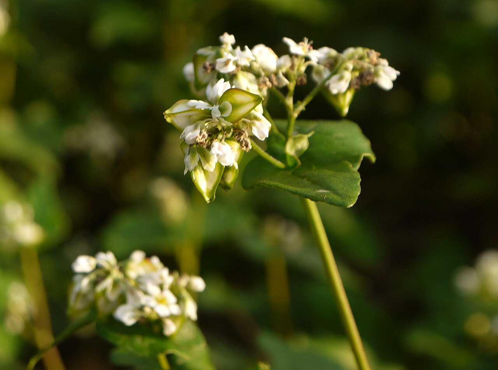

# 荞麦

荞麦（Fagopyrum esculentum）属于蓼科荞麦属，籽粒在植物学上是瘦果而非禾本科谷物，因此常被称为假谷物。它不含小麦、大麦那样的面筋蛋白，却能把淀粉、蛋白质与芦丁等黄酮带进发酵体系。全球荞麦产量远小于小麦，但在[啤酒](ref:beer)、日本[荞麦烧酒](ref:shochu)与中国部分地方[白酒](ref:baijiu)中，它提供的是别处难以复制的坚果、蜂蜜与泥土气息。

图：荞麦。图片：STRONGlk7，CC BY-SA 3.0，via Wikimedia Commons（[原图页面](https://commons.wikimedia.org/wiki/File:Japanese_Buckwheat_Flower.JPG)）。

## 植物学特征与籽粒组成

一年生草本，茎直立带红晕，花白色或淡粉，籽粒为三角锥形瘦果，外壳坚硬。栽培上分甜荞与苦荞：甜荞花大、籽粒较大、苦味轻；苦荞（F. tartaricum）籽粒小、芦丁含量高，常被用作功能食品原料。荞麦喜冷凉、生育期短，可在高海拔或茬口紧张的地块种植。

按美国农业部 FoodData Central 的数据，每 100 克生荞麦粒约含 71.5 克碳水化合物、13.2 克蛋白质、3.4 克脂肪与 10 克膳食纤维。淀粉中支链淀粉占多数，糊化温度约 68–76°C；蛋白质以清蛋白和球蛋白为主，缺少醇溶蛋白，这也是它无法形成面筋网络的原因。

## 制麦、糖化与发酵

荞麦可以直接蒸煮，也可以制麦。制麦时浸麦、发芽、干燥三段温度要缓和，发芽过长会让脂肪氧化产生陈旧味。荞麦麦芽的淀粉酶活力低于大麦麦芽，单靠自身酶难以把淀粉彻底降解，[糖化](ref:saccharification)时通常要掺入部分大麦麦芽或添加外源酶，并把休止温度控制在 62–65°C，兼顾可发酵糖与糊精。

荞麦麦芽的色泽较深，糖化时也会带入更重的谷物色，浅色风格通常把比例压在 10% 以下，并用大米或小麦麦芽稀释颜色。

[发酵](ref:fermentation)阶段，荞麦醪的游离氨基酸较丰富，酵母容易生成较多高级醇；温度偏高时，细腻的花香会被溶剂味掩盖。荞麦蛋白缺乏面筋，过滤时没有麦壳形成的天然滤层，啤酒厂往往要延长静置或使用助滤剂。

## 产地与品种

荞麦原产亚洲，中国、俄罗斯、乌克兰、法国、日本、美国是主要种植国。中国北方与西南山区保留了大量地方品种；法国布列塔尼以荞麦可丽饼闻名；日本长野、北海道一带的荞麦面文化，也支撑了荞麦烧酒的原料供应。苦荞在四川、云南、贵州的高海拔地区更常见。

## 与其他无麸质谷物的替代关系

在无麸质啤酒配方里，荞麦常与高粱、小米、藜麦并列。高粱提供更中性的谷物骨架，小米带来柔和甜香，荞麦的香气最强、颜色最深，比例过高会让酒体发干。若目标是模仿小麦啤酒的饱满感，可加入燕麦或少量大米糖浆补足酒体，而不是单纯提高荞麦比例。

## 香气与口感

荞麦的香气在生粒、麦芽与发酵后差别很大。生粒带青草与坚果；烘焙或炒制后出现焦糖、咖啡与烤面包调；发酵完成时，典型描述是蜂蜜、坚果、泥土与轻微谷物涩感。苦荞的芦丁会带来持续的后苦，适量可以增加层次，过量则显得药感。

## 法规与质量控制

无麸质标签并非“原料无麸质”即可。美国食品药品管理局要求标称无麸质的食品 gluten 含量低于 20 ppm，欧盟相关法规也采用 20 mg/kg 的阈值；荞麦本身不含面筋，但共用磨粉、输送与发酵设备可能造成交叉污染，需要单独清洗与检测。中国荞麦产品则要符合粮食卫生标准中的水分、杂质与真菌毒素限量。

荞麦的脂肪以不饱和脂肪酸为主，整粒在低温、干燥、避光条件下可存放较久；磨粉或破碎后氧化加快，很快出现陈味。酿酒厂通常把荞麦麦芽的水分控制在 5% 以下，使用前检测酶活力、霉菌毒素与杂质，发芽不足或霉变会让糖化收率与风味同时下降。与小麦相比，荞麦采购批量小、批次差异大，配方稳定更依赖进厂检验，而不是产地名声。日本一些烧酒厂会把制曲用荞麦与挂料用荞麦分开采购，前者要求颗粒整齐、杂菌少，后者更看重香气。冷饮时坚果调更明显，温度升高后酒精感与苦味前移。

## 常见误区

第一，把荞麦当作禾本科谷物。它是蓼科假谷物。第二，认为荞麦啤酒天然无麸质。原料无麸质不等于成品通过检测。第三，把荞麦烧酒当成伏特加。它经过曲霉糖化与单式蒸馏，香气来源完全不同。第四，以为苦荞越苦越好。苦味来自芦丁等黄酮，是否合适取决于目标风格与配比。

## 另见

- [啤酒](ref:beer)：无麸质啤酒与荞麦麦芽的使用。
- [荞麦烧酒](ref:shochu)：日本单式蒸馏酒的原料路线。
- [日本](ref:japan)：烧酒产区与消费文化。
- [白酒](ref:baijiu)：地方小曲酒中的荞麦辅料。
- [发酵](ref:fermentation)：温度、酵母与高级醇生成。
- [糖化](ref:saccharification)：酶活力不足时的补救方式。

对照阅读：[啤酒](ref:beer)、[日本](ref:japan)。

**关键事实。**

| 项目 | 内容 |
| --- | --- |
| 一句话定位 | 荞麦是蓼科荞麦属的假谷物，不含麸质；它用于荞麦啤酒、荞麦烧酒与部分地方白酒，带来泥土、蜂蜜与谷物香气，但蛋白质与淀粉特性使糖化与发酵需要单独调整 |
| 原料身份 | 荞麦是蓼科荞麦属的假谷物，不含麸质 |
| 加工用途 | 它用于荞麦啤酒、荞麦烧酒与部分地方白酒，带来泥土、蜂蜜与谷物香气，但蛋白质与淀粉特性使糖化与发酵需要单独调整 |

**来源与边界。** 本页关于「荞麦」的关键事实，主要由以下来源交叉核对：Oxford University Press（提供关于荞麦麦芽与无麸质啤酒的条目；提供关于荞麦烧酒与荞麦蒸馏酒的条目）、Food and Agriculture Organization of the United Nations (FAO)（荞麦的栽培与食用概况）、U.S. Department of Agriculture（荞麦籽粒的碳水化合物、蛋白质、脂肪与膳食纤维数值）等 7 条来源。价格、批次与状态会变，涉及这些字段时以页面所列来源的最新版本为准。正文为项目自写，来源只作核验，不复制原文。

**并读。** 把「荞麦」与「啤酒」、「日本烧酒」、「日本」放在一起读时，先确认它们是同一层级还是上下游关系：先确认原料形态与产地，再比较加工、风味与替代关系。本页负责给出原料的基本坐标，对照条目补上具体案例与差异；读完再回到本页，才能分清哪些差别属于原料本身，哪些只是产地、批次或品牌选择。

**适用边界。** 对「荞麦」而言，原料的品种、加工形态与产地会改变风味；本页说明通用角色，不替代具体配方。
