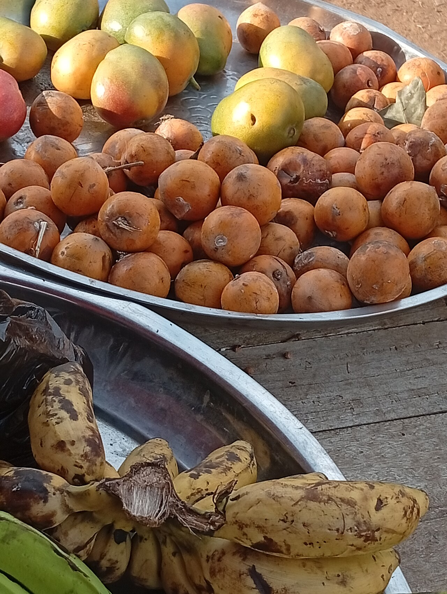

# 樱桃

樱桃是蔷薇科李属果实，甜樱桃与酸樱桃是两大类型；酸樱桃（Prunus cerasus）酸度高、香气强，是黑森林蛋糕、樱桃酒（kirsch）与樱桃白兰地的核心原料。

图：Cherry：Cherry 18th march 2025（Wikimedia Commons）。图片：Natashadonoh，CC0，via Wikimedia Commons（[原图页面](https://commons.wikimedia.org/wiki/File:Cherry_18th_march_2025.jpg)）。

## 定义与命名

樱桃是李属（Prunus）的核果，栽培上主要分甜樱桃（Prunus avium）与酸樱桃（Prunus cerasus）。甜樱桃果大、糖高、酸度较低，适合鲜食；酸樱桃果小、酸度高、香气浓，更适合煮酱、发酵与蒸馏。观赏樱花与结果樱桃也不是同一回事，不能因为都叫“樱桃”就混用。

“樱桃味”是食品工业里的复合香精概念，和真实樱桃的香气不是一一对应。真实樱桃的香气来自果肉、果核与发酵副产物；甜樱桃偏花果香，酸樱桃偏酸香与杏仁气息。读配方时要把“樱桃汁”“樱桃香精”“樱桃果渣”分开。

## 起源与传播

甜樱桃的栽培起源通常追溯到欧洲、西亚与小亚细亚一带，酸樱桃更接近欧洲与西亚的野生种群。罗马时期已有樱桃栽培记录，后来随移民、贸易与园艺选育扩散到欧洲各地、北美与智利、澳大利亚等温带产区。

樱桃酒（kirsch）是樱桃汁或果渣经发酵、蒸馏得到的透明樱桃白兰地，德国黑森林、法国阿尔萨斯与瑞士是核心产区。比利时以樱桃啤酒（kriek）闻名，把酸樱桃加入小麦啤酒进行二次发酵；这里的樱桃是风味与酸度来源，不是葡萄酒原料。

## 植物学与栽培

樱桃是核果，果肉包着硬核，核内是种子。甜樱桃多数品种自交不亲和，需要不同品种授粉；酸樱桃部分品种可自交。栽培上要看需冷量、花期霜冻、土壤排水与砧木亲和性，砧木会影响树势、早熟性与果园寿命。

修剪、拉枝、疏果与采收期决定果实品质。樱桃在成熟前遇雨容易裂果，采收后呼吸与软化很快，鲜食樱桃需要冷链；加工用酸樱桃可以稍晚采收，但仍要避免过熟导致香气流失与果肉褐变。

## 风格与味觉

Kirsch 通常无色透明，带樱桃、杏仁与花香，口感干烈；传统上会连核浸渍，带来轻微的苦杏仁气息。樱桃利口酒（cherry liqueur）则加糖或糖浆，口感更甜、更圆，酒精度通常低于白兰地。樱桃白兰地是一个宽泛说法，可能指 kirsch，也可能指调配型樱桃烈酒，读标签要看原料与工艺。

樱桃也用于巧克力、果酱、黑森林蛋糕与樱桃啤酒。酸樱桃的高酸能平衡麦芽甜感，果核与果皮带来颜色与单宁；甜樱桃更适合鲜食、糖渍与利口酒，发酵时香气容易在高温下损失。

## 主要产区与代表产品

德国黑森林、法国阿尔萨斯、瑞士、意大利与土耳其是甜樱桃与樱桃酒的重要产区；德国黑森林的 kirsch 常与樱桃蛋糕、巧克力一起出现。比利时 kriek 以酸樱桃与小麦啤酒为骨架，兰比克与法兰德斯风格各有不同。美国、智利与澳大利亚的甜樱桃更多进入鲜食市场。

“樱桃酒”在不同语言里可能指发酵樱桃酒、浸泡利口酒或蒸馏白兰地。看到 cherry wine、kirsch、cherry brandy、cherry liqueur 时，先确认它是发酵、浸泡还是蒸馏，不能只凭一个中文译名判断。

## 怎么喝与配餐

Kirsch 适合室温、小郁金香杯或白兰地杯，少量慢饮；它的香气集中，不需要加冰。樱桃利口酒可以冰镇或加苏打水，适合甜点与巧克力。Kriek 适合冷藏后饮用，酸度与气泡能切开油脂，配烤肉、奶酪与水果塔都合适。

樱桃与杏仁、巧克力、猪肉、鸭肉和软质奶酪有天然搭配；酸樱桃的酸度也能平衡奶油与甜点。对酒精敏感的人要注意 kirsch 的酒精度通常较高，利口酒的糖分则容易让饮用速度变快。

## 选购与常见误区

第一，把 kirsch 与樱桃利口酒当成同一种东西。前者通常是蒸馏酒，后者是加糖的利口酒。第二，把“樱桃味”饮料当成樱桃酒。第三，认为颜色越红越天然；kirsch 通常无色，颜色可能来自浸泡或添加。第四，忽略果核与添加糖，购买时要看配料、酒精度与生产商。

樱桃本身不是葡萄，不能用“克隆、砧木、老藤、单宁结构”这套葡萄品种话术来描述。它的关键变量是甜/酸类型、成熟度、果核处理、发酵或浸泡方式，以及是否蒸馏。

樱桃的品种选择还要看用途：鲜食重视果径、硬度、糖酸比与色泽，加工重视酸度、香气、果核比例与出汁率；同一品种在暖区与冷区的成熟期也不同。樱桃的季节性很强，采收窗口短，鲜果冷链与加工厂的距离会直接影响成本与品质。购买樱桃酒时，若标签只写“樱桃风味”，而没有说明果汁、果渣或蒸馏，就不能据此判断它与真实樱桃的关系；糖、基酒与浸泡时间同样会改变最终口感。

相关条目：[利口酒](ref:liqueur)。

## 延伸阅读与另见

- 相关条目：[brandy](ref:brandy)、[liqueur](ref:liqueur)、[distillation](ref:distillation)、[terroir](ref:terroir)、[france](ref:france)。
关于樱桃，本页不提供植物鉴定、价格或购买渠道；酒标名称不能替代植物学鉴定。

对照阅读：[白兰地](ref:brandy)、[蒸馏](ref:distillation)。

**关键事实。**

| 项目 | 内容 |
| --- | --- |
| 一句话定位 | 樱桃是蔷薇科李属果实，甜樱桃与酸樱桃是两大类型；酸樱桃（Prunus cerasus）酸度高、香气强，是黑森林蛋糕、樱桃酒（kirsch）与樱桃白兰地的核心原料 |
| 原料身份 | 樱桃是蔷薇科李属果实，甜樱桃与酸樱桃是两大类型 |
| 加工用途 | 酸樱桃（Prunus cerasus）酸度高、香气强，是黑森林蛋糕、樱桃酒（kirsch）与樱桃白兰地的核心原料 |

**来源与边界。** 本页关于「樱桃」的关键事实，主要由以下来源交叉核对：FAO（作物、产区与加工背景）、USDA（农业、植物与营养资料）、CGIAR（作物种质与农业研究框架）等 4 条来源。价格、批次与状态会变，涉及这些字段时以页面所列来源的最新版本为准。正文为项目自写，来源只作核验，不复制原文。

**并读。** 把「樱桃」与「白兰地」、「利口酒」、「蒸馏」放在一起读时，先确认它们是同一层级还是上下游关系：先确认原料形态与产地，再比较加工、风味与替代关系。本页负责给出原料的基本坐标，对照条目补上具体案例与差异；读完再回到本页，才能分清哪些差别属于原料本身，哪些只是产地、批次或品牌选择。

**适用边界。** 对「樱桃」而言，原料的品种、加工形态与产地会改变风味；本页说明通用角色，不替代具体配方。

**更新提示。** 「樱桃」最近核对于 2026-11-22；产地、加工形态、等级与价格会变，采购前以供应商规格为准。
