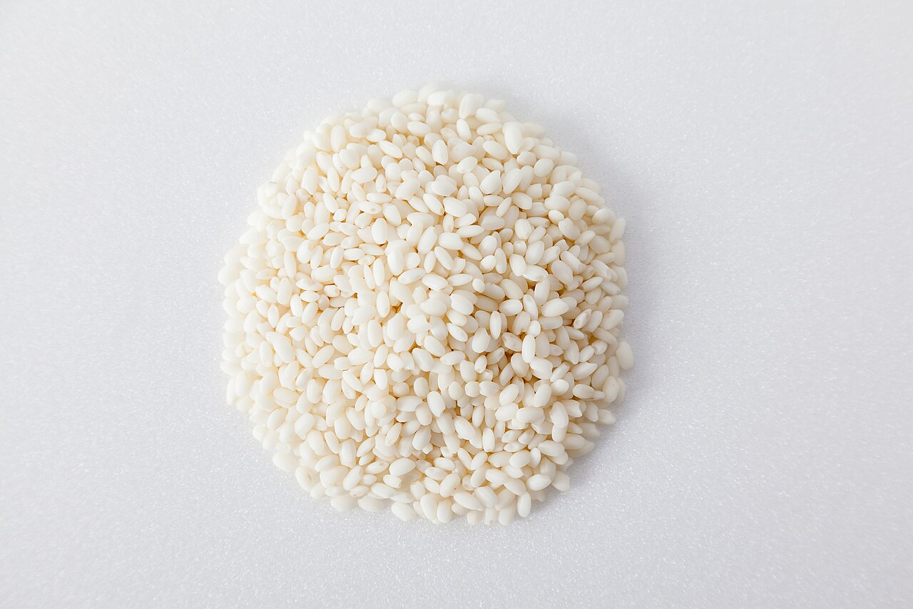

# 糯米

糯米是稻米的一类，因支链淀粉比例接近全部而具有极强的黏性。它在中文语境里也叫江米，在酿酒中常被称为酒米。糯米蒸熟后软糯、黏结成团，既是粽子、八宝饭等食物的原料，也是黄酒、甜米酒和多粮白酒的重要成分。

图：糯米。图片：국립국어원，CC BY-SA 2.0 kr，via Wikimedia Commons（[原图页面](https://commons.wikimedia.org/wiki/File:Chapssal_(glutinous_rice).jpg)）。

## 定义与形态

糯米与粳米、籼米的区别主要在淀粉结构。糯米的支链淀粉比例极高，直链淀粉很少，因此蒸煮后吸水快、黏性强、冷却后容易回生变硬。按粒形可分为长糯米与圆糯米，前者常见于南方部分产区，后者在北方与部分加工用途中更常见。

糯米还有籼糯与粳糯之分，但日常语境里通常不细分。酿酒用糯米关注粒形完整、淀粉含量、杂质与新鲜度；过度碾磨会损失外层物质，但糯米本身的黏性主要来自淀粉结构，不会因碾磨而改变。

## 主要产地

糯米的主产区集中在亚洲，中国南方、泰国、老挝、越南等地都有种植。中国南方的糯稻品种与栽培传统丰富，部分产区保留地方品种。气候与降水会影响籽粒灌浆与含水量，进而影响蒸煮吸水与发酵表现。

糯米在收获后需要及时干燥，否则容易霉变。储存时对湿度更敏感，因为高水分与高温会加速品质下降。规模生产通常检测水分、杂质与霉变粒，家庭使用则应选择包装完好、生产日期较近的产品。

## 在黄酒中的作用

[黄酒](ref:yellow-wine)是糯米最典型的酿造用途之一。绍兴一带的传统黄酒以糯米为主料，经浸米、蒸煮、摊凉、加曲与[发酵](ref:fermentation)等工序酿成。糯米的黏性有助于形成稳定的醪液结构，也让酒体更丰满；但黏性过强时，发酵过程中容易出现结团、散热不均与压榨困难。

黄酒并不是只用糯米。不同产区与产品会使用粳米、大米或混合米，糯米比例影响酒体的甜感、厚度与出酒率。把“黄酒一定用糯米”当作固定规则，会忽略产区与产品差异；更准确的说法是，糯米是传统黄酒的重要原料之一。

## 在白酒与甜米酒中

[白酒](ref:baijiu)中的糯米通常出现在多粮配方里。[浓香型白酒](ref:strong-aroma)常见高粱、大米、糯米、小麦、玉米并用，糯米为酒体增加绵柔与甜润感。糯米在固态发酵中需要与高粱、稻壳等搭配，避免因黏性过大而影响透气与蒸馏。

甜米酒、酒酿等产品则以糯米为主料，依靠酒曲把淀粉糖化后发酵，酒精度通常较低，甜味明显。这类产品与蒸馏白酒属于不同类别，工艺目标也不同：前者保留糖分与米香，后者追求酒精发酵后的蒸馏与陈年。

## 与清酒的原料差异

[清酒](ref:sake)同样以稻米为原料，但通常使用专门的酒造好适米，并以精米步合控制碾磨程度。清酒的主流体是粳米而非糯米，依靠米曲把蒸米淀粉糖化，再与酵母进行并行发酵。糯米的黏性在清酒工艺中并不适用，两者不能简单互换。

这一对比说明，“米酒”是一个宽泛说法，具体酒种要看原料、曲种、发酵方式与是否蒸馏。糯米适合追求黏性、甜感与丰满度的产品；粳米更适合需要精米、制曲与并行发酵的清酒体系。

| 产品类型 | 主要原料 | 关键工序 |
| --- | --- | --- |
| 传统黄酒 | 糯米为主 | 浸米、蒸煮、加曲、发酵、压榨 |
| 多粮白酒 | 糯米为配料之一 | 蒸煮、糖化、固态发酵、蒸馏 |
| 甜米酒 | 糯米为主 | 蒸煮、加曲、糖化发酵 |

## 黏性、蒸煮与工艺匹配

糯米的工艺难点主要在黏性。蒸煮时间不足，淀粉未充分糊化，糖化效率低；蒸煮过度，米粒黏结成团，醪液透气性差，发酵不均匀。生产者会通过浸泡时间、蒸煮方式与摊凉来控制吸水与温度。

糯米的比例也需要与目标风格匹配。比例高，酒体更绵柔、甜感更明显；比例低，发酵更易控制、出酒率更稳定。多粮配方不是固定公式，而是根据原料特性、曲种、季节与设备调整的结果。

## 选购与储存

选购糯米时关注粒形完整度、颜色、气味与杂质。新米香气清新，陈米可能带有陈味或脂肪酸败味。糯米比普通大米更容易吸潮，储存应放在干燥、通风、避光处，避免高温与虫害。

家庭自酿应使用来源清楚、无霉变的糯米，并注意器具与用水卫生。霉变米可能产生真菌毒素，不能通过清洗或蒸煮完全消除，因此不应进入酿造。

## 常见误区

第一，糯米与大米可以随意互换。黏性与淀粉结构不同，工艺需要调整。

第二，黄酒只能用糯米。不同产区与产品会使用粳米、大米或混合米。

第三，糯米越黏越好。黏性过强会增加结团与压榨困难。

第四，清酒也是糯米酒。清酒主流使用粳米与米曲，工艺体系不同。

第五，甜米酒与白酒只是酒精度不同。原料、曲、发酵与蒸馏目标都不同。

## 延伸阅读

- [黄酒](ref:yellow-wine)：糯米在传统黄酒中的核心位置。
- [白酒](ref:baijiu)：糯米作为多粮配方的组成部分。
- [浓香型白酒](ref:strong-aroma)：多粮配方与固态发酵的匹配。
- [清酒](ref:sake)：粳米、精米与米曲的对照体系。
- [发酵](ref:fermentation)：糖如何被转化为酒精与风味物质。

**关键事实。**

| 项目 | 内容 |
| --- | --- |
| 一句话定位 | 支链淀粉比例接近全部的稻米类型，蒸煮后黏性强、质地软糯；它是黄酒与部分甜米酒的典型原料，也常出现在多粮白酒配方中 |
| 原料身份 | 支链淀粉比例接近全部的稻米类型，蒸煮后黏性强、质地软糯 |
| 加工用途 | 它是黄酒与部分甜米酒的典型原料，也常出现在多粮白酒配方中 |

**来源与边界。** 本页关于「糯米」的关键事实，主要由以下来源交叉核对：国家市场监督管理总局、国家标准化管理委员会（白酒原料与多粮配方的术语；饮料酒类别与原料术语框架）、中国酒业协会（黄酒与白酒原料的行业表达；未复制协会文本）、FAO（补充核对条目背景、术语与制度口径）。价格、批次与状态会变，涉及这些字段时以页面所列来源的最新版本为准。正文为项目自写，来源只作核验，不复制原文。
