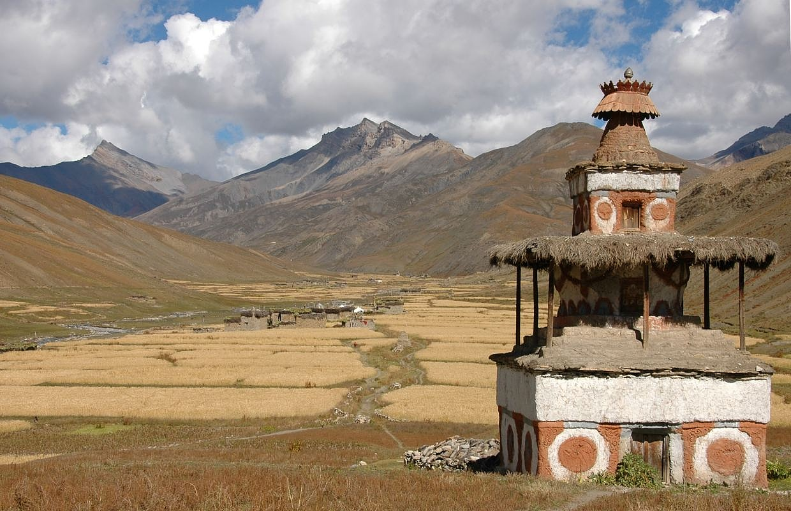

# 青稞

青稞是青藏高原的裸大麦，耐寒、耐旱、早熟，是糌粑、青稞酒与藏区日常饮食的基础；高纤维、β-葡聚糖与低升糖特性使它近年被视为健康谷物。

图：Highland Barley：Chorten and barley fields（Wikimedia Commons）。图片：Carsten.nebel，Public domain，via Wikimedia Commons（[原图页面](https://commons.wikimedia.org/wiki/File:Chorten_and_barley_fields.jpg)）。

## 定义与命名

青稞是藏区对裸大麦的称呼，植物学上属于禾本科大麦属。与皮大麦不同，青稞的颖壳在脱粒时容易脱落，籽粒裸露，因此也叫裸大麦。它不是一个独立物种，而是大麦在高原环境与栽培选择下形成的一类地方生态型。

“青稞”在汉语里既指作物，也指籽粒与磨成的粉；藏语、地方方言与商品名之间并不总是一一对应。读产品时要看它是原粮、糌粑粉、麦芽还是青稞酒，不能只凭包装上的“青稞”二字判断。

## 起源与传播

大麦的栽培起源与西亚肥沃新月地带有关，裸大麦在青藏高原经过长期选择，形成了耐寒、耐旱、早熟的栽培类型。高原河谷的海拔、强辐射、昼夜温差与短生长季，共同塑造了青稞的生育期与籽粒品质。

青稞在藏族日常饮食中以糌粑为主，也用于青稞酒、啤酒与健康食品。青稞酒（藏语“chang”）的家庭做法通常是煮熟青稞、加曲发酵，再直接饮用发酵醪或经蒸馏；不同家庭、寺院与节庆的做法并不相同。

## 植物学与栽培

青稞是禾本科一年生谷物，籽粒淀粉以支链淀粉为主，含β-葡聚糖与膳食纤维。高原栽培多为春播，生育期短，要抢在霜冻前成熟；品种选择看重早熟、抗倒伏、耐寒与抗病。

栽培管理的关键是整地、播种密度、施肥与灌水。青稞根系较浅，干旱与风蚀会影响出苗；氮肥过多容易倒伏与晚熟，过少则穗小粒轻。收获后要尽快干燥，避免穗发芽与霉变。

## 风格与味觉

青稞酒有发酵酒与蒸馏酒两类。发酵醪通常酸甜、带谷物与乳香，酒精度低；蒸馏后的青稞酒更接近白酒，口感干净、带谷物甜香。青稞麦芽也可用于啤酒，给酒体带来坚果、谷物与轻微的甜感。

糌粑是炒熟青稞磨粉后与酥油茶、奶渣或糖揉成团，风味是烤谷物、酥油与乳香。青稞本身不是葡萄，不能用“果皮、单宁、酿造浸渍”来描述；它的风味更多来自炒制、蒸煮、发芽与发酵。

## 主要产区与代表产品

青稞主要分布在西藏、青海、四川甘孜、云南迪庆等地，海拔与河谷差异造成品种与做法多样。西藏的青稞酒、青海的酩馏酒、甘孜与迪庆的土锅酒各有地方传统；近年来也出现青稞精酿啤酒与青稞白酒。

“青稞酒”在不同产品里可能指发酵酒、蒸馏酒或配制酒。看标签时要确认原料、酒精度、糖分与生产商；青稞啤酒则要区分青稞麦芽比例与是否添加其他谷物。

## 怎么喝与配餐

发酵青稞酒适合室温或微温饮用，配糌粑、酥油茶、牦牛肉与奶制品；蒸馏青稞酒按白酒方式小杯慢饮，不适合加冰。青稞啤酒冷藏后饮用，谷物甜香与麦芽苦味平衡，配烤肉、面食与火锅都合适。

青稞的谷物甜与乳制品、酥油、坚果、根茎类蔬菜相合；发酵酒的酸度能切开油脂，蒸馏酒的强度则适合味道厚重的肉食。对酒精敏感的人要注意发酵酒与蒸馏酒的度数差异。

## 选购与常见误区

第一，把青稞当成普通大麦或燕麦。青稞是裸大麦，脱壳后籽粒裸露。第二，把“青稞酒”都当成同一种酒；发酵酒、蒸馏酒与配制酒不同。第三，把青稞啤酒里的青稞比例当成全部原料。第四，忽略糌粑粉的粗细与炒制程度，它们直接影响口感。

青稞不是葡萄，也没有“克隆、砧木、老藤”这套葡萄品种概念。判断青稞产品要看品种、产地、是否发芽、发酵或蒸馏，以及标签上的原料与酒精度。

青稞的加工方式比品种名更能决定风味。炒制让糌粑带烤谷物香，蒸煮保留更多清甜，发芽则产生麦芽糖与酶活力；发酵与蒸馏又会把酸、甜与香气重新组合。青稞酒的家庭做法差异很大，卫生控制、曲种与温度都会影响成败；购买商业化产品时，应看原料、酒精度与生产许可，而不是把“传统”当成质量保证。青稞的β-葡聚糖与膳食纤维也让它进入健康食品，但“健康谷物”不等于可以无限量食用，平衡饮食仍是前提。高原品种的早熟性、抗倒伏与耐寒性，是农民在短生长季里最现实的选种标准；粒色、芒长与千粒重则影响加工与出粉率。

相关条目：[大麦](ref:barley)。

## 延伸阅读与另见

- 相关条目：[baijiu](ref:baijiu)、[barley](ref:barley)、[rice](ref:rice)、[fermentation](ref:fermentation)、[terroir](ref:terroir)。
关于青稞，本页不提供植物鉴定、价格或购买渠道；酒标名称不能替代植物学鉴定。

对照阅读：[白酒](ref:baijiu)、[大米](ref:rice)。

**关键事实。**

| 项目 | 内容 |
| --- | --- |
| 一句话定位 | 青藏高原的裸大麦，耐寒、耐旱、早熟，是糌粑、青稞酒与藏区日常饮食的基础；高纤维、β-葡聚糖与低升糖特性使它近年被视为健康谷物 |
| 原料身份 | 青藏高原的裸大麦，耐寒、耐旱、早熟，是糌粑、青稞酒与藏区日常饮食的基础 |
| 加工用途 | 高纤维、β-葡聚糖与低升糖特性使它近年被视为健康谷物 |

**来源与边界。** 本页关于「青稞」的关键事实，主要由以下来源交叉核对：FAO（作物、产区与加工背景）、USDA（农业、植物与营养资料）、CGIAR（作物种质与农业研究框架）等 4 条来源。价格、批次与状态会变，涉及这些字段时以页面所列来源的最新版本为准。正文为项目自写，来源只作核验，不复制原文。

**并读。** 把「青稞」与「白酒」、「大麦」、「大米」放在一起读时，先确认它们是同一层级还是上下游关系：先确认原料形态与产地，再比较加工、风味与替代关系。本页负责给出原料的基本坐标，对照条目补上具体案例与差异；读完再回到本页，才能分清哪些差别属于原料本身，哪些只是产地、批次或品牌选择。

**适用边界。** 对「青稞」而言，原料的品种、加工形态与产地会改变风味；本页说明通用角色，不替代具体配方。

**更新提示。** 「青稞」最近核对于 2026-11-22；产地、加工形态、等级与价格会变，采购前以供应商规格为准。
