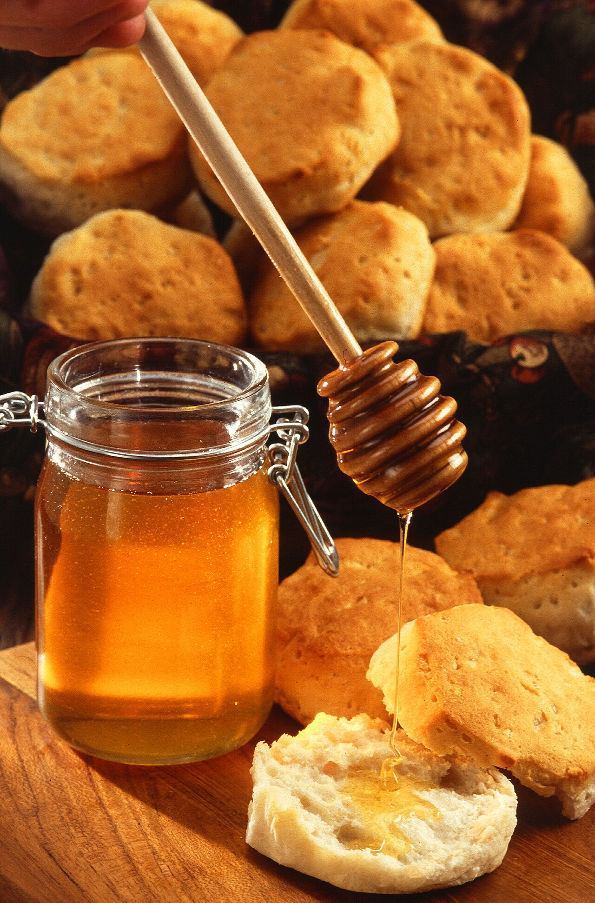

# 蜂蜜

蜂蜜是蜜蜂采集花蜜后，经自身酶作用与水分蒸发形成的甜味物质。它的糖分以果糖与葡萄糖为主，水分通常低于 20%，并含有少量有机酸、酶、矿物质与花粉。作为[蜂蜜酒](ref:honey-wine)的唯一糖源，蜂蜜的难点不在“够不够甜”，而在低氮、高糖与低 pH 共同造成的发酵迟滞。

图：蜂蜜。图片：Scott Bauer, USDA ARS，Public domain，via Wikimedia Commons（[原图页面](https://commons.wikimedia.org/wiki/File:Runny_hunny.jpg)）。

## 蜜蜂酿造与蜂蜜成分

蜜蜂把花蜜吸入蜜囊，混入转化酶，将蔗糖部分水解为葡萄糖与果糖；回巢后通过反复吐纳与扇风蒸发水分，最后封盖成熟。成熟蜂蜜的糖分约占 70–80%，果糖与葡萄糖合计通常超过 85% 的可溶性糖；水分低于 20%，水活度约 0.6，因此微生物难以生长。

蜂蜜的 pH 多在 3.4–6.1 之间，平均约 3.9；酸度来自葡萄糖酸、柠檬酸与苹果酸。过氧化氢与葡萄糖氧化酶构成天然的抑菌体系，但加热与光照会削弱它。

## 高糖、低氮与低 pH

蜂蜜的酵母可同化氮极低，若只加水与酵母，发酵常在中段停滞，并伴随硫化氢与还原味。生产上会补充磷酸氢二铵、氨基酸与维生素，采用分段加氮的方式，避免一次性加入造成酵母过早沉降。高糖造成的渗透压也需要通过稀释控制，蜂蜜酒的起始比重通常在 1.090–1.120。

低 pH 会抑制部分酵母，但酿酒酵母在 pH 3.2 以上仍能工作；真正的问题是缺乏缓冲能力，发酵产酸后 pH 迅速下降。

## 蜂蜜酒发酵

[蜂蜜酒](ref:honey-wine)的基本工艺是蜂蜜加水稀释、接种酵母、控温发酵。温度通常控制在 18–24°C，低温保留花香，高温加快速度但损失细腻度。发酵结束后可以保持残糖做成甜型，也可以完全发酵后回添蜂蜜调味。

蜂蜜的香气在发酵中会变化：洋槐蜜清淡，发酵后香气更薄；荞麦蜜深色、味重，能保留焦糖与谷物调；椴树蜜带薄荷与木质调。是否做二次发酵、是否陈年，都会改变最终风格。

## 啤酒、利口酒与蒸馏酒

在[啤酒](ref:beer)中，蜂蜜可以补充可发酵糖、增加花香与酒体，但比例过高会稀释麦芽风味并延长发酵时间。通常在煮沸后期或发酵前加入，以保留香气。[利口酒](ref:liqueur)用蜂蜜提供甜味与质地，常与草药、香料共同浸渍。蜂蜜也可以发酵后蒸馏，得到蜂蜜烈酒，但各国对原料与标签的要求不同。

## 蜜源、产区与分级

中国、土耳其、美国、阿根廷、墨西哥、印度是主要蜂蜜生产国。蜜源植物决定单花蜜的香气与颜色：洋槐、椴树、荆条、荔枝、荞麦、麦卢卡都是常见类型。单花蜜的标签通常要求某一蜜源占主导，具体比例与检测方法因国家而异。

欧盟蜂蜜指令 2001/110/EC 对水分、蔗糖与羟甲基糠醛设有上限，并禁止添加糖或蜂蜜以外的成分。中国蜂蜜国家标准也对水分、果糖与葡萄糖含量、蔗糖与抗生素残留作出规定。

蜂蜜在储存中会结晶，葡萄糖先析出，果糖比例高的蜜种结晶更慢。结晶不是变质，隔水加热可以恢复流动，但温度超过 40°C 会破坏酶与香气，超过 60°C 还会明显增加羟甲基糠醛。酒厂更愿意使用未经高温处理的蜂蜜，并在稀释后尽快接种，以减少野生酵母与耐渗菌的影响。

不同蜜源的发酵速度也不同。深色蜜的矿物质与缓冲物质较多，发酵 pH 下降较慢；浅色蜜缺乏缓冲，酸度上升快，酵母更容易提前沉降。配方中把深浅蜜按比例混合，既能调节香气，也能让发酵曲线更平稳。

## 替代与配方调整

用蔗糖或葡萄糖浆替代蜂蜜，发酵更稳定、成本更低，但缺少蜂蜜的花香与矿物质感。用枫糖浆替代时，会带来木质与焦糖调，发酵速度也不同。若配方中蜂蜜比例高，必须相应调整氮源、pH 与接种量；简单等量替换，往往导致发酵停滞。

## 感官影响

蜂蜜的香气从花香、柑橘、薄荷到焦糖、木质与药草不等。发酵后，清淡蜜源的花香会减弱，深色蜜源保留更多焦糖与谷物调。酒体从轻到重取决于残糖与甘油含量；酸度低时容易显得平淡，常通过添加少量柠檬酸或苹果酸调整。

## 常见误区

第一，蜂蜜不会变质所以不需要卫生管理。高糖低水活度抑制微生物，但耐渗酵母仍可导致发酵。第二，蜂蜜酒越甜越传统。干型蜂蜜酒同样有悠久历史。第三，蜂蜜可以用白糖等量替代。糖分相似，但香气、矿物质与发酵表现不同。第四，所有蜂蜜都适合同一种发酵温度。深色蜜与清淡蜜的最佳温度与营养方案不同。

## 另见

- [蜂蜜酒](ref:honey-wine)：蜂蜜作为唯一糖源的发酵。
- [利口酒](ref:liqueur)：蜂蜜的甜味与质地作用。
- [啤酒](ref:beer)：蜂蜜作为辅料的使用。
- [发酵](ref:fermentation)：氮源、pH 与温度管理。

对照阅读：[蜂蜜酒](ref:honey-wine)、[啤酒](ref:beer)。

**关键事实。**

| 项目 | 内容 |
| --- | --- |
| 一句话定位 | 蜂蜜是蜜蜂采集花蜜酿成的甜味物质，以葡萄糖与果糖为主；它既是蜂蜜酒的唯一糖源，也可为啤酒、利口酒与烈酒提供香气，但低氮、高糖与低 pH 让发酵启动困难 |
| 原料身份 | 蜂蜜是蜜蜂采集花蜜酿成的甜味物质，以葡萄糖与果糖为主 |
| 加工用途 | 它既是蜂蜜酒的唯一糖源，也可为啤酒、利口酒与烈酒提供香气，但低氮、高糖与低 pH 让发酵启动困难 |

**来源与边界。** 本页关于「蜂蜜」的关键事实，主要由以下来源交叉核对：Oxford University Press（提供关于蜂蜜酒、蜂蜜发酵与甜味剂的条目）、National Honey Board（蜂蜜的主要糖类、水分与单花蜜分类）、European Union（蜂蜜的水分、蔗糖与成分限定）等 5 条来源。价格、批次与状态会变，涉及这些字段时以页面所列来源的最新版本为准。正文为项目自写，来源只作核验，不复制原文。

**并读。** 把「蜂蜜」与「蜂蜜酒」、「利口酒」、「啤酒」放在一起读时，先确认它们是同一层级还是上下游关系：先确认原料形态与产地，再比较加工、风味与替代关系。本页负责给出原料的基本坐标，对照条目补上具体案例与差异；读完再回到本页，才能分清哪些差别属于原料本身，哪些只是产地、批次或品牌选择。

**适用边界。** 对「蜂蜜」而言，原料的品种、加工形态与产地会改变风味；本页说明通用角色，不替代具体配方。
