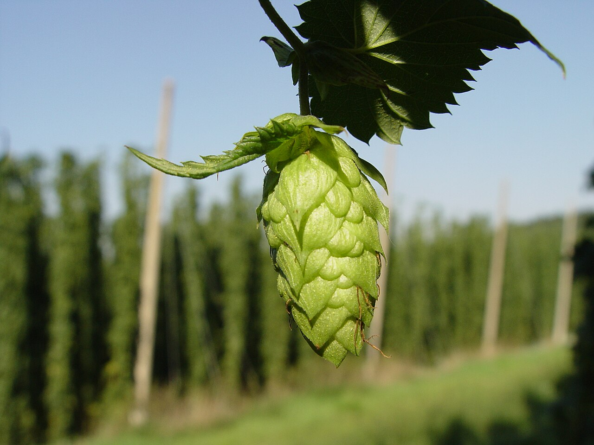

# 啤酒花

啤酒花（Humulus lupulus）是大麻科葎草属的多年生藤本植物。酿造使用的是未授粉的雌花球果，它同时提供苦味、香气、抑菌与泡沫稳定性。苦味并非直接来自 α-酸，而是 α-酸在煮沸中异构化生成的异α-酸；香气则来自精油，二者对投放时机的要求相反。

图：啤酒花。图片：LuckyStarr，CC BY 2.5，via Wikimedia Commons（[原图页面](https://commons.wikimedia.org/wiki/File:Humulus_Lupulus_Hopfendolde-mit-hopfengarten.jpg)）。

## 葎草属植物与球果

啤酒花地上部分每年枯萎，地下根茎多年存活，藤蔓可长到 6 米以上。雌花球果由苞片与花序轴组成，苞片基部有蛇麻腺，分泌树脂与精油。球果成熟时苞片张开、腺体饱满，采收后通常烘干至水分 8–10%，再压制成型或制粒。

未授粉的雌花才适合酿造；授粉后结籽会降低树脂含量并增加脂肪，影响泡沫与保质期。

## α-酸、β-酸与精油

树脂中的 α-酸包括葎草酮、伴葎草酮与加葎草酮，含量随品种从 3% 到 15% 不等。α-酸本身苦味很弱，在 100°C 煮沸中约 30–40% 异构化为异α-酸，后者才是主要苦味来源。β-酸苦味弱，氧化产物可参与风味，但稳定性较差。

精油以月桂烯、葎草烯、石竹烯与法尼烯为主。月桂烯偏树脂与柑橘，葎草烯偏香料与木质，法尼烯带花香。精油沸点低，长时间煮沸会挥发，因此香气投放通常在煮沸后期、回旋沉淀或发酵后干投。

## 煮沸、回旋与干投

苦味投放要早，让 α-酸有足够时间异构化；香气投放要晚，减少精油损失。回旋沉淀在 80–90°C 进行，兼顾杀菌与香气保留；干投在发酵后期或成熟期加入，提取柑橘、热带水果与草本香气，同时带来少量涩感与浑浊。

异α-酸的溶解度有限，苦味在约 100 IBU 附近趋于平台，继续增加酒花用量不会线性提高苦味，反而增加植物感与损失。

## 产区与品种

啤酒花适宜南北纬 35–55° 的长日照地区。德国哈勒陶、捷克萨兹、美国华盛顿州雅基马谷、俄勒冈、爱达荷、斯洛文尼亚与新西兰尼尔森是代表产区。哈勒陶是面积最大的连片种植区之一，萨兹以柔和香料香著称。

品种分苦花、香花与兼用型。萨兹的 α-酸约 3–4.5%，卡斯卡特约 4.5–7%，西楚与马赛克约 11–13%。品种名受育种权保护，商品名不等于植物学分类。

啤酒花的采收与烘干直接影响质量。成熟度不足时精油含量低，过熟则球果散裂、氧化加快；采收后应在 24 小时内进入烘干房，缓慢降到 8–10% 水分，温度过高会让香气变成干草味。压制成型前还要除去枝叶与杂质，否则会带入青草与涩味。

种植端，啤酒花采用根茎繁殖，第一年产量低，第三到五年进入盛产期；霜霉病与白粉病会显著降低产量，因此产区集中在昼夜温差大、夏季日照长的纬度带。干投时还要考虑多酚氧化，接触氧气会让柑橘香迅速变成洋葱与奶酪味。

## 替代与配方

苦花可以用高α酸品种替代以减少用量，但香气轮廓会改变；香花替代要考虑精油组成，而不是只看α酸。酒花提取物、异α酸制剂与酒花油可以替代部分天然酒花，适合稳定苦味或增加香气，但缺少花体带来的多酚与口感。

## 感官影响

啤酒花带来苦味、香气与口感三方面影响。苦味由异α-酸决定，受麦汁糖度、pH 与苦味单位影响；香气从柑橘、松脂、热带水果到花香、香料不等；多酚增加涩感与酒体结构。氧化后的酒花会出现纸板、奶酪与洋葱味。在同一苦度下，麦汁残糖越高，苦味显得越圆；干型酒体则让苦味更直接，酒花的草本与辛香在拉格中更容易被辨认。

## 法规与质量

中国 GB/T 17204-2021 把啤酒纳入饮料酒分类，并规定啤酒以麦芽、水为主要原料，可加啤酒花。美国与欧盟对酒花品种、农药残留与标签有各自要求。酒花应避光、低温、真空储存，α-酸会随温度与氧气下降。

酒花制品的形式也影响使用。全花酒花香气完整，但体积大、易氧化；颗粒酒花经过粉碎与压片，α-酸更稳定；酒花浸膏与异构化颗粒适合大规模生产，却少了花体多酚。选择哪种形式，要看酒厂对香气新鲜度、苦味稳定性与成本的权衡。

## 常见误区

第一，啤酒花是大麻。它同科不同属，不含四氢大麻酚。第二，苦味来自酒花本身。苦味主要来自异构化后的异α-酸。第三，酒花越多越香。过量干投会带来涩感与青草味。第四，IBU 越高越苦。IBU 是分析法测定值，与实际感知受麦汁平衡影响，这也是酒花品种选择比苦度数字更重要的原因。

相关条目：[印度淡色艾尔](ref:ipa)。

## 另见

- [啤酒](ref:beer)：酒花在啤酒中的整体角色。
- [IPA](ref:ipa)：大量酒花与干投的风格代表。
- [IBU](ref:ibu)：苦味单位与感知的关系。
- [拉格](ref:lager)：酒花用量克制的另一条风格线。

补充阅读：[龙舌兰（龙舌兰属）](ref:c-extra-1)。

对照阅读：[啤酒](ref:beer)、[IBU（国际苦味单位）](ref:ibu)。

**关键事实。**

| 项目 | 内容 |
| --- | --- |
| 一句话定位 | 啤酒花是大麻科葎草属的多年生藤本植物，雌花球果中的α-酸经煮沸异构化产生苦味，精油带来香气，多酚与抑菌成分影响泡沫、澄清与保质期 |
| 原料身份 | 啤酒花是大麻科葎草属的多年生藤本植物，雌花球果中的α-酸经煮沸异构化产生苦味，精油带来香气，多酚与抑菌成分影响泡沫、澄清与保质期 |

**来源与边界。** 本页关于「啤酒花」的关键事实，主要由以下来源交叉核对：Oxford University Press（提供关于啤酒花形态、α-酸、品种与投放方式的条目）、Hop Growers of America（美国啤酒花产区与品种概况）、国家市场监督管理总局、国家标准化管理委员会（啤酒在饮料酒分类中的位置）等 4 条来源。价格、批次与状态会变，涉及这些字段时以页面所列来源的最新版本为准。正文为项目自写，来源只作核验，不复制原文。

**并读。** 把「啤酒花」与「啤酒」、「印度淡色艾尔」、「IBU（国际苦味单位）」放在一起读时，先确认它们是同一层级还是上下游关系：先确认原料形态与产地，再比较加工、风味与替代关系。本页负责给出原料的基本坐标，对照条目补上具体案例与差异；读完再回到本页，才能分清哪些差别属于原料本身，哪些只是产地、批次或品牌选择。

**适用边界。** 对「啤酒花」而言，原料的品种、加工形态与产地会改变风味；本页说明通用角色，不替代具体配方。
