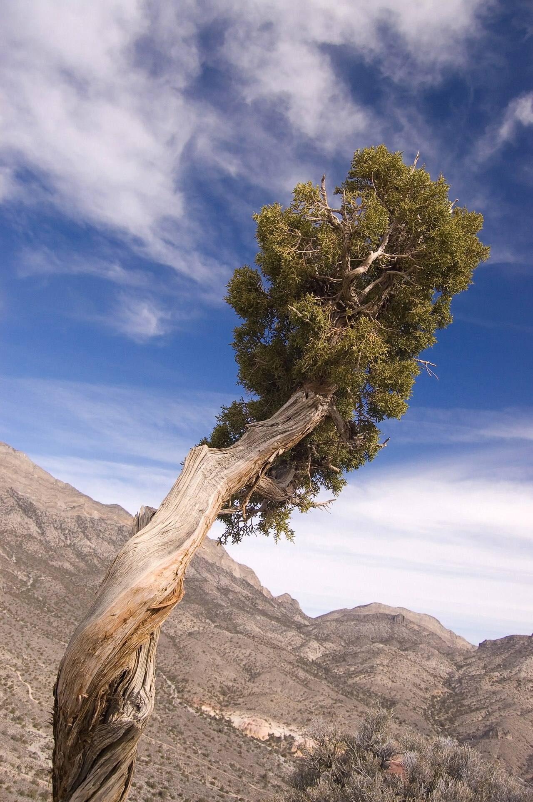

# 杜松子

杜松子（juniper berry）是刺柏属杜松（Juniperus communis）的雌球果。植物学上它不是浆果，而是肉质化的球果，成熟需两到三年。它把松针、树脂、柑橘与木质香气带进[金酒](ref:gin)，并且不是可有可无的装饰：欧盟与美国法规都把杜松列为金酒的定义性风味。

图：杜松子。图片：Fcb981，CC BY-SA 3.0，via Wikimedia Commons（[原图页面](https://commons.wikimedia.org/wiki/File:Juniperus_osteosperma_1.jpg)）。

## 刺柏属植物与球果

杜松是常绿针叶灌木或小乔木，雌雄异株，叶针状、三叶轮生。雌球果授粉后由绿色转为深蓝紫，表面覆一层白粉。球果直径约 6–9 毫米，含树脂道与精油腺。野生植株分布于北半球温带与寒带，生长慢，采收多靠人工。

## 精油组成与提取

杜松子精油含量通常为 0.5–2%，主成分是 α-蒎烯（常见 30–50%）、月桂烯、柠檬烯、沙宾烯与少量倍半萜。α-蒎烯提供松针与树脂感，柠檬烯带来柑橘亮度，月桂烯偏草本与胡椒。粉碎会加速精油挥发与氧化，因此酒厂常在临用前破碎，或整粒浸泡。同一产区的不同年份，精油组成也会因降雨与温度变化而偏移，调香师通常把两三个年份的球果拼配，以保持配方稳定。

## 金酒法定地位与蒸馏方式

欧盟《烈酒饮料法规》(EU) 2019/787 要求金酒以杜松子调味；美国 27 CFR 5 也把杜松列为金酒的必需风味。伦敦干金酒进一步要求以杜松为主的植物香气与极低甜度，成品糖分通常不超过 0.1 g/L。

生产上有两条路径：浸泡蒸馏把杜松子与其他植物放入中性酒精浸渍，再加热蒸馏；蒸气浸润把植物装在蒸馏器上方的篮中，让酒精蒸气穿过。前者提取更彻底、树脂与苦味更重，后者香气更清透、柑橘感更明显。温度与酒精度会改变萜类的溶解与水解。

## 产区、采收与等级

意大利托斯卡纳、北马其顿、保加利亚、克罗地亚、西班牙以及北欧都有商业采集。地中海产区的球果常带更明亮的柑橘与松脂，寒冷地区的香气更紧实。等级通常按产地、颗粒大小、颜色与杂质划分，但行业没有统一的国际分级标准，买家多凭样品与精油分析。杜松子采收后需要阴干或低温烘干，暴晒会让颜色发黄、柑橘调散失；整粒保存比粉碎保存更耐存放，粉碎后最好在数小时内使用。

杜松子的商业供应分为野生采集与栽培两类。野生球果成熟不一致，同一批里常混有未熟果与枝叶，分选成本高；栽培园可以通过修剪与统一采收提高一致性，但建立周期长。意大利、巴尔干与东欧的采集者多在秋冬进入山坡手工摘果，产量受天气与劳动力影响，价格波动明显。

金酒的历史也解释了杜松子的地位。17 世纪荷兰与英国的蒸馏酒商把杜松子加入谷物烈酒，18 世纪英国的《金酒法》对零售与税收作出限制，却未能阻止金酒成为城市饮品；19 世纪的连续蒸馏让酒体更干净，杜松子从掩盖杂味的香料变成风格核心。今天的高端金酒常标注杜松子产地与采收年份，但法规并不要求，标签更多是营销信息，这也是调香师重视年份差异的原因。

## 与其他杜松风味原料的替代

当杜松供应紧张或价格高时，部分配方会用杜松叶、杜松木或松针精油补足“松感”，但这些替代物缺少球果的柑橘与甜润，且叶油的刺激性更强。芫荽籽、当归、鸢尾根、柑橘皮可以支撑金酒的骨架，却不能替代杜松的法定身份。无酒精“金酒”通常用杜松精油加植物浸液模拟，但标签不能称为金酒。

## 感官影响

杜松子的香气在蒸馏后分为前段与后段：前段是松针、柑橘皮与胡椒，后段是树脂、木质与轻微苦味。用量过低时金酒显得扁平，过高则出现松节油感与持久苦尾。与芫荽籽的柠檬香、鸢尾根的粉感、当归的土甜搭配时，杜松的“主导”可以表现为清晰的方向感，而不是压倒性强度。杜松子的香气会随酒精度变化：装瓶酒精度高时松脂与胡椒更突出，稀释后柑橘与花香才逐渐打开；因此品鉴时常先纯饮，再滴少量水比较。

## 常见误区

第一，杜松子是浆果。它是肉质球果。第二，金酒都必须有浓烈的松针味。杜松是必需风味，但不同风格可以把它处理得更柔和。第三，杜松子越黑越熟。颜色受品种、成熟度与干燥影响，不能单独作为质量指标。第四，所有金酒都用同样的植物配方。配方与蒸馏方式是酒厂风格的核心。

相关条目：[伦敦干金](ref:london-dry-gin)。

## 另见

- [金酒](ref:gin)：杜松子作为定义性风味的位置。
- [伦敦干金酒](ref:london-dry-gin)：低糖、杜松主导的风格。
- [意大利](ref:italy)：托斯卡纳等地的采集传统。
- [蒸馏](ref:distillation)：浸泡与蒸气浸润的差异。

对照阅读：[金酒](ref:gin)、[意大利](ref:italy)。

**关键事实。**

| 项目 | 内容 |
| --- | --- |
| 一句话定位 | 杜松子是刺柏属杜松的雌球果，富含α-蒎烯、月桂烯等萜类；它是金酒的法定核心风味，蒸馏方式与用量决定杜松子是主导还是与其他植物协同 |
| 原料身份 | 杜松子是刺柏属杜松的雌球果，富含α-蒎烯、月桂烯等萜类 |
| 加工用途 | 它是金酒的法定核心风味，蒸馏方式与用量决定杜松子是主导还是与其他植物协同 |

**来源与边界。** 本页关于「杜松子」的关键事实，主要由以下来源交叉核对：European Union（金酒必须以杜松子调味的法定定义）、Oxford University Press（提供关于杜松子、金酒植物配方与蒸馏方式的条目）、Encyclopaedia Britannica（杜松属与杜松的植物学特征）等 5 条来源。价格、批次与状态会变，涉及这些字段时以页面所列来源的最新版本为准。正文为项目自写，来源只作核验，不复制原文。

**并读。** 把「杜松子」与「金酒」、「伦敦干金」、「意大利」放在一起读时，先确认它们是同一层级还是上下游关系：先确认原料形态与产地，再比较加工、风味与替代关系。本页负责给出原料的基本坐标，对照条目补上具体案例与差异；读完再回到本页，才能分清哪些差别属于原料本身，哪些只是产地、批次或品牌选择。

**适用边界。** 对「杜松子」而言，原料的品种、加工形态与产地会改变风味；本页说明通用角色，不替代具体配方。
