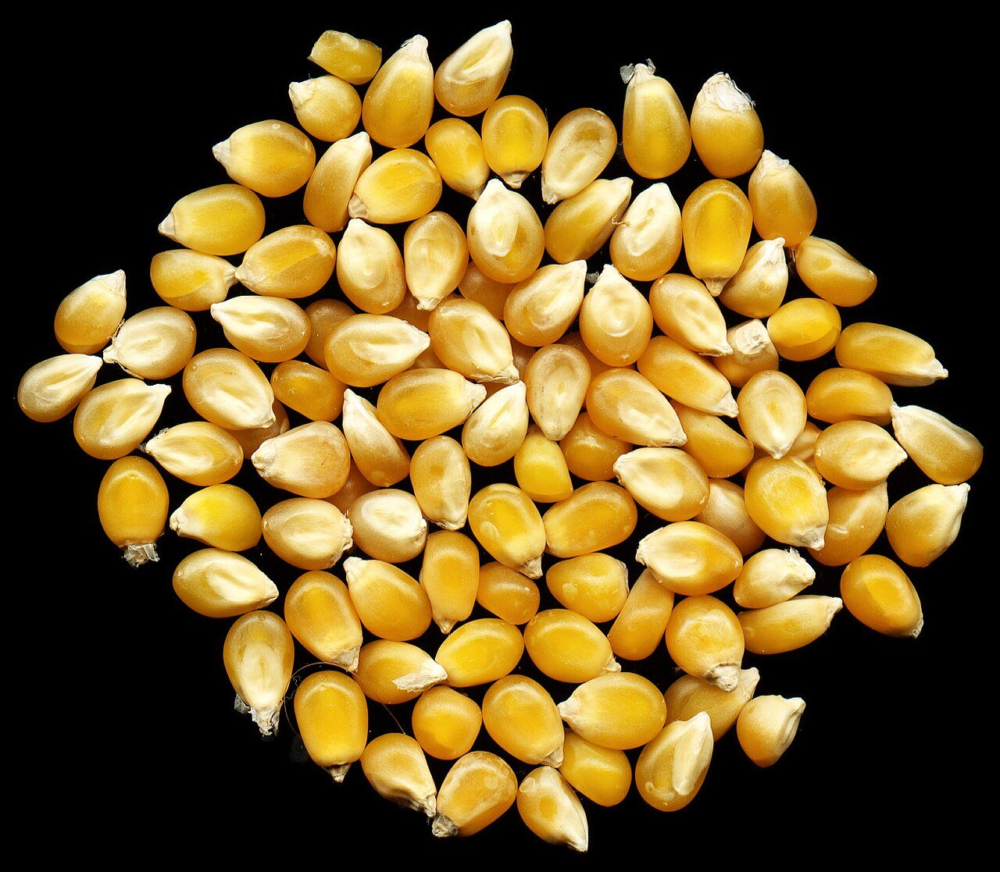

# 玉米

玉米是禾本科玉米属（Zea mays）的一年生谷物，原产美洲，如今在全球广泛种植。它的淀粉含量高，脂肪主要集中在胚芽，既是粮食与饲料，也是多粮白酒、波本威士忌和部分啤酒的原料。玉米在酿酒中的角色，取决于用的是整粒、脱胚玉米还是玉米淀粉制品。

图：干燥的玉米粒。酿酒常用马齿型或硬粒型，甜玉米并非主要原料。图片：Joel Penner，CC BY 2.0，来源：[原始页面](https://commons.wikimedia.org/wiki/File:Maize_Corn.jpg)。

## 定义与形态

玉米籽粒由胚乳、胚芽、皮层与颖壳组成。胚乳以淀粉为主，胚芽含较多脂肪与蛋白质。按粒型可分为马齿型、硬粒型、甜质型等，酿酒常用马齿型或硬粒型，因为淀粉总量较高、加工适应性较好。甜玉米糖分高但淀粉少，并不适合作为主要酿酒原料。

玉米的脂肪集中在胚芽，如果不去除，容易在储存与发酵中产生脂肪酸败味，也可能影响酒体的干净度。部分白酒与威士忌生产会使用脱胚玉米或玉米淀粉，以减少油脂带来的杂味。是否脱胚，是原料处理与风味目标之间的取舍。

## 主要产地

玉米主产国包括美国、中国、巴西、阿根廷与乌克兰。美国中西部是波本威士忌的玉米主产区，中国北方与西南也有大量玉米种植。气候、品种与干燥方式影响籽粒含水量、淀粉结构与杂质比例。

玉米收获后需要及时干燥，否则高水分容易霉变。霉变玉米可能产生真菌毒素，属于食品安全风险，不能进入酿造。规模生产通常对入厂玉米做水分、杂质、淀粉与霉变粒检测。

## 在白酒中的作用

[白酒](ref:baijiu)中的玉米通常作为多粮配方的组成部分。[浓香型白酒](ref:strong-aroma)常见高粱、大米、糯米、小麦、玉米并用，玉米为酒体带来甜感与一定的厚度。玉米淀粉含量高，蒸煮后较易糊化，但脂肪与蛋白质处理不当会带来杂味。

玉米在固态发酵中需要与其他原料搭配，以保持酒醅的疏松与透气。玉米比例过高时，酒体可能偏甜、缺少骨架；比例过低则贡献有限。多粮配方的目标不是把所有粮食都放进配方，而是让不同原料在淀粉、蛋白质与香气前体上形成互补。

## 在波本威士忌中的位置

[波本威士忌](ref:bourbon)是玉米最典型的烈酒用途。美国法规要求波本威士忌的谷物配方中玉米至少占 51%，其余通常是大麦麦芽、黑麦或小麦。玉米带来甜味、焦糖与谷物香气，黑麦增加香料与辛香感，大麦麦芽提供糖化酶。

玉米在威士忌中通常经过蒸煮糊化、糖化、[发酵](ref:fermentation)与蒸馏，再进入新烤橡木桶陈年。玉米比例、谷物配方、蒸馏切酒与桶陈条件共同决定风格。[威士忌](ref:whisky)大类中的玉米威士忌要求玉米比例更高，风格与波本并不相同。

## 在啤酒中的辅料角色

[啤酒](ref:beer)中，玉米常以玉米片、玉米淀粉或糖浆的形式作为辅料。它的作用是提供可发酵糖、降低蛋白质比例、让酒体更轻盈，并在成本上替代部分麦芽。美式淡爽型啤酒常用玉米辅料，但辅料比例过高会削弱麦芽香气与酒体结构。

玉米辅料的使用需要与糖化工艺配合。玉米淀粉的糊化温度较高，通常需要预糊化或与麦芽一起糖化；直接加入未处理的玉米淀粉，可能造成糖化不完全与过滤困难。辅料不是“偷工减料”的同义词，关键在于配方设计与工艺控制。

| 酒类 | 玉米形态 | 关键工序 |
| --- | --- | --- |
| 多粮白酒 | 整粒或破碎玉米 | 蒸煮、糖化、固态发酵、蒸馏 |
| 波本威士忌 | 玉米谷物 | 蒸煮、糖化、发酵、壶式或柱式蒸馏 |
| 啤酒 | 玉米片、淀粉或糖浆 | 糊化、糖化、过滤、发酵 |

## 脂肪、淀粉与工艺匹配

玉米的胚芽脂肪是工艺上的重点。脂肪过多会影响发酵稳定性与酒体干净度，因此脱胚、挤压或精制淀粉成为常见处理方式。与此同时，适度的谷物风味又是玉米的价值所在；过度精制会让原料特征消失。

玉米淀粉的糊化与糖化需要足够的水分与温度。整粒玉米蒸煮时间长，破碎玉米更易糊化但容易结团。生产者会根据设备、原料形态与目标酒种调整蒸煮与糖化参数，而不是套用同一套流程。

## 选购与储存

选购玉米时关注颗粒饱满度、颜色、气味、杂质与霉变粒。酿酒用玉米要求新鲜、无霉味、无虫害，水分不宜过高。脱胚玉米与玉米淀粉应关注加工日期与储存条件，避免吸潮结块。

储存环境要干燥、通风、避光，防止虫害与霉变。家庭自酿应选择来源清楚、无霉变的原料，并注意器具与用水卫生。霉变玉米不能通过清洗或蒸煮完全消除风险。

## 常见误区

第一，玉米只是饲料。它在白酒、波本威士忌与啤酒辅料中都有实际用途。

第二，玉米酒一定甜腻。甜感取决于配方、发酵与蒸馏，不是玉米的必然结果。

第三，玉米越多酒越香。比例过高可能削弱骨架与复杂度。

第四，所有玉米都适合酿酒。甜玉米淀粉少、糖分高，不适合作为主要淀粉来源。

第五，霉变玉米煮熟就安全。真菌毒素的风险不会因普通蒸煮而完全消失。

## 延伸阅读

- [白酒](ref:baijiu)：玉米在多粮白酒中的位置。
- [浓香型白酒](ref:strong-aroma)：多粮配方与固态发酵的匹配。
- [波本威士忌](ref:bourbon)：玉米比例与谷物配方的核心规则。
- [威士忌](ref:whisky)：谷物糖化、蒸馏与桶陈的总体框架。
- [啤酒](ref:beer)：玉米辅料在啤酒配方中的作用。

**关键事实。**

| 项目 | 内容 |
| --- | --- |
| 一句话定位 | 禾本科玉米属的一年生谷物，淀粉含量高、脂肪集中在胚芽；它是多粮白酒的常见配料，也是美国波本威士忌与部分啤酒辅料的核心原料 |
| 原料身份 | 禾本科玉米属的一年生谷物，淀粉含量高、脂肪集中在胚芽 |
| 加工用途 | 它是多粮白酒的常见配料，也是美国波本威士忌与部分啤酒辅料的核心原料 |

**来源与边界。** 本页关于「玉米」的关键事实，主要由以下来源交叉核对：国家市场监督管理总局、国家标准化管理委员会（白酒原料与多粮配方的术语；饮料酒类别与原料术语框架）、Oxford University Press（提供关于玉米辅料、淀粉提取与啤酒原料处理的条目；由原条目末尾参考资料迁移，未逐条复核访问日期）。价格、批次与状态会变，涉及这些字段时以页面所列来源的最新版本为准。正文为项目自写，来源只作核验，不复制原文。
