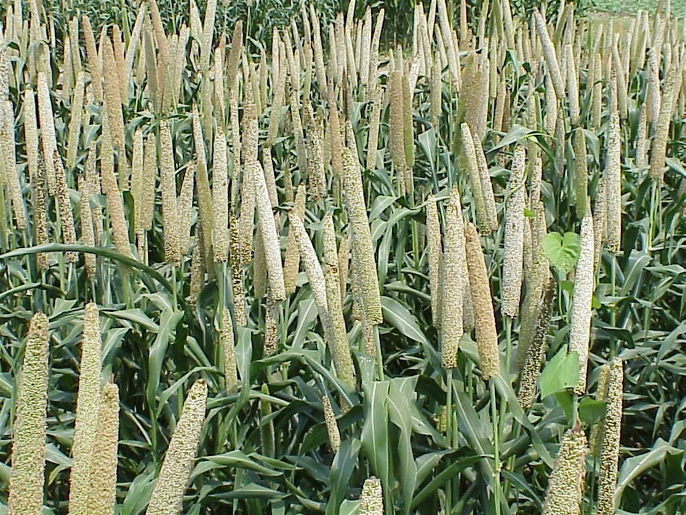

# 小米（粟）

小米是粟（Setaria italica）脱壳后的籽粒，颗粒直径约 1–2 毫米，颜色从淡黄到橙红不等。它在中国北方有悠久的栽培史，也是黄酒、小米酒与部分地方白酒的原料；在非洲与南亚，珍珠粟、指粟等小粒谷物则支撑着传统浑浊谷物酒的发酵体系。颗粒小、淀粉致密，使它在蒸煮、糖化与过滤中的表现与大米、高粱都不同。

图：小米（粟）。图片：Wikimedia Commons contributor，Public domain，via Wikimedia Commons（[原图页面](https://commons.wikimedia.org/wiki/File:Grain_millet,_early_grain_fill,_Tifton,_7-3-02.jpg)）。

## 粟、黍与珍珠粟

粟为一年生禾草，穗紧密，脱壳后即小米。黍（Panicum miliaceum）籽粒稍大、黏性品种多，即墨老酒所用的黍米属于这一类，不能与粟米混为一谈。珍珠粟（Pennisetum glaucum）耐旱、穗大，主要种植于非洲萨赫勒与南亚；指粟（Eleusine coracana）富含钙，是东非与印度的重要粮食。中文“小米”在日常语境中常泛指这些作物，但酿酒配方必须区分。

## 淀粉与蛋白质特征

小米淀粉含量约 70–80%，支链淀粉比例高，糊化温度约 70–80°C。蛋白质约 10–13%，脂肪与纤维高于精白大米，主要集中在糊粉层与胚芽。颗粒小意味着单位体积的表面积大，蒸煮时吸水快、易结块；糖化时若糊化过度，醪液会变得黏稠，压榨与过滤困难。

小米缺乏大麦那样发达的麦壳，固态发酵时常用稻壳或谷壳作为填充剂，改善透气性。

## 黄酒与小米酒

黄酒国家标准按原料与工艺分类，黍米黄酒是其中一类。山东即墨老酒以黍米为原料，经过浸米、糊化、糖化、发酵、压榨、煎酒而成，焦香与甜润是其特色。小米黄酒则多以粟米为主料，搭配麦曲或小曲，发酵周期从数天到数月不等。

小米酒在家庭与地方作坊中很常见，工艺接近甜型黄酒：蒸熟后拌曲、糖化、加水发酵，再压榨取酒。因小米蛋白与脂肪较高，发酵容易出现酸败与苦味，卫生条件与温度控制比配方更关键。

## 非洲与亚洲传统谷物酒

在非洲南部，高粱与小米混合发酵的传统浑浊啤酒（如 umqombothi）依靠乳酸菌与酵母共同作用，酸度低、酒精度通常只有 2–4%，成品未经过滤，富含悬浮酵母与谷物颗粒。东非的 merissa 与南亚的地方米酒也有类似逻辑：糖化与发酵常在同一容器中完成，依靠曲或发芽谷物提供酶。

这类酒不适合套用啤酒花的苦味框架，评价重点是酸度、谷物香、发酵度与卫生安全。

## 产区与地方品种

中国小米主产于华北、东北与西北，山西、河北、内蒙古、辽宁是重要产区。地方品种按粒色、黏性与生育期区分，酿酒用小米通常要求颗粒饱满、杂质少、无霉变。印度与非洲的珍珠粟、指粟品种更多，颜色从白到深褐，单宁与多酚含量差异大。

小米的脂肪酶活性较高，储存不当会酸败；脱壳后失去外壳保护，更应密封、避光、低温保存。酿酒厂对入厂小米做水分、杂质、不完善粒与黄曲霉毒素检测，因为小米在潮湿条件下容易感染霉菌。与大米相比，小米的直链淀粉比例因品种而异，糯性品种支链淀粉可超过 90%，这也是地方小米酒口感黏润的原因。在无麸质啤酒中，小米可以替代部分高粱，但蛋白质与脂肪更高，需要更长的蛋白质休止与更充分的过滤。

## 与大米、高粱的替代差异

大米淀粉更细腻、蛋白质低，酿出的酒干净、柔和；高粱含单宁与较粗的淀粉颗粒，适合固态多轮次发酵；小米介于两者之间，香气更明显，但黏度与脂肪带来工艺负担。用小米替代大米时，要减少蒸煮时间、增加谷壳比例，并防止醪液过黏；用小米替代高粱时，则要补足单宁结构与耐蒸煮性。

## 感官影响

小米酒通常带蒸谷物的甜香、坚果与轻微焦香，酸度比大米酒更明显，酒体中等。黍米黄酒的焦香来自糊化与煎酒过程中的美拉德反应，与小米的清香不同。发酵温度偏高时，小米酒容易出现刺鼻的高级醇与酸味；低温慢发酵则保留更多谷物甜感。冷却后甜香会减弱、酸度更突出，因此地方饮法多偏向温热饮用。

## 常见误区

第一，小米就是黍米。两者是不同属的作物，即墨老酒用的是黍米。第二，小米酒都是甜酒。发酵度提高后可以做成干型。第三，小米无麸质所以一定安全。原料无麸质，但共用设备与曲料可能引入麸质。第四，小米颗粒小所以容易糖化。颗粒小反而更容易结块，需要更精细的蒸煮与搅拌。

相关条目：[白酒](ref:baijiu)。

## 另见

- [黄酒](ref:yellow-wine)：黍米黄酒与小米黄酒的工艺背景。
- [白酒](ref:baijiu)：小米在地方配方中的辅料角色。
- [啤酒](ref:beer)：非洲小米啤酒与传统谷物发酵。
- [制曲](ref:qu-making)：曲霉与根霉提供的糖化酶。
- [糖化](ref:saccharification)：小米淀粉糊化与酶解。

对照阅读：[黄酒](ref:yellow-wine)、[啤酒](ref:beer)。

**关键事实。**

| 项目 | 内容 |
| --- | --- |
| 一句话定位 | 小米是粟（Setaria italica）脱壳后的籽粒，也是黍、珍珠粟等小粒谷物的统称；在中国它用于黄酒与小米酒，在非洲与亚洲则用于传统浑浊谷物酒，淀粉与蛋白质结构影响糖化与风味 |
| 原料身份 | 小米是粟（Setaria italica）脱壳后的籽粒，也是黍、珍珠粟等小粒谷物的统称 |
| 加工用途 | 在中国它用于黄酒与小米酒，在非洲与亚洲则用于传统浑浊谷物酒，淀粉与蛋白质结构影响糖化与风味 |

**来源与边界。** 本页关于「小米（粟）」的关键事实，主要由以下来源交叉核对：国家市场监督管理总局、国家标准化管理委员会（黄酒的原料与分类框架）、Food and Agriculture Organization of the United Nations (FAO)（小米类谷物的栽培与食用概况）、Oxford University Press（提供关于小米啤酒与非洲传统谷物发酵酒的条目）等 4 条来源。价格、批次与状态会变，涉及这些字段时以页面所列来源的最新版本为准。正文为项目自写，来源只作核验，不复制原文。

**并读。** 把「小米（粟）」与「黄酒」、「白酒」、「啤酒」放在一起读时，先确认它们是同一层级还是上下游关系：先确认原料形态与产地，再比较加工、风味与替代关系。本页负责给出原料的基本坐标，对照条目补上具体案例与差异；读完再回到本页，才能分清哪些差别属于原料本身，哪些只是产地、批次或品牌选择。

**适用边界。** 对「小米（粟）」而言，原料的品种、加工形态与产地会改变风味；本页说明通用角色，不替代具体配方。
