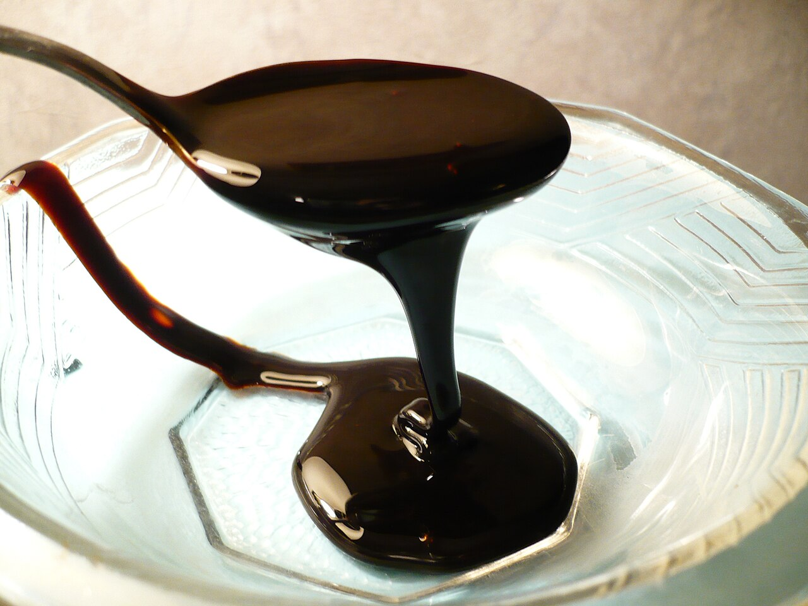

# 糖蜜

糖蜜是甘蔗或甜菜制糖过程中，糖结晶分离后剩下的黏稠糖浆。它把蔗糖、转化糖、矿物质与含氮物一并带入发酵罐，是[朗姆](ref:rum)最主要的糖源。与“废糖蜜”这个旧称相反，糖蜜的等级、灰分与微生物负荷会直接改变发酵速度、蒸馏收率与酒体厚度。

图：糖蜜。图片：Badagnani，CC BY 3.0，via Wikimedia Commons（[原图页面](https://commons.wikimedia.org/wiki/File:Blackstrapmolasses.JPG)）。

## 从糖厂副产物到发酵原料

甘蔗压榨得汁，经澄清、蒸发、结晶、离心分出蔗糖，剩余母液即糖蜜。第一次结晶后的糖蜜仍含大量蔗糖，可再煮糖；反复煮炼后得到黑糖蜜（blackstrap），颜色深、灰分高、糖分相对低。另有高糖蜜（high-test molasses），是部分转化、未完全结晶的糖浆，总糖可达 75–85%，适合直接发酵。

甜菜糖蜜含甜菜碱与较高水平的钠、钾，发酵后容易产生不愉快的土味与皂感，因此朗姆酒厂普遍偏好甘蔗糖蜜。

## 糖分、灰分与氮源

甘蔗糖蜜一般含 50–70% 总糖，其中蔗糖占多数，另有葡萄糖与果糖；水分 20–25%，灰分 4–10%，黑糖蜜的灰分更高。酵母不能直接吸收蔗糖，要先由转化酶水解为单糖。糖蜜的酵母可同化氮往往不足，尤其在高糖稀释醪中，酒厂会补加硫酸铵、尿素或复合氮源，并控制磷与镁的供应。

高灰分会提高缓冲能力，使发酵醪的 pH 下降较慢；但盐分过高也会抑制酵母。生产上通常把糖蜜稀释到 20–30°Brix 再接种，避免渗透压过高导致起发迟缓。

## 朗姆酒中的发酵机制

[发酵](ref:fermentation)温度多控制在 28–33°C，接种量随酒厂风格而变。追求轻爽风格的酒厂使用纯种酵母、较短发酵时间；追求高酯风格的牙买加酒厂则保留野生微生物与“dunder”残液回添，让细菌与酵母共同生成酯类、酸类与高沸点风味物。

发酵完成后的醪液进入[蒸馏](ref:distillation)。壶式蒸馏保留更多同源物，柱式蒸馏得到更干净的酒体。欧盟法规对朗姆酒的挥发性物质设有下限（不低于 225 g/hL 纯酒精），这也是“朗姆”与中性酒精在分析层面的一条分界。

## 产地、等级与风格

甘蔗糖蜜的主要供应国是巴西、印度、泰国、中国与加勒比国家。牙买加、巴巴多斯、圭亚那、马提尼克等地的朗姆传统，建立在本地糖厂与糖蜜供应之上。[牙买加](ref:jamaica)以高酯、厚重著称，[巴巴多斯](ref:barbados)则强调较干净的壶式与柱式风格。糖蜜的产地批次差异很大，酒厂通常按灰分、总糖与风味做拼配。

糖蜜的国际贸易以散装液袋与罐箱为主，运输过程中的温度与密封决定到厂质量。巴西、泰国等主产国在榨季集中出货，酒厂会在价格低点囤货，但长期储存会加深颜色与焦糖味，因此高端产品更倾向使用当季糖蜜。糖蜜的灰分与产地土壤、甘蔗品种和制糖工艺有关，同一国家不同糖厂的批次也可能相差明显。

## 与蔗汁、糖浆的替代差异

用新鲜[甘蔗](ref:sugarcane)汁直接发酵，得到的是农业朗姆或巴西卡莎萨路线，香气更青绿、带甘蔗皮与草本调；用糖蜜发酵，风味更偏向焦糖、糖蜜、香料与深色水果。两者不能简单互换：蔗汁含水量高、糖度低，需要更快处理；糖蜜黏度高，需要稀释与预热。

## 感官贡献

糖蜜给酒体带来焦糖、甘草、咖啡、烟熏与咸鲜的底色。高灰分糖蜜容易带矿物感与微苦；发酵温度高、野生菌活跃时，会出现香蕉、菠萝与溶剂香。陈年在橡木桶中，这些香气会与香草、椰子、香料融合。

糖蜜在储存中会吸收水分、发酵或结晶。露天罐温度波动大，表层容易滋生酵母与霉菌；酒厂通常把糖蜜保持在 25–30°C 以上以便泵送，但长期高温会促进美拉德反应，使焦糖与苦味加重。进厂检验一般看总糖、灰分、pH、总氮与微生物，单看颜色并不可靠。糖蜜的黏度随温度与含水量变化很大，稀释时要先预热再计量，否则糖度读数会偏离。牙买加酒厂还会把蒸馏残液（dunder）回添到发酵醪，酸度与酯类因此显著上升，但回添比例过高会抑制酵母。

## 常见误区

第一，糖蜜是废料。它是制糖的副产物，但有明确的等级与用途。第二，所有朗姆酒都用糖蜜。农业朗姆与卡莎萨以蔗汁为原料。第三，糖蜜越黑越好。颜色与灰分、煮炼次数有关，是否适合取决于目标风格。第四，糖蜜发酵不需要营养。高糖稀释后氮源与微量元素往往不足，必须补加。

## 另见

- [朗姆酒](ref:rum)：糖蜜与蔗汁两条原料路线。
- [牙买加](ref:jamaica)：高酯、厚重风格的产地背景。
- [巴巴多斯](ref:barbados)：壶式与柱式蒸馏传统。
- [发酵](ref:fermentation)：糖蜜稀释、接种与营养管理。
- [蒸馏](ref:distillation)：壶式与柱式对风味的影响。
- [甘蔗](ref:sugarcane)：蔗汁直接发酵的另一条路径。

对照阅读：[朗姆酒](ref:rum)、[巴巴多斯](ref:barbados)。

**关键事实。**

| 项目 | 内容 |
| --- | --- |
| 一句话定位 | 糖蜜是制糖结晶后剩下的糖浆，含蔗糖、葡萄糖、果糖与矿物质；它是朗姆酒最主要的糖源，也是工业酵母的常见培养基，等级与成分直接决定发酵速度与风味 |
| 原料身份 | 糖蜜是制糖结晶后剩下的糖浆，含蔗糖、葡萄糖、果糖与矿物质 |
| 加工用途 | 它是朗姆酒最主要的糖源，也是工业酵母的常见培养基，等级与成分直接决定发酵速度与风味 |

**来源与边界。** 本页关于「糖蜜」的关键事实，主要由以下来源交叉核对：Oxford University Press（提供关于糖蜜、糖蜜朗姆与高酯发酵的条目）、Food and Agriculture Organization of the United Nations (FAO)（制糖流程与糖蜜作为副产物的位置）、U.S. Department of Agriculture（糖蜜的糖分、水分与矿物质概况）等 5 条来源。价格、批次与状态会变，涉及这些字段时以页面所列来源的最新版本为准。正文为项目自写，来源只作核验，不复制原文。

**并读。** 把「糖蜜」与「朗姆酒」、「牙买加」、「巴巴多斯」放在一起读时，先确认它们是同一层级还是上下游关系：先确认原料形态与产地，再比较加工、风味与替代关系。本页负责给出原料的基本坐标，对照条目补上具体案例与差异；读完再回到本页，才能分清哪些差别属于原料本身，哪些只是产地、批次或品牌选择。

**适用边界。** 对「糖蜜」而言，原料的品种、加工形态与产地会改变风味；本页说明通用角色，不替代具体配方。

**更新提示。** 「糖蜜」最近核对于 2026-11-07；产地、加工形态、等级与价格会变，采购前以供应商规格为准。
