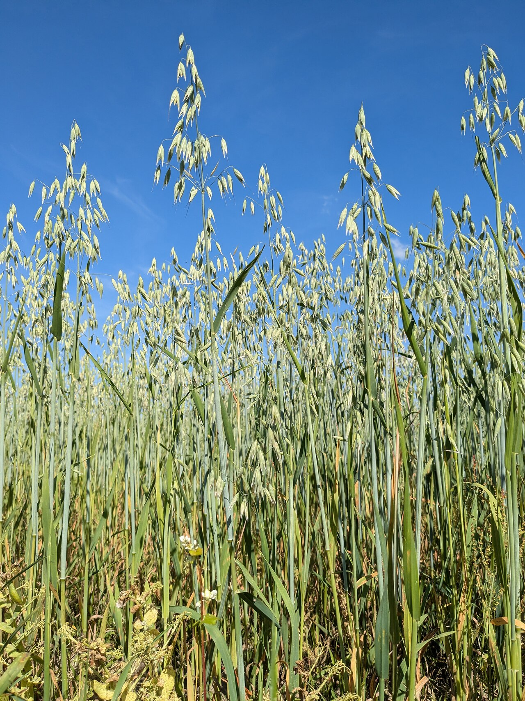

# 燕麦

燕麦（Avena sativa）是禾本科燕麦属的一年生谷物，喜冷凉湿润，籽粒脂肪与 β-葡聚糖含量明显高于大麦。它在[啤酒](ref:beer)里主要不是提供糖，而是提供[酒体](ref:body)、奶油感与浑浊；在燕麦[世涛](ref:stout)中，这种柔滑质地几乎成了风格标志。但高脂肪与高黏性，也让[糖化](ref:saccharification)、过滤与蒸馏比大麦更麻烦。

图：燕麦。图片：Christian Fischer，CC BY-SA 4.0，via Wikimedia Commons（[原图页面](https://commons.wikimedia.org/wiki/File:AvenaSativa3.jpg)）。

## 燕麦的植物学与籽粒结构

燕麦为一年生禾草，圆锥花序，籽粒被内外稃包裹。栽培种分冬燕麦与春燕麦，按用途又分饲用、食用与制麦用。籽粒由胚乳、糊粉层、胚与麦壳组成；麦壳比例高、结构疏松，既是过滤时的天然滤层，也是涩味与吸附损失的来源。

美国农业部 FoodData Central 的数据显示，每 100 克生燕麦约含 66.3 克碳水化合物、16.9 克蛋白质、6.9 克脂肪与 10.6 克膳食纤维。脂肪中不饱和脂肪酸比例高，储存不当容易氧化，产生纸板与哈喇味。

## β-葡聚糖、脂肪与糖化

β-葡聚糖是燕麦胚乳细胞壁中的可溶性纤维，含量约 4–6%。它吸水后形成高黏度溶液，能提升口感圆润度，却会让麦汁过滤变慢，严重时造成糖化醪“黏死”。生产上常安排 40–45°C 的 β-葡聚糖休止，或使用含 β-葡聚糖酶的制剂；分子量越高增稠越明显，但过度降解又会失去口感，酶剂量需要按麦汁黏度调整。

燕麦的淀粉酶活力有限，尤其是未制麦的压片燕麦，几乎只能作为辅料。配方中燕麦比例通常在 5–20%，其余糖源由大麦麦芽承担。脂肪会削弱泡沫持久性，过量燕麦会让泡沫粗大、消退快。

## 啤酒中的使用方式

燕麦可以以燕麦麦芽、压片燕麦、燕麦片或生燕麦进入糖化锅。燕麦麦芽经过部分发芽与干燥，酶活力高于生燕麦，但仍不足以独立糖化。浑浊 IPA 常用 10–20% 燕麦片追求顺滑与浑浊；燕麦世涛则用燕麦麦芽与烘烤麦芽搭配，形成丝绒般的口感。

[发酵](ref:fermentation)本身对燕麦并不特殊，关键是麦汁的黏度、氧含量与营养。高比例燕麦的麦汁清亮度低，酵母沉降慢，装瓶前需要更充分的冷降与过滤。

## 产区与品种

燕麦适合凉爽湿润地区，俄罗斯、加拿大、波兰、芬兰、美国、澳大利亚是主要生产国。中国北方与西南高海拔地区也有种植，主要用于食用与饲料。品种间的脂肪、β-葡聚糖与蛋白质差异明显，制麦用燕麦通常要求粒重高、壳薄、发芽整齐。

燕麦脂肪的氧化是储存与酿造中的主要风险。原料水分超过 12%、温度偏高或粉碎后长时间暴露，都会让脂肪酶与脂氧合酶活跃，产生己醛等物质，闻起来像旧纸板。酒厂因此倾向使用新鲜压片燕麦，并在糖化前才开封；制麦燕麦则要控制焙焦温度，避免把奶油香烤成焦苦。少数谷物威士忌配方会加入 5–10% 燕麦，目的是增加口感的油脂感，但蒸馏后香气保留有限。

燕麦壳的吸附性也会带走一部分酒花苦味，配方设计时要把这部分损失计入。在浑浊 IPA 中，燕麦与小麦常一起使用，小麦提供蛋白浑浊，燕麦提供滑感，两者比例失衡会让泡沫塌陷。家酿条件下，燕麦片需要与基础麦芽一起糊化，否则淀粉无法充分释放；使用前压碎可以改善吸水，而燕麦片的新鲜度往往比品种名声更能决定成品是否出现陈味。

## 与大麦、小麦的替代比较

与大麦相比，燕麦缺少发达的麦壳滤层与足够的酶活力，不能承担基础麦芽的角色；与小麦相比，燕麦的蛋白质不形成面筋，因此不会带来面包般的嚼劲，而是更柔软的滑感。若想增加酒体又不想引入小麦的浑浊蛋白，燕麦是常用选择；若要替代部分基础麦芽，则必须同时补充酶源。

## 感官与酒体

燕麦带来的是触感而非强烈香气：入口更圆、更厚，收口更柔，常被描述为奶油、丝滑或“天鹅绒”。它也会让酒液浑浊、颜色略深，并轻微削弱苦味的锐度。用量过高时，会出现谷物生味、涩感与泡沫问题。

## 常见误区

第一，燕麦只能做世涛。它在浑浊 IPA、小麦啤酒与浅色艾尔中同样常见。第二，燕麦越多越顺滑。超过一定比例后，黏度与过滤问题会抵消口感收益。第三，燕麦无麸质。燕麦本身不含面筋蛋白，但常与小麦共用设备，纯燕麦产品仍需认证。第四，燕麦能替代基础麦芽。它的酶活力不足，必须与大麦麦芽搭配。

## 另见

- [啤酒](ref:beer)：燕麦作为辅料与酒体调节剂。
- [世涛](ref:stout)：燕麦世涛的风格背景。
- [糖化](ref:saccharification)：β-葡聚糖休止与酶制剂。
- [酒体](ref:body)：燕麦带来的触感变化。
- [威士忌](ref:whisky)：燕麦在谷物蒸馏中的实验性使用。

对照阅读：[啤酒](ref:beer)、[糖化](ref:saccharification)。

**关键事实。**

| 项目 | 内容 |
| --- | --- |
| 一句话定位 | 燕麦是禾本科燕麦属的一年生谷物，脂肪与β-葡聚糖含量高；它在啤酒中带来柔滑酒体与浑浊感，也用于燕麦世涛，但高脂肪与黏性让糖化、过滤和蒸馏都比大麦更麻烦 |
| 原料身份 | 燕麦是禾本科燕麦属的一年生谷物，脂肪与β-葡聚糖含量高 |
| 加工用途 | 它在啤酒中带来柔滑酒体与浑浊感，也用于燕麦世涛，但高脂肪与黏性让糖化、过滤和蒸馏都比大麦更麻烦 |

**来源与边界。** 本页关于「燕麦」的关键事实，主要由以下来源交叉核对：Oxford University Press（提供关于燕麦麦芽、燕麦世涛、β-葡聚糖与过滤的条目）、Whole Grains Council（燕麦的脂肪、β-葡聚糖与营养概况）、U.S. Department of Agriculture（燕麦籽粒的碳水化合物、蛋白质、脂肪与膳食纤维数值）等 5 条来源。价格、批次与状态会变，涉及这些字段时以页面所列来源的最新版本为准。正文为项目自写，来源只作核验，不复制原文。

**并读。** 把「燕麦」与「啤酒」、「世涛」、「糖化」放在一起读时，先确认它们是同一层级还是上下游关系：先确认原料形态与产地，再比较加工、风味与替代关系。本页负责给出原料的基本坐标，对照条目补上具体案例与差异；读完再回到本页，才能分清哪些差别属于原料本身，哪些只是产地、批次或品牌选择。

**适用边界。** 对「燕麦」而言，原料的品种、加工形态与产地会改变风味；本页说明通用角色，不替代具体配方。
