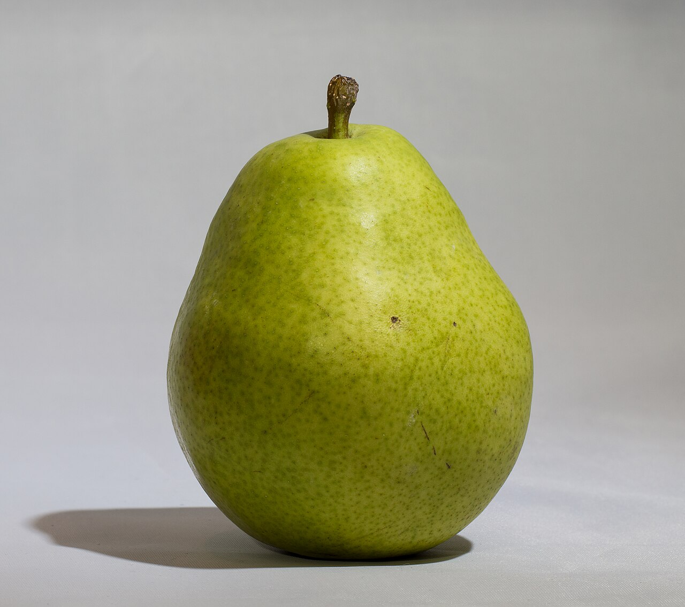

# 梨

梨是梨属水果，既可鲜食，也可酿酒；专门用于酿酒的“perry pear”单宁高、酸度高、香气强，在英国与法国诺曼底酿成 perry（梨酒），风格与苹果酒相近但更轻盈。

图：Pear：D'anjou pear（Wikimedia Commons）。图片：Rhododendrites，CC BY-SA 4.0，via Wikimedia Commons（[原图页面](https://commons.wikimedia.org/wiki/File:D%27anjou_pear.jpg)）。

## 定义与命名

梨是梨属（Pyrus）的仁果，栽培上主要有欧洲梨（Pyrus communis）与亚洲梨（Pyrus pyrifolia 等）。欧洲梨果肉软、香气细，亚洲梨脆、汁多；两者都能鲜食，也都能发酵或蒸馏。

Perry pear 是专门用于酿梨酒的梨，果实小、单宁高、酸度高，鲜食口感涩硬。它不是“更甜的梨”，而是为发酵与结构选育的原料。看到 perry、pear cider、pear wine 时，要区分梨酒、梨汁饮料与梨利口酒。

## 起源与传播

梨的栽培起源覆盖欧洲、西亚与中国多地；欧洲梨与亚洲梨各自经过长期选育，形成不同的果形、肉质与香气。梨随贸易、移民与园艺交流扩散到北美、南美、澳洲与新西兰等温带产区。

Perry 在英国赫里福德郡、格洛斯特郡与法国诺曼底有悠久传统；这些地区保留了许多老梨园与专用 perry 品种。中国的河北、山东、陕西等地以鲜食梨与梨汁为主，也有梨酒与梨蒸馏酒。

## 植物学与栽培

梨是仁果，果肉由花托发育，中心有种子。梨树多数品种自交不亲和，需要授粉树；栽培上要看需冷量、花期霜冻、土壤排水与砧木。梨锈病、火疫病与果实轮纹病是常见管理重点。

Perry 梨园常采用标准乔木或半标准树形，果实小、产量低，但单宁与酸度高。鲜食梨则更重视疏果、套袋、采收成熟度与冷链；过熟梨会绵软、香气下降，未熟梨则涩味重。

## 风格与味觉

Perry 通常是干型，带梨、白花、柑橘与单宁感；传统瓶内二次发酵可以产生气泡，风格从轻盈到饱满。梨酒与苹果酒一样，靠果实中的糖发酵，不添加葡萄；甜度取决于是否保留残糖或后期加糖。

梨也用于梨利口酒、Poire Williams 梨蒸馏酒与梨汁。Poire Williams 通常用威廉梨发酵后蒸馏，整颗梨浸入瓶中的做法属于展示与浸渍，不是发酵工艺。梨的香气清新，蒸馏后容易挥发，因此低温慢蒸与及时截取很重要。

## 主要产区与代表产品

英国西米德兰兹、赫里福德郡与格洛斯特郡是 perry 核心产区；法国诺曼底与安茹也有梨酒传统。中国河北、山东、陕西与新疆以鲜食梨、梨汁与梨罐头为主，梨酒仍是小众品类。

Perry 的“代表性”不如葡萄酒那样有统一分级，更多依赖果园、品种与酒坊。购买时应看是否标注 perry pear、是否瓶内发酵、甜度与产地，而不是只看“梨酒”两个字。

## 怎么喝与配餐

Perry 适合冷藏但不过冰，温度过低会压住香气；用郁金香杯或高脚杯，少量慢饮。干型 perry 配猪肉、鸡肉、奶酪与油炸食物；甜型 perry 配水果塔、蓝奶酪与辛辣菜肴。Poire Williams 适合室温、小杯纯饮，也可加冰或调酒。

梨的甜香与坚果、蓝奶酪、猪肉、鸭肉和根茎类蔬菜相合；单宁与酸度能切开油脂。对酒精敏感的人要注意 perry 与梨蒸馏酒的度数差异，甜型梨酒容易喝得快。

## 选购与常见误区

第一，把 perry 与梨汁饮料混为一谈。Perry 是发酵酒，不是加香梨汁。第二，把“梨酒”都当成干型；甜度要看标签与残糖。第三，把 Poire Williams 里的整颗梨当成发酵原料；它更多是浸渍展示。第四，认为梨越甜越适合酿酒；perry 需要的是酸度、单宁与香气。

梨不是葡萄，不能用“克隆、砧木、老藤、果皮浸渍”这套葡萄话术。它的关键变量是欧洲梨/亚洲梨、perry 专用品种、成熟度、发酵方式与是否蒸馏。

Perry 的梨园通常不是鲜食梨园。专用品种果实小、单宁高，树势旺，常与标准乔木管理配合；鲜食梨则重视果形、套袋与冷链。两者对采收成熟度的要求也不同：perry 梨要保留酸度与单宁，过熟会失去结构；鲜食梨要等到糖酸比合适，但过熟会绵软。梨酒与梨汁饮料的差别主要在发酵：前者把梨中糖转成酒精，后者只是调酸、调香或加水；标签上写“perry”通常意味着发酵梨酒，写“pear cider”可能是发酵酒，也可能是调配饮料。梨的香气以酯类与萜类为主，成熟度、酵母与发酵温度会改变花果香；低温发酵保留清新，带酒泥陈年则增加奶油与面包气息。Poire Williams 的整颗梨展示不等于发酵原料，瓶内梨更多是浸渍与包装工艺。梨的品种选择还要看用途：鲜食看果形、脆度与糖酸比，perry 看单宁、酸度与出汁率；同一品种在不同砧木与树龄下也会变化。购买梨酒时先确认是 perry、pear cider 还是梨利口酒，再看甜度与是否瓶内发酵。梨的采收与储存也会改变出汁率与香气。

相关条目：[利口酒](ref:liqueur)。

## 延伸阅读与另见

- 相关条目：[cider](ref:cider)、[liqueur](ref:liqueur)、[fermentation](ref:fermentation)、[terroir](ref:terroir)、[france](ref:france)。
关于梨，本页不提供植物鉴定、价格或购买渠道；酒标名称不能替代植物学鉴定。

对照阅读：[苹果酒](ref:cider)、[发酵](ref:fermentation)。

**关键事实。**

| 项目 | 内容 |
| --- | --- |
| 一句话定位 | 梨是梨属水果，既可鲜食，也可酿酒；专门用于酿酒的“perry pear”单宁高、酸度高、香气强，在英国与法国诺曼底酿成 perry（梨酒），风格与苹果酒相近但更轻盈 |
| 原料身份 | 梨是梨属水果，既可鲜食，也可酿酒 |
| 加工用途 | 专门用于酿酒的“perry pear”单宁高、酸度高、香气强，在英国与法国诺曼底酿成 perry（梨酒），风格与苹果酒相近但更轻盈 |

**来源与边界。** 本页关于「梨」的关键事实，主要由以下来源交叉核对：FAO（作物、产区与加工背景）、USDA（农业、植物与营养资料）、CGIAR（作物种质与农业研究框架）等 4 条来源。价格、批次与状态会变，涉及这些字段时以页面所列来源的最新版本为准。正文为项目自写，来源只作核验，不复制原文。

**并读。** 把「梨」与「苹果酒」、「利口酒」、「发酵」放在一起读时，先确认它们是同一层级还是上下游关系：先确认原料形态与产地，再比较加工、风味与替代关系。本页负责给出原料的基本坐标，对照条目补上具体案例与差异；读完再回到本页，才能分清哪些差别属于原料本身，哪些只是产地、批次或品牌选择。

**适用边界。** 对「梨」而言，原料的品种、加工形态与产地会改变风味；本页说明通用角色，不替代具体配方。

**更新提示。** 「梨」最近核对于 2026-11-22；产地、加工形态、等级与价格会变，采购前以供应商规格为准。
