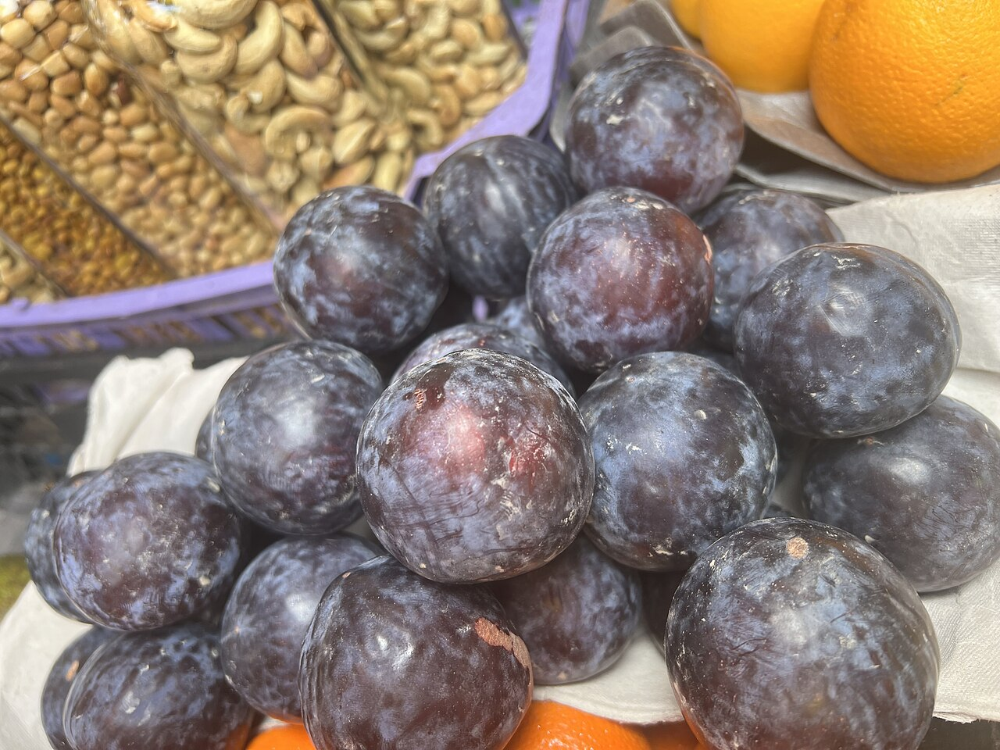

# 梅

梅是蔷薇科李属果实，东亚的“梅”（Prunus mume）与西方李子不同；青梅酸度高、香气清，常用于腌渍、梅酒（umeshu）与梅醋，是日本、中国与韩国共有的饮食传统。

图：Plum：Plum Fruit on Display（Wikimedia Commons）。图片：Iwai-Dialax，CC BY 4.0，via Wikimedia Commons（[原图页面](https://commons.wikimedia.org/wiki/File:Plum_Fruit_on_Display.jpg)）。

## 定义与命名

梅（Prunus mume）原产中国，后传入日本与朝鲜半岛；青梅未熟时青绿、极酸，成熟后转黄、香气增加。西方李子（Prunus domestica、Prunus salicina 等）是另一类李属果实，果肉更甜、酸度更低，二者在中文里都常被译成 plum，容易混淆。

梅酒（umeshu）是把青梅、糖与烧酒或白兰地浸泡数月到一年得到的浸泡酒，不是发酵酒。梅醋、腌梅、梅酱则是盐渍或糖渍产品。看到“plum wine”时，要确认它是梅酒、李子发酵酒还是李子蒸馏酒。

## 起源与传播

梅原产中国长江流域与西南山地，栽培与食用历史很长，后经交流传入日本、朝鲜半岛与东南亚。日本和歌山、中国福建与云南、韩国是青梅与梅酒的重要产区；西方李子则在地中海、欧洲与北美形成不同品种群。

梅的传播伴随腌渍、药用与调味传统，不只是生食。日本梅酒在家庭与商业生产中都很普遍，韩国梅酒与梅醋也有自己的配方；中国青梅酒近年重新流行，产品从浸泡酒到调配酒都有。

## 植物学与栽培

梅是核果，果肉包核，核内有种子。青梅的酸度主要来自柠檬酸与苹果酸，糖分低，直接食用刺激性强；成熟梅的香气更复杂，但酸度仍高。栽培上要看待霜期、需冷量、授粉与排水。

梅树修剪与疏果影响果径与酸度；青梅要在硬熟期采收，过熟果实香气增加但酸度下降，浸泡后容易浑浊。盐渍与糖渍可以保存梅子，但会改变其后续入酒的风味。

## 风格与味觉

梅酒通常甜中带酸，酒精度从低度到中度不等；糖、基酒与浸泡时间决定风格。青梅的酸与香气在糖液中逐渐释放，基酒可能是烧酒、白兰地或其他中性烈酒。梅酒不是发酵梅汁，也不是葡萄酒。

西方李子可以发酵成李子酒，也可以蒸馏成李子白兰地（slivovitz 等）。李子白兰地通常带核发酵或蒸馏，杏仁气息明显；梅酒则更偏酸甜、果香与浸泡感。两者都叫“plum”，但工艺与风味不同。

## 主要产区与代表产品

日本和歌山以青梅与梅酒闻名，代表品牌包括 Choya、Umenoyado 等；中国福建、云南与广东有青梅酒与青梅制品；韩国梅酒、梅醋与腌梅也很常见。巴尔干半岛则以李子白兰地 slivovitz 为代表。

“梅酒”在不同产品里可能是本格浸泡、调配酒或加香酒。看标签时要确认梅子比例、糖分、基酒与酒精度，不能只凭“梅”字判断。

## 怎么喝与配餐

梅酒适合冷藏或加冰饮用，也可加苏打水、绿茶或汤力水；甜度高的梅酒要控制饮用量。梅酒配寿司、烤肉、炸物与奶酪都合适，酸度能切开油脂；李子白兰地适合室温小杯慢饮，配烤肉与硬奶酪。

梅的酸与甜在配餐中很灵活，但高糖梅酒容易压住清淡菜肴。对酒精敏感的人要区分浸泡酒的糖分与基酒的度数，避免把“梅酒”当成低度饮料。

## 选购与常见误区

第一，把梅（Prunus mume）与西方李子当成同一种水果。第二，把梅酒当成发酵酒；它通常是浸泡酒。第三，把李子白兰地当成梅酒；两者原料与工艺不同。第四，忽略糖分与基酒，甜度高的产品更容易掩盖酒精度。

梅不是葡萄，不能用“克隆、砧木、老藤、单宁结构”来描述。判断梅产品要看青梅成熟度、盐渍或糖渍、基酒、浸泡时间与是否蒸馏。

梅酒与李子酒的边界在原料与工艺。梅酒通常用青梅浸泡，糖与基酒决定甜度和酒精度；李子酒可以是发酵酒，也可以是蒸馏酒，slivovitz 这类李子白兰地常带核发酵或蒸馏，杏仁气息更明显。梅醋与腌梅属于保存食品，不是酒类。购买时先看配料表：梅子、糖、基酒、酸度调节剂与香精的顺序，比正面大字更能说明产品。青梅的采收期很短，过早酸高香弱，过晚酸降易软；盐渍与糖渍会改变果实水分与酸度，进而影响浸泡效率。日本和歌山、中国福建与云南、韩国的地方品种与做法不同，标签上的“本格梅酒”通常指以梅子浸泡、不添加香精的路线，但仍要看糖与基酒。梅的品种与采收也会改变浸泡结果：果皮薄、果核小的青梅更容易释放酸香，过熟果则让酒液浑浊、甜感变重。购买时把“梅酒”“李子酒”“李子白兰地”分成三个货架来看，比记住一个外文词更有用。梅核大小也会影响浸泡与出酒率。

相关条目：[烧酒](ref:soju)。

## 延伸阅读与另见

- 相关条目：[liqueur](ref:liqueur)、[soju](ref:soju)、[fermentation](ref:fermentation)、[terroir](ref:terroir)、[japan](ref:japan)。
关于梅，本页不提供植物鉴定、价格或购买渠道；酒标名称不能替代植物学鉴定。

对照阅读：[利口酒](ref:liqueur)、[发酵](ref:fermentation)。

**关键事实。**

| 项目 | 内容 |
| --- | --- |
| 一句话定位 | 梅是蔷薇科李属果实，东亚的“梅”（Prunus mume）与西方李子不同；青梅酸度高、香气清，常用于腌渍、梅酒（umeshu）与梅醋，是日本、中国与韩国共有的饮食传统 |
| 原料身份 | 梅是蔷薇科李属果实，东亚的“梅”（Prunus mume）与西方李子不同 |
| 加工用途 | 青梅酸度高、香气清，常用于腌渍、梅酒（umeshu）与梅醋，是日本、中国与韩国共有的饮食传统 |

**来源与边界。** 本页关于「梅」的关键事实，主要由以下来源交叉核对：FAO（作物、产区与加工背景）、USDA（农业、植物与营养资料）、CGIAR（作物种质与农业研究框架）等 4 条来源。价格、批次与状态会变，涉及这些字段时以页面所列来源的最新版本为准。正文为项目自写，来源只作核验，不复制原文。

**并读。** 把「梅」与「利口酒」、「烧酒」、「发酵」放在一起读时，先确认它们是同一层级还是上下游关系：先确认原料形态与产地，再比较加工、风味与替代关系。本页负责给出原料的基本坐标，对照条目补上具体案例与差异；读完再回到本页，才能分清哪些差别属于原料本身，哪些只是产地、批次或品牌选择。

**适用边界。** 对「梅」而言，原料的品种、加工形态与产地会改变风味；本页说明通用角色，不替代具体配方。

**更新提示。** 「梅」最近核对于 2026-11-22；产地、加工形态、等级与价格会变，采购前以供应商规格为准。
