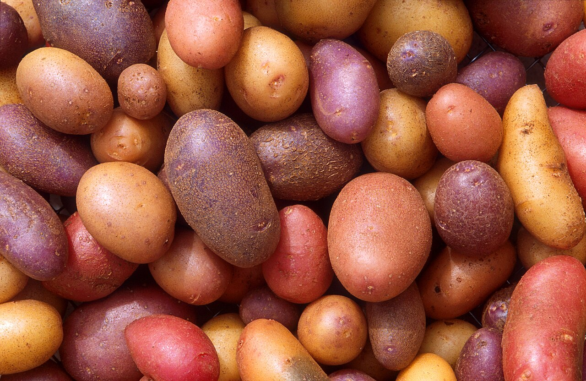

# 马铃薯

马铃薯是茄科块茎作物，富含淀粉与水分，是波兰、德国、瑞典与东欧马铃薯伏特加的核心原料；口感通常比谷物伏特加更圆润、略带甜感，且天然无麸质。

图：Potato：Patates（Wikimedia Commons）。图片：Scott Bauer, USDA ARS，Public domain，via Wikimedia Commons（[原图页面](https://commons.wikimedia.org/wiki/File:Patates.jpg)）。

## 定义与命名

马铃薯是茄科茄属的块茎，植物学名为 Solanum tuberosum。可食用部分是地下茎膨大的块茎，不是根，也不是果实；块茎上分布芽眼，发芽后会产生龙葵素，不能食用。

“马铃薯”“土豆”“洋芋”是同一作物的不同叫法；作为酿酒原料时，它通常指淀粉型马铃薯，而不是鲜食型小土豆。看标签要区分马铃薯伏特加、马铃薯蒸馏酒与添加马铃薯风味的调配酒。

## 起源与传播

马铃薯原产南美洲安第斯山区，十六世纪后传入欧洲，逐渐成为波兰、德国、瑞典与东欧的重要粮食与酿酒原料。寒冷地区适合种植淀粉型马铃薯，块茎耐储存，能在冬季提供发酵糖源。

马铃薯伏特加在波兰与德国有较长传统；波兰的 Chopin 与 Luksusowa 是常见代表。马铃薯也用于工业酒精、薯片与淀粉，但酒用原料更看重淀粉含量、成熟度与储存条件。

## 植物学与栽培

马铃薯块茎富含淀粉与水，淀粉颗粒较大；酿酒前要蒸煮使淀粉糊化，再用酶或麦芽糖化，把淀粉转成可发酵糖。与谷物相比，马铃薯含水量高，原料运输与储存成本更高。

栽培上要看种薯健康、土壤疏松、排水与晚疫病管理。块茎在低温、避光与通风条件下储存；见光会变绿并积累龙葵素，发芽块茎不能进入食品或酿酒流程。

## 风格与味觉

马铃薯伏特加通常比小麦或黑麦伏特加更圆润，带轻微甜感与泥土气息，酒体更重；高度稀释后仍能保留质地。它适合纯饮、加冰或调制鸡尾酒，但“甜”更多是口感，不是添加糖。

马铃薯也可以发酵成马铃薯酒或蒸馏成马铃薯烈酒，但商业化产品以伏特加为主。马铃薯本身不是葡萄，不能用“果皮、单宁、浸渍”描述；它的风味来自块茎品种、蒸煮、糖化、发酵与蒸馏。

## 主要产区与代表产品

波兰、德国、瑞典与东欧是马铃薯伏特加的主要产区；波兰的 Chopin 与 Luksusowa 使用马铃薯原料，德国与瑞典也有各自品牌。美国与加拿大部分酒厂用马铃薯生产小批量伏特加。

“马铃薯伏特加”不等于“马铃薯酒精加香”。看标签要确认原料是否以马铃薯为主、是否添加谷物、是否有糖或香精；纯马铃薯伏特加的质地与谷物伏特加不同，但并非所有产品都标明比例。

## 怎么喝与配餐

伏特加通常冷藏后纯饮，也可以室温小杯慢饮；马铃薯伏特加的圆润质地在低温下更明显。加冰会稀释，但能压低酒精刺激；调酒时适合与柑橘、香草、奶油和辛香料搭配。

马铃薯伏特加配烤肉、熏鱼、鱼子酱、腌菜与土豆类菜肴都合适；它的质地能承托油脂，酒精则切开腻感。对酒精敏感的人要注意伏特加通常度数较高，不要因为口感圆润就低估强度。

## 选购与常见误区

第一，把马铃薯伏特加当成“无麸质就一定更好”。无麸质是原料特性，不是质量等级。第二，把马铃薯淀粉或马铃薯香精当成原料。第三，认为所有马铃薯伏特加都甜；甜感可能来自甘油或添加物。第四，忽略原料比例与生产商。

马铃薯不是葡萄，也没有“克隆、砧木、老藤”这套葡萄品种概念。判断马铃薯酒要看块茎品种、淀粉含量、糖化与蒸馏方式，以及标签上的原料与酒精度。

马铃薯伏特加的原料处理比“马铃薯”三个字更能决定风格。淀粉型块茎要先蒸煮糊化，再用酶或麦芽糖化；发酵温度与酵母决定杂醇油与酯类，蒸馏时的掐头去尾影响干净度。纯马铃薯伏特加通常不添加糖或香精，但“马铃薯风味”产品可能只加了少量马铃薯提取物。购买时看原料表、酒精度与生产商，不要只看“无麸质”或“小批量”。马铃薯与谷物伏特加的差别更多在质地而不是香气：马铃薯酒体更圆、更重，谷物酒更干净、更直接。冷藏纯饮能突出质地，加冰或调酒则更看重干净度与配餐。储存时避光、低温、通风，见光变绿或发芽的块茎不能进入酿酒流程。马铃薯伏特加的“甜感”多来自甘油与口感，不等于添加糖；原料比例与蒸馏次数，比产地故事更能说明风格。购买时优先选原料表第一位是马铃薯的产品。

相关条目：[蒸馏](ref:distillation)。

## 延伸阅读与另见

- 相关条目：[vodka](ref:vodka)、[distillation](ref:distillation)、[barley](ref:barley)、[terroir](ref:terroir)、[fermentation](ref:fermentation)。
关于马铃薯，本页不提供植物鉴定、价格或购买渠道；酒标名称不能替代植物学鉴定。

对照阅读：[伏特加](ref:vodka)、[大麦](ref:barley)。

**关键事实。**

| 项目 | 内容 |
| --- | --- |
| 一句话定位 | 马铃薯是茄科块茎作物，富含淀粉与水分，是波兰、德国、瑞典与东欧马铃薯伏特加的核心原料；口感通常比谷物伏特加更圆润、略带甜感，且天然无麸质 |
| 原料身份 | 马铃薯是茄科块茎作物，富含淀粉与水分，是波兰、德国、瑞典与东欧马铃薯伏特加的核心原料 |
| 加工用途 | 口感通常比谷物伏特加更圆润、略带甜感，且天然无麸质 |

**来源与边界。** 本页关于「马铃薯」的关键事实，主要由以下来源交叉核对：FAO（作物、产区与加工背景）、USDA（农业、植物与营养资料）、CGIAR（作物种质与农业研究框架）等 4 条来源。价格、批次与状态会变，涉及这些字段时以页面所列来源的最新版本为准。正文为项目自写，来源只作核验，不复制原文。

**并读。** 把「马铃薯」与「伏特加」、「蒸馏」、「大麦」放在一起读时，先确认它们是同一层级还是上下游关系：先确认原料形态与产地，再比较加工、风味与替代关系。本页负责给出原料的基本坐标，对照条目补上具体案例与差异；读完再回到本页，才能分清哪些差别属于原料本身，哪些只是产地、批次或品牌选择。

**适用边界。** 对「马铃薯」而言，原料的品种、加工形态与产地会改变风味；本页说明通用角色，不替代具体配方。

**更新提示。** 「马铃薯」最近核对于 2026-11-22；产地、加工形态、等级与价格会变，采购前以供应商规格为准。
