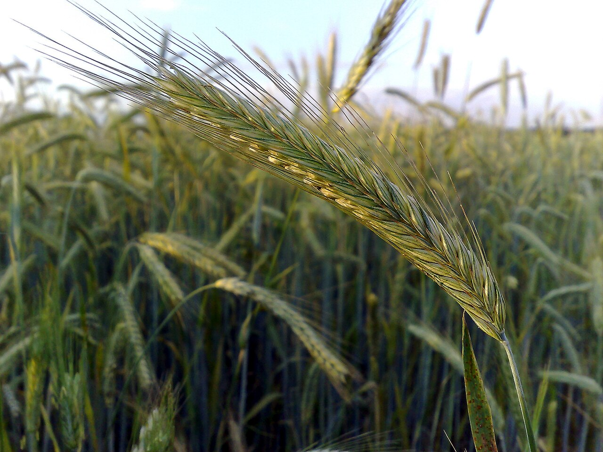

# 黑麦

黑麦（Secale cereale）是禾本科黑麦属的一年生或越年生谷物，耐寒、耐瘠薄，能在小麦难以越冬的纬度生长。它在美国被写成黑麦威士忌的法定主体，在德国与北欧变成黑麦面包，在啤酒里则提供辛辣、干爽的谷物骨架。黑麦的 β-葡聚糖与蛋白质让[糖化](ref:saccharification)和过滤变难，这也是它不如大麦普及的原因。

图：黑麦。图片：LSDSL，CC BY-SA 3.0，via Wikimedia Commons（[原图页面](https://commons.wikimedia.org/wiki/File:Ear_of_rye.jpg)）。

## 黑麦的植物学与耐寒性

黑麦为穗状花序，籽粒细长，颜色从黄褐到青灰。异花授粉使品种群体差异大，也让它适应性强。根系发达，可在沙质与贫瘠土壤上生长；冬黑麦的越冬能力来自低温驯化与细胞渗透调节。黑麦容易感染麦角菌（Claviceps purpurea），菌核含麦角生物碱，原料清理与检验因此格外重要。

## 籽粒成分与糖化难点

黑麦淀粉含量约 60–68%，蛋白质约 10–14%，β-葡聚糖约 2–4%，高于小麦。β-葡聚糖在糖化醪中形成高黏度，导致过滤缓慢甚至堵塞；蛋白质中的醇溶蛋白与谷蛋白比例也不同于小麦，形成的面团黏而不弹。

酿造上通常安排 40–45°C 的 β-葡聚糖休止，并延长 62–65°C 的糖化休止。黑麦麦芽的酶活力较高，可以承担部分基础麦芽角色，但比例过高仍会让麦汁浑浊、收率下降。

## 黑麦威士忌的法定框架

美国联邦法规 27 CFR 5 规定，黑麦威士忌的发酵醪中黑麦比例不得低于 51%，蒸馏酒精度不超过 62.5% vol，必须在新烧焦的橡木桶中陈年至少 2 年，装瓶酒精度不低于 40% vol。肯塔基、印第安纳、马里兰与宾夕法尼亚是主要产区；[美国](ref:usa)的黑麦威士忌传统与[波本](ref:bourbon)共享工艺框架，但原料比例不同。

加拿大威士忌允许用黑麦作为调味谷物；法规允许加入其他烈酒或葡萄酒作为调味，“9.09% 规则”是年龄声明与出口证书门槛，不是普通成分上限。因此“加拿大黑麦”不一定以黑麦为主体，这一点常被消费者误解。

## 啤酒与其他酒类

在[啤酒](ref:beer)中，黑麦通常占谷物配方的 10–60%，带来辛辣、胡椒与面包壳香气，并增加酒体与泡沫质感。黑麦 IPA、黑麦世涛与德国黑麦啤酒都是常见类型。比例超过 40% 时，需要稻壳等助滤材料，否则过滤时间会显著延长。

黑麦也用于伏特加、金酒与部分北欧阿夸维特；在[德国](ref:germany)与波兰，黑麦面包与黑麦烈酒有长期传统。中国白酒很少使用黑麦，但在多粮配方中偶有出现。

## 产区与品种

黑麦主产于俄罗斯、波兰、德国、白俄罗斯、乌克兰与加拿大、美国北部。冬黑麦与春黑麦的用途不同，前者产量高、后者品质稳定。品种间的戊聚糖与β-葡聚糖含量差异明显，酿酒用黑麦通常要求粒重高、霉变粒少、麦角菌核为零。

黑麦的戊聚糖吸水后同样增加黏度，与 β-葡聚糖叠加时，糖化醪几乎像粥。糖化锅的搅拌设计、投料浓度与升温速率都会影响过滤；有的酒厂宁可使用 20–30% 的黑麦并延长休止，也不愿冒险把比例推到 60% 以上。黑麦水分超过 14% 时容易发热霉变，麦角菌核也会在清理不彻底时残留；进厂检验通常包括容重、水分、不完善粒与麦角含量，磨粉前还要过磁选与去石。

## 替代与配方差异

用小麦替代黑麦时，风味会更柔和、黏度更低，但缺少黑麦的辛辣与干爽；用大麦替代时，酶活力与过滤性更好，却失去黑麦的谷物个性。在威士忌配方中，黑麦常与玉米、小麦搭配：玉米提供甜感与产量，小麦提供柔顺，黑麦提供香料与结构。

## 感官影响

黑麦带来胡椒、丁香、面包壳、甘草与轻微酸感。在威士忌中，高比例黑麦通常表现为辛香、干口与较长的余味；在啤酒中，黑麦增加酒体与泡沫细腻度，过量则出现涩感与黏稠口感。黑麦比例越高，酒液的颜色与浑浊度也越明显，过滤后仍可能保留轻微雾度。陈年后的黑麦威士忌会发展出香草、焦糖与柑橘皮香气。

## 常见误区

第一，黑麦威士忌必须 100% 黑麦。法规只要求不低于 51%。第二，加拿大威士忌都是黑麦威士忌。黑麦可以是调味谷物，比例不一定高。第三，黑麦啤酒越黑越好。颜色来自烘烤麦芽，与黑麦比例无关。第四，黑麦容易种植所以便宜。产量与价格受产区、年份与需求影响，不能简单推断。黑麦的辛辣来自谷物酚类与烘烤产物，而非添加香料；配方中通常不会让黑麦超过一半，否则黏度与苦味都难控制。

## 另见

- [威士忌](ref:whisky)：黑麦威士忌在烈酒体系中的位置。
- [啤酒](ref:beer)：黑麦作为谷物辅料的使用。
- [美国](ref:usa)：肯塔基、印第安纳等产区。
- [德国](ref:germany)：黑麦面包与烈酒传统。
- [蒸馏](ref:distillation)：黑麦威士忌的蒸馏与陈年。
- [糖化](ref:saccharification)：β-葡聚糖休止与过滤。
- [波本](ref:bourbon)：与黑麦威士忌共享的工艺框架。

对照阅读：[威士忌](ref:whisky)、[美国](ref:usa)。

**关键事实。**

| 项目 | 内容 |
| --- | --- |
| 一句话定位 | 黑麦是禾本科黑麦属的一年生谷物，耐寒耐瘠；它是美国黑麦威士忌的法定主体，也为啤酒带来辛辣干爽的谷物风味，β-葡聚糖与蛋白质使糖化和过滤更难 |
| 原料身份 | 黑麦是禾本科黑麦属的一年生谷物，耐寒耐瘠 |
| 加工用途 | 它是美国黑麦威士忌的法定主体，也为啤酒带来辛辣干爽的谷物风味，β-葡聚糖与蛋白质使糖化和过滤更难 |

**来源与边界。** 本页关于「黑麦」的关键事实，主要由以下来源交叉核对：U.S. Government Publishing Office（美国黑麦威士忌的原料比例与陈年要求）、Oxford University Press（提供关于黑麦威士忌、加拿大威士忌与黑麦啤酒的条目；提供关于黑麦麦芽、β-葡聚糖与糖化困难的条目）、U.S. Department of Agriculture（黑麦籽粒的碳水化合物、蛋白质与膳食纤维概况）等 8 条来源。价格、批次与状态会变，涉及这些字段时以页面所列来源的最新版本为准。正文为项目自写，来源只作核验，不复制原文。

**并读。** 把「黑麦」与「威士忌」、「啤酒」、「美国」放在一起读时，先确认它们是同一层级还是上下游关系：先确认原料形态与产地，再比较加工、风味与替代关系。本页负责给出原料的基本坐标，对照条目补上具体案例与差异；读完再回到本页，才能分清哪些差别属于原料本身，哪些只是产地、批次或品牌选择。
