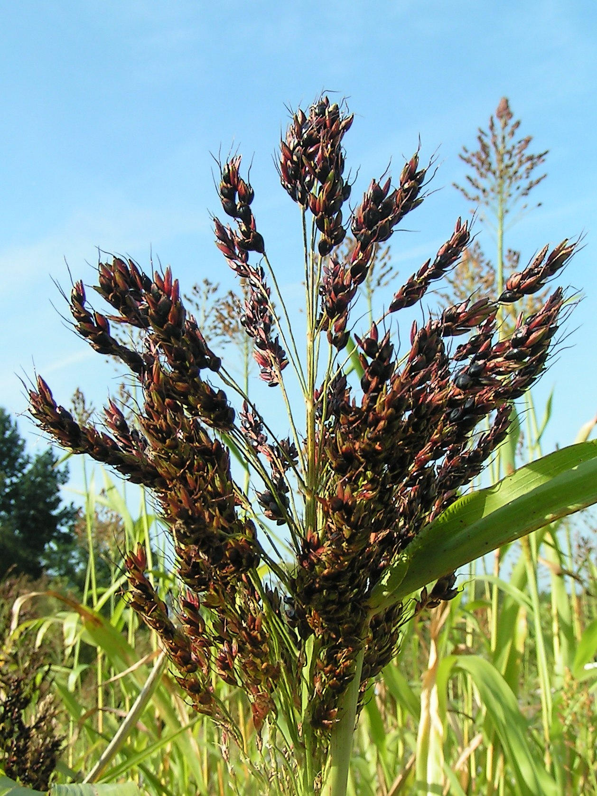

# 高粱

高粱是禾本科高粱属（Sorghum）的一年生草本植物，栽培种通常写作 Sorghum bicolor。联合国粮农组织资料把它列为非洲、亚洲干旱与半干旱地区的重要谷物，别名包括 great millet、kaoliang 等；在中国，高粱也常被称为蜀黍、红粮。它耐旱、耐热、适应性强，既可以作为粮食和饲料，也是酿造白酒、黄酒和食醋的重要原料。

图：高粱。图片：No machine-readable author provided. Pethan assumed (based on copyright claims).，CC BY-SA 3.0，via Wikimedia Commons（[原图页面](https://commons.wikimedia.org/wiki/File:Sorghum_bicolor03.jpg)）。

## 植物学与主要类型

高粱籽粒按颜色可分为红、白、黄等类型，按淀粉结构又有糯性与粳性之分。糯高粱的支链淀粉比例较高，蒸煮后黏性大、易糊化；粳高粱的直链淀粉比例较高，结构更紧实。酿酒用的高粱通常要求颗粒饱满、皮壳完整、杂质少。

高粱壳和籽粒外层含有单宁，适量单宁在发酵中可转化为香气成分，过多则会带来涩感并抑制微生物活动。因此“去壳程度”与“单宁含量”是酿酒原料评价中的实际变量，而不是越干净越好。不同品种的蛋白质与脂肪比例也会影响蒸煮后的疏松程度和微生物生长。

## 为什么白酒常用高粱

[白酒](ref:baijiu)选择高粱，不是因为它“更高级”，而是因为它的成分组合适合固态发酵。高粱淀粉含量较高，蛋白质和脂肪比例适中，蒸煮后颗粒疏松、透气性好，便于曲中的微生物生长；适量的单宁还能为酒体提供结构感。

中国白酒的香型差异，很大程度上来自高粱品种、曲种、窖池和蒸馏方式的不同组合，而不是由单一原料决定。用大米、糯米、小麦、玉米等多粮配方，也能酿出优质白酒；高粱的普遍性来自工艺适配与产区传统，而不是排他性的“唯一正确答案”。

## 在酿造中的位置

在白酒中，高粱通常是最主要的粮谷原料。清香型、酱香型白酒多以高粱为主料；[浓香型白酒](ref:strong-aroma)则常见多粮配方，例如高粱、大米、糯米、小麦、玉米并用。

茅台镇一带的酱香型白酒常使用当地糯高粱，当地俗称“红缨子”，其颗粒小、皮厚、耐多次蒸煮，适合酱香工艺的多轮次取酒；[茅台酒](ref:moutai)就是这一原料路线的代表之一。需要注意的是，这些说法描述的是原料与工艺的匹配关系，不是对某一品牌的质量背书。

高粱在其他酒类中也有位置。黄酒的传统原料以稻米为主，但部分地方黄酒会加入高粱；白酒之外，高粱还用于酿造食醋和部分蒸馏酒。作为粮食，高粱米可以煮粥、做主食，但酿酒用高粱与食用高粱在品种和用途上并不完全相同。

## 水稻与高粱的对比

把高粱与稻米放在一起比较，有助于理解原料差异。稻米淀粉细腻、蛋白质较低，蒸煮后黏性较强，适合小曲工艺与部分黄酒；高粱淀粉颗粒较粗、皮壳含单宁，蒸煮后更疏松，适合大曲固态发酵与多轮次蒸煮。两者都能酿酒，但对应的曲种、设备和发酵周期不同。

这种对比也说明，原料没有绝对优劣，只有与工艺是否匹配。[黄酒](ref:yellow-wine)以稻米为主料形成独特体系，白酒以高粱为主料形成另一套体系，各自都有完整的技术传统。把一种原料的标准套到另一种酒上，容易得出错误结论。

## 高粱与香型的关系

高粱不是决定香型的唯一因素，但它会影响香型的表达方向。清香型白酒追求清雅、干净，常使用颗粒整齐、皮壳适中的高粱，并通过低温曲和清蒸清烧来控制风味；酱香型白酒需要耐多次蒸煮的糯高粱，配合高温曲和高温堆积，形成酱香、焦香与花果香的复合；浓香型白酒常用多粮配方，高粱提供骨架，大米、糯米增加绵柔，小麦和玉米带来不同的香气与甜感。

理解这些组合，比单独讨论“哪种高粱最好”更有意义。香型是原料、曲种、发酵容器、蒸馏与陈年共同作用的结果，任何一个环节改变，都会改变最终风格。

## 产区、气候与原料质量

高粱的种植区域跨越热带与温带，耐旱性让它在降水有限的地区仍有产量。中国北方与西南的多个省份都有高粱种植，糯性与粳性、红粒与白粒的地方品种并存。产区气候影响籽粒的成熟度、含水量与单宁积累，进而影响蒸煮与发酵表现。

原料质量还与收获年份、晾晒与储存有关。收获期遇雨容易霉变，霉变籽粒会产生不良风味并带来食品安全风险。规模酒厂通常对入厂高粱做水分、杂质、淀粉与霉变粒检测，这些指标比“颜色好看”更能反映实际质量。

## 选购、储存与识别

如果从原料角度了解高粱，可以关注三点：颗粒是否饱满、颜色是否均匀、杂质和碎粒比例是否合理。酿酒用高粱通常不追求“越白越好”，而更看重淀粉总量、皮壳比例和新鲜度。

储存时要防潮、防虫，避免霉变，因为霉变会产生不良风味，也可能带来食品安全风险。家庭少量储存应放在干燥、通风、避光处，并与有异味的物品分开。购买高粱米时，包装上的品种、产地、生产日期与储存条件，是比外观更可靠的判断依据。

## 常见误区

第一，“高粱酒”不等于所有白酒。高粱酒是按主要原料称呼的一类白酒，但白酒还可以使用大米、糯米、小麦、玉米等多种粮食。

第二，红高粱不一定比白高粱更适合酿酒。颜色与单宁、淀粉结构有关，是否适合取决于目标工艺和香型，而不是颜色本身。

第三，高粱越贵越好，这个判断不成立。原料质量要看品种、产地、年份和储存条件，价格还包含供需与品牌因素。

第四，认为高粱只能酿酒。它也是重要的粮食与饲料作物，并在食醋等发酵产品中使用。

第五，把“红缨子”当作所有酱香酒的唯一原料。地方品种与工艺路线有关，其他产区也有适配本地原料的做法。

## 延伸阅读

- [白酒](ref:baijiu)：白酒的原料、曲与香型体系概览。
- [浓香型白酒](ref:strong-aroma)：多粮配方与泥窖固态发酵的框架。
- [茅台酒](ref:moutai)：酱香型工艺与当地糯高粱的原料路线。
- [黄酒](ref:yellow-wine)：以稻米为主料的另一套谷物酒传统。
