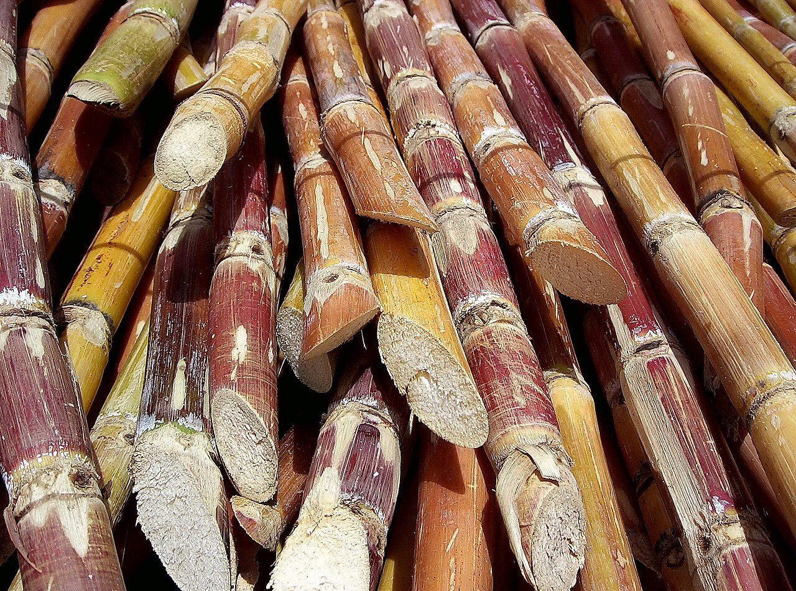

# 甘蔗

甘蔗是禾本科甘蔗属（Saccharum）的多年生 C4 草本，茎秆像一根储糖的管道，把光合产物以蔗糖形式积累到 12–16%。它既是全球糖业的基础，也是朗姆酒、卡莎萨与农业朗姆的起点。压汁直接发酵，还是先结晶取糖、再用糖蜜发酵，决定了酒的香气走向与产区传统。

图：收获后切段的甘蔗茎，可见节与节间。图片：ruurmo，CC BY-SA 2.0，来源：[原始页面](https://commons.wikimedia.org/wiki/File:Cut_sugarcane.jpg)。

## 禾本科甘蔗属与茎秆结构

栽培甘蔗多为杂交种，亲本涉及 S. officinarum、S. spontaneum 等。茎秆由节与节间组成，节上有芽与根带；成熟茎的蔗糖主要储存在薄壁细胞中。甘蔗为 C4 植物，光效高、需水量大，生长期通常 10–18 个月。收获后蔗糖会因转化酶作用迅速降解，因此从砍收到压榨的间隔越短越好，通常要求在 24–48 小时内处理。

## 蔗糖储存与汁液处理

压榨得到的蔗汁含水约 75–85%、蔗糖 12–16%，pH 约 5.0–5.5，并带有野生酵母、乳酸菌与醋酸菌。蔗汁离开压榨机后很快开始发酵或酸败，酒厂会通过快速冷却、添加二氧化硫或直接接种来争夺微生物优势。酵母不能直接利用蔗糖，必须先由转化酶水解为葡萄糖与果糖，这也是蔗汁发酵起发快、但更容易失控的原因。

## 直接发酵：农业朗姆与卡莎萨

在法属马提尼克，[农业朗姆](ref:martinique)要求使用新鲜蔗汁，经发酵后蒸馏，并在橡木桶中陈年至少规定时间；AOC 规则对甘蔗品种、压榨与蒸馏都有约束。巴西的卡莎萨同样以蔗汁为原料，发酵 12–24 小时，常用柱式蒸馏，法规规定成品酒精度 38–48% vol。

直接发酵的酒体带有青甘蔗、草本、柑橘皮与矿物感，发酵温度通常控制在 28–32°C。野生菌参与程度越高，酸度与酯类越复杂，但也越难稳定。

## 制糖路线与糖蜜

先制糖、再发酵糖蜜，是[朗姆](ref:rum)的另一条主路线。蔗汁经澄清、蒸发、结晶、离心分出蔗糖，母液成为糖蜜。糖蜜发酵的酒体更偏向焦糖、甘草与深色水果，与蔗汁路线的青绿感形成对比。两条路线在加勒比地区并存，[巴巴多斯](ref:barbados)与[牙买加](ref:jamaica)的酒厂根据原料供应与传统选择工艺。

## 产区与品种

甘蔗集中在热带与亚热带，巴西、印度、中国、泰国、巴基斯坦是主要生产国；中国以广西、云南、广东为主。加勒比的海岛产区、留尼汪、毛里求斯、菲律宾与澳大利亚也各有传统。甘蔗收割后的运输半径通常限制在数十公里内，远距离运输会加剧糖分损失，这也是蔗汁朗姆产区多靠近糖厂的原因。品种按糖分、抗病性、宿根性与成熟期选育，酒厂偏好糖分高、纤维适中、汁液清新的品种。

传统产区常在收割前焚烧蔗叶，以减少运输体积与蛇虫风险，但焚烧会造成空气污染与土壤有机质损失，巴西近年逐步限制“绿蔗收割”，改为机械收割并保留蔗叶覆盖。蔗叶覆盖能保墒、抑草，却也会增加原料中的杂质，压榨前需要更彻底的清洗。甘蔗的成熟度以锤度与蔗糖分为指标，未熟蔗汁酸高、糖低，过熟则转化糖上升，发酵更易失控。

蔗汁浓缩是热带酒厂的常见做法。把汁加热到 60–70°C 蒸发部分水分，可以提高糖度、抑制野生菌，同时产生轻微的熟甘蔗香；但高温也会损失清新感，并使颜色加深。部分酒厂在浓缩后冷却、接种，得到介于蔗汁与糖蜜之间的风味。

## 替代与工艺差异

用糖蜜替代蔗汁，成本更低、供应更稳定，但香气更重、灰分更高；用蔗糖或高糖蜜替代，则发酵更干净，却缺少甘蔗本身的植物感。蔗汁发酵需要更快的处理链与更严格的卫生，糖蜜发酵则需要稀释、营养补充与更高的控温要求。两者不能只按“原料相同”就视为等价。

## 感官影响

蔗汁朗姆通常带青草、甘蔗皮、柑橘与白胡椒；糖蜜朗姆则有焦糖、香草、咖啡、烟熏与咸鲜。蔗汁路线的酒体通常更轻、收口更干，也更容易显出产地差异。壶式蒸馏保留更多酯类与酸类，柱式蒸馏更干净、更适合轻爽风格。陈年在橡木桶中会加入香草、椰子与香料，但原料差异始终是底色。

## 常见误区

第一，朗姆酒都以糖蜜为原料。农业朗姆与卡莎萨用蔗汁。第二，甘蔗酒就是朗姆。卡莎萨、农业朗姆与朗姆各有法规定义。第三，蔗汁越甜酒越好。发酵管理比糖度更重要。第四，陈年越久越好。陈年受桶型、气候与酒体结构影响，不是单一时间变量。

## 另见

- [朗姆酒](ref:rum)：蔗汁与糖蜜两条原料路线。
- [巴巴多斯](ref:barbados)：糖蜜朗姆的传统产区。
- [马提尼克](ref:martinique)：农业朗姆的 AOC 体系。
- [牙买加](ref:jamaica)：高酯朗姆与野生发酵。
- [发酵](ref:fermentation)：蔗汁处理与接种。
- [蒸馏](ref:distillation)：壶式与柱式的风格差异。

对照阅读：[朗姆酒](ref:rum)、[马提尼克](ref:martinique)。

**关键事实。**

| 项目 | 内容 |
| --- | --- |
| 一句话定位 | 甘蔗是禾本科甘蔗属的高大草本，茎秆富含蔗糖；压汁直接发酵可做甘蔗汁朗姆与巴西甘蔗酒，先制糖再用糖蜜发酵则形成另一条朗姆路线，原料处理方式决定酒的风格 |
| 原料身份 | 甘蔗是禾本科甘蔗属的高大草本，茎秆富含蔗糖 |
| 加工用途 | 压汁直接发酵可做甘蔗汁朗姆与巴西甘蔗酒，先制糖再用糖蜜发酵则形成另一条朗姆路线，原料处理方式决定酒的风格 |

**来源与边界。** 本页关于「甘蔗」的关键事实，主要由以下来源交叉核对：Oxford University Press（提供关于甘蔗、蔗汁朗姆、糖蜜朗姆与产区的条目）、Food and Agriculture Organization of the United Nations (FAO)（甘蔗栽培、压榨与制糖流程的公开概况；甘蔗的全球产量与主产国排序）、U.S. Government Publishing Office（美国对朗姆酒原料与酒精度的类别要求）等 5 条来源。价格、批次与状态会变，涉及这些字段时以页面所列来源的最新版本为准。正文为项目自写，来源只作核验，不复制原文。

**并读。** 把「甘蔗」与「朗姆酒」、「巴巴多斯」、「马提尼克」放在一起读时，先确认它们是同一层级还是上下游关系：先确认原料形态与产地，再比较加工、风味与替代关系。本页负责给出原料的基本坐标，对照条目补上具体案例与差异；读完再回到本页，才能分清哪些差别属于原料本身，哪些只是产地、批次或品牌选择。
