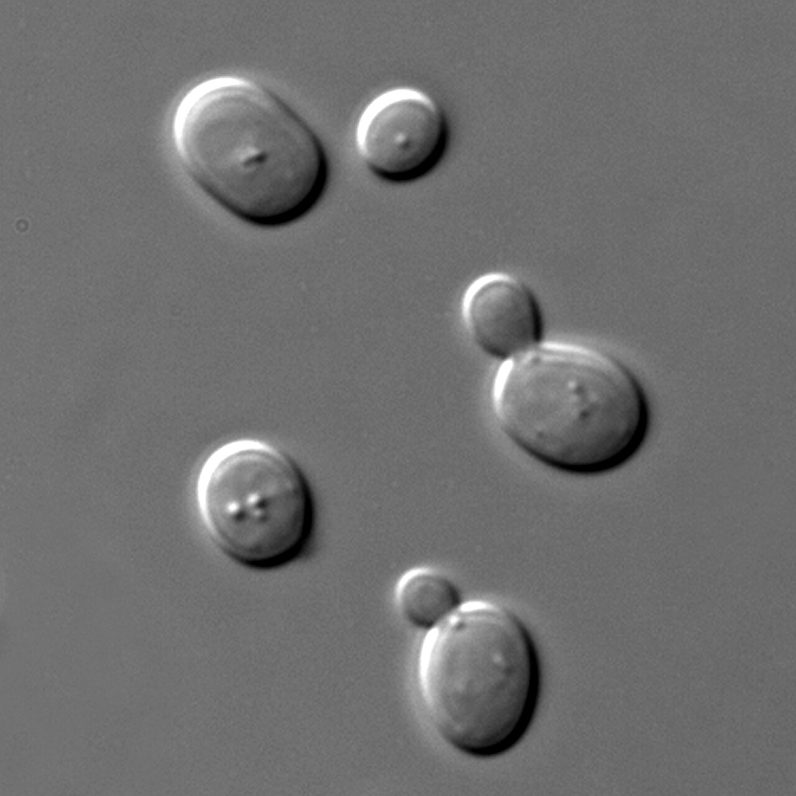

# 酵母

酵母是单细胞真菌，在酿酒中把糖转化为乙醇与二氧化碳，并通过酯类、高级醇、甘油与有机酸塑造风味。它既是发酵的执行者，也是风格的来源。同一份麦汁或葡萄汁，换一株酵母、换一个温度，结果可能完全不同；这也是为什么酵母常被称为“最容易被忽略的原料”。

图：酵母。图片：Masur，Public domain，via Wikimedia Commons（[原图页面](https://commons.wikimedia.org/wiki/File:S_cerevisiae_under_DIC_microscopy.jpg)）。

## 单细胞真菌与分类

酿酒酵母（Saccharomyces cerevisiae）属于子囊菌门，细胞呈球形或椭圆形，直径约 5–10 微米，以出芽方式繁殖；在 30°C、营养充足时，代时约 90–120 分钟。啤酒酵母分艾尔酵母与拉格酵母：前者多为 S. cerevisiae，发酵温度 16–22°C，常在液面形成泡盖；后者为 S. pastorianus（S. cerevisiae 与 S. eubayanus 的杂交种），发酵温度 8–13°C，沉降于罐底。

葡萄酒、清酒、黄酒与白酒使用不同的酵母或曲霉体系，但核心的乙醇发酵路径相同。

## 糖代谢与风味生成

酵母在厌氧条件下把葡萄糖转化为两分子乙醇与两分子二氧化碳，理论乙醇转化率约 51.1%（质量分数），实际收率通常为理论的 90–95%。发酵前期酵母先消耗葡萄糖与果糖，蔗糖需先被转化酶水解；麦芽糖与麦芽三糖在啤酒发酵中后期被利用。

风味物质主要来自两条路径：酯化反应生成乙酸乙酯、乙酸异戊酯（香蕉）与乙酸苯乙酯（玫瑰）；氨基酸代谢生成高级醇、醛与酸。温度升高会加快酯类生成，也会增加高级醇与溶剂味。

## 菌种与接种

啤酒厂按风格选择艾尔、拉格、小麦与香槟酵母；葡萄酒厂区分商业酵母与原生酵母；白酒厂使用酒母、大曲与小曲中的霉菌、酵母与细菌共同体。接种量影响起发速度与风味：接种量过低容易染菌，过高则发酵过猛、香气粗糙。

商业干酵母的活菌数通常以每克十亿计，复水温度与活化液组成会影响存活率。原生发酵依赖果皮或环境中的酵母，风险更高，但能带来地块与年份的复杂度。

复水时水温过高会杀死酵母，过低则细胞膜恢复不完全；多数干酵母建议在 35–40°C 的无菌水中复水，再逐步降温到发酵温度，避免冷激。接种后前 24 小时是酵母建立优势的关键期，溶氧、游离氮与温度要同时到位，否则野生菌或细菌会抢先繁殖。

## 温度、氮源与发酵管理

温度是最直接的控制变量。艾尔发酵 16–22°C，拉格 8–13°C，葡萄酒 15–30°C，蜂蜜酒 18–24°C。温度过高会加速发酵但增加高级醇与硫化物；温度过低则容易停滞。

酵母可同化氮（YAN）是另一关键。葡萄酒发酵通常要求 YAN 在 150–250 mg/L，低于 100 mg/L 时停滞风险显著上升。啤酒麦汁的游离氨基氮也应满足酵母生长需求；不足时补加氮源，过量则可能促进不必要的酯香。

发酵初期的溶氧同样重要。酵母需要氧来合成麦角固醇与不饱和脂肪酸，细胞膜才能承受酒精毒性；麦汁接种时的溶氧通常控制在 8–10 mg/L，过高会促进氧化味，过低则酵母生长不足。发酵进入厌氧阶段后，再通气只会带来醋酸菌风险与香气损失。酵母在酒精浓度超过 15% vol 时活力明显下降，这也是多数自然发酵酒精度停在 14–16% 的原因。

## 产区与酒种差异

不同产区的酵母群体与工艺形成地方风格：比利时艾尔的酚香、英国艾尔的果香、德国拉格的干净、法国葡萄酒的野生发酵、日本清酒的协会酵母、中国白酒的曲药体系。产区不是酵母的唯一变量，但长期选育与使用习惯会让地方菌株具有辨识度。

## 替代与野生发酵

用商业酵母替代原生酵母，发酵更可控、结果更稳定，但可能失去地块复杂度；用野生酵母替代商业酵母，风味更丰富，却伴随停滞、挥发酸与污染风险。混合发酵、顺序接种与预培养（pied de cuve）是介于两者之间的常用方法。

## 感官影响

酵母带来的香气包括面包、饼干、香蕉、梨、玫瑰、蜂蜜与香料。艾尔酵母常带果香与酯香，拉格酵母更干净、突出麦芽；酒泥陈酿会释放甘露糖蛋白，增加圆润感与口感厚度。酵母自溶过度则产生肉汤、硫与苦味。

## 常见误区

第一，酵母只是“发酵粉”。菌种与工艺决定了大量风味。第二，酵母越多发酵越快越好。接种量过高会带来粗糙香气与营养竞争。第三，野生酵母一定更好。风险与稳定性必须权衡。第四，酵母味道就是面包味。不同菌种与温度会生成完全不同的酯类与酚类。

## 另见

- [啤酒](ref:beer)：艾尔与拉格酵母的发酵差异。
- [葡萄酒](ref:wine)：商业酵母与原生发酵。
- [白酒](ref:baijiu)：酒母、大曲与多菌种发酵。
- [黄酒](ref:yellow-wine)：麦曲、酒药与酵母体系。
- [发酵](ref:fermentation)：温度、氮源与代谢管理。
- [酒泥](ref:lees)：酵母自溶与甘露糖蛋白。

对照阅读：[啤酒](ref:beer)、[白酒](ref:baijiu)。

**关键事实。**

| 项目 | 内容 |
| --- | --- |
| 一句话定位 | 酵母是单细胞真菌，把糖转化为乙醇与二氧化碳，并产生酯类、高级醇等风味物质；菌种、接种方式与温度决定发酵走向，是酿酒中最关键却最常被忽略的变量 |
| 原料身份 | 酵母是单细胞真菌，把糖转化为乙醇与二氧化碳，并产生酯类、高级醇等风味物质 |
| 加工用途 | 菌种、接种方式与温度决定发酵走向，是酿酒中最关键却最常被忽略的变量 |

**来源与边界。** 本页关于「酵母」的关键事实，主要由以下来源交叉核对：国家市场监督管理总局、国家标准化管理委员会（白酒工业中酵母、酒母与发酵相关的术语框架）、Oxford University Press（提供关于酵母、接种、原生发酵与酒泥的条目；提供关于啤酒酵母、拉格与艾尔发酵温度的条目）、National Center for Biotechnology Information（酿酒酵母的分类学位置与学名）等 7 条来源。价格、批次与状态会变，涉及这些字段时以页面所列来源的最新版本为准。正文为项目自写，来源只作核验，不复制原文。

**并读。** 把「酵母」与「啤酒」、「葡萄酒」、「白酒」放在一起读时，先确认它们是同一层级还是上下游关系：先确认原料形态与产地，再比较加工、风味与替代关系。本页负责给出原料的基本坐标，对照条目补上具体案例与差异；读完再回到本页，才能分清哪些差别属于原料本身，哪些只是产地、批次或品牌选择。

**适用边界。** 对「酵母」而言，原料的品种、加工形态与产地会改变风味；本页说明通用角色，不替代具体配方。
