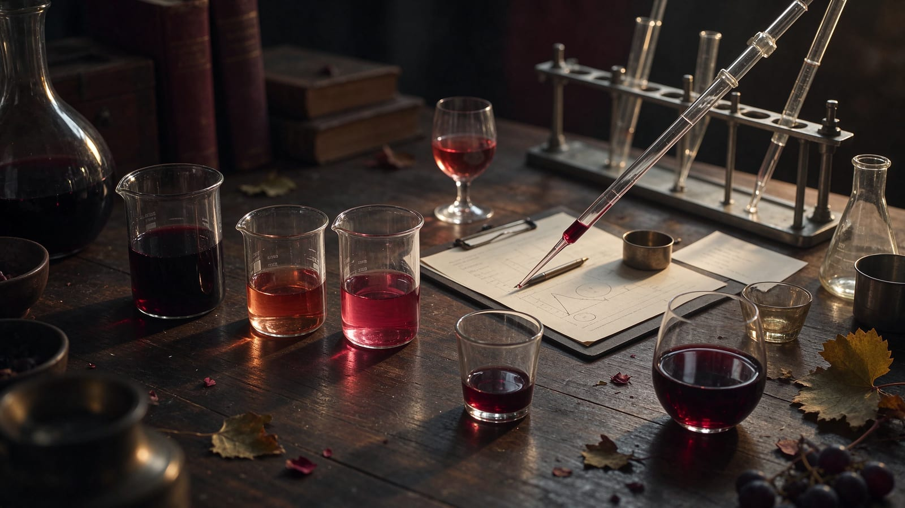

# 调配

调配是把不同批次、年份、品种、产区或桶型的酒液按比例组合的工序。它既可以是稳定品质的技术手段，也可以是设计风格的核心环节。葡萄酒、香槟、威士忌、白兰地与白酒都调配，但法规允许的范围、术语体系与目标并不相同。把调配简单理解为“混在一起”，会忽略比例设计、感官校准与后续融合。

图：葡萄酒调配实验的编辑插图：不同基酒在烧杯中对比，移液管用于小样调配；画面为 AI 辅助绘制，不是实验室实拍。 图片：Hejiu 编辑团队，项目自有。

## 工序定位

调配位于各组分完成发酵或陈酿之后、稳定处理与装瓶之前。它可能发生多次：原酒调配、桶间调配、装瓶前最终调配。对香槟，assemblage 发生在瓶内二次发酵之前；对威士忌，调和发生在装瓶前，但参与调和的酒液已经过不同时长的[橡木桶陈酿](ref:oak-ageing)。对白酒，勾调是把不同轮次、不同窖池的基酒组合，属于成品设计的一部分。

## 步骤与参数

流程通常是：组分评估、小样试验、比例确定、大罐混合、静置融合、稳定与过滤。小样阶段要记录酒精度、滴定酸度、pH、残糖、色度、单宁与香气强度；大罐混合后静置 2–4 周，让胶体与香气重新平衡。上述区间取自本页参考资料所列法规、行业协会与工具书的常见表述。混合时的温度、搅拌强度与溶氧会改变融合速度；酒精精度差异过大时，应先做相容性试验，避免蛋白或酒石酸析出。

## 机制：胶体、呈色与挥发平衡

调配不是简单的加法。不同酒液混合后，酒石酸氢钾与蛋白质可能越过溶解度边界而析出；单宁与色素发生共色作用，使颜色更深、更稳定；单宁分子之间聚合，涩感从尖锐转向圆润。乙醇浓度改变香气物质的挥发系数，酒精度略高的组分会让香气“冲”出来，也会压住细腻的花香。酸与糖的平衡遵循感官交互：酸高时甜感被削弱，酒精高时酸感被放大。

## 设备与变体

设备包括带搅拌与温控的调配罐、流量计、在线混合器、氮气保护与取样系统。传统酒厂用木桶与人工计量，现代工厂用自动配料与批次追溯。变体有单一年份调配、跨年份调配、单一品种与混酿、单一桶与桶间调和、以及香槟的垂直与水平 assemblage。设备精度影响比例重复性，但感官校准仍依赖品评小组，仪器不能替代舌头。

## 失败模式与判断

常见问题有四类。其一，比例失衡：酸度或酒精突出，香气被压制，通常在小样阶段就能发现。其二，稳定性失败：装瓶后出现酒石酸结晶、蛋白浑浊或色素沉淀，多因混合后未做冷稳定与蛋白稳定。其三，微生物风险：组分带残糖或已感染，混合后整罐受污染。其四，标签与法规不符：品种、年份或类别标注超出允许范围。判断应结合小样复评、稳定性试验与法规核对，而不是只看大罐口感。

## 对风味的影响

适度调配能提升完整度：酸度高的组分补足清淡批次，老酒带来干果、香料与柔和单宁，新酒带来新鲜果香与活力；新桶组分提供香草与烘烤，旧桶组分提供中性质地。在[葡萄酒](ref:wine)中，调配可发生在品种、地块或年份层面；在[香槟](ref:sparkling)中，assemblage 是风格设计；在[威士忌](ref:whisky)中，调和与单一桶代表两种产品逻辑；在[白兰地](ref:brandy)中，年份组合决定圆润度与复杂度。过度调配则会把个性抹平。

## 对稳定性的影响

调配会打破原有胶体平衡，因此混合后必须重新做冷稳定、蛋白稳定与微生物稳定。酒石酸氢钾在低温下析出，可通过冷处理与接触法预防；蛋白不稳定来自不同批次的蛋白组成差异，需用膨润土试验验证；残糖与酒精度变化会影响二氧化硫的有效性，需重新计算游离与分子态比例。调配后的过滤会改变口感，过度过滤可能损失部分香气与质地。

## 法规与标签

调配不是无限制的。欧盟葡萄酒法规对类别、品种标注与允许的调配方式有规定；苏格兰威士忌对 blended Scotch whisky、blended malt 等名称有明确要求；中国白酒的勾调与年份表达也受标准约束。酒标上的 single cask、single vintage、blended 描述的正是调配范围。中文“勾兑”常被误解为掺假，但在白酒行业它是正常的基酒组合工序；真正的问题是虚假年份、非法添加与标签欺诈。

## 常见误区

第一，把调配等同于稀释或掺假。第二，认为所有酒都适合跨批次混合，忽略单一年份与单一桶的个性价值。第三，只按比例复制配方，忽略基酒年份差异。第四，混合后不做稳定性试验就装瓶。第五，把“原酒”当成品质保证，原酒同样需要评估与设计。

## 另见

- [葡萄酒](ref:wine)与[香槟](ref:sparkling)：静止酒混酿与 assemblage。
- [威士忌](ref:whisky)与[白兰地](ref:brandy)：调和型烈酒的产品逻辑。
- [橡木桶陈酿](ref:oak-ageing)：调配前后影响风味整合的陈酿环节。

对照阅读：[葡萄酒](ref:wine)、[威士忌](ref:whisky)。

**关键事实。**

| 项目 | 内容 |
| --- | --- |
| 一句话定位 | 把不同批次、年份、品种或桶型的酒液按比例组合，以稳定品质、平衡结构或形成固定风格的工序；葡萄酒、香槟、威士忌、白兰地与白酒的法规与调配逻辑各不相同 |
| 适用对象 | 葡萄酒、起泡酒、威士忌 |

**来源与边界。** 本页关于「调配」的关键事实，主要由以下来源交叉核对：European Union（欧盟葡萄酒类别、调配与标签规则框架）、Scotch Whisky Association (SWA)（苏格兰威士忌的调和类别与标签规则）、国家市场监督管理总局、国家标准化管理委员会（白酒勾调与基酒相关术语）等 5 条来源。价格、批次与状态会变，涉及这些字段时以页面所列来源的最新版本为准。正文为项目自写，来源只作核验，不复制原文。

**并读。** 把「调配」与「葡萄酒」、「起泡酒」、「威士忌」放在一起读时，先确认它们是同一层级还是上下游关系：先确认目的与步骤，再比较设备、温度、时间与副产物。本页负责给出工艺的基本坐标，对照条目补上具体案例与差异；读完再回到本页，才能分清哪些差别属于工艺本身，哪些只是产地、批次或品牌选择。

**适用边界。** 对「调配」而言，设备、温度与时间参数随生产商变化；本页说明目的与原理，不是操作手册。
