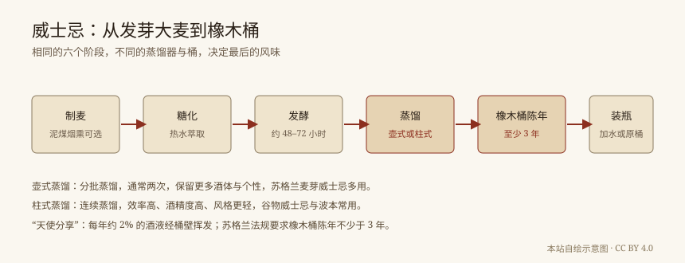

# 蒸馏

蒸馏是利用混合物中各组分沸点不同，把乙醇与水、其他挥发性成分分离的过程。发酵液或酒醅中的乙醇浓度通常较低，经过加热、汽化、冷凝，可以得到酒精度更高的馏出液。蒸馏是白兰地、威士忌、朗姆、伏特加、白酒等烈酒的必要工序，但不同酒种对设备和切酒方式的选择差异很大。

图：威士忌的六个生产阶段，以及壶式蒸馏与柱式蒸馏的分岔。本站自绘示意图，CC BY 4.0。

## 原理

乙醇的沸点约为 78 °C，水约为 100 °C。加热含乙醇的液体时，蒸气中的乙醇比例高于液相，冷凝后得到的液体酒精度随之提高。普通蒸馏无法把乙醇完全提纯：乙醇与水会形成共沸混合物，常压下共沸点约为 95.6% vol，单靠一次或多次简单蒸馏很难超过这一浓度。要得到更高纯度，需要特殊脱水方法，例如分子筛或共沸蒸馏。

蒸馏同时也是一个“选择性浓缩”的过程。不同挥发性物质的沸点、溶解度与蒸汽压不同，加热速度与回流条件会改变它们在馏出液中的比例。这就是为什么同样的发酵液，用不同设备与切酒方式，可以得到风格差异很大的酒。

## 主要设备

常见的蒸馏设备包括壶式蒸馏器、柱式蒸馏器和中国的甑桶。壶式蒸馏器由加热锅、鹅颈和冷凝器组成，分批蒸馏，适合保留原料风味；柱式蒸馏器内部有多层塔板，可连续蒸馏，效率更高，酒体通常更中性；甑桶用于中国白酒的固态蒸馏，酒醅直接装入甑桶，蒸汽穿过酒醅带走乙醇与香气。

设备选择不是中性的技术问题，而是风格设计的一部分。壶式蒸馏的批处理与较低回流，保留了更多原料与发酵产生的香气；柱式蒸馏通过多级平衡提高纯度，适合追求干净、轻盈的产品。甑桶则把蒸馏与固态酒醅的处理结合在一起，形成中国白酒特有的香气层次。

## 蒸馏与酒种

不同酒种对蒸馏方式有不同偏好。[白酒](ref:baijiu)多采用固态蒸馏，强调粮香、曲香与窖香；[威士忌](ref:whisky)常使用壶式蒸馏，苏格兰麦芽威士忌通常蒸馏两次，部分酒厂使用三次；[白兰地](ref:brandy)以壶式蒸馏为主，追求果香与陈年潜力；朗姆酒、伏特加则常使用柱式蒸馏，追求效率与纯净度。

这些选择与原料、法规和消费传统有关。以葡萄为原料的白兰地需要保留果香与陈年潜力，因此更依赖壶式蒸馏；以糖蜜或谷物为原料的伏特加追求中性，柱式蒸馏更合适。酒种名称往往隐含一套工艺预期，但具体做法仍因生产者而异。

## 切酒与风味

蒸馏过程中，流出液会按顺序分为酒头、酒心和酒尾。酒头含有较多低沸点物质，如醛类和部分酯类，香气冲但口感辛辣；酒心是主体，酒精度与风味较平衡；酒尾含有较多高沸点物质，如高级醇和脂肪酸，口感沉重。生产者通过“掐头去尾”保留酒心，具体切点取决于酒种、设备与目标风格。

切酒点直接决定成品的组成。切得过早，会损失香气与酒体；切得过晚，会带入辛辣、油腻或苦涩的物质。生产者常用[酒精度](ref:abv)、香气与口感综合判断切换时机，而不是只看一个数字。切酒之后，酒精度仍会随贮存与加水调整，因此切酒是风味决策，不只是浓度决策。

## 关键参数

加热速度、回流比、塔板数、真空度和冷凝温度都会影响馏出液的组成。缓慢加热与较高回流比通常能得到更干净、更集中的酒体；快速蒸馏则保留更多挥发性风味，但也可能带入杂质。

真空蒸馏可以降低沸点，减少热敏物质的损失，常用于果味较强的蒸馏酒。冷凝温度影响蒸气的凝结与回流，设备保温与冷却水温度都会改变实际效果。生产者需要在纯度、风味保留与能耗之间取舍，参数没有脱离酒种的“最优解”。

## 两次与三次蒸馏

蒸馏次数是风格设计的一部分。苏格兰麦芽威士忌通常蒸馏两次，部分酒厂采用三次蒸馏以追求更轻盈、干净的口感；爱尔兰威士忌也常使用三次蒸馏。次数增加会提高酒精度与纯度，但也会减少风味物质。一次蒸馏保留更多原料特征，但酒精度较低、杂质更多。

生产者根据目标风格选择次数，而不是盲目追求“越多越好”。同一酒厂可能对不同产品线采用不同次数，以形成产品差异。评价时应把蒸馏次数与原料、设备、切酒和陈年一起看，单看次数容易得出片面结论。

## 蒸馏的历史与演变

蒸馏技术在不同地区独立发展，并随着贸易、殖民与工业化传播。早期蒸馏多用于保存易腐的农产品或制作药用酒精，后来逐渐发展为饮用烈酒。柱式蒸馏器的出现提高了效率与产量，壶式蒸馏器则在追求风味的酒种中保留下来。

中国白酒的固态蒸馏与甑桶工艺，是另一条独立的技术传统。不同传统的共同点是利用沸点差异浓缩乙醇，差异则在于原料状态、设备结构与风味目标。理解这条历史线索，有助于解释为什么今天的烈酒风格如此多样。

## 常见误区

第一，蒸馏次数越多越好。多次蒸馏会提高纯度，但也会剥离风味，是否适合取决于酒种。

第二，酒精度越高，质量越好。酒精度只是浓度参数，风味、平衡与原料表达同样重要。

第三，所有烈酒都用同一种蒸馏器。壶式、柱式、甑桶各有适用场景，设备选择是风格设计的一部分。

第四，认为“掐头去尾”只是去除杂质。它同时影响香气、酒体与口感，是风味设计的关键步骤。

第五，把蒸馏等同于提纯。蒸馏在提高酒精度的同时，也选择性地保留或排除挥发性成分。

## 延伸阅读

- [白酒](ref:baijiu)：固态蒸馏与甑桶工艺的体系。
- [威士忌](ref:whisky)：壶式蒸馏、蒸馏次数与陈年框架。
- [白兰地](ref:brandy)：以葡萄为原料的蒸馏与陈年路线。
- [酒精度](ref:abv)：理解馏出液浓度、切酒与加水降度。
