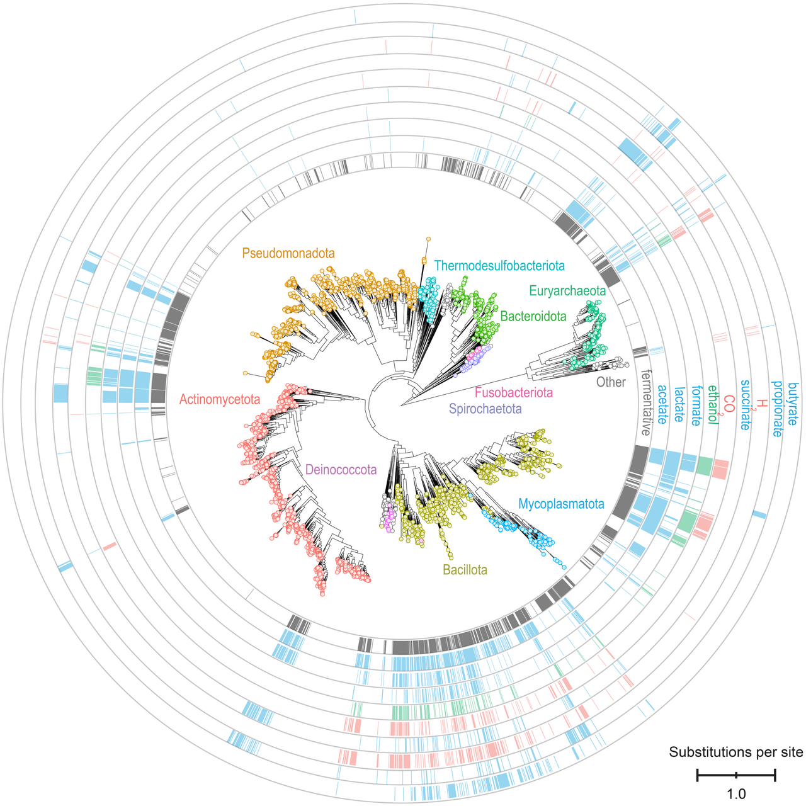

# 发酵

发酵是酵母或细菌在低氧条件下分解糖、生成乙醇、二氧化碳与风味物质的代谢过程。它把糖化学能转成细胞能量，顺带把乙醇排到细胞外。所有发酵酒都以这一步为核心：葡萄酒、啤酒、清酒、苹果酒、蜂蜜酒靠它得到酒精；白酒、威士忌、白兰地则先发酵，再用[蒸馏](ref:distillation)浓缩。

图：发酵。图片：Tjhackmann，CC BY-SA 4.0，via Wikimedia Commons（[原图页面](https://commons.wikimedia.org/wiki/File:Phylogenetic_tree_of_bacteria_and_archaea,_highlighting_those_that_carry_out_fermentation.png)）。

## 工序定位

发酵位于糖供应与后处理之间。上游是压榨、[糖化](ref:saccharification)或制曲；下游是倒罐、过滤、陈酿、蒸馏或灌装。它有明确的起点（接种或自然起酵）和终点（糖耗尽、酒精达到耐受上限或被人工终止）。把发酵、陈酿与蒸馏混为一段，会看不清酒精度与风味分别在哪一步形成。

## 步骤与参数

发酵通常经历迟滞期、对数生长期、稳定期与衰亡期。啤酒艾尔多在 18–22 °C 发酵 3–7 天，拉格在 8–12 °C 发酵 7–14 天；红葡萄酒多在 20–30 °C 浸皮发酵 5–15 天，白葡萄酒多在 12–20 °C；清酒醪常在 10–18 °C 缓慢发酵约 20–35 天。上述区间为本页参考资料中 OIV、国家标准与行业协会资料的常见表述。每升约 17 g 糖可生成 1% 体积酒精；酿酒酵母的耐受上限通常在 15–16%，驯化菌株可更高。葡萄酒 pH 多在 3.2–3.8，啤酒发酵液多在 4.0–4.6。

## 机制：糖酵解与副产物

酿酒酵母走糖酵解途径，把葡萄糖变成丙酮酸，再由丙酮酸脱羧酶转成乙醛，最后由乙醇脱氢酶还原为乙醇，同时再生 NAD⁺。缺氧时这条路线让细胞继续产 ATP。甘油是渗透压与氧化还原平衡的副产物；高级醇经埃利希途径由氨基酸转来；酯类由乙酰辅酶 A 与醇在酶催化下缩合；硫化氢来自含硫氨基酸代谢。细菌路线不同，乳酸菌走同型或异型乳酸发酵，醋酸菌则把乙醇氧化成醋酸，这也是发酵酒变酸的原因。

## 设备与变体

容器包括不锈钢罐、橡木桶、混凝土罐、开放式发酵槽、陶坛与窖池。不锈钢便于温控与清洗，橡木桶提供微氧与木质香气，混凝土蓄热稳定，开放式槽利于酵母回收但氧化风险高。变体有自然发酵与接种发酵、带皮与澄清汁发酵、整串发酵、二氧化碳浸渍、连续发酵与分批发酵。白酒的固态发酵用窖池或地缸，清酒用开放式或密闭罐，设备随酒种和产量而变，不存在通用最佳方案。

## 失败模式与判断

发酵停滞表现为比重或糖度长时间不降，常由营养不足、温度骤降、酒精毒性或杀菌剂残留造成。还原味来自硫化氢与硫醇，闻起来像臭鸡蛋或下水道；挥发酸升高说明醋酸菌或异型乳酸菌活跃；乙醛过多带来青苹果与溶剂感。判断时要同时看比重曲线、温度记录、酵母活菌数与挥发酸，而不是只闻香气。瓶中再次发酵会带来浑浊、爆塞甚至炸瓶，装瓶前必须确认残糖与微生物状态。

## 对风味的影响

发酵决定酒精、酸度与香气骨架。低温慢发酵保留更多果香与酯类，高温快发酵产生更多高级醇与溶剂感；带皮发酵提取颜色与单宁，酒泥接触增加圆润感；酵母菌株决定酯谱与硫化物产量。在[葡萄酒](ref:wine)中，发酵温度与浸皮时间决定果味与结构；在[啤酒](ref:beer)中，酵母与温度决定酯香与干净度；在[白酒](ref:baijiu)中，固态多菌种发酵产生复杂香气前体，再经蒸馏进入酒体。

## 对稳定性的影响

发酵结束时的残糖、pH、酒精与营养残留，决定后续稳定性。残糖高而酒精度不足以抑制微生物，瓶中可能再发酵；pH 偏高让乳酸菌与醋酸菌更易活动；氧气残留会促进醋酸菌生长与氧化。发酵完全、酒精度足够、二氧化硫或过滤处理到位，才能支撑长期陈酿。发酵温度失控还会产生过多氨基甲酸乙酯前体，这是需要监测的安全指标。

## 常见误区

第一，认为发酵只是“产生酒精”，忽略甘油、酯类与酸对口感的作用。第二，把发酵温度当成唯一变量，忽略营养与溶氧。第三，认为自然发酵一定优于接种，忽略失控与批次差异。第四，把“二次发酵”当成通用词，实际上起泡酒瓶内二次发酵与苹乳发酵是两回事。第五，看到残糖就认定发酵失败，甜型酒可能是有意保留。

发酵不是“加酵母等几天”，而是菌种、温度、糖浓度、pH 与氧气共同决定的代谢过程：糖被转成乙醇与二氧化碳，同时生成高级醇、酯与酸。温度高会加快发酵，也容易损失香气；营养不足或氧气过多则可能产生异味。判断发酵是否正常，要看糖度下降、温度曲线与感官，而不只是看气泡。

## 另见

- [糖化](ref:saccharification)：把淀粉变成可发酵糖的上游步骤。
- [蒸馏](ref:distillation)：对发酵液进行酒精浓缩的下游步骤。
- [葡萄酒](ref:wine)、[啤酒](ref:beer)、[白酒](ref:baijiu)：三种不同原料与微生物体系下的发酵组织。

对照阅读：[糖化](ref:saccharification)、[葡萄酒](ref:wine)。

**关键事实。**

| 项目 | 内容 |
| --- | --- |
| 一句话定位 | 酵母或细菌在低氧条件下把糖转化为乙醇、二氧化碳与风味物质的代谢过程；菌种、温度、糖浓度、pH 与氧决定发酵速度、酒精度和香气走向 |
| 适用对象 | 葡萄酒、啤酒、白酒 |

**来源与边界。** 本页关于「发酵」的关键事实，主要由以下来源交叉核对：International Organisation of Vine and Wine (OIV)（葡萄酒发酵、酵母与酒精度框架）、国家市场监督管理总局、国家标准化管理委员会（发酵酒类别与工艺术语）、Encyclopaedia Britannica（提供关于发酵代谢、酵母与厌氧过程的条目）等 4 条来源。价格、批次与状态会变，涉及这些字段时以页面所列来源的最新版本为准。正文为项目自写，来源只作核验，不复制原文。

**并读。** 把「发酵」与「糖化」、「蒸馏」、「葡萄酒」放在一起读时，先确认它们是同一层级还是上下游关系：先确认目的与步骤，再比较设备、温度、时间与副产物。本页负责给出工艺的基本坐标，对照条目补上具体案例与差异；读完再回到本页，才能分清哪些差别属于工艺本身，哪些只是产地、批次或品牌选择。

**适用边界。** 对「发酵」而言，设备、温度与时间参数随生产商变化；本页说明目的与原理，不是操作手册。

**更新提示。** 「发酵」最近核对于 2026-11-07；设备、温度、时间与操作细节会因工艺版本不同，实践前以设备说明与专业文献为准。
