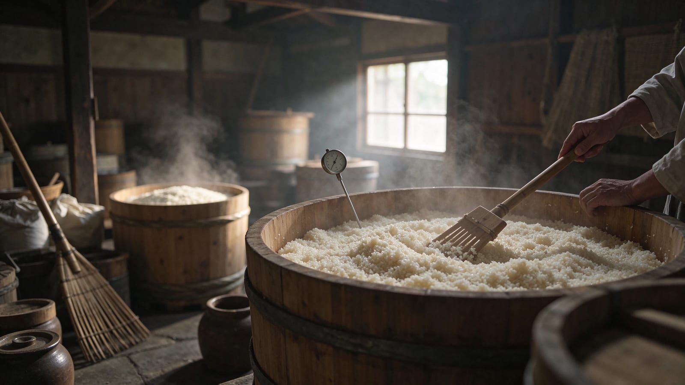

# 生酛与山废

生酛与山废是[清酒](ref:sake)的两种传统酒母制法，都依靠天然乳酸菌把酒母酸化，而不是直接加入乳酸。生酛保留“山卸”这一捣糊操作，山废则把它省略。两者常被当成同义词，实际上在微生物作用方式、劳动强度与成品风格上都有差别，也都不能与酒母之外的工序混为一谈。

图：生酛与山废酒母的编辑插图：木桶中的米麹与蒸汽、竹耙翻拌；画面为 AI 辅助绘制，不是酒厂实拍。 图片：Hejiu 编辑团队，项目自有。

## 工序定位

酒母（酛）是培养酵母的中间阶段，位于[制曲](ref:qu-making)与醪发酵之间。米、米曲与水混合后，必须让酵母大量增殖，同时抑制杂菌。清酒用酸化解决这个矛盾，由此分出三条路线：添加乳酸的速酿、天然乳酸菌主导的生酛、以及省略山卸的山废。酒母路线不是清酒的等级，同一种特定名称酒可以用不同酒母制造，因此标签上的酒母词只说明工艺。

## 步骤与参数

生酛的流程是：蒸米、米曲与水入桶，先低温下料，随后进行山卸，把混合物捣成糊状，再经“暖气”阶段逐步升温，让乳酸菌与酵母接力。整个过程通常 2–4 周，初期温度约 5–10 °C，后期升至 10–15 °C。山废不捣糊，靠长时间搅拌与温度管理完成酸化，周期同样约 2–4 周。速酿则直接加乳酸，周期约 2 周。上述区间取自本页参考资料所列行业协会、国税厅与酒类综合研究所资料的常见表述。

## 机制：乳酸菌接力与酸化

酒母起始时 pH 接近中性，米与曲带来糖、氨基酸与矿物质，也带来乳酸菌、野生酵母与杂菌。生酛依靠山卸把米粒打碎，释放淀粉与酶，同时带入氧气并让温度均匀，使乳酸菌先繁殖。乳酸链球菌类先把 pH 降到 4 左右，随后更耐酸的乳酸杆菌继续产酸，pH 可降到 3.3–3.5。这个酸性环境抑制多数腐败菌，却允许清酒酵母在后续“酵母添加”后占优势。山废不捣糊，酸化更依赖搅拌带来的溶氧与温度曲线，因此风味走向略有不同。

## 设备与变体

传统使用木制酛桶、山卸用的长柄櫂与人工搅拌；现代酒厂多用不锈钢或珐琅桶、机械搅拌与温控夹套。变体包括完全手工生酛、机械辅助生酛、山废、以及“生酛仕込み”“山廃仕込み”等标签表达。部分酒厂会用高温糖化法制作酒母以缩短周期，那已不属于生酛或山废。容器材质影响保温与清洁，搅拌强度影响溶氧与微生物群落。

## 失败模式与判断

第一，酸化不足：pH 迟迟不降，杂菌有机可乘，酒母可能出现异味或发黏。第二，酸化过快或温度过高：乳酸菌与野生酵母失控，产生醋酸、丁酸或异臭。第三，山卸不足：米粒未充分破碎，酶作用不匀，发酵启动迟缓。第四，酵母添加时机不当：酸度尚未建立就接入酵母，导致杂菌竞争。判断要结合 pH、酸度、温度记录、气味与镜检，而不是只看周期天数。

## 对风味的影响

天然乳酸菌路线通常带来更高的酸度与更明显的旨味，香气偏乳香、坚果、谷物与熟成感，而不是吟酿类的水果香。生酛因山卸带来的溶氧与微生物多样性，常被描述为层次更复杂；山废则更强调酸度与浓郁感。温饮会放大酸度与旨味，也让酒精感更突出。这类酒适合搭配炖物、酱味与油脂较多的鱼贝，清淡刺身容易被压过。

## 对稳定性的影响

酒母的酸度是后续醪发酵的第一道防线。pH 低、乳酸浓度足够的酒母，能抑制多数杂菌，让清酒酵母在 10–18 °C 的低温醪中缓慢工作。若酒母酸度不足，醪可能提前酸败或产生异香。生酛与山废的酵母活菌数通常较高，发酵启动更稳，但周期长、温度管理复杂，夏季高温期风险更大。成品酒若未做火入或过滤，残留酶与微生物仍可能带来变化。

## 标签与识别

标签常见“生酛仕込み”“山廃仕込み”“生酛造り”等表达，说明酒母路线，而不是特定名称酒的等级。山废清酒可以是[纯米酒](ref:junmai)，也可以是[本酿造](ref:honjozo)，因此不能把山废等同于纯米。选购时应同时看类别词、酒母标示、精米步合与酒精度，只看到“山废”二字就推断风味或品质，容易误判。

## 常见误区

第一，把生酛与山废当成同一件事，忽略山卸的有无。第二，把山废等同于纯米酒，忽略它可以与本酿造组合。第三，认为速酿是廉价工艺，实际上它稳定、干净，是现代主流。第四，认为天然乳酸一定更好喝，复杂度并不等于人人喜欢。第五，把“山废”当成法定等级，它只是酒母制法与标签用语。

## 另见

- [清酒](ref:sake)：类别体系与酿造框架。
- [纯米酒](ref:junmai)与[本酿造](ref:honjozo)：常与生酛、山废组合的类别。
- [制曲](ref:qu-making)与[发酵](ref:fermentation)：米曲与醪发酵的上游原理。
- [日本](ref:japan)：清酒的国家与产区背景。

对照阅读：[清酒](ref:sake)、[本酿造](ref:honjozo)。

**关键事实。**

| 项目 | 内容 |
| --- | --- |
| 一句话定位 | 清酒依靠天然乳酸菌培养酒母的两条传统路线；生酛保留山卸，山废省略山卸，二者都区别于直接添加乳酸的速酿酒母，并影响酸度、旨味与生产周期 |
| 适用对象 | 清酒、纯米酒、本酿造 |

**来源与边界。** 本页关于「生酛与山废」的关键事实，主要由以下来源交叉核对：Japan Sake and Shochu Makers Association（生酛、山废与速酿酒母的差异）、National Tax Agency of Japan（生酛仕込み、山廃仕込み等标示的用法）、Oxford University Press（提供关于酒母、生酛与山废的条目；由原条目末尾参考资料迁移，未逐条复核访问日期）等 5 条来源。价格、批次与状态会变，涉及这些字段时以页面所列来源的最新版本为准。正文为项目自写，来源只作核验，不复制原文。

**并读。** 把「生酛与山废」与「清酒」、「纯米酒」、「本酿造」放在一起读时，先确认它们是同一层级还是上下游关系：先确认目的与步骤，再比较设备、温度、时间与副产物。本页负责给出工艺的基本坐标，对照条目补上具体案例与差异；读完再回到本页，才能分清哪些差别属于工艺本身，哪些只是产地、批次或品牌选择。

**适用边界。** 对「生酛与山废」而言，设备、温度与时间参数随生产商变化；本页说明目的与原理，不是操作手册。

**更新提示。** 「生酛与山废」最近核对于 2026-11-07；设备、温度、时间与操作细节会因工艺版本不同，实践前以设备说明与专业文献为准。
