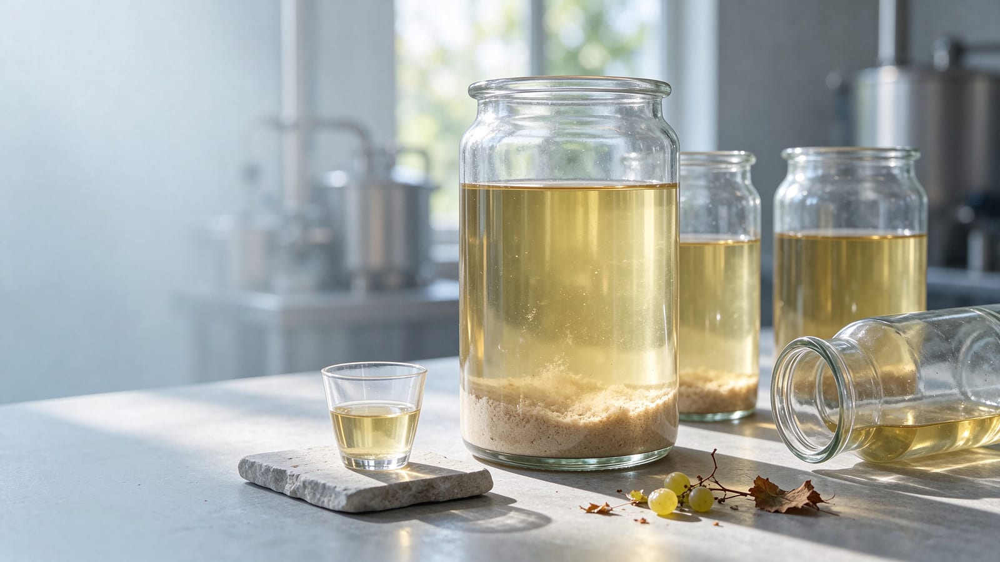

# 酒泥陈酿

酒泥陈酿（lees ageing，法语 sur lie）让葡萄酒与发酵结束后沉降的[酒泥](ref:lees)保持接触一段时间。酒泥的主体是失活酵母，混有少量葡萄碎屑与酒石。粗酒泥颗粒大、易腐败，通常尽快分离；细酒泥颗粒细、沉降慢，可以被有意保留。工序的关键不在“放着不动”，而在接触时间、温度、二氧化硫与是否搅动。

图：酒泥陈酿的编辑插图：酒液与底部细酒泥分层，取样管与酒杯用于说明倒罐；AI 辅助绘制，不是实拍。 图片：Hejiu 编辑团队，项目自有。

## 工序定位

酒泥陈酿处在酒精[发酵](ref:fermentation)之后、澄清与装瓶之前。它属于熟成手段，但不等于陈酿本身：陈酿是时间维度，酒泥陈酿是带有接触介质的做法。它与[橡木桶陈酿](ref:oak-ageing)可以叠加，也可以完全在不锈钢罐中完成。起泡酒的瓶中带泥是同一原理在密闭容器中的延伸，但多了压力与除泥环节。

## 步骤与参数

静止白葡萄酒常在发酵结束后保留细酒泥，于 10–15 °C 静置 4–12 个月；搅泥（bâtonnage）每周 1–2 次，或按品尝结果调整。游离二氧化硫常控制在 20–35 mg/L，既要抑制氧化与杂菌，又不能压住自溶。上述区间取自本页参考资料所列 OIV 文件与葡萄酒工具书的常见表述。香槟的传统法规则是：无年份香槟上市前总陈酿不少于 15 个月，其中带泥不少于 12 个月；年份香槟总陈酿不少于 36 个月。

## 机制：自溶与还原保护

酵母细胞在酒泥中逐渐自溶，细胞壁与胞内物质被水解酶分解，释放甘露蛋白、多糖、氨基酸、脂肪酸与核苷。甘露蛋白吸附单宁与色素，增加胶体稳定性，也让口感更圆润；多糖提高黏度感，缓和酸的尖锐边缘。细酒泥还会消耗溶解氧，在酒面下方形成低氧化还原电位区，抑制氧化。代价是：缺氧环境下硫代谢继续，硫化氢与硫醇可能积累，形成还原味。

## 设备与变体

常见容器是带温控的不锈钢罐、橡木桶与混凝土罐，配搅泥棒或内置搅拌装置。变体包括静置不搅、定期搅泥、微氧配合、酒泥与酒液分离后再回添，以及起泡酒的瓶内带泥。香槟还需要转瓶与除泥设备；部分酒厂用惰性气体保护减少氧摄入。容器越密闭、温度越稳定，还原风险越可控，但完全缺氧也会让硫化物更难逸散。

## 失败模式与判断

第一，还原味：闻起来像卷心菜、下水道或烧橡胶，来自硫化氢与甲硫醇，常因酒泥过厚、缺氧或营养不足。第二，苦涩与腐败：粗酒泥停留过久，带来苦味、土味与脂肪酸败。第三，浑浊与蛋白不稳：酒泥过细、搅动过猛，悬浮物难以沉降。第四，二氧化硫失衡：过量抑制自溶，不足则氧化或乳酸菌活动。判断应结合感官、浊度、氧化还原电位与硫化物检测，不能只凭“带泥时间够长”。

## 对风味的影响

最明显的变化在口感：酒体更饱满，酸度边缘更柔，白葡萄酒获得奶油、面包、坚果与酵母气息。在[起泡酒](ref:sparkling-wine)中，带泥时间直接决定烘烤与饼干风味的强度，年份香槟的层次往往来自更长的自溶。在[葡萄酒](ref:wine)中，酒泥与橡木桶常同时使用：桶给微氧与木质香，酒泥给质感与还原保护。若酒泥处理不当，果香会被硫化物掩盖，出现沉闷的还原风格。

## 对稳定性的影响

酒泥释放的甘露蛋白与多糖能抑制酒石酸氢钾结晶，改善蛋白稳定性，减少装瓶后的冷混浊与蛋白浑浊。自溶还会释放少量氮源，若随后不处理，可能成为微生物营养。酒泥陈酿期间氧气被持续消耗，氧化风险下降，但一旦倒罐曝气，已形成的还原味可能被氧化成更持久的硫醇。起泡酒带泥时间越长，气泡越细腻，但除泥后仍需补液与封口，避免二次氧化。

## 常见误区

第一，把酒泥陈酿等同于“陈酿”，忽略它只是其中一种接触式做法。第二，认为酒泥越多越好，粗酒泥带来的苦涩与腐败常被忽视。第三，把还原味当成“复杂度”，实际上过量硫化物是缺陷。第四，认为必须搅泥，实际上静置带泥同样成立。第五，把酒泥陈酿与酵母自溶画等号，自溶只是产生风味的原因之一。

酒泥陈酿让酒液与发酵后沉降的细酒泥保持接触，酵母自溶释放甘露糖蛋白与含氮物质，带来圆润口感、奶油与面包气息，并形成还原保护。搅泥能增加接触，过度则可能带来硫化物与苦涩；它和白葡萄酒的“sur lie”有关，但不是所有酒都适合长期带泥。

## 另见

- [酒泥](ref:lees)：酒泥的分类、成分与分离方式。
- [葡萄酒](ref:wine)与[起泡酒](ref:sparkling-wine)：静止酒与瓶中带泥两种应用场景。
- [发酵](ref:fermentation)与[橡木桶陈酿](ref:oak-ageing)：上游代谢与并行熟成手段。

对照阅读：[酒泥（lees）](ref:lees)、[起泡酒](ref:sparkling-wine)。

**关键事实。**

| 项目 | 内容 |
| --- | --- |
| 一句话定位 | 让葡萄酒与发酵后沉降的细酒泥保持接触的熟成方式；搅泥频率、温度与时间带来圆润口感、奶油与面包气息，并形成还原保护，但处理不当会产生硫化物与苦涩 |
| 适用对象 | 葡萄酒、起泡酒 |

**来源与边界。** 本页关于「酒泥陈酿」的关键事实，主要由以下来源交叉核对：International Organisation of Vine and Wine (OIV)（酒泥、带酒泥陈酿与搅泥相关术语）、Oxford University Press（提供关于细酒泥、搅泥与酵母自溶的条目）、Comité Interprofessionnel du vin de Champagne（香槟带泥陈酿的最短时间与除泥流程）等 4 条来源。价格、批次与状态会变，涉及这些字段时以页面所列来源的最新版本为准。正文为项目自写，来源只作核验，不复制原文。

**并读。** 把「酒泥陈酿」与「酒泥（lees）」、「葡萄酒」、「起泡酒」放在一起读时，先确认它们是同一层级还是上下游关系：先确认目的与步骤，再比较设备、温度、时间与副产物。本页负责给出工艺的基本坐标，对照条目补上具体案例与差异；读完再回到本页，才能分清哪些差别属于工艺本身，哪些只是产地、批次或品牌选择。

**适用边界。** 对「酒泥陈酿」而言，设备、温度与时间参数随生产商变化；本页说明目的与原理，不是操作手册。

**更新提示。** 「酒泥陈酿」最近核对于 2026-11-07；设备、温度、时间与操作细节会因工艺版本不同，实践前以设备说明与专业文献为准。

**编者注。** 本页把「酒泥陈酿」作为工艺条目处理：定义、流程与关键数字以正文表格为准，与「酒泥（lees）」、「葡萄酒」的差异用对照阅读验证；遇到价格、批次或地址，回到页面所列来源核对。
