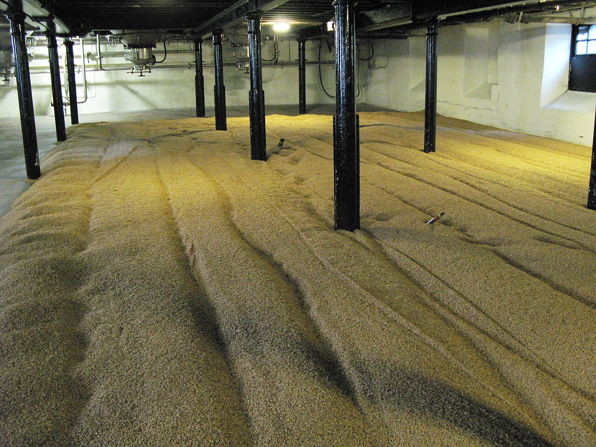

# 制麦

制麦（malting）把[大麦](ref:barley)等谷物变成麦芽。它的核心不是“让谷物发芽”，而是借发芽唤醒谷物内部的酶系统，再通过烘干把酶固定下来、把水分降下来。啤酒与威士忌都依赖制麦：没有麦芽提供的淀粉酶，[糖化](ref:saccharification)就无法把胚乳淀粉转成可发酵糖。

图：制麦。图片：Lakeworther，CC BY-SA 3.0，via Wikimedia Commons（[原图页面](https://commons.wikimedia.org/wiki/File:Highland_park_malting_floor.jpg)）。

## 工序定位

制麦位于农业原料与酿造车间之间，是独立的预处理产业。上游是品种选择、清选与分级；下游是粉碎、糖化与发酵。它把不能长期储存、酶活很低的休眠谷物，变成水分稳定、酶活可控、风味可设计的半成品。把制麦当成“原料清洗”会低估它的作用：麦芽的溶解度和色度在这一步已经被写定。

## 步骤与参数

制麦分为浸麦、发芽、烘干与除根。浸麦通常 40–48 小时，采用湿浸与空气休止交替，使含水达到 42–46%；发芽在 12–16 °C 下持续 4–6 天，通过翻动与通风控制床温与水分；烘干先以 50–65 °C 排湿，再以 80–85 °C 焙烤基础麦芽，特种麦芽可升到 100–220 °C；最后除根，根芽约占成品质量的 3–5%。上述区间取自本页参考资料所列酿造工具书、百科与行业协会资料的常见表述。浸麦末段常用石灰水或碱液处理，降低表面霉菌负荷；发芽床每 4–6 小时翻动一次，避免局部积热与发芽不齐。

## 机制：酶的形成与淀粉溶解

休眠大麦几乎不含活性淀粉酶。吸水后赤霉素被激活，糊粉层合成 α-淀粉酶、蛋白酶与 β-葡聚糖酶，β-淀粉酶则从结合态释放。α-淀粉酶随机切断 α-1,4 键，β-淀粉酶从非还原端切出麦芽糖，蛋白酶分解储存蛋白，β-葡聚糖酶降解胚乳细胞壁，让淀粉暴露。这个过程叫“溶解”。烘干升温使酶逐渐失活，同时糖与氨基酸发生美拉德反应，生成色度与烘烤香气。

## 设备与变体

传统制麦用浸麦槽、发芽地板、铲子与直火烘干炉；现代用 Saladin 箱、转鼓、塔式发芽与间接热风烘干。变体包括地板麦芽、箱式麦芽、塔式麦芽；按产品分基础麦芽、焦糖麦芽、巧克力麦芽、烟熏麦芽与维也纳麦芽。威士忌常用泥煤烘干，让酚类附着在麦芽上；啤酒厂则按色度与酶活选择配方。小型精酿厂多直接采购成品麦芽，自行制麦需要稳定的温湿度与大场地。

## 失败模式与判断

第一，发芽不齐：床层过厚、翻动不足或水分不均，表现为根芽长短不一、溶解不一致。第二，霉变：浸麦后通风不足或温度过高，出现霉味与结块。第三，溶解过度：蛋白质分解过多，麦芽虽易糖化但泡沫与酒体变差，出酒率也下降。第四，酶活不足：烘干温度过高或时间过长，糖化时碘液长时间不褪色。第五，根芽残留过多：带来苦涩与吸湿。判断应结合根芽长度、粉质率、脆度、酶活与糖化试验。此外，麦芽水分超过 5% 后储存会加速酶活下降与霉变，应按批次先进先出。

## 对风味的影响

基础麦芽提供大部分可发酵糖与谷物甜，特种麦芽提供色度、焦糖、坚果、咖啡与烟熏气息。同一配方中，基础麦芽占比越高，酶活越充足；特种麦芽占比越高，色度与烘烤香越强。烘干温度越高，酶活保留越少，风味贡献越强。在[啤酒](ref:beer)中，麦芽配方决定颜色、甜感、泡沫与麦芽香，是风格区分的主要变量；在[威士忌](ref:whisky)中，麦芽提供酶与糖，泥煤烘干带来烟熏酚类；在[发酵](ref:fermentation)前的麦汁中，麦芽处理方式影响糖化效率与酵母可用的营养。

## 对稳定性的影响

麦芽的水分、酶活与微生物负荷影响成品稳定性。水分高于 5% 易吸湿霉变，酶活也会下降；溶解不足的麦芽需要更长糖化时间，增加氧化风险；溶解过度则让蛋白质缓冲能力下降，啤酒泡沫稳定性变差。麦芽表面的微生物在粉碎后进入麦汁，若煮沸不足，可能带来异味。储存时应避光、干燥、低温，并先进先出，避免酶活随时间衰减。

## 常见误区

第一，把制麦等同于发芽，忽略浸麦、烘干与除根。第二，认为麦芽越浅色越“纯”，忽略不同色度麦芽的功能差异。第三，只看色度不看溶解度，导致糖化方案失配。第四，认为烟熏味来自谷物本身，实际上多来自烘干燃料的酚类。第五，把制麦与糖化混为一谈，无法解释麦芽品质为何会限制出酒率。

制麦是把大麦浸泡、发芽、烘干并除根的预处理：发芽产生淀粉酶与蛋白酶，烘干曲线决定酶活、溶解度和色度。麦芽溶解不足，糖化效率低；溶解过度，酒体可能单薄。它是啤酒与部分威士忌的起点，不是“把麦子烤香”这么简单。

## 另见

- [大麦](ref:barley)：制麦的主要原料与品种差异。
- [啤酒](ref:beer)与[威士忌](ref:whisky)：两类主要的下游产品。
- [糖化](ref:saccharification)与[发酵](ref:fermentation)：麦芽酶与糖谱如何进入后续工序。

对照阅读：[大麦](ref:barley)、[威士忌](ref:whisky)。

**关键事实。**

| 项目 | 内容 |
| --- | --- |
| 一句话定位 | 把大麦等谷物浸泡、发芽、烘干并除根的预处理工序；发芽程度与烘干曲线决定淀粉酶活力、麦芽溶解度和色度，进而影响糖化效率与成品风味 |
| 适用对象 | 啤酒、威士忌 |

**来源与边界。** 本页关于「制麦」的关键事实，主要由以下来源交叉核对：Oxford University Press（提供关于浸麦、发芽、烘干与麦芽类型的条目）、Encyclopaedia Britannica（提供关于麦芽制备与发芽工序的描述）、Brewers Association（浸麦含水、发芽温度与烘干曲线等制麦参数的行业表述）等 4 条来源。价格、批次与状态会变，涉及这些字段时以页面所列来源的最新版本为准。正文为项目自写，来源只作核验，不复制原文。

**并读。** 把「制麦」与「大麦」、「啤酒」、「威士忌」放在一起读时，先确认它们是同一层级还是上下游关系：先确认目的与步骤，再比较设备、温度、时间与副产物。本页负责给出工艺的基本坐标，对照条目补上具体案例与差异；读完再回到本页，才能分清哪些差别属于工艺本身，哪些只是产地、批次或品牌选择。

**适用边界。** 对「制麦」而言，设备、温度与时间参数随生产商变化；本页说明目的与原理，不是操作手册。

**更新提示。** 「制麦」最近核对于 2026-11-07；设备、温度、时间与操作细节会因工艺版本不同，实践前以设备说明与专业文献为准。
