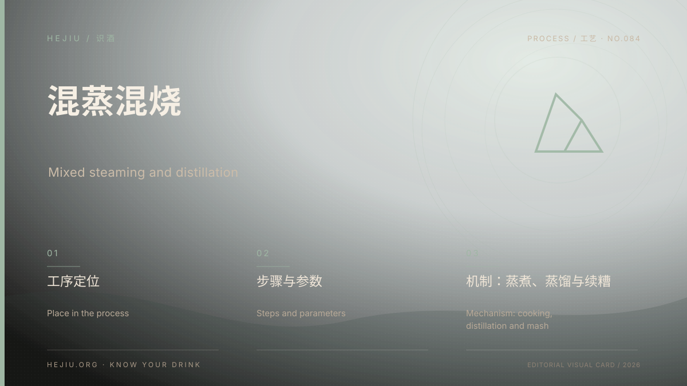

# 混蒸混烧

混蒸混烧是固态法白酒[蒸馏](ref:distillation)的组织方式：新拌入的粮粉、填充料与待蒸馏的酒醅同甑装填，蒸粮与蒸酒在同一次蒸馏中完成，酒气与粮香一并进入冷凝系统。它与“清蒸清烧”相对，后者把粮与酒分开蒸煮、分开蒸馏。两者不是优劣之分，而是不同香型与原料体系下的路线选择。

图：混蒸混烧 双语视觉卡（项目自绘 SVG）。不是实拍。

## 工序定位

混蒸混烧描述的是一套组合动作，不是单独的加热步骤。它通常与续糟配料一起出现：取出一部分发酵完成的酒醅蒸馏，同时补充新粮、新曲与填充料，形成下一轮的入窖料。蒸与烧在同一甑内完成，故称“混蒸混烧”。在流程上，它处在[固态发酵](ref:solid-state)之后、摘酒与贮存之前，是[白酒](ref:baijiu)从窖池走向原酒的关键转换点。

## 步骤与参数

典型顺序是：出窖、配料、拌和、装甑、蒸酒蒸粮、摘酒、摊晾、加曲、入窖。浓香型常把入窖水分控制在 53–58%，入窖温度 18–22 °C，发酵周期 60–90 天；装甑后流酒温度常控制在 25–30 °C，并按酒精度与香气分段接酒。上述区间取自本页参考资料所列国家标准与行业协会资料的常见表述，各厂会按窖池条件与产品定位调整。新粮比例、稻壳用量与拌和均匀度决定甑内透气性。

## 机制：蒸煮、蒸馏与续糟

蒸粮阶段，新粮淀粉在湿热条件下糊化，颗粒打开，为后续[制曲](ref:qu-making)带来的酶提供作用面；同时高温使部分蛋白质与糖发生美拉德反应，生成粮香与烘烤气息。蒸馏阶段，乙醇与水形成共沸倾向的混合蒸气，酯类、醛类、高级醇按挥发度与溶解度分配进入酒气。续糟把上一轮酒醅的残余淀粉、酸度与微生物带进下一轮，[泥窖](ref:fermentation-pit)中的窖泥菌群则持续提供己酸菌等风味微生物，形成循环生态。

## 设备与变体

核心设备是甑桶、冷凝器、窖池、摊晾床与通风设备。传统甑桶用木制或水泥制，底部有竹篦，靠人工撒料；现代车间用不锈钢甑桶、行车与自动装甑机。变体包括混蒸混烧续糟法、清蒸清烧、清蒸混烧与老五甑等操作法。浓香型多用混蒸混烧续糟，[清香型](ref:light-aroma)与[老白干香型](ref:laobaigan)常采用清蒸清烧或清蒸清烧三排净。设备与操作法必须匹配，不能只改名称不改流程。

## 失败模式与判断

第一，压汽与塌甑：装甑过快、料层过厚或水分过大，蒸汽走不通，酒尾长、出酒率低。第二，粮腥与生粮味：蒸粮不透或新粮粉碎过粗，香气带生青。第三，辅料杂味：稻壳未清蒸或用量过多，带来糠味与涩感。第四，酸败：入窖温度过高、水分过大或窖池卫生差，糟醅发酸。第五，摘酒不当：头尾不分，酒体冲辣或杂味重。判断应结合出酒率、酒精度、酸度、感官与入窖记录。

## 对风味的影响

混蒸混烧把粮香、蒸煮香与酒香一起收进酒体，成品通常粮香突出、酒体饱满，己酸乙酯与乳酸乙酯的比例构成浓香型的骨架。清蒸清烧则让酒醅香气更集中、风格更清爽。新粮比例高，粮香更明显但可能带生味；续糟比例高，糟香与陈香更足但酸度上升。分段摘酒决定头段、中段与尾段的比例，中段通常最平衡。

## 对稳定性的影响

混蒸混烧的稳定性取决于糟醅循环是否健康。续糟使酸度、淀粉与微生物逐轮累积，若酸度过高，发酵受抑、出酒率下降；若酸度过低，杂菌更易繁殖。入窖水分与温度是控制酸败的关键，夏季尤其需要低温入窖。蒸馏时的高温也起到一定杀菌作用，但甑桶、摊晾床与管道的清洁仍决定下一轮的微生物起点。原酒贮存中的酯化与氧化，则决定成品能否长期稳定。

## 常见误区

第一，把混蒸混烧当成“把粮泡进酒里”，它其实是同甑蒸煮与蒸馏。第二，认为混蒸混烧一定优于清蒸清烧，忽略香型与原料差异。第三，把“续糟”理解成“老酒”，续糟指酒醅循环，不等于瓶中酒龄。第四，把“量质摘酒”当成营销词，它是实际的分段取酒操作。第五，忽略辅料清蒸，稻壳杂味会直接进入酒体。

混蒸混烧把新粮与酒醅同甑蒸煮，并在同一次蒸馏中接酒，通常与续糟配料配套。它与清蒸清烧相对：新粮的粮香、酒醅的酯香与蒸煮后的糊化在同一环节交叠，影响酒体饱满度与糟醅循环。工序名称说明操作顺序，不代表所有固态法白酒都采用同一路线。

## 另见

- [白酒](ref:baijiu)：混蒸混烧所在的酒种框架。
- [浓香型白酒](ref:strong-aroma)：常与续糟配料、混蒸混烧联系在一起的香型。
- [清香型白酒](ref:light-aroma)与[老白干香型白酒](ref:laobaigan)：常采用清蒸清烧的对照路线。
- [固态发酵](ref:solid-state)与[蒸馏](ref:distillation)：前段发酵与后段蒸馏的一般原理。
- [制曲](ref:qu-making)与[泥窖](ref:fermentation-pit)：微生物与酶系、窖泥菌群的来源。

对照阅读：[白酒](ref:baijiu)、[清香型白酒](ref:light-aroma)。

**来源与边界。** 本页关于「混蒸混烧」的关键事实，主要由以下来源交叉核对：国家市场监督管理总局、国家标准化管理委员会（浓香型白酒的术语、工艺与质量要求框架；未复制标准正文；蒸粮、蒸酒、续糟与摘酒等术语；未复制标准正文）、中国酒业协会（行业对混蒸混烧、续糟配料与量质摘酒的通用表述；未复制协会文本）、Oxford University Press（提供关于中国白酒蒸馏与固态发酵的条目；由原条目末尾参考资料迁移，未逐条复核访问日期）。价格、批次与状态会变，涉及这些字段时以页面所列来源的最新版本为准。正文为项目自写，来源只作核验，不复制原文。

**并读。** 把「混蒸混烧」与「白酒」、「浓香型白酒」、「清香型白酒」放在一起读时，先确认它们是同一层级还是上下游关系：先确认目的与步骤，再比较设备、温度、时间与副产物。本页负责给出工艺的基本坐标，对照条目补上具体案例与差异；读完再回到本页，才能分清哪些差别属于工艺本身，哪些只是产地、批次或品牌选择。

**适用边界。** 对「混蒸混烧」而言，设备、温度与时间参数随生产商变化；本页说明目的与原理，不是操作手册。
