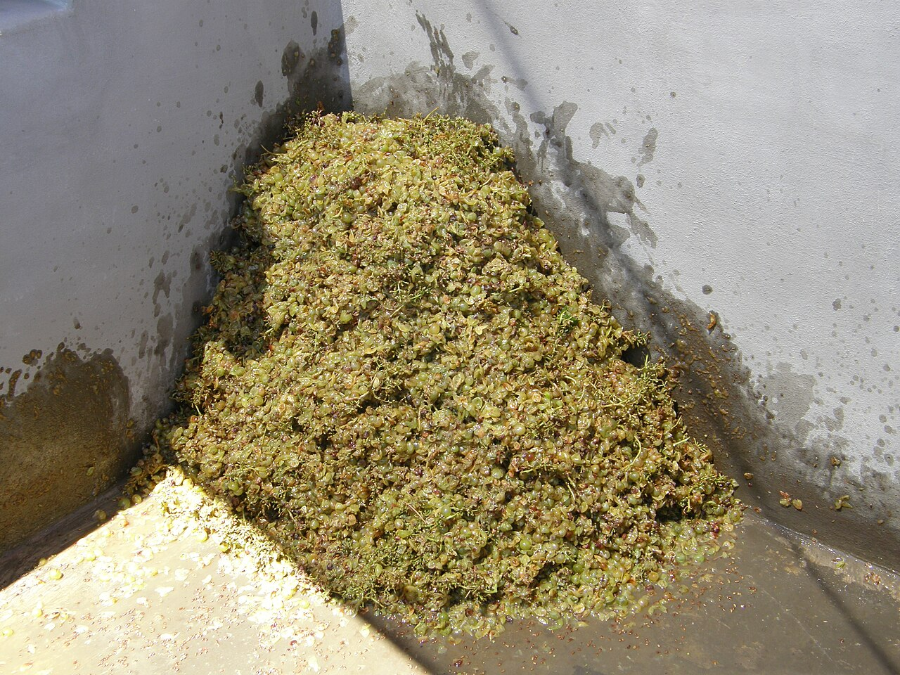

# 压榨

压榨是把葡萄汁或酒液从皮渣、种子与梗中分离出来的工序。它看起来只是“挤”，实际上是一次关于压力、时间与分段的取舍：压力越大，出汁率越高，但单宁、色素与苦涩物质也越多；压力越小，酒液越干净，但产量越低。酿酒师要在产量与质量之间画一条线。

压榨的时机因酒种而异。白葡萄酒通常在发酵前压榨，先把清汁与皮渣分开，再低温发酵；红葡萄酒则在浸渍或发酵结束后压榨，把“自流酒”与“压榨酒”分开。起泡酒的压榨更早、更轻柔，以避免色素与单宁进入基酒。同一台压榨机，不同的时间点，会做出完全不同的酒。

图：圣托里尼的白葡萄压榨，葡萄汁与皮渣分离。图片：Klearchos Kapoutsis，CC BY 2.0，via Wikimedia Commons（[原图页面](https://commons.wikimedia.org/wiki/File:White_wine_grape_pressing_in_Santorini.jpg)）。

## 白葡萄酒：先压榨，后发酵

白葡萄酒的压榨目标是尽快把汁与皮渣分开，减少氧化与酚类物质浸出。整串压榨（whole-bunch pressing）是常见做法：葡萄不除梗直接进入压榨机，果梗形成排水通道，压力可以更均匀，汁液也更清。除梗后压榨则适合成熟度高、梗味明显的葡萄。

压榨机通常分段取汁。最初的“初榨汁”最清、酸度最高；后续段落的汁液带有更多固体与酚类。香槟区把压榨汁分为“cuvée”和“taille”两部分，前者更纯净，后者更厚实，酒厂会按风格决定是否混入。白葡萄酒压榨后还要静置澄清，把悬浮固体沉降，再转入发酵。

白葡萄酒压榨的关键是“轻”与“快”。压力过高会把皮中的色素、单宁与苦味物质挤出来，让白葡萄酒失去清爽；时间过长则增加氧化风险。现代压榨机多用气囊或膜片，压力可编程，配合惰性气体保护，减少人为误差。

## 红葡萄酒：发酵后压榨

红葡萄酒的压榨发生在浸渍或发酵之后。发酵结束后，酒液从罐底放出，称为“自流酒”（free-run wine）；剩下的皮渣进入压榨机，得到的酒称为“压榨酒”（press wine）。自流酒通常更柔和、果香更清晰；压榨酒颜色更深、单宁更强、pH 更高，带有更多结构感与苦涩。

酿酒师会把压榨酒按压力段落分开：轻压段可以并入自流酒，增加颜色与骨架；重压段则单宁粗粝，可能单独存放或用于蒸馏。压榨酒的比例通常不高，但对某些需要陈年结构的红葡萄酒，它是配方的一部分。把压榨酒全部丢弃，酒可能显得单薄；全部混入，酒可能过于粗犷。

红葡萄酒压榨的另一个变量是浸渍时间。浸渍越长，皮渣越软，压榨越容易；浸渍越短，皮渣越硬，压榨压力需要更高，单宁也更容易被挤出。压榨不是孤立的工序，它与浸渍、发酵温度与倒罐次数共同决定最终风格。

## 压榨设备与压力控制

传统压榨机是篮式压榨（basket press）：皮渣装入篮中，靠液压或手动加压，汁液从篮壁流出。篮式压榨压力温和、操作直观，适合小酒庄与精品酒；缺点是批次效率低、清洗费时。螺旋压榨（screw press）连续进料、效率高，但压力较大，容易把粗糙单宁挤出，现代精品酒较少使用。

气囊压榨（bladder press）与膜片压榨（membrane press）是现代主流。气囊在筒内充气，把皮渣向筒壁挤压，压力均匀、可编程；膜片压榨则用柔性膜片分隔气室与物料。两者都能实现“低压多次”的曲线，减少对皮渣的破坏。部分设备还能在密闭环境中充入惰性气体，降低氧化。

压力控制的核心是“渐进”。一次性加压到最大值，会压穿皮渣、挤出苦味；分段加压、延长低压时间，可以让汁液在较低压力下流出。酿酒师会根据葡萄品种、成熟度、皮渣状态与目标风格设定曲线，而不是照搬设备说明书。

## 压榨在别的酒里

苹果酒与梨酒也压榨。苹果先破碎，再压榨取汁，汁液发酵成 cider；压榨后的果渣可以做饲料或堆肥。与葡萄酒不同，苹果酒压榨更看重出汁率与果香，压力控制相对粗放，但现代酒厂也会用气囊压榨与惰性气体保护。

葡萄渣还可以再压榨或蒸馏。压榨后的皮渣叫 marc，可以加水再发酵蒸馏，做成渣酿白兰地（marc、grappa、orujo）；也可以直接作为堆肥。压榨的“剩余物”在烈酒与循环经济中仍有价值。

啤酒的糖化醪过滤叫 lautering，不叫压榨；虽然原理都是固液分离，但麦糟是过滤床，不是被挤压的皮渣。把啤酒的过滤叫 pressing，会混淆工艺。术语的准确性，决定了读者能否理解不同酒类的真实差异。

## 常见误解与判断

第一个误解是“压榨越用力，出酒越多越好”。出汁率确实会上升，但单宁、色素与苦味也会上升，酒的精细度下降。第二个误解是“压榨酒一定差”。压榨酒可以增加颜色、结构与陈年潜力，关键在分段与比例。第三个误解是“初榨一定最好”。初榨汁清、酸度高，但某些风格需要后期段落的厚度与复杂度。

判断压榨质量，酿酒师会看汁液的浊度、颜色、pH、单宁与品尝表现。白葡萄酒压榨后要尽快澄清与降温，避免氧化；红葡萄酒压榨酒要单独品尝，决定是否混入以及混入多少。压榨不是一次性的动作，而是一系列需要记录与复盘的决策。

对消费者，压榨工艺不会直接写在酒标上，但它解释了同一产区、同一品种的酒为什么风格差异巨大。看得见的标签是产区与年份，看不见的压榨曲线，才是酒体与结构的底层代码。

## 另见与参考资料

- 发酵：参见 [发酵](ref:fermentation)。
- 苹果酸-乳酸发酵：参见 [苹果酸-乳酸发酵](ref:malolactic-fermentation)。
- 葡萄酒：参见 [葡萄酒](ref:wine)。
- 红葡萄酒：参见 [红葡萄酒](ref:red-wine)。
- 白葡萄酒：参见 [白葡萄酒](ref:white-wine)。
- 风土：参见 [风土](ref:terroir)。

对照阅读：[发酵](ref:fermentation)、[葡萄酒](ref:wine)。

**关键事实。**

| 项目 | 内容 |
| --- | --- |
| 一句话定位 | 压榨是把葡萄汁或酒液从皮渣、种子与梗中分离出来的工序；白葡萄酒多在发酵前压榨，红葡萄酒多在浸渍或发酵后压榨，压力曲线与取酒分段决定产量、单宁与酒体 |
| 适用对象 | 葡萄酒、红葡萄酒、白葡萄酒 |

**来源与边界。** 本页关于「压榨」的关键事实，主要由以下来源交叉核对：International Organisation of Vine and Wine（压榨、取汁与葡萄处理相关的酿酒实践定义）、European Parliament and Council of the European Union（葡萄酒产品定义与允许的酿酒实践框架）、European Commission（欧盟允许的压榨与取汁实践及其条件）等 5 条来源。价格、批次与状态会变，涉及这些字段时以页面所列来源的最新版本为准。正文为项目自写，来源只作核验，不复制原文。
